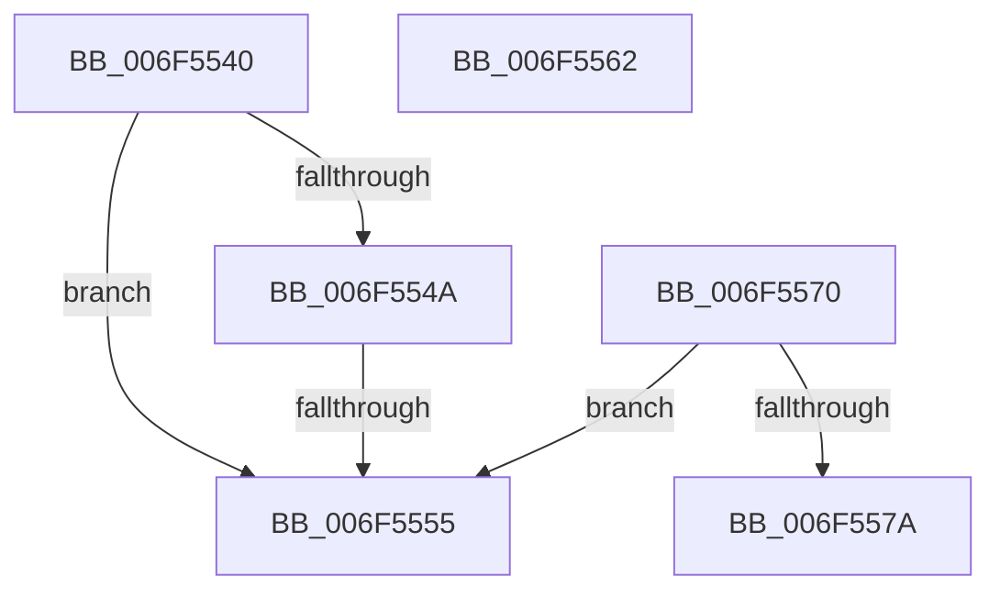

# sub_006F5540

- RVA: `0x006F5540`–`0x006F5584` (길이 `68` bytes)
- VA: `0x00000001406F5540`
- 실행 섹션: `.text`
- PDB 이름 있음: `아니요`; PDB Function 태그: `아니요`
- unwind 정보 RVA: `0x000AF6C0`
- 디코드: `16`개 명령, `68/68` bytes 표시
- 미해석 바이트: `0` (있으면 어셈블리에 `.byte`로 보존)

> 이 문서는 커널 이미지의 기계어와 PDB 기호를 분석해 생성했습니다. 4번과 5번은 함수 원형과 자료형을 바이너리 사용 방식에서 추정한 C 해석이며 원본 소스 복구 결과는 아닙니다.

## 1. Dependencies

- 직접 호출 지점: **0**; 고유 호출 대상: **0**
- 직접 호출자로 확인된 함수: **0**
- RIP 상대 이미지 참조: **0**

### Outgoing calls
- 직접 디코드된 call 명령이 없습니다.

### Direct callers
- 이 함수 시작 RVA로 연결되는 직접 call은 확인되지 않았습니다. 간접 호출은 완전히 역산할 수 없습니다.

### Static image references
- 디코드된 RIP-relative 메모리 참조가 없습니다.

## 2. Other-region calls and transfers

- 다른 실행 섹션으로 향하는 call: **0**
- call이 아닌 외부 분기/꼬리 이동: **4**
  - `0x006F554F` → [CountUTF8ToUnicode + 0x20](../48/CountUTF8ToUnicode_function_00485D40.md) (`tail-transfer`)
  - `0x006F555D` → [CountUTF8ToUnicode + 0xF6](../48/CountUTF8ToUnicode_function_00485D40.md) (`tail-transfer`)
  - `0x006F556B` → [CountUTF8ToUnicode + 0x20](../48/CountUTF8ToUnicode_function_00485D40.md) (`tail-transfer`)
  - `0x006F557F` → [CountUTF8ToUnicode + 0x20](../48/CountUTF8ToUnicode_function_00485D40.md) (`tail-transfer`)

## 3. Assembly (complete function range)

```asm
006F5540  41 8B C1                        mov eax, r9d
006F5543  25 E0 03 00 00                  and eax, 0x3e0
006F5548  74 0B                           je 0x1406f5555
006F554A  3D 60 03 00 00                  cmp eax, 0x360
006F554F  0F 85 0B 08 D9 FF               jne 0x140485d60
006F5555  41 BB 07 01 00 00               mov r11d, 0x107
006F555B  FF C2                           inc edx
006F555D  E9 D4 08 D9 FF                  jmp 0x140485e36
006F5562  41 81 C9 00 80 22 48            or r9d, 0x48228000
006F5569  03 D5                           add edx, ebp
006F556B  E9 F0 07 D9 FF                  jmp 0x140485d60
006F5570  41 83 E1 1F                     and r9d, 0x1f
006F5574  41 83 F9 01                     cmp r9d, 1
006F5578  76 DB                           jbe 0x1406f5555
006F557A  41 0F BA E9 17                  bts r9d, 0x17
006F557F  E9 DC 07 D9 FF                  jmp 0x140485d60
```

## 4. C-style interpretation (structured pseudocode)

```c
__int64 __fastcall sub_006F5540(__int64 a1, int a2, __int64 a3, int a4)
{
    __int64 result;

    result = (unsigned int)(((unsigned int)(a4)) & (992));
    if (condition_is_equal) goto loc_006F5555;
loc_006F5555:
    a2 = (unsigned int)((a2) + 1);
}
```

## 5. (Beta) C Style

```c
int64_t sub_006F5540(int64_t Arg1, int32_t Arg2, int64_t Arg3, int32_t Arg4)
{
    int64_t result;

    result = (uint32_t)(((uint32_t)(Arg4)) & (992));
    if (condition_is_equal) goto loc_006F5555;
loc_006F5555:
    Arg2 = (uint32_t)((Arg2) + 1);
}
```

## 6. Execution-region graph

[열기: 2D/3D 그래프와 함수 탐색 컨트롤 패널](../../../control-panel.html?section=text&rva=0x006F5540&view=graph)

- 2D 그래프는 위에서 아래로 흐르고, 3D 그래프는 빈 공간을 드래그해 회전합니다. Shift+드래그는 이동, 휠은 확대·축소, 함수 노드 선택은 대상 보고서 이동입니다.

### Static fallback


