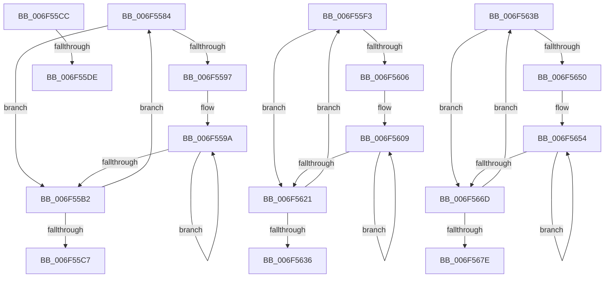

# sub_006F5584

- RVA: `0x006F5584`–`0x006F5683` (길이 `255` bytes)
- VA: `0x00000001406F5584`
- 실행 섹션: `.text`
- PDB 이름 있음: `아니요`; PDB Function 태그: `아니요`
- unwind 정보 RVA: `0x000AF7B8`
- 디코드: `81`개 명령, `255/255` bytes 표시
- 미해석 바이트: `0` (있으면 어셈블리에 `.byte`로 보존)

> 이 문서는 커널 이미지의 기계어와 PDB 기호를 분석해 생성했습니다. 4번과 5번은 함수 원형과 자료형을 바이너리 사용 방식에서 추정한 C 해석이며 원본 소스 복구 결과는 아닙니다.

## 1. Dependencies

- 직접 호출 지점: **4**; 고유 호출 대상: **2**
- 직접 호출자로 확인된 함수: **0**
- RIP 상대 이미지 참조: **0**

### Outgoing calls
- `0x006F55A7` → [KiHaltOnAddress](../4F/KiHaltOnAddress_function_004FBA3C.md) (function, `0x004FBA3C`)
- `0x006F55D1` → [KeAdjustInterruptTime](../4C/KeAdjustInterruptTime_function_004C9EB0.md) (function, `0x004C9EB0`)
- `0x006F5616` → [KiHaltOnAddress](../4F/KiHaltOnAddress_function_004FBA3C.md) (function, `0x004FBA3C`)
- `0x006F5661` → [KiHaltOnAddress](../4F/KiHaltOnAddress_function_004FBA3C.md) (function, `0x004FBA3C`)

### Direct callers
- 이 함수 시작 RVA로 연결되는 직접 call은 확인되지 않았습니다. 간접 호출은 완전히 역산할 수 없습니다.

### Static image references
- 디코드된 RIP-relative 메모리 참조가 없습니다.

## 2. Other-region calls and transfers

- 다른 실행 섹션으로 향하는 call: **0**
- call이 아닌 외부 분기/꼬리 이동: **5**
  - `0x006F55C7` → [KiSetSystemTimeDpc + 0x5F](../48/KiSetSystemTimeDpc_function_00486130.md) (`tail-transfer`)
  - `0x006F55D8` → [KiSetSystemTimeDpc + 0x151](../48/KiSetSystemTimeDpc_function_00486130.md) (`tail-transfer`)
  - `0x006F55EE` → [KiSetSystemTimeDpc + 0x151](../48/KiSetSystemTimeDpc_function_00486130.md) (`tail-transfer`)
  - `0x006F5636` → [KiSetSystemTimeDpc + 0x181](../48/KiSetSystemTimeDpc_function_00486130.md) (`tail-transfer`)
  - `0x006F567E` → [KiSetSystemTimeDpc + 0x1FE](../48/KiSetSystemTimeDpc_function_00486130.md) (`tail-transfer`)

## 3. Assembly (complete function range)

```asm
006F5584  0F BA E9 1E                     bts ecx, 0x1e
006F5588  8B C2                           mov eax, edx
006F558A  8B F1                           mov esi, ecx
006F558C  F0 0F B1 33                     lock cmpxchg dword ptr [rbx], esi
006F5590  8B C8                           mov ecx, eax
006F5592  41 3B C0                        cmp eax, r8d
006F5595  75 1B                           jne 0x1406f55b2
006F5597  89 75 48                        mov dword ptr [rbp + 0x48], esi
006F559A  41 B8 04 00 00 00               mov r8d, 4
006F55A0  48 8D 55 48                     lea rdx, [rbp + 0x48]
006F55A4  48 8B CB                        mov rcx, rbx
006F55A7  E8 90 64 E0 FF                  call 0x1404fba3c
006F55AC  8B 0B                           mov ecx, dword ptr [rbx]
006F55AE  3B CE                           cmp ecx, esi
006F55B0  74 E8                           je 0x1406f559a
006F55B2  8B C1                           mov eax, ecx
006F55B4  89 4D 48                        mov dword ptr [rbp + 0x48], ecx
006F55B7  BE 00 00 00 80                  mov esi, 0x80000000
006F55BC  8B D1                           mov edx, ecx
006F55BE  23 C6                           and eax, esi
006F55C0  44 8B C1                        mov r8d, ecx
006F55C3  3B C7                           cmp eax, edi
006F55C5  75 BD                           jne 0x1406f5584
006F55C7  E9 C3 0B D9 FF                  jmp 0x14048618f
006F55CC  D1 EA                           shr edx, 1
006F55CE  80 E2 01                        and dl, 1
006F55D1  E8 DA 48 DD FF                  call 0x1404c9eb0
006F55D6  84 C0                           test al, al
006F55D8  0F 84 A3 0C D9 FF               je 0x140486281
006F55DE  49 8B 45 18                     mov rax, qword ptr [r13 + 0x18]
006F55E2  48 F7 D8                        neg rax
006F55E5  41 C6 45 00 01                  mov byte ptr [r13], 1
006F55EA  49 89 45 18                     mov qword ptr [r13 + 0x18], rax
006F55EE  E9 8E 0C D9 FF                  jmp 0x140486281
006F55F3  0F BA E9 1E                     bts ecx, 0x1e
006F55F7  8B C2                           mov eax, edx
006F55F9  8B F1                           mov esi, ecx
006F55FB  F0 0F B1 33                     lock cmpxchg dword ptr [rbx], esi
006F55FF  8B C8                           mov ecx, eax
006F5601  41 3B C0                        cmp eax, r8d
006F5604  75 1B                           jne 0x1406f5621
006F5606  89 75 58                        mov dword ptr [rbp + 0x58], esi
006F5609  41 B8 04 00 00 00               mov r8d, 4
006F560F  48 8D 55 58                     lea rdx, [rbp + 0x58]
006F5613  48 8B CB                        mov rcx, rbx
006F5616  E8 21 64 E0 FF                  call 0x1404fba3c
006F561B  8B 0B                           mov ecx, dword ptr [rbx]
006F561D  3B CE                           cmp ecx, esi
006F561F  74 E8                           je 0x1406f5609
006F5621  8B C1                           mov eax, ecx
006F5623  89 4D 58                        mov dword ptr [rbp + 0x58], ecx
006F5626  BE 00 00 00 80                  mov esi, 0x80000000
006F562B  8B D1                           mov edx, ecx
006F562D  23 C6                           and eax, esi
006F562F  44 8B C1                        mov r8d, ecx
006F5632  3B C7                           cmp eax, edi
006F5634  75 BD                           jne 0x1406f55f3
006F5636  E9 76 0C D9 FF                  jmp 0x1404862b1
006F563B  0F BA E9 1E                     bts ecx, 0x1e
006F563F  8B C2                           mov eax, edx
006F5641  44 8B F1                        mov r14d, ecx
006F5644  F0 44 0F B1 33                  lock cmpxchg dword ptr [rbx], r14d
006F5649  8B C8                           mov ecx, eax
006F564B  41 3B C0                        cmp eax, r8d
006F564E  75 1D                           jne 0x1406f566d
006F5650  44 89 75 E0                     mov dword ptr [rbp - 0x20], r14d
006F5654  41 B8 04 00 00 00               mov r8d, 4
006F565A  48 8D 55 E0                     lea rdx, [rbp - 0x20]
006F565E  48 8B CB                        mov rcx, rbx
006F5661  E8 D6 63 E0 FF                  call 0x1404fba3c
006F5666  8B 0B                           mov ecx, dword ptr [rbx]
006F5668  41 3B CE                        cmp ecx, r14d
006F566B  74 E7                           je 0x1406f5654
006F566D  8B C1                           mov eax, ecx
006F566F  89 4D E0                        mov dword ptr [rbp - 0x20], ecx
006F5672  41 23 C5                        and eax, r13d
006F5675  8B D1                           mov edx, ecx
006F5677  44 8B C1                        mov r8d, ecx
006F567A  3B C7                           cmp eax, edi
006F567C  75 BD                           jne 0x1406f563b
006F567E  E9 AB 0C D9 FF                  jmp 0x14048632e
```

## 4. C-style interpretation (structured pseudocode)

```c
__int64 __fastcall sub_006F5584(int a1, int a2, int a3)
{
    __int64 result;

    if (((unsigned int)((unsigned int)(a2))) != a3) goto loc_006F55B2;
    *(unsigned int *)(v_rbp + 72) = (unsigned int)((unsigned int)(a1));
loc_006F559A:
    result = KiHaltOnAddress(v_rbx, v_rbp + 72, 4, a4);
    if (((unsigned int)((unsigned int)(*(unsigned int *)(v_rbx)))) == ((unsigned int)((unsigned int)(a1)))) goto loc_006F559A;
loc_006F55B2:
    *(unsigned int *)(v_rbp + 72) = (unsigned int)((unsigned int)(*(unsigned int *)(v_rbx)));
    result = (unsigned int)(((unsigned int)((unsigned int)((unsigned int)(*(unsigned int *)(v_rbx))))) & ((unsigned int)((unsigned int)(0x80000000ULL))));
    if (((unsigned int)(result)) != ((unsigned int)(v_rdi))) goto loc_006F5584;
}
```

## 5. (Beta) C Style

```c
int64_t sub_006F5584(int32_t Arg1, int32_t Arg2, int32_t Arg3)
{
    int64_t result;

    if (((uint32_t)((uint32_t)(Arg2))) != Arg3) goto loc_006F55B2;
    *(uint32_t *)(local_rbp + 0x48) = (uint32_t)((uint32_t)(Arg1));
loc_006F559A:
    result = KiHaltOnAddress(local_rbx, local_rbp + 72, 4, a4);
    if (((uint32_t)((uint32_t)(*(uint32_t *)(local_rbx)))) == ((uint32_t)((uint32_t)(Arg1)))) goto loc_006F559A;
loc_006F55B2:
    *(uint32_t *)(local_rbp + 0x48) = (uint32_t)((uint32_t)(*(uint32_t *)(local_rbx)));
    result = (uint32_t)(((uint32_t)((uint32_t)((uint32_t)(*(uint32_t *)(local_rbx))))) & ((uint32_t)((uint32_t)(0x80000000ULL))));
    if (((uint32_t)(result)) != ((uint32_t)(local_rdi))) goto loc_006F5584;
}
```

## 6. Execution-region graph

[열기: 2D/3D 그래프와 함수 탐색 컨트롤 패널](../../../control-panel.html?section=text&rva=0x006F5584&view=graph)

- 2D 그래프는 위에서 아래로 흐르고, 3D 그래프는 빈 공간을 드래그해 회전합니다. Shift+드래그는 이동, 휠은 확대·축소, 함수 노드 선택은 대상 보고서 이동입니다.

### Static fallback


