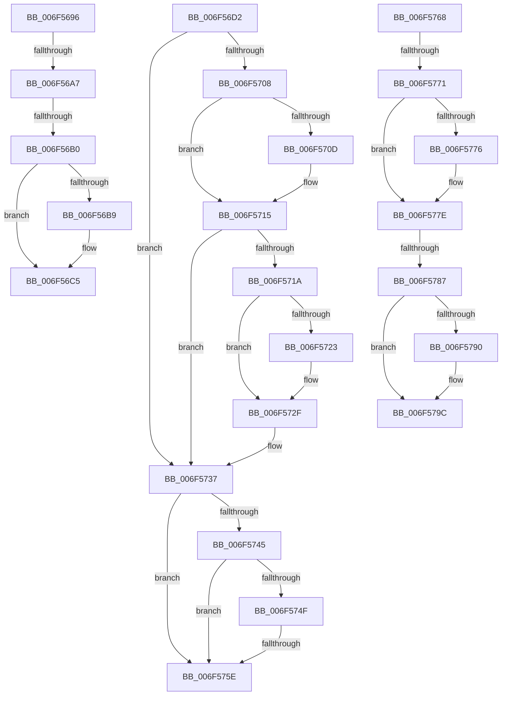

# sub_006F5696

- RVA: `0x006F5696`–`0x006F57A9` (길이 `275` bytes)
- VA: `0x00000001406F5696`
- 실행 섹션: `.text`
- PDB 이름 있음: `아니요`; PDB Function 태그: `아니요`
- unwind 정보 RVA: `0x000AFB78`
- 디코드: `68`개 명령, `275/275` bytes 표시
- 미해석 바이트: `0` (있으면 어셈블리에 `.byte`로 보존)

> 이 문서는 커널 이미지의 기계어와 PDB 기호를 분석해 생성했습니다. 4번과 5번은 함수 원형과 자료형을 바이너리 사용 방식에서 추정한 C 해석이며 원본 소스 복구 결과는 아닙니다.

## 1. Dependencies

- 직접 호출 지점: **5**; 고유 호출 대상: **3**
- 직접 호출자로 확인된 함수: **0**
- RIP 상대 이미지 참조: **4**

### Outgoing calls
- `0x006F56C0` → [KiLowerIrqlProcessIrqlFlags](../4F/KiLowerIrqlProcessIrqlFlags_function_004F5698.md) (function, `0x004F5698`)
- `0x006F56EB` → [HalpMcaReportError](../54/HalpMcaReportError_function_00541D04.md) (function, `0x00541D04`)
- `0x006F56FC` → [HalpMcaClearError](../54/HalpMcaClearError_function_00541478.md) (function, `0x00541478`)
- `0x006F572A` → [KiLowerIrqlProcessIrqlFlags](../4F/KiLowerIrqlProcessIrqlFlags_function_004F5698.md) (function, `0x004F5698`)
- `0x006F5797` → [KiLowerIrqlProcessIrqlFlags](../4F/KiLowerIrqlProcessIrqlFlags_function_004F5698.md) (function, `0x004F5698`)

### Direct callers
- 이 함수 시작 RVA로 연결되는 직접 call은 확인되지 않았습니다. 간접 호출은 완전히 역산할 수 없습니다.

### Static image references
- `0x006F5698` → RVA `0x00E0F6BC` (`.data`; read)
- `0x006F56B0` → RVA `0x00FC6D20` (`ALMOSTRO`; read)
- `0x006F570F` → RVA `0x00E0F6BC` (`.data`; read/write)
- `0x006F5737` → RVA `0x00E0A76C` (`.data`; read)

## 2. Other-region calls and transfers

- 다른 실행 섹션으로 향하는 call: **0**
- call이 아닌 외부 분기/꼬리 이동: **8**
  - `0x006F56A1` → [HalpCmcPollProcessor + 0x7C](../48/HalpCmcPollProcessor_function_0048772C.md) (`tail-transfer`)
  - `0x006F56AA` → [HalpCmcPollProcessor + 0x109](../48/HalpCmcPollProcessor_function_0048772C.md) (`tail-transfer`)
  - `0x006F56CD` → [HalpCmcPollProcessor + 0x109](../48/HalpCmcPollProcessor_function_0048772C.md) (`tail-transfer`)
  - `0x006F5758` → [HalpCmcPollProcessor + 0xC9](../48/HalpCmcPollProcessor_function_0048772C.md) (`tail-transfer`)
  - `0x006F5763` → [HalpCmcPollProcessor + 0x109](../48/HalpCmcPollProcessor_function_0048772C.md) (`tail-transfer`)
  - `0x006F576B` → [HalpCmcPollProcessor + 0xC9](../48/HalpCmcPollProcessor_function_0048772C.md) (`tail-transfer`)
  - `0x006F5781` → [HalpCmcPollProcessor + 0xC9](../48/HalpCmcPollProcessor_function_0048772C.md) (`tail-transfer`)
  - `0x006F57A4` → [HalpCmcPollProcessor + 0xC9](../48/HalpCmcPollProcessor_function_0048772C.md) (`tail-transfer`)

## 3. Assembly (complete function range)

```asm
006F5696  33 C0                           xor eax, eax
006F5698  F0 44 0F B1 35 1B A0 71 00      lock cmpxchg dword ptr [rip + 0x71a01b], r14d
006F56A1  0F 84 01 21 D9 FF               je 0x1404877a8
006F56A7  40 84 ED                        test bpl, bpl
006F56AA  0F 84 85 21 D9 FF               je 0x140487835
006F56B0  83 3D 69 16 8D 00 00            cmp dword ptr [rip + 0x8d1669], 0
006F56B7  74 0C                           je 0x1406f56c5
006F56B9  44 0F 20 C1                     mov rcx, cr8
006F56BD  40 8A D6                        mov dl, sil
006F56C0  E8 D3 FF DF FF                  call 0x1404f5698
006F56C5  40 0F B6 C6                     movzx eax, sil
006F56C9  44 0F 22 C0                     mov cr8, rax
006F56CD  E9 63 21 D9 FF                  jmp 0x140487835
006F56D2  B8 01 00 00 00                  mov eax, 1
006F56D7  83 61 0C 00                     and dword ptr [rcx + 0xc], 0
006F56DB  48 8D 51 50                     lea rdx, [rcx + 0x50]
006F56DF  03 F8                           add edi, eax
006F56E1  4C 8B C3                        mov r8, rbx
006F56E4  8B 44 24 34                     mov eax, dword ptr [rsp + 0x34]
006F56E8  89 41 14                        mov dword ptr [rcx + 0x14], eax
006F56EB  E8 14 C6 E4 FF                  call 0x140541d04
006F56F0  48 8B 4C 24 38                  mov rcx, qword ptr [rsp + 0x38]
006F56F5  48 8B D3                        mov rdx, rbx
006F56F8  48 83 C1 50                     add rcx, 0x50
006F56FC  E8 77 BD E4 FF                  call 0x140541478
006F5701  80 7C 24 30 00                  cmp byte ptr [rsp + 0x30], 0
006F5706  74 2F                           je 0x1406f5737
006F5708  45 84 F6                        test r14b, r14b
006F570B  74 08                           je 0x1406f5715
006F570D  33 C0                           xor eax, eax
006F570F  87 05 A7 9F 71 00               xchg dword ptr [rip + 0x719fa7], eax
006F5715  40 84 ED                        test bpl, bpl
006F5718  74 1D                           je 0x1406f5737
006F571A  83 3D FF 15 8D 00 00            cmp dword ptr [rip + 0x8d15ff], 0
006F5721  74 0C                           je 0x1406f572f
006F5723  44 0F 20 C1                     mov rcx, cr8
006F5727  40 8A D6                        mov dl, sil
006F572A  E8 69 FF DF FF                  call 0x1404f5698
006F572F  40 0F B6 C6                     movzx eax, sil
006F5733  44 0F 22 C0                     mov cr8, rax
006F5737  8B 05 2F 50 71 00               mov eax, dword ptr [rip + 0x71502f]
006F573D  41 FF C4                        inc r12d
006F5740  83 F8 FF                        cmp eax, -1
006F5743  74 19                           je 0x1406f575e
006F5745  8B 05 21 50 71 00               mov eax, dword ptr [rip + 0x715021]
006F574B  85 C0                           test eax, eax
006F574D  74 0F                           je 0x1406f575e
006F574F  8B 05 17 50 71 00               mov eax, dword ptr [rip + 0x715017]
006F5755  44 3B E0                        cmp r12d, eax
006F5758  0F 83 97 20 D9 FF               jae 0x1404877f5
006F575E  44 8A 7C 24 30                  mov r15b, byte ptr [rsp + 0x30]
006F5763  E9 CD 20 D9 FF                  jmp 0x140487835
006F5768  45 84 FF                        test r15b, r15b
006F576B  0F 84 84 20 D9 FF               je 0x1404877f5
006F5771  45 84 F6                        test r14b, r14b
006F5774  74 08                           je 0x1406f577e
006F5776  33 C0                           xor eax, eax
006F5778  87 05 3E 9F 71 00               xchg dword ptr [rip + 0x719f3e], eax
006F577E  40 84 ED                        test bpl, bpl
006F5781  0F 84 6E 20 D9 FF               je 0x1404877f5
006F5787  83 3D 92 15 8D 00 00            cmp dword ptr [rip + 0x8d1592], 0
006F578E  74 0C                           je 0x1406f579c
006F5790  44 0F 20 C1                     mov rcx, cr8
006F5794  40 8A D6                        mov dl, sil
006F5797  E8 FC FE DF FF                  call 0x1404f5698
006F579C  40 0F B6 C6                     movzx eax, sil
006F57A0  44 0F 22 C0                     mov cr8, rax
006F57A4  E9 4C 20 D9 FF                  jmp 0x1404877f5
```

## 4. C-style interpretation (structured pseudocode)

```c
__int64 __fastcall sub_006F5696(void)
{
    __int64 result;
    unsigned __int8 v_stack_p30;
    unsigned int v_stack_p34;
    unsigned __int64 v_stack_p38;

    result = 0;
    if ((*(unsigned int *)(v_rip + 9246313)) != 0) {
        a1 = v_cr8;
        a2 = (unsigned __int8)(v_rsi);
        result = KiLowerIrqlProcessIrqlFlags(a1, a2, a3, a4);
    }
}
```

## 5. (Beta) C Style

```c
void sub_006F5696(void)
{
    int64_t result;
    uint8_t v_stack_p30;
    uint32_t v_stack_p34;
    uint64_t v_stack_p38;

    result = 0;
    if ((*(uint32_t *)(v_rip + 0x8D1669)) != 0) {
        a1 = v_cr8;
        a2 = (uint8_t)(local_rsi);
        result = KiLowerIrqlProcessIrqlFlags(a1, a2, a3, a4);
    }
}
```

## 6. Execution-region graph

[열기: 2D/3D 그래프와 함수 탐색 컨트롤 패널](../../../control-panel.html?section=text&rva=0x006F5696&view=graph)

- 2D 그래프는 위에서 아래로 흐르고, 3D 그래프는 빈 공간을 드래그해 회전합니다. Shift+드래그는 이동, 휠은 확대·축소, 함수 노드 선택은 대상 보고서 이동입니다.

### Static fallback


