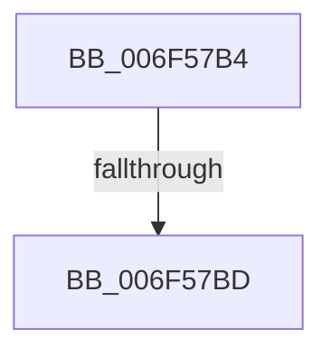

# sub_006F57B4

- RVA: `0x006F57B4`–`0x006F57DA` (길이 `38` bytes)
- VA: `0x00000001406F57B4`
- 실행 섹션: `.text`
- PDB 이름 있음: `아니요`; PDB Function 태그: `아니요`
- unwind 정보 RVA: `0x000AFC44`
- 디코드: `10`개 명령, `38/38` bytes 표시
- 미해석 바이트: `0` (있으면 어셈블리에 `.byte`로 보존)

> 이 문서는 커널 이미지의 기계어와 PDB 기호를 분석해 생성했습니다. 4번과 5번은 함수 원형과 자료형을 바이너리 사용 방식에서 추정한 C 해석이며 원본 소스 복구 결과는 아닙니다.

## 1. Dependencies

- 직접 호출 지점: **1**; 고유 호출 대상: **1**
- 직접 호출자로 확인된 함수: **0**
- RIP 상대 이미지 참조: **0**

### Outgoing calls
- `0x006F57CF` → [RtlpLogHeapFailure](../35/RtlpLogHeapFailure_function_0035B7BC.md) (function, `0x0035B7BC`)

### Direct callers
- 이 함수 시작 RVA로 연결되는 직접 call은 확인되지 않았습니다. 간접 호출은 완전히 역산할 수 없습니다.

### Static image references
- 디코드된 RIP-relative 메모리 참조가 없습니다.

## 2. Other-region calls and transfers

- 다른 실행 섹션으로 향하는 call: **0**
- call이 아닌 외부 분기/꼬리 이동: **2**
  - `0x006F57B7` → [RtlFreeHeap + 0x25](../48/RtlFreeHeap_function_00487F60.md) (`tail-transfer`)
  - `0x006F57D5` → [RtlFreeHeap + 0x25](../48/RtlFreeHeap_function_00487F60.md) (`tail-transfer`)

## 3. Assembly (complete function range)

```asm
006F57B4  48 85 FF                        test rdi, rdi
006F57B7  0F 85 C8 27 D9 FF               jne 0x140487f85
006F57BD  48 89 5C 24 28                  mov qword ptr [rsp + 0x28], rbx
006F57C2  48 89 5C 24 20                  mov qword ptr [rsp + 0x20], rbx
006F57C7  45 33 C9                        xor r9d, r9d
006F57CA  33 D2                           xor edx, edx
006F57CC  8D 4F 13                        lea ecx, [rdi + 0x13]
006F57CF  E8 E8 5F C6 FF                  call 0x14035b7bc
006F57D4  90                              nop
006F57D5  E9 AB 27 D9 FF                  jmp 0x140487f85
```

## 4. C-style interpretation (structured pseudocode)

```c
__int64 __fastcall sub_006F57B4(__int64 a1, int a2, __int64 a3, int a4)
{
    __int64 result;
    unsigned __int64 v_stack_p20;
    unsigned __int64 v_stack_p28;

    v_stack_p28 = v_rbx;
    v_stack_p20 = v_rbx;
    a4 = 0;
    a2 = 0;
    result = RtlpLogHeapFailure(v_rdi + 19, a2, a3, a4);
}
```

## 5. (Beta) C Style

```c
int64_t sub_006F57B4(int64_t Arg1, int32_t Arg2, int64_t Arg3, int32_t Arg4)
{
    int64_t result;
    uint64_t v_stack_p20;
    uint64_t v_stack_p28;

    v_stack_p28 = local_rbx;
    v_stack_p20 = local_rbx;
    Arg4 = 0;
    Arg2 = 0;
    result = RtlpLogHeapFailure(local_rdi + 19, Arg2, Arg3, Arg4);
}
```

## 6. Execution-region graph

[열기: 2D/3D 그래프와 함수 탐색 컨트롤 패널](../../../control-panel.html?section=text&rva=0x006F57B4&view=graph)

- 2D 그래프는 위에서 아래로 흐르고, 3D 그래프는 빈 공간을 드래그해 회전합니다. Shift+드래그는 이동, 휠은 확대·축소, 함수 노드 선택은 대상 보고서 이동입니다.

### Static fallback


