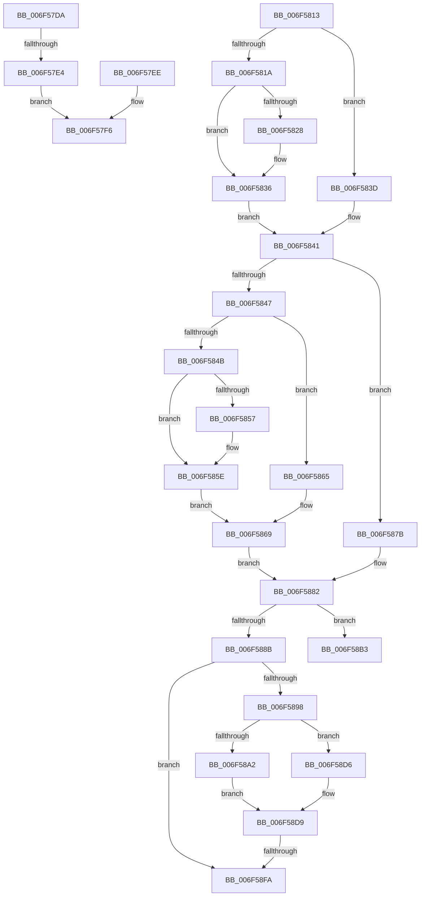

# sub_006F57DA

- RVA: `0x006F57DA`–`0x006F5914` (길이 `314` bytes)
- VA: `0x00000001406F57DA`
- 실행 섹션: `.text`
- PDB 이름 있음: `아니요`; PDB Function 태그: `아니요`
- unwind 정보 RVA: `0x000AFC6C`
- 디코드: `88`개 명령, `314/314` bytes 표시
- 미해석 바이트: `0` (있으면 어셈블리에 `.byte`로 보존)

> 이 문서는 커널 이미지의 기계어와 PDB 기호를 분석해 생성했습니다. 4번과 5번은 함수 원형과 자료형을 바이너리 사용 방식에서 추정한 C 해석이며 원본 소스 복구 결과는 아닙니다.

## 1. Dependencies

- 직접 호출 지점: **4**; 고유 호출 대상: **3**
- 직접 호출자로 확인된 함수: **0**
- RIP 상대 이미지 참조: **0**

### Outgoing calls
- `0x006F5806` → [RtlpLogHeapFailure](../35/RtlpLogHeapFailure_function_0035B7BC.md) (function, `0x0035B7BC`)
- `0x006F58CB` → [RtlpLogHeapFailure](../35/RtlpLogHeapFailure_function_0035B7BC.md) (function, `0x0035B7BC`)
- `0x006F58ED` → [RtlpCallInterceptRoutine](../47/RtlpCallInterceptRoutine_function_00479594.md) (function, `0x00479594`)
- `0x006F5907` → [RtlpFreeHeap](../5E/RtlpFreeHeap_function_005EABC0.md) (function, `0x005EABC0`)

### Direct callers
- 이 함수 시작 RVA로 연결되는 직접 call은 확인되지 않았습니다. 간접 호출은 완전히 역산할 수 없습니다.

### Static image references
- 디코드된 RIP-relative 메모리 참조가 없습니다.

## 2. Other-region calls and transfers

- 다른 실행 섹션으로 향하는 call: **0**
- call이 아닌 외부 분기/꼬리 이동: **5**
  - `0x006F57DE` → [RtlpFreeNTHeapInternal + 0x65](../48/RtlpFreeNTHeapInternal_function_00487FDC.md) (`tail-transfer`)
  - `0x006F580E` → [RtlpFreeNTHeapInternal + 0x65](../48/RtlpFreeNTHeapInternal_function_00487FDC.md) (`tail-transfer`)
  - `0x006F58D1` → [RtlpFreeNTHeapInternal + 0x3E](../48/RtlpFreeNTHeapInternal_function_00487FDC.md) (`tail-transfer`)
  - `0x006F58F4` → [RtlpFreeNTHeapInternal + 0x3E](../48/RtlpFreeNTHeapInternal_function_00487FDC.md) (`tail-transfer`)
  - `0x006F590F` → [RtlpFreeNTHeapInternal + 0x3E](../48/RtlpFreeNTHeapInternal_function_00487FDC.md) (`tail-transfer`)

## 3. Assembly (complete function range)

```asm
006F57DA  F6 47 0F 3F                     test byte ptr [rdi + 0xf], 0x3f
006F57DE  0F 85 5D 28 D9 FF               jne 0x140488041
006F57E4  4C 8B C7                        mov r8, rdi
006F57E7  B9 08 00 00 00                  mov ecx, 8
006F57EC  EB 08                           jmp 0x1406f57f6
006F57EE  4C 8B C5                        mov r8, rbp
006F57F1  B9 09 00 00 00                  mov ecx, 9
006F57F6  48 89 5C 24 28                  mov qword ptr [rsp + 0x28], rbx
006F57FB  45 33 C9                        xor r9d, r9d
006F57FE  48 8B D6                        mov rdx, rsi
006F5801  48 89 5C 24 20                  mov qword ptr [rsp + 0x20], rbx
006F5806  E8 B1 5F C6 FF                  call 0x14035b7bc
006F580B  48 8B FB                        mov rdi, rbx
006F580E  E9 2E 28 D9 FF                  jmp 0x140488041
006F5813  8B 4E 7C                        mov ecx, dword ptr [rsi + 0x7c]
006F5816  85 C9                           test ecx, ecx
006F5818  74 23                           je 0x1406f583d
006F581A  8B 47 08                        mov eax, dword ptr [rdi + 8]
006F581D  8B 4E 7C                        mov ecx, dword ptr [rsi + 0x7c]
006F5820  89 44 24 38                     mov dword ptr [rsp + 0x38], eax
006F5824  85 C8                           test eax, ecx
006F5826  74 0E                           je 0x1406f5836
006F5828  41 33 00                        xor eax, dword ptr [r8]
006F582B  4C 8D 86 88 00 00 00            lea r8, [rsi + 0x88]
006F5832  89 44 24 38                     mov dword ptr [rsp + 0x38], eax
006F5836  0F B7 54 24 38                  movzx edx, word ptr [rsp + 0x38]
006F583B  EB 04                           jmp 0x1406f5841
006F583D  0F B7 57 08                     movzx edx, word ptr [rdi + 8]
006F5841  80 7F 0F 04                     cmp byte ptr [rdi + 0xf], 4
006F5845  75 34                           jne 0x1406f587b
006F5847  85 C9                           test ecx, ecx
006F5849  74 1A                           je 0x1406f5865
006F584B  8B 4F 08                        mov ecx, dword ptr [rdi + 8]
006F584E  89 4C 24 48                     mov dword ptr [rsp + 0x48], ecx
006F5852  85 4E 7C                        test dword ptr [rsi + 0x7c], ecx
006F5855  74 07                           je 0x1406f585e
006F5857  41 33 08                        xor ecx, dword ptr [r8]
006F585A  89 4C 24 48                     mov dword ptr [rsp + 0x48], ecx
006F585E  0F B7 44 24 48                  movzx eax, word ptr [rsp + 0x48]
006F5863  EB 04                           jmp 0x1406f5869
006F5865  0F B7 47 08                     movzx eax, word ptr [rdi + 8]
006F5869  48 8B 4F F0                     mov rcx, qword ptr [rdi - 0x10]
006F586D  0F B7 C0                        movzx eax, ax
006F5870  48 2B C8                        sub rcx, rax
006F5873  0F B7 C2                        movzx eax, dx
006F5876  48 03 C8                        add rcx, rax
006F5879  EB 07                           jmp 0x1406f5882
006F587B  0F B7 CA                        movzx ecx, dx
006F587E  48 C1 E1 04                     shl rcx, 4
006F5882  48 8D 04 39                     lea rax, [rcx + rdi]
006F5886  48 3B C5                        cmp rax, rbp
006F5889  72 28                           jb 0x1406f58b3
006F588B  44 8B 55 F8                     mov r10d, dword ptr [rbp - 8]
006F588F  41 F7 C6 02 01 00 3C            test r14d, 0x3c000102
006F5896  75 62                           jne 0x1406f58fa
006F5898  48 8D 4D F0                     lea rcx, [rbp - 0x10]
006F589C  80 79 0F 05                     cmp byte ptr [rcx + 0xf], 5
006F58A0  75 34                           jne 0x1406f58d6
006F58A2  0F B6 41 0E                     movzx eax, byte ptr [rcx + 0xe]
006F58A6  48 C1 E0 04                     shl rax, 4
006F58AA  48 2B C8                        sub rcx, rax
006F58AD  48 83 C1 10                     add rcx, 0x10
006F58B1  EB 26                           jmp 0x1406f58d9
006F58B3  48 89 5C 24 28                  mov qword ptr [rsp + 0x28], rbx
006F58B8  4C 8B CD                        mov r9, rbp
006F58BB  4C 8B C7                        mov r8, rdi
006F58BE  48 89 5C 24 20                  mov qword ptr [rsp + 0x20], rbx
006F58C3  48 8B D6                        mov rdx, rsi
006F58C6  B9 03 00 00 00                  mov ecx, 3
006F58CB  E8 EC 5E C6 FF                  call 0x14035b7bc
006F58D0  90                              nop
006F58D1  E9 44 27 D9 FF                  jmp 0x14048801a
006F58D6  48 8B CB                        mov rcx, rbx
006F58D9  48 89 4C 24 20                  mov qword ptr [rsp + 0x20], rcx
006F58DE  41 B9 03 00 00 00               mov r9d, 3
006F58E4  41 8B CA                        mov ecx, r10d
006F58E7  4C 8B C5                        mov r8, rbp
006F58EA  48 8B D6                        mov rdx, rsi
006F58ED  E8 A2 3C D8 FF                  call 0x140479594
006F58F2  85 C0                           test eax, eax
006F58F4  0F 88 20 27 D9 FF               js 0x14048801a
006F58FA  41 83 CE 02                     or r14d, 2
006F58FE  4C 8B C7                        mov r8, rdi
006F5901  41 8B D6                        mov edx, r14d
006F5904  48 8B CE                        mov rcx, rsi
006F5907  E8 B4 52 EF FF                  call 0x1405eabc0
006F590C  0F B6 D8                        movzx ebx, al
006F590F  E9 06 27 D9 FF                  jmp 0x14048801a
```

## 4. C-style interpretation (structured pseudocode)

```c
__int64 __fastcall sub_006F57DA(__int64 a1, __int64 a2, __int64 a3, int a4)
{
    __int64 result;
    unsigned __int64 v_stack_p20;
    unsigned __int64 v_stack_p28;
    unsigned int v_stack_p38;
    unsigned int v_stack_p48;

    goto loc_006F57F6;
loc_006F57F6:
    v_stack_p28 = v_rbx;
    a4 = 0;
    v_stack_p20 = v_rbx;
    result = RtlpLogHeapFailure(8, v_rsi, v_rdi, a4);
}
```

## 5. (Beta) C Style

```c
int64_t sub_006F57DA(int64_t Arg1, int64_t Arg2, int64_t Arg3, int32_t Arg4)
{
    int64_t result;
    uint64_t v_stack_p20;
    uint64_t v_stack_p28;
    uint32_t v_stack_p38;
    uint32_t v_stack_p48;

    goto loc_006F57F6;
loc_006F57F6:
    v_stack_p28 = local_rbx;
    Arg4 = 0;
    v_stack_p20 = local_rbx;
    result = RtlpLogHeapFailure(8, local_rsi, local_rdi, Arg4);
}
```

## 6. Execution-region graph

[열기: 2D/3D 그래프와 함수 탐색 컨트롤 패널](../../../control-panel.html?section=text&rva=0x006F57DA&view=graph)

- 2D 그래프는 위에서 아래로 흐르고, 3D 그래프는 빈 공간을 드래그해 회전합니다. Shift+드래그는 이동, 휠은 확대·축소, 함수 노드 선택은 대상 보고서 이동입니다.

### Static fallback


