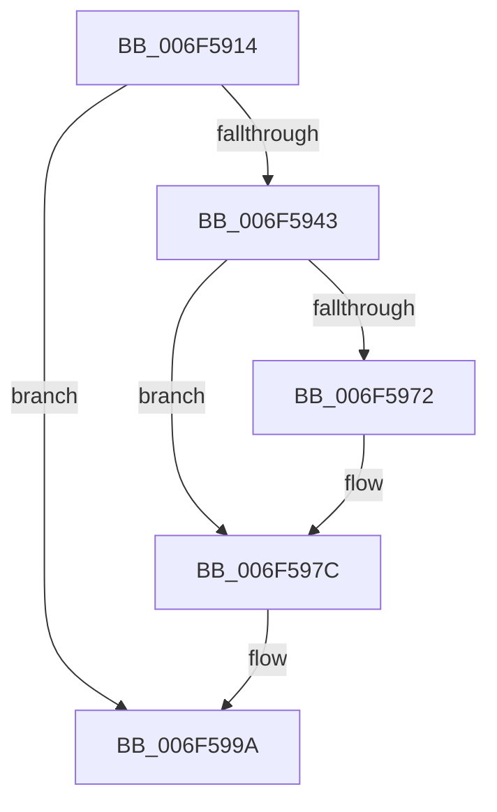

# sub_006F5914

- RVA: `0x006F5914`–`0x006F59B3` (길이 `159` bytes)
- VA: `0x00000001406F5914`
- 실행 섹션: `.text`
- PDB 이름 있음: `아니요`; PDB Function 태그: `아니요`
- unwind 정보 RVA: `0x000AFCA0`
- 디코드: `40`개 명령, `159/159` bytes 표시
- 미해석 바이트: `0` (있으면 어셈블리에 `.byte`로 보존)

> 이 문서는 커널 이미지의 기계어와 PDB 기호를 분석해 생성했습니다. 4번과 5번은 함수 원형과 자료형을 바이너리 사용 방식에서 추정한 C 해석이며 원본 소스 복구 결과는 아닙니다.

## 1. Dependencies

- 직접 호출 지점: **8**; 고유 호출 대상: **8**
- 직접 호출자로 확인된 함수: **0**
- RIP 상대 이미지 참조: **1**

### Outgoing calls
- `0x006F591B` → [ExAcquireSpinLockExclusive](../24/ExAcquireSpinLockExclusive_function_00248690.md) (function, `0x00248690`)
- `0x006F5929` → [MiPrepareAttachThread](../2B/MiPrepareAttachThread_function_002B4650.md) (function, `0x002B4650`)
- `0x006F593A` → [MiReleaseSpinLockExclusive](../24/MiReleaseSpinLockExclusive_function_002482C0.md) (function, `0x002482C0`)
- `0x006F5950` → [KeForceAttachProcess](../21/KeForceAttachProcess_function_00216650.md) (function, `0x00216650`)
- `0x006F5958` → [MiLockWorkingSetShared](../27/MiLockWorkingSetShared_function_0027CBF0.md) (function, `0x0027CBF0`)
- `0x006F5981` → [MiUnlockWorkingSetShared](../27/MiUnlockWorkingSetShared_function_0027D690.md) (function, `0x0027D690`)
- `0x006F598D` → [KeForceDetachProcess](../3C/KeForceDetachProcess_function_003C7770.md) (function, `0x003C7770`)
- `0x006F5995` → [MiAttachThreadDone](../28/MiAttachThreadDone_function_0028F3E0.md) (function, `0x0028F3E0`)

### Direct callers
- 이 함수 시작 RVA로 연결되는 직접 call은 확인되지 않았습니다. 간접 호출은 완전히 역산할 수 없습니다.

### Static image references
- `0x006F5914` → RVA `0x00E374C0` (`.data`; read)

## 2. Other-region calls and transfers

- 다른 실행 섹션으로 향하는 call: **0**
- call이 아닌 외부 분기/꼬리 이동: **1**
  - `0x006F59AE` → [MmQueryCommitReleaseState + 0xB5](../48/MmQueryCommitReleaseState_function_004880B8.md) (`tail-transfer`)

## 3. Assembly (complete function range)

```asm
006F5914  48 8D 0D A5 1B 74 00            lea rcx, [rip + 0x741ba5]
006F591B  E8 70 2D B5 FF                  call 0x140248690
006F5920  48 8B D7                        mov rdx, rdi
006F5923  48 8B CB                        mov rcx, rbx
006F5926  44 8A C8                        mov r9b, al
006F5929  E8 22 ED BB FF                  call 0x1402b4650
006F592E  41 8A D1                        mov dl, r9b
006F5931  48 8D 0D 88 1B 74 00            lea rcx, [rip + 0x741b88]
006F5938  8B D8                           mov ebx, eax
006F593A  E8 81 29 B5 FF                  call 0x1402482c0
006F593F  85 DB                           test ebx, ebx
006F5941  74 57                           je 0x1406f599a
006F5943  48 8B 4C 24 48                  mov rcx, qword ptr [rsp + 0x48]
006F5948  48 8D 54 24 50                  lea rdx, [rsp + 0x50]
006F594D  45 33 C0                        xor r8d, r8d
006F5950  E8 FB 0C B2 FF                  call 0x140216650
006F5955  48 8B CF                        mov rcx, rdi
006F5958  E8 93 72 B8 FF                  call 0x14027cbf0
006F595D  8B 97 B8 00 00 00               mov edx, dword ptr [rdi + 0xb8]
006F5963  89 54 24 20                     mov dword ptr [rsp + 0x20], edx
006F5967  C1 EA 18                        shr edx, 0x18
006F596A  80 E2 30                        and dl, 0x30
006F596D  80 FA 20                        cmp dl, 0x20
006F5970  75 0A                           jne 0x1406f597c
006F5972  49 8B 16                        mov rdx, qword ptr [r14]
006F5975  4D 8B 2F                        mov r13, qword ptr [r15]
006F5978  4C 8B 62 20                     mov r12, qword ptr [rdx + 0x20]
006F597C  8A D0                           mov dl, al
006F597E  48 8B CF                        mov rcx, rdi
006F5981  E8 0A 7D B8 FF                  call 0x14027d690
006F5986  33 D2                           xor edx, edx
006F5988  48 8D 4C 24 50                  lea rcx, [rsp + 0x50]
006F598D  E8 DE 1D CD FF                  call 0x1403c7770
006F5992  48 8B CF                        mov rcx, rdi
006F5995  E8 46 9A B9 FF                  call 0x14028f3e0
006F599A  4C 8B 54 24 40                  mov r10, qword ptr [rsp + 0x40]
006F599F  4C 8B 4C 24 38                  mov r9, qword ptr [rsp + 0x38]
006F59A4  4C 8B 44 24 30                  mov r8, qword ptr [rsp + 0x30]
006F59A9  48 8B 54 24 28                  mov rdx, qword ptr [rsp + 0x28]
006F59AE  E9 BA 27 D9 FF                  jmp 0x14048816d
```

## 4. C-style interpretation (structured pseudocode)

```c
__int64 __fastcall sub_006F5914(__int64 a1, __int64 a2, int a3, __int64 a4, __int64 a5, __int64 a6, __int64 a7, __int64 a8, __int64 a9, __int64 a10)
{
    __int64 result;
    __int64 v_r12;
    __int64 v_r13;
    unsigned int v_stack_p20;

    result = ExAcquireSpinLockExclusive(v_rip + 7609253, a2, a3, a4);
    result = MiPrepareAttachThread(v_rbx, v_rdi, a3, (unsigned __int8)(result));
    result = MiReleaseSpinLockExclusive(v_rip + 7609224, (unsigned __int8)((unsigned __int8)(result)), a3, (unsigned __int8)(result));
    if ((unsigned int)((unsigned int)((unsigned int)(result))) == 0) goto loc_006F599A;
    a3 = 0;
    result = KeForceAttachProcess(a9, a10, a3, (unsigned __int8)(result));
    result = MiLockWorkingSetShared(v_rdi, a10, a3, (unsigned __int8)(result));
    v_stack_p20 = (unsigned int)((unsigned int)(*(unsigned int *)(v_rdi + 184)));
    a2 = (unsigned int)(((unsigned int)(*(unsigned int *)(v_rdi + 184))) >> (24));
    a2 = (unsigned __int8)((a2) & (48));
    if (((unsigned __int8)(a2)) == 32) {
        a2 = *(unsigned __int64 *)(v_r14);
        v_r13 = *(unsigned __int64 *)(v_r15);
        v_r12 = *(unsigned __int64 *)(a2 + 32);
    }
    result = MiUnlockWorkingSetShared(v_rdi, (unsigned __int8)(result), a3, (unsigned __int8)(result));
    a2 = 0;
    result = KeForceDetachProcess(a10, a2, a3, (unsigned __int8)(result));
    result = MiAttachThreadDone(v_rdi, a2, a3, (unsigned __int8)(result));
loc_006F599A:
}
```

## 5. (Beta) C Style

```c
int64_t sub_006F5914(int64_t Arg1, int64_t Arg2, int32_t Arg3, int64_t Arg4, int64_t Arg5, int64_t Arg6, int64_t Arg7, int64_t Arg8, int64_t Arg9, int64_t Arg10)
{
    int64_t result;
    int64_t local_r12;
    int64_t local_r13;
    uint32_t v_stack_p20;

    result = ExAcquireSpinLockExclusive(v_rip + 7609253, Arg2, Arg3, Arg4);
    result = MiPrepareAttachThread(local_rbx, local_rdi, Arg3, (uint8_t)(result));
    result = MiReleaseSpinLockExclusive(v_rip + 7609224, (uint8_t)((uint8_t)(result)), Arg3, (uint8_t)(result));
    if ((uint32_t)((uint32_t)((uint32_t)(result))) == 0) goto loc_006F599A;
    Arg3 = 0;
    result = KeForceAttachProcess(Arg9, Arg10, Arg3, (uint8_t)(result));
    result = MiLockWorkingSetShared(local_rdi, Arg10, Arg3, (uint8_t)(result));
    v_stack_p20 = (uint32_t)((uint32_t)(*(uint32_t *)(local_rdi + 0xB8)));
    Arg2 = (uint32_t)(((uint32_t)(*(uint32_t *)(local_rdi + 0xB8))) >> (24));
    Arg2 = (uint8_t)((Arg2) & (48));
    if (((uint8_t)(Arg2)) == 32) {
        Arg2 = *(uint64_t *)(local_r14);
        local_r13 = *(uint64_t *)(local_r15);
        local_r12 = *(uint64_t *)(Arg2 + 0x20);
    }
    result = MiUnlockWorkingSetShared(local_rdi, (uint8_t)(result), Arg3, (uint8_t)(result));
    Arg2 = 0;
    result = KeForceDetachProcess(Arg10, Arg2, Arg3, (uint8_t)(result));
    result = MiAttachThreadDone(local_rdi, Arg2, Arg3, (uint8_t)(result));
loc_006F599A:
}
```

## 6. Execution-region graph

[열기: 2D/3D 그래프와 함수 탐색 컨트롤 패널](../../../control-panel.html?section=text&rva=0x006F5914&view=graph)

- 2D 그래프는 위에서 아래로 흐르고, 3D 그래프는 빈 공간을 드래그해 회전합니다. Shift+드래그는 이동, 휠은 확대·축소, 함수 노드 선택은 대상 보고서 이동입니다.

### Static fallback


