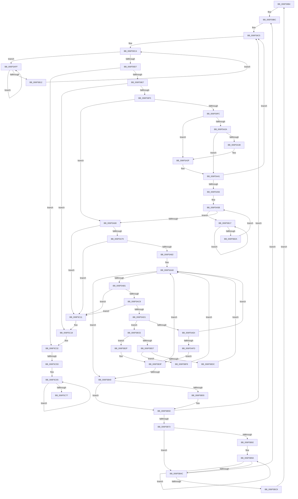

# sub_006F59B4

- RVA: `0x006F59B4`–`0x006F5C7C` (길이 `712` bytes)
- VA: `0x00000001406F59B4`
- 실행 섹션: `.text`
- PDB 이름 있음: `아니요`; PDB Function 태그: `아니요`
- unwind 정보 RVA: `0x000AFD88`
- 디코드: `173`개 명령, `712/712` bytes 표시
- 미해석 바이트: `0` (있으면 어셈블리에 `.byte`로 보존)

> 이 문서는 커널 이미지의 기계어와 PDB 기호를 분석해 생성했습니다. 4번과 5번은 함수 원형과 자료형을 바이너리 사용 방식에서 추정한 C 해석이며 원본 소스 복구 결과는 아닙니다.

## 1. Dependencies

- 직접 호출 지점: **15**; 고유 호출 대상: **11**
- 직접 호출자로 확인된 함수: **0**
- RIP 상대 이미지 참조: **2**

### Outgoing calls
- `0x006F59B7` → [KiRaiseIrqlProcessIrqlFlags](../4F/KiRaiseIrqlProcessIrqlFlags_function_004F56FC.md) (function, `0x004F56FC`)
- `0x006F5A1F` → [ExAcquireSpinLockSharedAtDpcLevel](../24/ExAcquireSpinLockSharedAtDpcLevel_function_00248E30.md) (function, `0x00248E30`)
- `0x006F5A2D` → [KiAcquireKobjectLockSafe](../25/KiAcquireKobjectLockSafe_function_00251C90.md) (function, `0x00251C90`)
- `0x006F5A44` → [ExReleaseSpinLockSharedFromDpcLevel](../24/ExReleaseSpinLockSharedFromDpcLevel_function_0024A590.md) (function, `0x0024A590`)
- `0x006F5AF4` → [KiTryUnwaitThread](../35/KiTryUnwaitThread_function_003506D0.md) (function, `0x003506D0`)
- `0x006F5B04` → [KeYieldProcessorEx](../3F/KeYieldProcessorEx_function_003FBD00.md) (function, `0x003FBD00`)
- `0x006F5B1C` → [KeYieldProcessorEx](../3F/KeYieldProcessorEx_function_003FBD00.md) (function, `0x003FBD00`)
- `0x006F5B3A` → [KiInsertQueueInternal](../21/KiInsertQueueInternal_function_00219B30.md) (function, `0x00219B30`)
- `0x006F5B88` → [KiExitDispatcher](../25/KiExitDispatcher_function_00251CF0.md) (function, `0x00251CF0`)
- `0x006F5B9D` → [KeAbPostRelease](../2E/KeAbPostRelease_function_002E1600.md) (function, `0x002E1600`)
- `0x006F5BEE` → [KeInsertQueueDpc](../20/KeInsertQueueDpc_function_00207C50.md) (function, `0x00207C50`)
- `0x006F5C07` → [KiTryUnwaitThread](../35/KiTryUnwaitThread_function_003506D0.md) (function, `0x003506D0`)
- `0x006F5C2C` → [KeBugCheckEx](../4F/KeBugCheckEx_function_004FD660.md) (function, `0x004FD660`)
- `0x006F5C4F` → [KiExitDispatcher](../25/KiExitDispatcher_function_00251CF0.md) (function, `0x00251CF0`)
- `0x006F5C68` → [KeAbPostRelease](../2E/KeAbPostRelease_function_002E1600.md) (function, `0x002E1600`)

### Direct callers
- 이 함수 시작 RVA로 연결되는 직접 call은 확인되지 않았습니다. 간접 호출은 완전히 역산할 수 없습니다.

### Static image references
- `0x006F59FC` → RVA `0x00FD2D80` (`CACHEALI`; read)
- `0x006F5BBD` → RVA `0x00FC6D20` (`ALMOSTRO`; read)

## 2. Other-region calls and transfers

- 다른 실행 섹션으로 향하는 call: **0**
- call이 아닌 외부 분기/꼬리 이동: **2**
  - `0x006F5C57` → [KiRundownMutants + 0x59](../48/KiRundownMutants_function_00488504.md) (`tail-transfer`)
  - `0x006F5C77` → [KiRundownMutants + 0x59](../48/KiRundownMutants_function_00488504.md) (`tail-transfer`)

## 3. Assembly (complete function range)

```asm
006F59B4  41 8A D7                        mov dl, r15b
006F59B7  E8 40 FD DF FF                  call 0x1404f56fc
006F59BC  65 4C 8B 24 25 20 00 00 00      mov r12, qword ptr gs:[0x20]
006F59C5  83 64 24 34 00                  and dword ptr [rsp + 0x34], 0
006F59CA  F0 48 0F BA 6E 40 00            lock bts qword ptr [rsi + 0x40], 0
006F59D1  0F 82 28 01 00 00               jb 0x1406f5aff
006F59D7  4D 8B 7D 00                     mov r15, qword ptr [r13]
006F59DB  49 8B FF                        mov rdi, r15
006F59DE  4D 3B FD                        cmp r15, r13
006F59E1  0F 84 4B 02 00 00               je 0x1406f5c32
006F59E7  49 8D 5F E8                     lea rbx, [r15 - 0x18]
006F59EB  80 7B 31 00                     cmp byte ptr [rbx + 0x31], 0
006F59EF  0F 85 23 02 00 00               jne 0x1406f5c18
006F59F5  F0 0F BA 2B 07                  lock bts dword ptr [rbx], 7
006F59FA  73 6C                           jae 0x1406f5a68
006F59FC  48 8D 05 7D D3 8D 00            lea rax, [rip + 0x8dd37d]
006F5A03  48 C7 46 40 00 00 00 00         mov qword ptr [rsi + 0x40], 0
006F5A0B  48 8B EB                        mov rbp, rbx
006F5A0E  48 C1 ED 04                     shr rbp, 4
006F5A12  83 E5 3F                        and ebp, 0x3f
006F5A15  48 C1 E5 06                     shl rbp, 6
006F5A19  48 03 E8                        add rbp, rax
006F5A1C  48 8B CD                        mov rcx, rbp
006F5A1F  E8 0C 34 B5 FF                  call 0x140248e30
006F5A24  4D 3B 7D 00                     cmp r15, qword ptr [r13]
006F5A28  75 15                           jne 0x1406f5a3f
006F5A2A  48 8B CB                        mov rcx, rbx
006F5A2D  E8 5E C2 B5 FF                  call 0x140251c90
006F5A32  48 39 73 28                     cmp qword ptr [rbx + 0x28], rsi
006F5A36  74 09                           je 0x1406f5a41
006F5A38  F0 81 23 7F FF FF FF            lock and dword ptr [rbx], 0xffffff7f
006F5A3F  33 FF                           xor edi, edi
006F5A41  48 8B CD                        mov rcx, rbp
006F5A44  E8 47 4B B5 FF                  call 0x14024a590
006F5A49  8B 6C 24 30                     mov ebp, dword ptr [rsp + 0x30]
006F5A4D  48 85 FF                        test rdi, rdi
006F5A50  0F 84 6F FF FF FF               je 0x1406f59c5
006F5A56  83 64 24 38 00                  and dword ptr [rsp + 0x38], 0
006F5A5B  F0 48 0F BA 6E 40 00            lock bts qword ptr [rsi + 0x40], 0
006F5A62  0F 82 AF 00 00 00               jb 0x1406f5b17
006F5A68  49 8B 0F                        mov rcx, qword ptr [r15]
006F5A6B  49 8B 47 08                     mov rax, qword ptr [r15 + 8]
006F5A6F  4C 39 79 08                     cmp qword ptr [rcx + 8], r15
006F5A73  0F 85 98 01 00 00               jne 0x1406f5c11
006F5A79  4C 39 38                        cmp qword ptr [rax], r15
006F5A7C  0F 85 8F 01 00 00               jne 0x1406f5c11
006F5A82  48 89 08                        mov qword ptr [rax], rcx
006F5A85  4C 8D 7B 08                     lea r15, [rbx + 8]
006F5A89  48 89 41 08                     mov qword ptr [rcx + 8], rax
006F5A8D  48 C7 46 40 00 00 00 00         mov qword ptr [rsi + 0x40], 0
006F5A95  80 4B 30 01                     or byte ptr [rbx + 0x30], 1
006F5A99  48 83 63 28 00                  and qword ptr [rbx + 0x28], 0
006F5A9E  49 8B 3F                        mov rdi, qword ptr [r15]
006F5AA1  C7 43 04 01 00 00 00            mov dword ptr [rbx + 4], 1
006F5AA8  49 3B FF                        cmp rdi, r15
006F5AAB  0F 84 98 00 00 00               je 0x1406f5b49
006F5AB1  48 8B 17                        mov rdx, qword ptr [rdi]
006F5AB4  48 8B C7                        mov rax, rdi
006F5AB7  48 8B FA                        mov rdi, rdx
006F5ABA  48 8B 48 08                     mov rcx, qword ptr [rax + 8]
006F5ABE  48 39 42 08                     cmp qword ptr [rdx + 8], rax
006F5AC2  0F 85 49 01 00 00               jne 0x1406f5c11
006F5AC8  48 39 01                        cmp qword ptr [rcx], rax
006F5ACB  0F 85 40 01 00 00               jne 0x1406f5c11
006F5AD1  48 89 11                        mov qword ptr [rcx], rdx
006F5AD4  48 89 4A 08                     mov qword ptr [rdx + 8], rcx
006F5AD8  8A 48 10                        mov cl, byte ptr [rax + 0x10]
006F5ADB  80 F9 01                        cmp cl, 1
006F5ADE  0F 85 EA 00 00 00               jne 0x1406f5bce
006F5AE4  44 0F B7 40 12                  movzx r8d, word ptr [rax + 0x12]
006F5AE9  4C 8D 4C 24 48                  lea r9, [rsp + 0x48]
006F5AEE  48 8B D0                        mov rdx, rax
006F5AF1  49 8B CC                        mov rcx, r12
006F5AF4  E8 D7 AB C5 FF                  call 0x1403506d0
006F5AF9  84 C0                           test al, al
006F5AFB  74 AB                           je 0x1406f5aa8
006F5AFD  EB 40                           jmp 0x1406f5b3f
006F5AFF  48 8D 4C 24 34                  lea rcx, [rsp + 0x34]
006F5B04  E8 F7 61 D0 FF                  call 0x1403fbd00
006F5B09  48 8B 46 40                     mov rax, qword ptr [rsi + 0x40]
006F5B0D  48 85 C0                        test rax, rax
006F5B10  75 ED                           jne 0x1406f5aff
006F5B12  E9 B3 FE FF FF                  jmp 0x1406f59ca
006F5B17  48 8D 4C 24 38                  lea rcx, [rsp + 0x38]
006F5B1C  E8 DF 61 D0 FF                  call 0x1403fbd00
006F5B21  48 8B 46 40                     mov rax, qword ptr [rsi + 0x40]
006F5B25  48 85 C0                        test rax, rax
006F5B28  75 ED                           jne 0x1406f5b17
006F5B2A  E9 2C FF FF FF                  jmp 0x1406f5a5b
006F5B2F  C6 40 11 05                     mov byte ptr [rax + 0x11], 5
006F5B33  48 8B D0                        mov rdx, rax
006F5B36  48 8B 48 18                     mov rcx, qword ptr [rax + 0x18]
006F5B3A  E8 F1 3F B2 FF                  call 0x140219b30
006F5B3F  83 6B 04 01                     sub dword ptr [rbx + 4], 1
006F5B43  0F 85 5F FF FF FF               jne 0x1406f5aa8
006F5B49  41 BF 02 00 00 00               mov r15d, 2
006F5B4F  44 84 7B 30                     test byte ptr [rbx + 0x30], r15b
006F5B53  74 08                           je 0x1406f5b5d
006F5B55  4A 89 5C F4 50                  mov qword ptr [rsp + r14*8 + 0x50], rbx
006F5B5A  41 FF C6                        inc r14d
006F5B5D  F0 81 23 7F FF FF FF            lock and dword ptr [rbx], 0xffffff7f
006F5B64  FF C5                           inc ebp
006F5B66  89 6C 24 30                     mov dword ptr [rsp + 0x30], ebp
006F5B6A  83 FD 20                        cmp ebp, 0x20
006F5B6D  0F 85 52 FE FF FF               jne 0x1406f59c5
006F5B73  48 8B 44 24 40                  mov rax, qword ptr [rsp + 0x40]
006F5B78  44 8D 4D E1                     lea r9d, [rbp - 0x1f]
006F5B7C  45 8B C1                        mov r8d, r9d
006F5B7F  88 44 24 20                     mov byte ptr [rsp + 0x20], al
006F5B83  33 D2                           xor edx, edx
006F5B85  49 8B CC                        mov rcx, r12
006F5B88  E8 63 C1 B5 FF                  call 0x140251cf0
006F5B8D  45 85 F6                        test r14d, r14d
006F5B90  74 1A                           je 0x1406f5bac
006F5B92  48 8D 5C 24 50                  lea rbx, [rsp + 0x50]
006F5B97  41 8B FE                        mov edi, r14d
006F5B9A  48 8B 0B                        mov rcx, qword ptr [rbx]
006F5B9D  E8 5E BA BE FF                  call 0x1402e1600
006F5BA2  48 8D 5B 08                     lea rbx, [rbx + 8]
006F5BA6  48 83 EF 01                     sub rdi, 1
006F5BAA  75 EE                           jne 0x1406f5b9a
006F5BAC  33 ED                           xor ebp, ebp
006F5BAE  89 6C 24 30                     mov dword ptr [rsp + 0x30], ebp
006F5BB2  45 33 F6                        xor r14d, r14d
006F5BB5  44 0F 20 C1                     mov rcx, cr8
006F5BB9  45 0F 22 C7                     mov cr8, r15
006F5BBD  39 2D 5D 11 8D 00               cmp dword ptr [rip + 0x8d115d], ebp
006F5BC3  0F 84 F3 FD FF FF               je 0x1406f59bc
006F5BC9  E9 E6 FD FF FF                  jmp 0x1406f59b4
006F5BCE  80 F9 02                        cmp cl, 2
006F5BD1  0F 84 58 FF FF FF               je 0x1406f5b2f
006F5BD7  80 F9 04                        cmp cl, 4
006F5BDA  75 1C                           jne 0x1406f5bf8
006F5BDC  C6 40 11 05                     mov byte ptr [rax + 0x11], 5
006F5BE0  4C 8B C0                        mov r8, rax
006F5BE3  83 63 04 00                     and dword ptr [rbx + 4], 0
006F5BE7  48 8B D3                        mov rdx, rbx
006F5BEA  48 8B 48 18                     mov rcx, qword ptr [rax + 0x18]
006F5BEE  E8 5D 20 B1 FF                  call 0x140207c50
006F5BF3  E9 B0 FE FF FF                  jmp 0x1406f5aa8
006F5BF8  45 33 C9                        xor r9d, r9d
006F5BFB  41 B8 00 01 00 00               mov r8d, 0x100
006F5C01  48 8B D0                        mov rdx, rax
006F5C04  49 8B CC                        mov rcx, r12
006F5C07  E8 C4 AA C5 FF                  call 0x1403506d0
006F5C0C  E9 97 FE FF FF                  jmp 0x1406f5aa8
006F5C11  B9 03 00 00 00                  mov ecx, 3
006F5C16  CD 29                           int 0x29
006F5C18  48 83 64 24 20 00               and qword ptr [rsp + 0x20], 0
006F5C1E  45 33 C9                        xor r9d, r9d
006F5C21  4C 8B C3                        mov r8, rbx
006F5C24  48 8B D6                        mov rdx, rsi
006F5C27  B9 8A 00 00 40                  mov ecx, 0x4000008a
006F5C2C  E8 2F 7A E0 FF                  call 0x1404fd660
006F5C31  CC                              int3
006F5C32  48 8B 44 24 40                  mov rax, qword ptr [rsp + 0x40]
006F5C37  33 D2                           xor edx, edx
006F5C39  49 8B CC                        mov rcx, r12
006F5C3C  48 C7 46 40 00 00 00 00         mov qword ptr [rsi + 0x40], 0
006F5C44  88 44 24 20                     mov byte ptr [rsp + 0x20], al
006F5C48  44 8D 4A 01                     lea r9d, [rdx + 1]
006F5C4C  45 8B C1                        mov r8d, r9d
006F5C4F  E8 9C C0 B5 FF                  call 0x140251cf0
006F5C54  45 85 F6                        test r14d, r14d
006F5C57  0F 84 00 29 D9 FF               je 0x14048855d
006F5C5D  48 8D 5C 24 50                  lea rbx, [rsp + 0x50]
006F5C62  41 8B FE                        mov edi, r14d
006F5C65  48 8B 0B                        mov rcx, qword ptr [rbx]
006F5C68  E8 93 B9 BE FF                  call 0x1402e1600
006F5C6D  48 8D 5B 08                     lea rbx, [rbx + 8]
006F5C71  48 83 EF 01                     sub rdi, 1
006F5C75  75 EE                           jne 0x1406f5c65
006F5C77  E9 E1 28 D9 FF                  jmp 0x14048855d
```

## 4. C-style interpretation (structured pseudocode)

```c
__int64 __fastcall sub_006F59B4(__int64 a1, __int64 a2, __int64 a3, __int64 a4, __int64 a5, unsigned int a6, unsigned int a7, __int64 a8, __int64 a9, __int64 a10)
{
    __int64 result;
    __int64 v_r14;
    __int64 v_rbp;
    __int64 v_rdi;
    unsigned __int8 v_stack_p20;
    unsigned int v_stack_p30;
    unsigned int v_stack_p34;

    result = KiRaiseIrqlProcessIrqlFlags(a1, (unsigned __int8)(v_r15), a3, a4);
loc_006F59BC:
loc_006F59C5:
loc_006F59CA:
    if (condition_is_below) goto loc_006F5AFF;
    if ((*(unsigned __int64 *)(v_r13)) == v_r13) goto loc_006F5C32;
    if ((*(unsigned __int8 *)(*(unsigned __int64 *)(v_r13) - 24 + 49)) != 0) goto loc_006F5C18;
    if ((*(unsigned __int8 *)(*(unsigned __int64 *)(v_r13) - 24 + 49)) >= 0) goto loc_006F5A68;
    *(unsigned __int64 *)(v_rsi + 64) = 0;
    v_rbp = (*(unsigned __int64 *)(v_r13) - 24) >> (4);
    v_rbp = (unsigned int)((v_rbp) & (63));
    v_rbp = (v_rbp) << (6);
    v_rbp = (v_rbp) + (v_rip + 9294717);
    result = ExAcquireSpinLockSharedAtDpcLevel(v_rbp, (unsigned __int8)(v_r15), a3, a4);
    if ((*(unsigned __int64 *)(v_r13)) != (*(unsigned __int64 *)(v_r13))) goto loc_006F5A3F;
    result = KiAcquireKobjectLockSafe(*(unsigned __int64 *)(v_r13) - 24, (unsigned __int8)(v_r15), a3, a4);
    if ((*(unsigned __int64 *)(*(unsigned __int64 *)(v_r13) - 24 + 40)) == v_rsi) goto loc_006F5A41;
loc_006F5A3F:
    v_rdi = 0;
loc_006F5A41:
    result = ExReleaseSpinLockSharedFromDpcLevel(v_rbp, (unsigned __int8)(v_r15), a3, a4);
    if (0 == 0) goto loc_006F59C5;
loc_006F5A5B:
    if (condition_is_below) goto loc_006F5B17;
loc_006F5A68:
    if ((*(unsigned __int64 *)(*(unsigned __int64 *)(*(unsigned __int64 *)(v_r13)) + 8)) != (*(unsigned __int64 *)(v_r13))) goto loc_006F5C11;
    if ((*(unsigned __int64 *)(*(unsigned __int64 *)(*(unsigned __int64 *)(v_r13) + 8))) != (*(unsigned __int64 *)(v_r13))) goto loc_006F5C11;
    *(unsigned __int64 *)(*(unsigned __int64 *)(*(unsigned __int64 *)(v_r13) + 8)) = *(unsigned __int64 *)(*(unsigned __int64 *)(v_r13));
    *(unsigned __int64 *)(*(unsigned __int64 *)(*(unsigned __int64 *)(v_r13)) + 8) = *(unsigned __int64 *)(*(unsigned __int64 *)(v_r13) + 8);
    *(unsigned __int64 *)(v_rsi + 64) = 0;
    *(unsigned int *)(*(unsigned __int64 *)(v_r13) - 24 + 4) = 1;
loc_006F5AA8:
    if ((*(unsigned __int64 *)(*(unsigned __int64 *)(v_r13) - 24 + 8)) == (*(unsigned __int64 *)(v_r13) - 24 + 8)) goto loc_006F5B49;
    if ((*(unsigned __int64 *)(*(unsigned __int64 *)(*(unsigned __int64 *)(*(unsigned __int64 *)(v_r13) - 24 + 8)) + 8)) != (*(unsigned __int64 *)(*(unsigned __int64 *)(v_r13) - 24 + 8))) goto loc_006F5C11;
    if ((*(unsigned __int64 *)(*(unsigned __int64 *)(*(unsigned __int64 *)(*(unsigned __int64 *)(v_r13) - 24 + 8) + 8))) != (*(unsigned __int64 *)(*(unsigned __int64 *)(v_r13) - 24 + 8))) goto loc_006F5C11;
    *(unsigned __int64 *)(*(unsigned __int64 *)(*(unsigned __int64 *)(*(unsigned __int64 *)(v_r13) - 24 + 8) + 8)) = *(unsigned __int64 *)(*(unsigned __int64 *)(*(unsigned __int64 *)(v_r13) - 24 + 8));
    *(unsigned __int64 *)(*(unsigned __int64 *)(*(unsigned __int64 *)(*(unsigned __int64 *)(v_r13) - 24 + 8)) + 8) = *(unsigned __int64 *)(*(unsigned __int64 *)(*(unsigned __int64 *)(v_r13) - 24 + 8) + 8);
    if (((unsigned __int8)(*(unsigned __int8 *)(*(unsigned __int64 *)(*(unsigned __int64 *)(v_r13) - 24 + 8) + 16))) != 1) goto loc_006F5BCE;
    result = KiTryUnwaitThread(*(unsigned __int64 *)(gs_base + (0 + 32)), *(unsigned __int64 *)(*(unsigned __int64 *)(v_r13) - 24 + 8), *(unsigned __int16 *)(*(unsigned __int64 *)(*(unsigned __int64 *)(v_r13) - 24 + 8) + 18), a9);
    if ((unsigned __int8)(result) == 0) goto loc_006F5AA8;
    goto loc_006F5B3F;
loc_006F5AFF:
    result = KeYieldProcessorEx(v_stack_p34, *(unsigned __int64 *)(*(unsigned __int64 *)(v_r13) - 24 + 8), *(unsigned __int16 *)(*(unsigned __int64 *)(*(unsigned __int64 *)(v_r13) - 24 + 8) + 18), a9);
    if (*(unsigned __int64 *)(v_rsi + 64) != 0) goto loc_006F5AFF;
    goto loc_006F59CA;
loc_006F5B17:
    result = KeYieldProcessorEx(a7, *(unsigned __int64 *)(*(unsigned __int64 *)(v_r13) - 24 + 8), *(unsigned __int16 *)(*(unsigned __int64 *)(*(unsigned __int64 *)(v_r13) - 24 + 8) + 18), a9);
    if (*(unsigned __int64 *)(v_rsi + 64) != 0) goto loc_006F5B17;
    goto loc_006F5A5B;
loc_006F5B2F:
    *(unsigned __int8 *)(*(unsigned __int64 *)(v_rsi + 64) + 17) = 5;
    result = KiInsertQueueInternal(*(unsigned __int64 *)(*(unsigned __int64 *)(v_rsi + 64) + 24), *(unsigned __int64 *)(v_rsi + 64), *(unsigned __int16 *)(*(unsigned __int64 *)(*(unsigned __int64 *)(v_r13) - 24 + 8) + 18), a9);
loc_006F5B3F:
    if (*(unsigned __int64 *)(v_rsi + 64) != 0) goto loc_006F5AA8;
loc_006F5B49:
    if (((*(unsigned __int8 *)(*(unsigned __int64 *)(v_r13) - 24 + 48)) & (2)) != 0) {
        *(unsigned __int64 *)(v_rsp + v_r14 * 8 + 80) = *(unsigned __int64 *)(v_r13) - 24;
        v_r14 = (unsigned int)((v_r14) + 1);
    }
    v_rbp = (unsigned int)(((unsigned int)(a6)) + 1);
    v_stack_p30 = (unsigned int)(v_rbp);
    if (((unsigned int)(v_rbp)) != 32) goto loc_006F59C5;
    v_stack_p20 = (unsigned __int8)(a8);
    a2 = 0;
    result = KiExitDispatcher(*(unsigned __int64 *)(gs_base + (0 + 32)), a2, (unsigned int)((unsigned int)(v_rbp - 31)), v_rbp - 31);
    if ((unsigned int)(v_r14) == 0) goto loc_006F5BAC;
loc_006F5B9A:
    result = KeAbPostRelease(*(unsigned __int64 *)(a10), a2, (unsigned int)((unsigned int)(v_rbp - 31)), v_rbp - 31);
    v_rdi = ((unsigned int)((unsigned int)(v_r14))) - (1);
    if (condition_is_not_equal) goto loc_006F5B9A;
loc_006F5BAC:
    v_rbp = 0;
    v_stack_p30 = 0;
    v_r14 = 0;
    if ((*(unsigned int *)(v_rip + 9245021)) == 0) goto loc_006F59BC;
    goto loc_006F59B4;
loc_006F5BCE:
    if (((unsigned __int8)(v_cr8)) == 2) goto loc_006F5B2F;
    if (((unsigned __int8)(v_cr8)) != 4) goto loc_006F5BF8;
    *(unsigned __int8 *)(result + 17) = 5;
    result = KeInsertQueueDpc(*(unsigned __int64 *)(result + 24), a10 + 8, result, v_rbp - 31);
    goto loc_006F5AA8;
loc_006F5BF8:
    a4 = 0;
    result = KiTryUnwaitThread(*(unsigned __int64 *)(gs_base + (0 + 32)), result, 256, a4);
    goto loc_006F5AA8;
loc_006F5C11:
loc_006F5C18:
    a4 = 0;
    result = KeBugCheckEx((unsigned int)(0x4000008AULL), v_rsi, a10 + 8, a4);
loc_006F5C32:
    a2 = 0;
    *(unsigned __int64 *)(v_rsi + 64) = 0;
    v_stack_p20 = (unsigned __int8)(a8);
    result = KiExitDispatcher(*(unsigned __int64 *)(gs_base + (0 + 32)), a2, (unsigned int)((unsigned int)(a2 + 1)), a2 + 1);
loc_006F5C65:
    result = KeAbPostRelease(*(unsigned __int64 *)(a10), a2, (unsigned int)((unsigned int)(a2 + 1)), a2 + 1);
    v_rdi = (0) - (1);
    if (condition_is_not_equal) goto loc_006F5C65;
}
```

## 5. (Beta) C Style

```c
int64_t sub_006F59B4(int64_t Arg1, int64_t Arg2, int64_t Arg3, int64_t Arg4, uint64_t Arg5, uint32_t Arg6, uint32_t Arg7, int64_t Arg8, int64_t Arg9, int64_t Arg10)
{
    int64_t result;
    int64_t local_r14;
    int64_t local_rbp;
    int64_t local_rdi;
    uint8_t v_stack_p20;
    uint32_t v_stack_p30;
    uint32_t v_stack_p34;

    result = KiRaiseIrqlProcessIrqlFlags(Arg1, (uint8_t)(local_r15), Arg3, Arg4);
loc_006F59BC:
loc_006F59C5:
loc_006F59CA:
    if (condition_is_below) goto loc_006F5AFF;
    if ((*(uint64_t *)(local_r13)) == local_r13) goto loc_006F5C32;
    if ((*(uint8_t *)(*(uint64_t *)(local_r13) - 0x18 + 0x31)) != 0) goto loc_006F5C18;
    if ((*(uint8_t *)(*(uint64_t *)(local_r13) - 0x18 + 0x31)) >= 0) goto loc_006F5A68;
    *(uint64_t *)(local_rsi + 0x40) = 0;
    local_rbp = (*(uint64_t *)(local_r13) - 24) >> (4);
    local_rbp = (uint32_t)((local_rbp) & (63));
    local_rbp = (local_rbp) << (6);
    local_rbp = (local_rbp) + (v_rip + 9294717);
    result = ExAcquireSpinLockSharedAtDpcLevel(local_rbp, (uint8_t)(local_r15), Arg3, Arg4);
    if ((*(uint64_t *)(local_r13)) != (*(uint64_t *)(local_r13))) goto loc_006F5A3F;
    result = KiAcquireKobjectLockSafe(*(uint64_t *)(local_r13) - 24, (uint8_t)(local_r15), Arg3, Arg4);
    if ((*(uint64_t *)(*(uint64_t *)(local_r13) - 0x18 + 0x28)) == local_rsi) goto loc_006F5A41;
loc_006F5A3F:
    local_rdi = 0;
loc_006F5A41:
    result = ExReleaseSpinLockSharedFromDpcLevel(local_rbp, (uint8_t)(local_r15), Arg3, Arg4);
    if (0 == 0) goto loc_006F59C5;
loc_006F5A5B:
    if (condition_is_below) goto loc_006F5B17;
loc_006F5A68:
    if ((*(uint64_t *)(*(uint64_t *)(*(uint64_t *)(local_r13)) + 0x8)) != (*(uint64_t *)(local_r13))) goto loc_006F5C11;
    if ((*(uint64_t *)(*(uint64_t *)(*(uint64_t *)(local_r13) + 0x8))) != (*(uint64_t *)(local_r13))) goto loc_006F5C11;
    *(uint64_t *)(*(uint64_t *)(*(uint64_t *)(local_r13) + 0x8)) = *(uint64_t *)(*(uint64_t *)(local_r13));
    *(uint64_t *)(*(uint64_t *)(*(uint64_t *)(local_r13)) + 0x8) = *(uint64_t *)(*(uint64_t *)(local_r13) + 0x8);
    *(uint64_t *)(local_rsi + 0x40) = 0;
    *(uint32_t *)(*(uint64_t *)(local_r13) - 0x18 + 0x4) = 1;
loc_006F5AA8:
    if ((*(uint64_t *)(*(uint64_t *)(local_r13) - 0x18 + 0x8)) == (*(uint64_t *)(local_r13) - 24 + 8)) goto loc_006F5B49;
    if ((*(uint64_t *)(*(uint64_t *)(*(uint64_t *)(*(uint64_t *)(local_r13) - 0x18 + 0x8)) + 0x8)) != (*(uint64_t *)(*(uint64_t *)(local_r13) - 0x18 + 0x8))) goto loc_006F5C11;
    if ((*(uint64_t *)(*(uint64_t *)(*(uint64_t *)(*(uint64_t *)(local_r13) - 0x18 + 0x8) + 0x8))) != (*(uint64_t *)(*(uint64_t *)(local_r13) - 0x18 + 0x8))) goto loc_006F5C11;
    *(uint64_t *)(*(uint64_t *)(*(uint64_t *)(*(uint64_t *)(local_r13) - 0x18 + 0x8) + 0x8)) = *(uint64_t *)(*(uint64_t *)(*(uint64_t *)(local_r13) - 0x18 + 0x8));
    *(uint64_t *)(*(uint64_t *)(*(uint64_t *)(*(uint64_t *)(local_r13) - 0x18 + 0x8)) + 0x8) = *(uint64_t *)(*(uint64_t *)(*(uint64_t *)(local_r13) - 0x18 + 0x8) + 0x8);
    if (((uint8_t)(*(uint8_t *)(*(uint64_t *)(*(uint64_t *)(local_r13) - 0x18 + 0x8) + 0x10))) != 1) goto loc_006F5BCE;
    result = KiTryUnwaitThread(*(uint64_t *)(gs_base + (0 + 0x20)), *(uint64_t *)(*(uint64_t *)(local_r13) - 0x18 + 0x8), *(uint16_t *)(*(uint64_t *)(*(uint64_t *)(local_r13) - 0x18 + 0x8) + 0x12), Arg9);
    if ((uint8_t)(result) == 0) goto loc_006F5AA8;
    goto loc_006F5B3F;
loc_006F5AFF:
    result = KeYieldProcessorEx(v_stack_p34, *(uint64_t *)(*(uint64_t *)(local_r13) - 0x18 + 0x8), *(uint16_t *)(*(uint64_t *)(*(uint64_t *)(local_r13) - 0x18 + 0x8) + 0x12), Arg9);
    if (*(uint64_t *)(local_rsi + 0x40) != 0) goto loc_006F5AFF;
    goto loc_006F59CA;
loc_006F5B17:
    result = KeYieldProcessorEx(Arg7, *(uint64_t *)(*(uint64_t *)(local_r13) - 0x18 + 0x8), *(uint16_t *)(*(uint64_t *)(*(uint64_t *)(local_r13) - 0x18 + 0x8) + 0x12), Arg9);
    if (*(uint64_t *)(local_rsi + 0x40) != 0) goto loc_006F5B17;
    goto loc_006F5A5B;
loc_006F5B2F:
    *(uint8_t *)(*(uint64_t *)(local_rsi + 0x40) + 0x11) = 5;
    result = KiInsertQueueInternal(*(uint64_t *)(*(uint64_t *)(local_rsi + 0x40) + 0x18), *(uint64_t *)(local_rsi + 0x40), *(uint16_t *)(*(uint64_t *)(*(uint64_t *)(local_r13) - 0x18 + 0x8) + 0x12), Arg9);
loc_006F5B3F:
    if (*(uint64_t *)(local_rsi + 0x40) != 0) goto loc_006F5AA8;
loc_006F5B49:
    if (((*(uint8_t *)(*(uint64_t *)(local_r13) - 0x18 + 0x30)) & (2)) != 0) {
        *(uint64_t *)(local_rsp + local_r14 * 8 + 0x50) = *(uint64_t *)(local_r13) - 24;
        local_r14 = (uint32_t)((local_r14) + 1);
    }
    local_rbp = (uint32_t)(((uint32_t)(Arg6)) + 1);
    v_stack_p30 = (uint32_t)(local_rbp);
    if (((uint32_t)(local_rbp)) != 32) goto loc_006F59C5;
    v_stack_p20 = (uint8_t)(Arg8);
    Arg2 = 0;
    result = KiExitDispatcher(*(uint64_t *)(gs_base + (0 + 0x20)), Arg2, (uint32_t)((uint32_t)(local_rbp - 31)), local_rbp - 31);
    if ((uint32_t)(local_r14) == 0) goto loc_006F5BAC;
loc_006F5B9A:
    result = KeAbPostRelease(*(uint64_t *)(Arg10), Arg2, (uint32_t)((uint32_t)(local_rbp - 31)), local_rbp - 31);
    local_rdi = ((uint32_t)((uint32_t)(local_r14))) - (1);
    if (condition_is_not_equal) goto loc_006F5B9A;
loc_006F5BAC:
    local_rbp = 0;
    v_stack_p30 = 0;
    local_r14 = 0;
    if ((*(uint32_t *)(v_rip + 0x8D115D)) == 0) goto loc_006F59BC;
    goto loc_006F59B4;
loc_006F5BCE:
    if (((uint8_t)(v_cr8)) == 2) goto loc_006F5B2F;
    if (((uint8_t)(v_cr8)) != 4) goto loc_006F5BF8;
    *(uint8_t *)(result + 0x11) = 5;
    result = KeInsertQueueDpc(*(uint64_t *)(result + 0x18), Arg10 + 8, result, local_rbp - 31);
    goto loc_006F5AA8;
loc_006F5BF8:
    Arg4 = 0;
    result = KiTryUnwaitThread(*(uint64_t *)(gs_base + (0 + 0x20)), result, 256, Arg4);
    goto loc_006F5AA8;
loc_006F5C11:
loc_006F5C18:
    Arg4 = 0;
    result = KeBugCheckEx((uint32_t)(0x4000008AULL), local_rsi, Arg10 + 8, Arg4);
loc_006F5C32:
    Arg2 = 0;
    *(uint64_t *)(local_rsi + 0x40) = 0;
    v_stack_p20 = (uint8_t)(Arg8);
    result = KiExitDispatcher(*(uint64_t *)(gs_base + (0 + 0x20)), Arg2, (uint32_t)((uint32_t)(Arg2 + 1)), Arg2 + 1);
loc_006F5C65:
    result = KeAbPostRelease(*(uint64_t *)(Arg10), Arg2, (uint32_t)((uint32_t)(Arg2 + 1)), Arg2 + 1);
    local_rdi = (0) - (1);
    if (condition_is_not_equal) goto loc_006F5C65;
}
```

## 6. Execution-region graph

[열기: 2D/3D 그래프와 함수 탐색 컨트롤 패널](../../../control-panel.html?section=text&rva=0x006F59B4&view=graph)

- 2D 그래프는 위에서 아래로 흐르고, 3D 그래프는 빈 공간을 드래그해 회전합니다. Shift+드래그는 이동, 휠은 확대·축소, 함수 노드 선택은 대상 보고서 이동입니다.

### Static fallback


