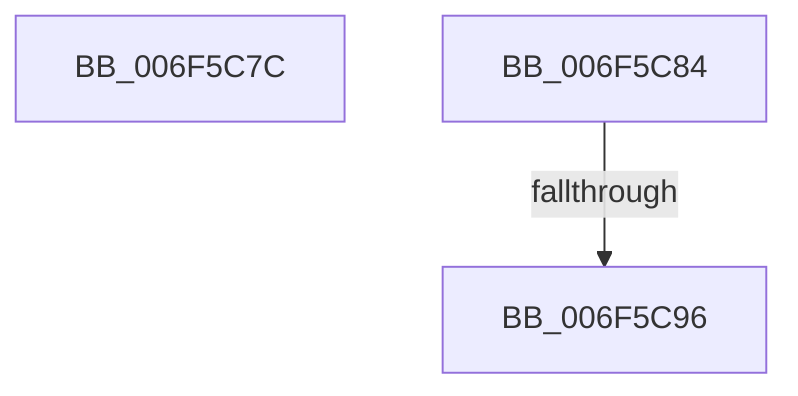

# sub_006F5C7C

- RVA: `0x006F5C7C`–`0x006F5C9B` (길이 `31` bytes)
- VA: `0x00000001406F5C7C`
- 실행 섹션: `.text`
- PDB 이름 있음: `아니요`; PDB Function 태그: `아니요`
- unwind 정보 RVA: `0x000AFDC0`
- 디코드: `8`개 명령, `31/31` bytes 표시
- 미해석 바이트: `0` (있으면 어셈블리에 `.byte`로 보존)

> 이 문서는 커널 이미지의 기계어와 PDB 기호를 분석해 생성했습니다. 4번과 5번은 함수 원형과 자료형을 바이너리 사용 방식에서 추정한 C 해석이며 원본 소스 복구 결과는 아닙니다.

## 1. Dependencies

- 직접 호출 지점: **1**; 고유 호출 대상: **1**
- 직접 호출자로 확인된 함수: **0**
- RIP 상대 이미지 참조: **0**

### Outgoing calls
- `0x006F5C89` → [MiUnlockVadCore](../43/MiUnlockVadCore_function_004311C0.md) (function, `0x004311C0`)

### Direct callers
- 이 함수 시작 RVA로 연결되는 직접 call은 확인되지 않았습니다. 간접 호출은 완전히 역산할 수 없습니다.

### Static image references
- 디코드된 RIP-relative 메모리 참조가 없습니다.

## 2. Other-region calls and transfers

- 다른 실행 섹션으로 향하는 call: **0**
- call이 아닌 외부 분기/꼬리 이동: **3**
  - `0x006F5C7F` → [MiCheckUserVirtualAddress + 0xE9](../48/MiCheckUserVirtualAddress_function_00488834.md) (`tail-transfer`)
  - `0x006F5C90` → [MiCheckUserVirtualAddress + 0x1C4](../48/MiCheckUserVirtualAddress_function_00488834.md) (`tail-transfer`)
  - `0x006F5C96` → [MiCheckUserVirtualAddress + 0x7B](../48/MiCheckUserVirtualAddress_function_00488834.md) (`tail-transfer`)

## 3. Assembly (complete function range)

```asm
006F5C7C  45 89 31                        mov dword ptr [r9], r14d
006F5C7F  E9 99 2C D9 FF                  jmp 0x14048891d
006F5C84  B2 11                           mov dl, 0x11
006F5C86  48 8B CB                        mov rcx, rbx
006F5C89  E8 32 B5 D3 FF                  call 0x1404311c0
006F5C8E  85 F6                           test esi, esi
006F5C90  0F 85 62 2D D9 FF               jne 0x1404889f8
006F5C96  E9 14 2C D9 FF                  jmp 0x1404888af
```

## 4. C-style interpretation (structured pseudocode)

```c
__int64 __fastcall sub_006F5C7C(__int64 a1, __int64 a2, __int64 a3, __int64 a4)
{
    *(unsigned int *)(a4) = (unsigned int)(v_r14);
}
```

## 5. (Beta) C Style

```c
int64_t sub_006F5C7C(int64_t Arg1, int64_t Arg2, int64_t Arg3, void *Arg4)
{
    uint8_t *arg4 = (uint8_t *)Arg4;

    *(uint32_t *)(arg4) = (uint32_t)(local_r14);
}
```

### 관측된 메모리 오프셋

구조체 형식이 확인되지 않은 접근은 인자 기준의 오프셋으로만 기록했습니다.

| 기준 인자 | 오프셋 표현 | 폭 (bit) | 접근 |
|---|---:|---:|---|
| `Arg4` | `+ 0x0` | `32` | `W` |

## 6. Execution-region graph

[열기: 2D/3D 그래프와 함수 탐색 컨트롤 패널](../../../control-panel.html?section=text&rva=0x006F5C7C&view=graph)

- 2D 그래프는 위에서 아래로 흐르고, 3D 그래프는 빈 공간을 드래그해 회전합니다. Shift+드래그는 이동, 휠은 확대·축소, 함수 노드 선택은 대상 보고서 이동입니다.

### Static fallback


