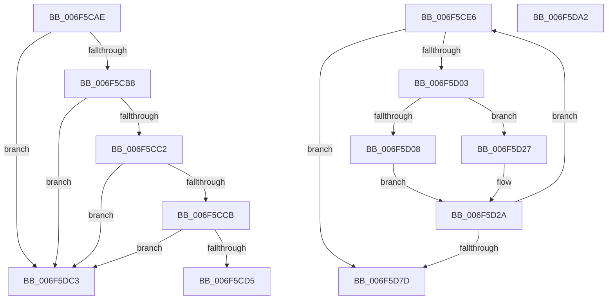

# sub_006F5CAE

- RVA: `0x006F5CAE`–`0x006F5DD8` (길이 `298` bytes)
- VA: `0x00000001406F5CAE`
- 실행 섹션: `.text`
- PDB 이름 있음: `아니요`; PDB Function 태그: `아니요`
- unwind 정보 RVA: `0x000AFEB4`
- 디코드: `69`개 명령, `298/298` bytes 표시
- 미해석 바이트: `0` (있으면 어셈블리에 `.byte`로 보존)

> 이 문서는 커널 이미지의 기계어와 PDB 기호를 분석해 생성했습니다. 4번과 5번은 함수 원형과 자료형을 바이너리 사용 방식에서 추정한 C 해석이며 원본 소스 복구 결과는 아닙니다.

## 1. Dependencies

- 직접 호출 지점: **5**; 고유 호출 대상: **4**
- 직접 호출자로 확인된 함수: **0**
- RIP 상대 이미지 참조: **0**

### Outgoing calls
- `0x006F5CF5` → [VmpFindNextPinnedPageStateHelper](../64/VmpFindNextPinnedPageStateHelper_function_0064C7E4.md) (function, `0x0064C7E4`)
- `0x006F5D15` → [VmpFindNextPinnedPageStateHelper](../64/VmpFindNextPinnedPageStateHelper_function_0064C7E4.md) (function, `0x0064C7E4`)
- `0x006F5D32` → [VmpProcessContextUnlockExclusive](../48/VmpProcessContextUnlockExclusive_function_004894C8.md) (function, `0x004894C8`)
- `0x006F5D5F` → [VmpUnpinMemoryRange](../../page/7A/VmpUnpinMemoryRange_function_007ADF6C.md) (function, `0x007ADF6C`)
- `0x006F5D6A` → [VmpProcessContextLockExclusive](../31/VmpProcessContextLockExclusive_function_003147A4.md) (function, `0x003147A4`)

### Direct callers
- 이 함수 시작 RVA로 연결되는 직접 call은 확인되지 않았습니다. 간접 호출은 완전히 역산할 수 없습니다.

### Static image references
- 디코드된 RIP-relative 메모리 참조가 없습니다.

## 2. Other-region calls and transfers

- 다른 실행 섹션으로 향하는 call: **1**
  - `0x006F5D5F` → [VmpUnpinMemoryRange](../../page/7A/VmpUnpinMemoryRange_function_007ADF6C.md) (`.text` → `PAGE`)
- call이 아닌 외부 분기/꼬리 이동: **4**
  - `0x006F5CE1` → [VmpRemoveMemoryRange + 0x17E](../48/VmpRemoveMemoryRange_function_00489018.md) (`tail-transfer`)
  - `0x006F5D9D` → [VmpRemoveMemoryRange + 0x188](../48/VmpRemoveMemoryRange_function_00489018.md) (`tail-transfer`)
  - `0x006F5DBE` → [VmpRemoveMemoryRange + 0x1DC](../48/VmpRemoveMemoryRange_function_00489018.md) (`tail-transfer`)
  - `0x006F5DD3` → [VmpRemoveMemoryRange + 0x73](../48/VmpRemoveMemoryRange_function_00489018.md) (`tail-transfer`)

## 3. Assembly (complete function range)

```asm
006F5CAE  4C 3B 6B 38                     cmp r13, qword ptr [rbx + 0x38]
006F5CB2  0F 85 0B 01 00 00               jne 0x1406f5dc3
006F5CB8  4C 3B 4F 20                     cmp r9, qword ptr [rdi + 0x20]
006F5CBC  0F 85 01 01 00 00               jne 0x1406f5dc3
006F5CC2  4D 3B F8                        cmp r15, r8
006F5CC5  0F 86 F8 00 00 00               jbe 0x1406f5dc3
006F5CCB  4C 3B 67 18                     cmp r12, qword ptr [rdi + 0x18]
006F5CCF  0F 86 EE 00 00 00               jbe 0x1406f5dc3
006F5CD5  BD 02 00 00 00                  mov ebp, 2
006F5CDA  89 AC 24 D0 00 00 00            mov dword ptr [rsp + 0xd0], ebp
006F5CE1  E9 B0 34 D9 FF                  jmp 0x140489196
006F5CE6  41 B9 01 00 00 00               mov r9d, 1
006F5CEC  4C 8B C7                        mov r8, rdi
006F5CEF  49 8B D4                        mov rdx, r12
006F5CF2  48 8B CE                        mov rcx, rsi
006F5CF5  E8 EA 6A F5 FF                  call 0x14064c7e4
006F5CFA  4C 8B E8                        mov r13, rax
006F5CFD  48 83 F8 FF                     cmp rax, -1
006F5D01  74 7A                           je 0x1406f5d7d
006F5D03  48 3B C7                        cmp rax, rdi
006F5D06  74 1F                           je 0x1406f5d27
006F5D08  48 8D 50 01                     lea rdx, [rax + 1]
006F5D0C  45 33 C9                        xor r9d, r9d
006F5D0F  4C 8B C7                        mov r8, rdi
006F5D12  48 8B CE                        mov rcx, rsi
006F5D15  E8 CA 6A F5 FF                  call 0x14064c7e4
006F5D1A  48 83 F8 FF                     cmp rax, -1
006F5D1E  4C 8B E3                        mov r12, rbx
006F5D21  4C 0F 45 E0                     cmovne r12, rax
006F5D25  EB 03                           jmp 0x1406f5d2a
006F5D27  4C 8B E3                        mov r12, rbx
006F5D2A  48 8B 54 24 48                  mov rdx, qword ptr [rsp + 0x48]
006F5D2F  48 8B CE                        mov rcx, rsi
006F5D32  E8 91 37 D9 FF                  call 0x1404894c8
006F5D37  48 83 64 24 30 00               and qword ptr [rsp + 0x30], 0
006F5D3D  4D 8B C5                        mov r8, r13
006F5D40  4D 2B C7                        sub r8, r15
006F5D43  C7 44 24 28 03 00 00 00         mov dword ptr [rsp + 0x28], 3
006F5D4B  4D 8B CC                        mov r9, r12
006F5D4E  48 89 6C 24 20                  mov qword ptr [rsp + 0x20], rbp
006F5D53  4D 03 C6                        add r8, r14
006F5D56  4D 2B CD                        sub r9, r13
006F5D59  49 8B D5                        mov rdx, r13
006F5D5C  48 8B CE                        mov rcx, rsi
006F5D5F  E8 08 82 0B 00                  call 0x1407adf6c
006F5D64  48 8B CE                        mov rcx, rsi
006F5D67  49 FF C4                        inc r12
006F5D6A  E8 35 EA C1 FF                  call 0x1403147a4
006F5D6F  48 89 44 24 48                  mov qword ptr [rsp + 0x48], rax
006F5D74  4C 3B E7                        cmp r12, rdi
006F5D77  0F 86 69 FF FF FF               jbe 0x1406f5ce6
006F5D7D  48 8B 5C 24 60                  mov rbx, qword ptr [rsp + 0x60]
006F5D82  4C 8D 76 08                     lea r14, [rsi + 8]
006F5D86  48 8B 7C 24 68                  mov rdi, qword ptr [rsp + 0x68]
006F5D8B  45 33 D2                        xor r10d, r10d
006F5D8E  8B AC 24 D0 00 00 00            mov ebp, dword ptr [rsp + 0xd0]
006F5D95  4C 8B A4 24 D8 00 00 00         mov r12, qword ptr [rsp + 0xd8]
006F5D9D  E9 FE 33 D9 FF                  jmp 0x1404891a0
006F5DA2  49 8D 47 FF                     lea rax, [r15 - 1]
006F5DA6  48 89 43 38                     mov qword ptr [rbx + 0x38], rax
006F5DAA  49 8D 44 24 FF                  lea rax, [r12 - 1]
006F5DAF  48 89 47 20                     mov qword ptr [rdi + 0x20], rax
006F5DB3  48 8B BC 24 E0 00 00 00         mov rdi, qword ptr [rsp + 0xe0]
006F5DBB  48 8B EF                        mov rbp, rdi
006F5DBE  E9 31 34 D9 FF                  jmp 0x1404891f4
006F5DC3  48 8B BC 24 E0 00 00 00         mov rdi, qword ptr [rsp + 0xe0]
006F5DCB  BB BB 00 00 C0                  mov ebx, 0xc00000bb
006F5DD0  48 8B EF                        mov rbp, rdi
006F5DD3  E9 B3 32 D9 FF                  jmp 0x14048908b
```

## 4. C-style interpretation (structured pseudocode)

```c
__int64 __fastcall sub_006F5CAE(__int64 a1, __int64 a2, __int64 a3, __int64 a4, __int64 a5, __int64 a6, __int64 a7, __int64 a8, __int64 a9, __int64 a10, __int64 a11, __int64 a12, __int64 a13, __int64 a14, __int64 a15, __int64 a16, __int64 a17, __int64 a18, __int64 a19, __int64 a20, __int64 a21, __int64 a22, __int64 a23, __int64 a24, __int64 a25, __int64 a26, __int64 a27, __int64 a28)
{
    unsigned __int64 v_stack_p20;
    unsigned int v_stack_p28;
    unsigned __int64 v_stack_p30;
    unsigned __int64 v_stack_p48;
    unsigned __int64 v_stack_p60;
    unsigned __int64 v_stack_p68;
    unsigned int v_stack_pD0;
    unsigned __int64 v_stack_pD8;
    unsigned __int64 v_stack_pE0;

    if (v_r13 != (*(unsigned __int64 *)(v_rbx + 56))) goto loc_006F5DC3;
    if (a4 != (*(unsigned __int64 *)(v_rdi + 32))) goto loc_006F5DC3;
    if (v_r15 <= a3) goto loc_006F5DC3;
    if (v_r12 <= (*(unsigned __int64 *)(v_rdi + 24))) goto loc_006F5DC3;
    v_stack_pD0 = 2;
loc_006F5DC3:
}
```

## 5. (Beta) C Style

```c
int64_t sub_006F5CAE(int64_t Arg1, int64_t Arg2, int64_t Arg3, int64_t Arg4, uint64_t Arg5, uint64_t Arg6, uint64_t Arg7, uint64_t Arg8, uint64_t Arg9, uint64_t Arg10, uint64_t Arg11, uint64_t Arg12, uint64_t Arg13, uint64_t Arg14, uint64_t Arg15, uint64_t Arg16, uint64_t Arg17, uint64_t Arg18, uint64_t Arg19, uint64_t Arg20, uint64_t Arg21, uint64_t Arg22, uint64_t Arg23, uint64_t Arg24, uint64_t Arg25, uint64_t Arg26, uint64_t Arg27, int64_t Arg28)
{
    uint64_t v_stack_p20;
    uint32_t v_stack_p28;
    uint64_t v_stack_p30;
    uint64_t v_stack_p48;
    uint64_t v_stack_p60;
    uint64_t v_stack_p68;
    uint32_t v_stack_pD0;
    uint64_t v_stack_pD8;
    uint64_t v_stack_pE0;

    if (local_r13 != (*(uint64_t *)(local_rbx + 0x38))) goto loc_006F5DC3;
    if (Arg4 != (*(uint64_t *)(local_rdi + 0x20))) goto loc_006F5DC3;
    if (local_r15 <= Arg3) goto loc_006F5DC3;
    if (local_r12 <= (*(uint64_t *)(local_rdi + 0x18))) goto loc_006F5DC3;
    v_stack_pD0 = 2;
loc_006F5DC3:
}
```

## 6. Execution-region graph

[열기: 2D/3D 그래프와 함수 탐색 컨트롤 패널](../../../control-panel.html?section=text&rva=0x006F5CAE&view=graph)

- 2D 그래프는 위에서 아래로 흐르고, 3D 그래프는 빈 공간을 드래그해 회전합니다. Shift+드래그는 이동, 휠은 확대·축소, 함수 노드 선택은 대상 보고서 이동입니다.

### Static fallback


