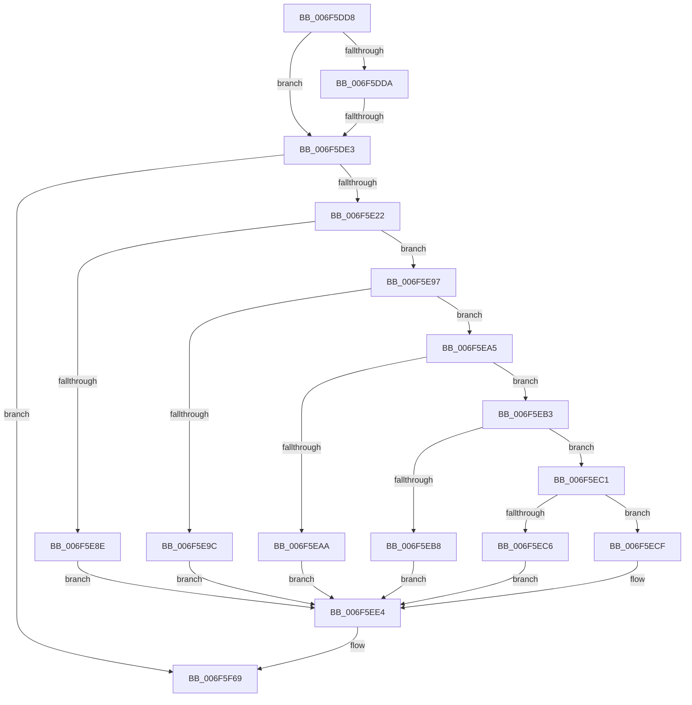

# sub_006F5DD8

- RVA: `0x006F5DD8`–`0x006F5F87` (길이 `431` bytes)
- VA: `0x00000001406F5DD8`
- 실행 섹션: `.text`
- PDB 이름 있음: `아니요`; PDB Function 태그: `아니요`
- unwind 정보 RVA: `0x000AFFC0`
- 디코드: `101`개 명령, `431/431` bytes 표시
- 미해석 바이트: `0` (있으면 어셈블리에 `.byte`로 보존)

> 이 문서는 커널 이미지의 기계어와 PDB 기호를 분석해 생성했습니다. 4번과 5번은 함수 원형과 자료형을 바이너리 사용 방식에서 추정한 C 해석이며 원본 소스 복구 결과는 아닙니다.

## 1. Dependencies

- 직접 호출 지점: **7**; 고유 호출 대상: **6**
- 직접 호출자로 확인된 함수: **0**
- RIP 상대 이미지 참조: **11**

### Outgoing calls
- `0x006F5DEB` → [KeAcquireSpinLockRaiseToDpc](../20/KeAcquireSpinLockRaiseToDpc_function_00208470.md) (function, `0x00208470`)
- `0x006F5E06` → [PopPlCalculateDevicePowerDraw](../5D/PopPlCalculateDevicePowerDraw_function_005DD934.md) (function, `0x005DD934`)
- `0x006F5E81` → [tlgCreate1Sz_char](../42/tlgCreate1Sz_char_function_00427304.md) (function, `0x00427304`)
- `0x006F5EE8` → [tlgCreate1Sz_char](../42/tlgCreate1Sz_char_function_00427304.md) (function, `0x00427304`)
- `0x006F5F64` → [tlgWriteEx_EtwWriteEx](../4A/tlgWriteEx_EtwWriteEx_function_004AA348.md) (function, `0x004AA348`)
- `0x006F5F6F` → [PopPlPublishSystemPowerChange](../5D/PopPlPublishSystemPowerChange_function_005DDD0C.md) (function, `0x005DDD0C`)
- `0x006F5F7C` → [KeReleaseSpinLock](../39/KeReleaseSpinLock_function_00392BA0.md) (function, `0x00392BA0`)

### Direct callers
- 이 함수 시작 RVA로 연결되는 직접 call은 확인되지 않았습니다. 간접 호출은 완전히 역산할 수 없습니다.

### Static image references
- `0x006F5E15` → RVA `0x00E07748` (`.data`; read)
- `0x006F5E31` → RVA `0x006CC510` (` ?? ::FNODOBFM::`string'`; read)
- `0x006F5E6A` → RVA `0x006CC490` (` ?? ::FNODOBFM::`string'`; read)
- `0x006F5E8E` → RVA `0x006CC470` (` ?? ::FNODOBFM::`string'`; read)
- `0x006F5E9C` → RVA `0x006CC4B0` (` ?? ::FNODOBFM::`string'`; read)
- `0x006F5EAA` → RVA `0x006CC4A0` (` ?? ::FNODOBFM::`string'`; read)
- `0x006F5EB8` → RVA `0x006CC4D0` (` ?? ::FNODOBFM::`string'`; read)
- `0x006F5EC6` → RVA `0x006CC4C0` (` ?? ::FNODOBFM::`string'`; read)
- `0x006F5ED2` → RVA `0x006CC4F0` (` ?? ::FNODOBFM::`string'`; read)
- `0x006F5ED9` → RVA `0x006CC4E0` (` ?? ::FNODOBFM::`string'`; read)
- `0x006F5EFA` → RVA `0x0005083D` (`.rdata`; read)

## 2. Other-region calls and transfers

- 다른 실행 섹션으로 향하는 call: **0**
- call이 아닌 외부 분기/꼬리 이동: **2**
  - `0x006F5DDD` → [PopPlNotifyDeviceDState + 0x44](../48/PopPlNotifyDeviceDState_function_0048958C.md) (`tail-transfer`)
  - `0x006F5F82` → [PopPlNotifyDeviceDState + 0x44](../48/PopPlNotifyDeviceDState_function_0048958C.md) (`tail-transfer`)

## 3. Assembly (complete function range)

```asm
006F5DD8  7D 09                           jge 0x1406f5de3
006F5DDA  40 84 F6                        test sil, sil
006F5DDD  0F 85 ED 37 D9 FF               jne 0x1404895d0
006F5DE3  4D 8B 6F 10                     mov r13, qword ptr [r15 + 0x10]
006F5DE7  49 8D 4D 10                     lea rcx, [r13 + 0x10]
006F5DEB  E8 80 26 B1 FF                  call 0x140208470
006F5DF0  41 88 45 18                     mov byte ptr [r13 + 0x18], al
006F5DF4  48 8D 54 24 40                  lea rdx, [rsp + 0x40]
006F5DF9  41 8B 5F 20                     mov ebx, dword ptr [r15 + 0x20]
006F5DFD  45 33 C9                        xor r9d, r9d
006F5E00  45 33 C0                        xor r8d, r8d
006F5E03  49 8B CE                        mov rcx, r14
006F5E06  E8 29 7B EE FF                  call 0x1405dd934
006F5E0B  44 8B E0                        mov r12d, eax
006F5E0E  41 89 47 20                     mov dword ptr [r15 + 0x20], eax
006F5E12  44 2B E3                        sub r12d, ebx
006F5E15  83 3D 2C 19 71 00 05            cmp dword ptr [rip + 0x71192c], 5
006F5E1C  0F 86 47 01 00 00               jbe 0x1406f5f69
006F5E22  48 8D 44 24 40                  lea rax, [rsp + 0x40]
006F5E27  41 BB 01 00 00 00               mov r11d, 1
006F5E2D  48 89 45 80                     mov qword ptr [rbp - 0x80], rax
006F5E31  48 8D 15 D8 66 FD FF            lea rdx, [rip - 0x29928]
006F5E38  48 8D 45 A8                     lea rax, [rbp - 0x58]
006F5E3C  66 44 89 5C 24 40               mov word ptr [rsp + 0x40], r11w
006F5E42  48 89 45 90                     mov qword ptr [rbp - 0x70], rax
006F5E46  48 8D 4D B0                     lea rcx, [rbp - 0x50]
006F5E4A  49 8B 86 E0 00 00 00            mov rax, qword ptr [r14 + 0xe0]
006F5E51  45 8D 53 01                     lea r10d, [r11 + 1]
006F5E55  48 89 45 A0                     mov qword ptr [rbp - 0x60], rax
006F5E59  45 33 C0                        xor r8d, r8d
006F5E5C  41 0F B7 86 D8 00 00 00         movzx eax, word ptr [r14 + 0xd8]
006F5E64  40 84 F6                        test sil, sil
006F5E67  89 45 A8                        mov dword ptr [rbp - 0x58], eax
006F5E6A  48 8D 05 1F 66 FD FF            lea rax, [rip - 0x299e1]
006F5E71  48 0F 45 D0                     cmovne rdx, rax
006F5E75  4C 89 55 88                     mov qword ptr [rbp - 0x78], r10
006F5E79  4C 89 55 98                     mov qword ptr [rbp - 0x68], r10
006F5E7D  44 89 45 AC                     mov dword ptr [rbp - 0x54], r8d
006F5E81  E8 7E 14 D3 FF                  call 0x140427304
006F5E86  45 8D 4B 03                     lea r9d, [r11 + 3]
006F5E8A  85 FF                           test edi, edi
006F5E8C  75 09                           jne 0x1406f5e97
006F5E8E  48 8D 15 DB 65 FD FF            lea rdx, [rip - 0x29a25]
006F5E95  EB 4D                           jmp 0x1406f5ee4
006F5E97  41 3B FB                        cmp edi, r11d
006F5E9A  75 09                           jne 0x1406f5ea5
006F5E9C  48 8D 15 0D 66 FD FF            lea rdx, [rip - 0x299f3]
006F5EA3  EB 3F                           jmp 0x1406f5ee4
006F5EA5  41 3B FA                        cmp edi, r10d
006F5EA8  75 09                           jne 0x1406f5eb3
006F5EAA  48 8D 15 EF 65 FD FF            lea rdx, [rip - 0x29a11]
006F5EB1  EB 31                           jmp 0x1406f5ee4
006F5EB3  83 FF 03                        cmp edi, 3
006F5EB6  75 09                           jne 0x1406f5ec1
006F5EB8  48 8D 15 11 66 FD FF            lea rdx, [rip - 0x299ef]
006F5EBF  EB 23                           jmp 0x1406f5ee4
006F5EC1  41 3B F9                        cmp edi, r9d
006F5EC4  75 09                           jne 0x1406f5ecf
006F5EC6  48 8D 15 F3 65 FD FF            lea rdx, [rip - 0x29a0d]
006F5ECD  EB 15                           jmp 0x1406f5ee4
006F5ECF  83 FF 05                        cmp edi, 5
006F5ED2  48 8D 15 17 66 FD FF            lea rdx, [rip - 0x299e9]
006F5ED9  48 8D 05 00 66 FD FF            lea rax, [rip - 0x29a00]
006F5EE0  48 0F 45 D0                     cmovne rdx, rax
006F5EE4  48 8D 4D C0                     lea rcx, [rbp - 0x40]
006F5EE8  E8 17 14 D3 FF                  call 0x140427304
006F5EED  48 8D 44 24 48                  lea rax, [rsp + 0x48]
006F5EF2  4C 89 4D D8                     mov qword ptr [rbp - 0x28], r9
006F5EF6  48 89 45 D0                     mov qword ptr [rbp - 0x30], rax
006F5EFA  48 8D 15 3C A9 95 FF            lea rdx, [rip - 0x6a56c4]
006F5F01  41 8B 47 20                     mov eax, dword ptr [r15 + 0x20]
006F5F05  89 44 24 4C                     mov dword ptr [rsp + 0x4c], eax
006F5F09  48 8D 44 24 4C                  lea rax, [rsp + 0x4c]
006F5F0E  48 89 45 E0                     mov qword ptr [rbp - 0x20], rax
006F5F12  48 8D 44 24 50                  lea rax, [rsp + 0x50]
006F5F17  48 89 45 F0                     mov qword ptr [rbp - 0x10], rax
006F5F1B  49 8B 47 10                     mov rax, qword ptr [r15 + 0x10]
006F5F1F  4C 89 4D E8                     mov qword ptr [rbp - 0x18], r9
006F5F23  4C 89 4D F8                     mov qword ptr [rbp - 8], r9
006F5F27  44 89 64 24 48                  mov dword ptr [rsp + 0x48], r12d
006F5F2C  44 89 64 24 50                  mov dword ptr [rsp + 0x50], r12d
006F5F31  8B 48 1C                        mov ecx, dword ptr [rax + 0x1c]
006F5F34  48 8D 44 24 54                  lea rax, [rsp + 0x54]
006F5F39  41 03 CC                        add ecx, r12d
006F5F3C  48 89 45 00                     mov qword ptr [rbp], rax
006F5F40  48 8D 44 24 60                  lea rax, [rsp + 0x60]
006F5F45  89 4C 24 54                     mov dword ptr [rsp + 0x54], ecx
006F5F49  4C 89 4D 08                     mov qword ptr [rbp + 8], r9
006F5F4D  48 8D 0D F4 17 71 00            lea rcx, [rip + 0x7117f4]
006F5F54  48 89 44 24 38                  mov qword ptr [rsp + 0x38], rax
006F5F59  45 8B CB                        mov r9d, r11d
006F5F5C  C7 44 24 30 0B 00 00 00         mov dword ptr [rsp + 0x30], 0xb
006F5F64  E8 DF 43 DB FF                  call 0x1404aa348
006F5F69  41 8B D4                        mov edx, r12d
006F5F6C  49 8B CD                        mov rcx, r13
006F5F6F  E8 98 7D EE FF                  call 0x1405ddd0c
006F5F74  41 8A 55 18                     mov dl, byte ptr [r13 + 0x18]
006F5F78  49 8D 4D 10                     lea rcx, [r13 + 0x10]
006F5F7C  E8 1F CC C9 FF                  call 0x140392ba0
006F5F81  90                              nop
006F5F82  E9 49 36 D9 FF                  jmp 0x1404895d0
```

## 4. C-style interpretation (structured pseudocode)

```c
__int64 __fastcall sub_006F5DD8(__int64 a1, __int64 a2, int a3, int a4, __int64 a5, __int64 a6, __int64 a7, __int64 a8, __int64 a9, __int64 a10, __int64 a11, __int64 a12)
{
    __int64 result;
    __int64 v_r12;
    unsigned int v_stack_p30;
    unsigned __int64 v_stack_p38;
    unsigned __int16 v_stack_p40;
    unsigned int v_stack_p48;
    unsigned int v_stack_p4C;
    unsigned int v_stack_p50;
    unsigned __int64 v_stack_p54;

    if (condition_is_greater_or_equal) goto loc_006F5DE3;
loc_006F5DE3:
    result = KeAcquireSpinLockRaiseToDpc(*(unsigned __int64 *)(v_r15 + 16) + 16, a2, a3, a4);
    *(unsigned __int8 *)(*(unsigned __int64 *)(v_r15 + 16) + 24) = (unsigned __int8)(result);
    a4 = 0;
    a3 = 0;
    result = PopPlCalculateDevicePowerDraw(v_r14, a8, a3, a4);
    *(unsigned int *)(v_r15 + 32) = (unsigned int)(result);
    v_r12 = (unsigned int)(((unsigned int)((unsigned int)(result))) - ((unsigned int)((unsigned int)(*(unsigned int *)(v_r15 + 32)))));
    if ((*(unsigned int *)(v_rip + 7412012)) <= 5) goto loc_006F5F69;
    *(unsigned __int64 *)(v_rbp - 128) = a8;
    v_stack_p40 = 1;
    *(unsigned __int64 *)(v_rbp - 112) = v_rbp - 88;
    *(unsigned __int64 *)(v_rbp - 96) = *(unsigned __int64 *)(v_r14 + 224);
    a3 = 0;
    *(unsigned int *)(v_rbp - 88) = (unsigned int)(*(unsigned __int16 *)(v_r14 + 216));
    a2 = v_rip - 170280;
    if ((unsigned __int8)(v_rsi) != 0) { a2 = v_rip - 170465; }
    *(unsigned __int64 *)(v_rbp - 120) = 1 + 1;
    *(unsigned __int64 *)(v_rbp - 104) = 1 + 1;
    *(unsigned int *)(v_rbp - 84) = 0;
    result = tlgCreate1Sz_char(v_rbp - 80, a2, a3, a4);
    if ((unsigned int)(v_rdi) != 0) goto loc_006F5E97;
    goto loc_006F5EE4;
loc_006F5E97:
    if (((unsigned int)(v_rdi)) != 1) goto loc_006F5EA5;
    goto loc_006F5EE4;
loc_006F5EA5:
    if (((unsigned int)(v_rdi)) != ((unsigned int)(1 + 1))) goto loc_006F5EB3;
    goto loc_006F5EE4;
loc_006F5EB3:
    if (((unsigned int)(v_rdi)) != 3) goto loc_006F5EC1;
    goto loc_006F5EE4;
loc_006F5EC1:
    if (((unsigned int)(v_rdi)) != ((unsigned int)(1 + 3))) goto loc_006F5ECF;
    goto loc_006F5EE4;
loc_006F5ECF:
    a2 = v_rip - 170473;
    if (((unsigned int)(v_rdi)) != 5) { a2 = v_rip - 170496; }
loc_006F5EE4:
    result = tlgCreate1Sz_char(v_rbp - 64, a2, a3, 1 + 3);
    *(unsigned __int64 *)(v_rbp - 40) = 1 + 3;
    *(unsigned __int64 *)(v_rbp - 48) = a9;
    v_stack_p4C = (unsigned int)((unsigned int)(*(unsigned int *)(v_r15 + 32)));
    *(unsigned __int64 *)(v_rbp - 32) = v_stack_p4C;
    *(unsigned __int64 *)(v_rbp - 16) = a10;
    *(unsigned __int64 *)(v_rbp - 24) = 1 + 3;
    *(unsigned __int64 *)(v_rbp - 8) = 1 + 3;
    v_stack_p48 = (unsigned int)(v_r12);
    v_stack_p50 = (unsigned int)(v_r12);
    a1 = (unsigned int)(((unsigned int)(*(unsigned int *)(*(unsigned __int64 *)(v_r15 + 16) + 28))) + ((unsigned int)(v_r12)));
    *(unsigned __int64 *)(v_rbp) = v_stack_p54;
    v_stack_p54 = (unsigned int)(a1);
    *(unsigned __int64 *)(v_rbp + 8) = 1 + 3;
    v_stack_p38 = a12;
    v_stack_p30 = 11;
    result = tlgWriteEx_EtwWriteEx(v_rip + 7411700, v_rip - 6969028, a3, 1);
loc_006F5F69:
    result = PopPlPublishSystemPowerChange(*(unsigned __int64 *)(v_r15 + 16), (unsigned int)((unsigned int)(v_r12)), a3, 1);
    result = KeReleaseSpinLock(*(unsigned __int64 *)(v_r15 + 16) + 16, *(unsigned __int8 *)(*(unsigned __int64 *)(v_r15 + 16) + 24), a3, 1);
}
```

## 5. (Beta) C Style

```c
int64_t sub_006F5DD8(int64_t Arg1, int64_t Arg2, int32_t Arg3, int32_t Arg4, uint64_t Arg5, uint64_t Arg6, uint64_t Arg7, int64_t Arg8, int64_t Arg9, int64_t Arg10, uint64_t Arg11, int64_t Arg12)
{
    int64_t result;
    int64_t local_r12;
    uint32_t v_stack_p30;
    uint64_t v_stack_p38;
    uint16_t v_stack_p40;
    uint32_t v_stack_p48;
    uint32_t v_stack_p4C;
    uint32_t v_stack_p50;
    uint64_t v_stack_p54;

    if (condition_is_greater_or_equal) goto loc_006F5DE3;
loc_006F5DE3:
    result = KeAcquireSpinLockRaiseToDpc(*(uint64_t *)(local_r15 + 0x10) + 16, Arg2, Arg3, Arg4);
    *(uint8_t *)(*(uint64_t *)(local_r15 + 0x10) + 0x18) = (uint8_t)(result);
    Arg4 = 0;
    Arg3 = 0;
    result = PopPlCalculateDevicePowerDraw(local_r14, Arg8, Arg3, Arg4);
    *(uint32_t *)(local_r15 + 0x20) = (uint32_t)(result);
    local_r12 = (uint32_t)(((uint32_t)((uint32_t)(result))) - ((uint32_t)((uint32_t)(*(uint32_t *)(local_r15 + 0x20)))));
    if ((*(uint32_t *)(v_rip + 0x71192C)) <= 5) goto loc_006F5F69;
    *(uint64_t *)(local_rbp - 0x80) = Arg8;
    v_stack_p40 = 1;
    *(uint64_t *)(local_rbp - 0x70) = local_rbp - 88;
    *(uint64_t *)(local_rbp - 0x60) = *(uint64_t *)(local_r14 + 0xE0);
    Arg3 = 0;
    *(uint32_t *)(local_rbp - 0x58) = (uint32_t)(*(uint16_t *)(local_r14 + 0xD8));
    Arg2 = v_rip - 170280;
    if ((uint8_t)(local_rsi) != 0) { Arg2 = v_rip - 170465; }
    *(uint64_t *)(local_rbp - 0x78) = 1 + 1;
    *(uint64_t *)(local_rbp - 0x68) = 1 + 1;
    *(uint32_t *)(local_rbp - 0x54) = 0;
    result = tlgCreate1Sz_char(local_rbp - 80, Arg2, Arg3, Arg4);
    if ((uint32_t)(local_rdi) != 0) goto loc_006F5E97;
    goto loc_006F5EE4;
loc_006F5E97:
    if (((uint32_t)(local_rdi)) != 1) goto loc_006F5EA5;
    goto loc_006F5EE4;
loc_006F5EA5:
    if (((uint32_t)(local_rdi)) != ((uint32_t)(1 + 1))) goto loc_006F5EB3;
    goto loc_006F5EE4;
loc_006F5EB3:
    if (((uint32_t)(local_rdi)) != 3) goto loc_006F5EC1;
    goto loc_006F5EE4;
loc_006F5EC1:
    if (((uint32_t)(local_rdi)) != ((uint32_t)(1 + 3))) goto loc_006F5ECF;
    goto loc_006F5EE4;
loc_006F5ECF:
    Arg2 = v_rip - 170473;
    if (((uint32_t)(local_rdi)) != 5) { Arg2 = v_rip - 170496; }
loc_006F5EE4:
    result = tlgCreate1Sz_char(local_rbp - 64, Arg2, Arg3, 1 + 3);
    *(uint64_t *)(local_rbp - 0x28) = 1 + 3;
    *(uint64_t *)(local_rbp - 0x30) = Arg9;
    v_stack_p4C = (uint32_t)((uint32_t)(*(uint32_t *)(local_r15 + 0x20)));
    *(uint64_t *)(local_rbp - 0x20) = v_stack_p4C;
    *(uint64_t *)(local_rbp - 0x10) = Arg10;
    *(uint64_t *)(local_rbp - 0x18) = 1 + 3;
    *(uint64_t *)(local_rbp - 0x8) = 1 + 3;
    v_stack_p48 = (uint32_t)(local_r12);
    v_stack_p50 = (uint32_t)(local_r12);
    Arg1 = (uint32_t)(((uint32_t)(*(uint32_t *)(*(uint64_t *)(local_r15 + 0x10) + 0x1C))) + ((uint32_t)(local_r12)));
    *(uint64_t *)(local_rbp) = v_stack_p54;
    v_stack_p54 = (uint32_t)(Arg1);
    *(uint64_t *)(local_rbp + 0x8) = 1 + 3;
    v_stack_p38 = Arg12;
    v_stack_p30 = 11;
    result = tlgWriteEx_EtwWriteEx(v_rip + 7411700, v_rip - 6969028, Arg3, 1);
loc_006F5F69:
    result = PopPlPublishSystemPowerChange(*(uint64_t *)(local_r15 + 0x10), (uint32_t)((uint32_t)(local_r12)), Arg3, 1);
    result = KeReleaseSpinLock(*(uint64_t *)(local_r15 + 0x10) + 16, *(uint8_t *)(*(uint64_t *)(local_r15 + 0x10) + 0x18), Arg3, 1);
}
```

## 6. Execution-region graph

[열기: 2D/3D 그래프와 함수 탐색 컨트롤 패널](../../../control-panel.html?section=text&rva=0x006F5DD8&view=graph)

- 2D 그래프는 위에서 아래로 흐르고, 3D 그래프는 빈 공간을 드래그해 회전합니다. Shift+드래그는 이동, 휠은 확대·축소, 함수 노드 선택은 대상 보고서 이동입니다.

### Static fallback


