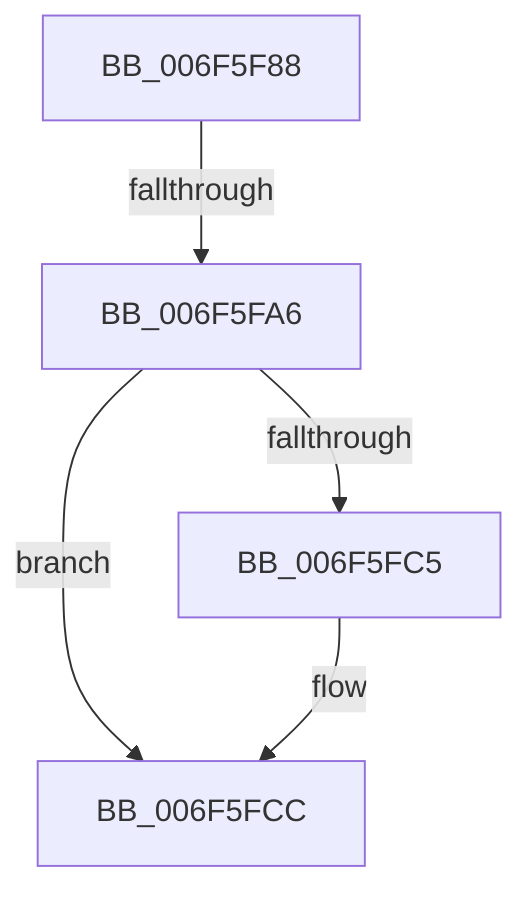

# sub_006F5F88

- RVA: `0x006F5F88`–`0x006F5FDF` (길이 `87` bytes)
- VA: `0x00000001406F5F88`
- 실행 섹션: `.text`
- PDB 이름 있음: `아니요`; PDB Function 태그: `아니요`
- unwind 정보 RVA: `0x000AFFD0`
- 디코드: `21`개 명령, `87/87` bytes 표시
- 미해석 바이트: `0` (있으면 어셈블리에 `.byte`로 보존)

> 이 문서는 커널 이미지의 기계어와 PDB 기호를 분석해 생성했습니다. 4번과 5번은 함수 원형과 자료형을 바이너리 사용 방식에서 추정한 C 해석이며 원본 소스 복구 결과는 아닙니다.

## 1. Dependencies

- 직접 호출 지점: **1**; 고유 호출 대상: **1**
- 직접 호출자로 확인된 함수: **0**
- RIP 상대 이미지 참조: **1**

### Outgoing calls
- `0x006F5F98` → [ExAllocatePool2](../../poolcode/B8/ExAllocatePool2_function_00B820F0.md) (function, `0x00B820F0`)

### Direct callers
- 이 함수 시작 RVA로 연결되는 직접 call은 확인되지 않았습니다. 간접 호출은 완전히 역산할 수 없습니다.

### Static image references
- `0x006F5FA6` → RVA `0x00F0FE80` (`.data`; read)

## 2. Other-region calls and transfers

- 다른 실행 섹션으로 향하는 call: **1**
  - `0x006F5F98` → [ExAllocatePool2](../../poolcode/B8/ExAllocatePool2_function_00B820F0.md) (`.text` → `POOLCODE`)
- call이 아닌 외부 분기/꼬리 이동: **2**
  - `0x006F5FA0` → [SepGetTokenSessionMapEntry + 0x92](../48/SepGetTokenSessionMapEntry_function_00489654.md) (`tail-transfer`)
  - `0x006F5FDA` → [SepGetTokenSessionMapEntry + 0x38](../48/SepGetTokenSessionMapEntry_function_00489654.md) (`tail-transfer`)

## 3. Assembly (complete function range)

```asm
006F5F88  BA 40 00 00 00                  mov edx, 0x40
006F5F8D  B9 00 01 00 00                  mov ecx, 0x100
006F5F92  41 B8 53 65 4C 73               mov r8d, 0x734c6553
006F5F98  E8 53 C1 48 00                  call 0x140b820f0
006F5F9D  48 85 C0                        test rax, rax
006F5FA0  0F 84 40 37 D9 FF               je 0x1404896e6
006F5FA6  48 8B 15 D3 9E 81 00            mov rdx, qword ptr [rip + 0x819ed3]
006F5FAD  48 8D 48 18                     lea rcx, [rax + 0x18]
006F5FB1  48 83 21 00                     and qword ptr [rcx], 0
006F5FB5  C6 40 38 00                     mov byte ptr [rax + 0x38], 0
006F5FB9  89 70 10                        mov dword ptr [rax + 0x10], esi
006F5FBC  4C 8B 02                        mov r8, qword ptr [rdx]
006F5FBF  49 39 50 08                     cmp qword ptr [r8 + 8], rdx
006F5FC3  74 07                           je 0x1406f5fcc
006F5FC5  B9 03 00 00 00                  mov ecx, 3
006F5FCA  CD 29                           int 0x29
006F5FCC  4C 89 00                        mov qword ptr [rax], r8
006F5FCF  48 89 50 08                     mov qword ptr [rax + 8], rdx
006F5FD3  49 89 40 08                     mov qword ptr [r8 + 8], rax
006F5FD7  48 89 02                        mov qword ptr [rdx], rax
006F5FDA  E9 AD 36 D9 FF                  jmp 0x14048968c
```

## 4. C-style interpretation (structured pseudocode)

```c
__int64 __fastcall sub_006F5F88(void)
{
    __int64 result;

    result = ExAllocatePool2(256, 64, (unsigned int)(0x734C6553ULL), a4);
    *(unsigned __int8 *)(result + 56) = 0;
    *(unsigned int *)(result + 16) = (unsigned int)(v_rsi);
    if ((*(unsigned __int64 *)(*(unsigned __int64 *)(*(unsigned __int64 *)(v_rip + 8494803)) + 8)) != (*(unsigned __int64 *)(v_rip + 8494803))) {
        a1 = 3;
    }
    *(unsigned __int64 *)(result) = *(unsigned __int64 *)(*(unsigned __int64 *)(v_rip + 8494803));
    *(unsigned __int64 *)(result + 8) = *(unsigned __int64 *)(v_rip + 8494803);
    *(unsigned __int64 *)(*(unsigned __int64 *)(*(unsigned __int64 *)(v_rip + 8494803)) + 8) = result;
    *(unsigned __int64 *)(*(unsigned __int64 *)(v_rip + 8494803)) = result;
}
```

## 5. (Beta) C Style

```c
void sub_006F5F88(void)
{
    int64_t result;

    result = ExAllocatePool2(256, 64, (uint32_t)(0x734C6553ULL), a4);
    *(uint8_t *)(result + 0x38) = 0;
    *(uint32_t *)(result + 0x10) = (uint32_t)(local_rsi);
    if ((*(uint64_t *)(*(uint64_t *)(*(uint64_t *)(v_rip + 0x819ED3)) + 0x8)) != (*(uint64_t *)(v_rip + 0x819ED3))) {
        a1 = 3;
    }
    *(uint64_t *)(result) = *(uint64_t *)(*(uint64_t *)(v_rip + 0x819ED3));
    *(uint64_t *)(result + 0x8) = *(uint64_t *)(v_rip + 0x819ED3);
    *(uint64_t *)(*(uint64_t *)(*(uint64_t *)(v_rip + 0x819ED3)) + 0x8) = result;
    *(uint64_t *)(*(uint64_t *)(v_rip + 0x819ED3)) = result;
}
```

## 6. Execution-region graph

[열기: 2D/3D 그래프와 함수 탐색 컨트롤 패널](../../../control-panel.html?section=text&rva=0x006F5F88&view=graph)

- 2D 그래프는 위에서 아래로 흐르고, 3D 그래프는 빈 공간을 드래그해 회전합니다. Shift+드래그는 이동, 휠은 확대·축소, 함수 노드 선택은 대상 보고서 이동입니다.

### Static fallback


