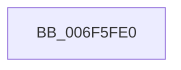

# sub_006F5FE0

- RVA: `0x006F5FE0`–`0x006F601A` (길이 `58` bytes)
- VA: `0x00000001406F5FE0`
- 실행 섹션: `.text`
- PDB 이름 있음: `아니요`; PDB Function 태그: `아니요`
- unwind 정보 RVA: `0x000B0100`
- 디코드: `13`개 명령, `58/58` bytes 표시
- 미해석 바이트: `0` (있으면 어셈블리에 `.byte`로 보존)

> 이 문서는 커널 이미지의 기계어와 PDB 기호를 분석해 생성했습니다. 4번과 5번은 함수 원형과 자료형을 바이너리 사용 방식에서 추정한 C 해석이며 원본 소스 복구 결과는 아닙니다.

## 1. Dependencies

- 직접 호출 지점: **2**; 고유 호출 대상: **2**
- 직접 호출자로 확인된 함수: **0**
- RIP 상대 이미지 참조: **1**

### Outgoing calls
- `0x006F5FF9` → [HalpInterruptSetProblemEx](../48/HalpInterruptSetProblemEx_function_0048AC8C.md) (function, `0x0048AC8C`)
- `0x006F6014` → [KeBugCheckEx](../4F/KeBugCheckEx_function_004FD660.md) (function, `0x004FD660`)

### Direct callers
- 이 함수 시작 RVA로 연결되는 직접 call은 확인되지 않았습니다. 간접 호출은 완전히 역산할 수 없습니다.

### Static image references
- `0x006F5FEB` → RVA `0x00010AA8` (`.rdata`; read)

## 2. Other-region calls and transfers

- 다른 실행 섹션으로 향하는 call: **0**
- 별도 외부 분기/꼬리 이동을 확인하지 못했습니다.

## 3. Assembly (complete function range)

```asm
006F5FE0  45 33 C0                        xor r8d, r8d
006F5FE3  C7 44 24 20 F7 08 00 00         mov dword ptr [rsp + 0x20], 0x8f7
006F5FEB  4C 8D 0D B6 AA 91 FF            lea r9, [rip - 0x6e554a]
006F5FF2  48 8B CE                        mov rcx, rsi
006F5FF5  41 8D 50 20                     lea edx, [r8 + 0x20]
006F5FF9  E8 8E 4C D9 FF                  call 0x14048ac8c
006F5FFE  44 8B 4B 30                     mov r9d, dword ptr [rbx + 0x30]
006F6002  4C 8B C3                        mov r8, rbx
006F6005  BA 02 02 00 00                  mov edx, 0x202
006F600A  4C 89 54 24 20                  mov qword ptr [rsp + 0x20], r10
006F600F  B9 5C 00 00 00                  mov ecx, 0x5c
006F6014  E8 47 76 E0 FF                  call 0x1404fd660
006F6019  CC                              int3
```

## 4. C-style interpretation (structured pseudocode)

```c
__int64 __fastcall sub_006F5FE0(__int64 a1, __int64 a2, int a3)
{
    __int64 result;
    unsigned int v_stack_p20;

    a3 = 0;
    v_stack_p20 = 0x8F7ULL;
    result = HalpInterruptSetProblemEx(v_rsi, a3 + 32, a3, v_rip - 7230794);
    v_stack_p20 = v_r10;
    result = KeBugCheckEx(92, 514, v_rbx, (unsigned int)(*(unsigned int *)(v_rbx + 48)));
    return result;
}
```

## 5. (Beta) C Style

```c
int64_t sub_006F5FE0(int64_t Arg1, int64_t Arg2, int32_t Arg3)
{
    int64_t result;
    uint32_t v_stack_p20;

    Arg3 = 0;
    v_stack_p20 = 0x8F7ULL;
    result = HalpInterruptSetProblemEx(local_rsi, Arg3 + 32, Arg3, v_rip - 7230794);
    v_stack_p20 = local_r10;
    result = KeBugCheckEx(92, 514, local_rbx, (uint32_t)(*(uint32_t *)(local_rbx + 0x30)));
    return result;
}
```

## 6. Execution-region graph

[열기: 2D/3D 그래프와 함수 탐색 컨트롤 패널](../../../control-panel.html?section=text&rva=0x006F5FE0&view=graph)

- 2D 그래프는 위에서 아래로 흐르고, 3D 그래프는 빈 공간을 드래그해 회전합니다. Shift+드래그는 이동, 휠은 확대·축소, 함수 노드 선택은 대상 보고서 이동입니다.

### Static fallback


