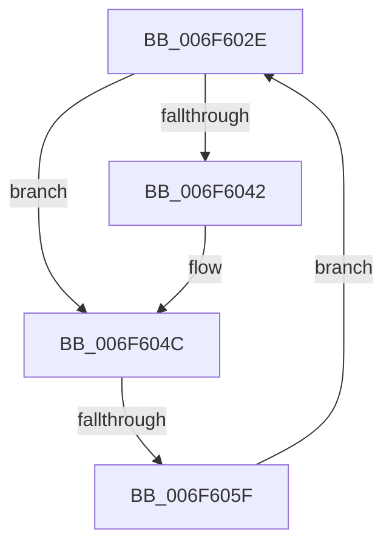

# sub_006F602E

- RVA: `0x006F602E`–`0x006F606A` (길이 `60` bytes)
- VA: `0x00000001406F602E`
- 실행 섹션: `.text`
- PDB 이름 있음: `아니요`; PDB Function 태그: `아니요`
- unwind 정보 RVA: `0x000B02CC`
- 디코드: `15`개 명령, `60/60` bytes 표시
- 미해석 바이트: `0` (있으면 어셈블리에 `.byte`로 보존)

> 이 문서는 커널 이미지의 기계어와 PDB 기호를 분석해 생성했습니다. 4번과 5번은 함수 원형과 자료형을 바이너리 사용 방식에서 추정한 C 해석이며 원본 소스 복구 결과는 아닙니다.

## 1. Dependencies

- 직접 호출 지점: **3**; 고유 호출 대상: **3**
- 직접 호출자로 확인된 함수: **0**
- RIP 상대 이미지 참조: **0**

### Outgoing calls
- `0x006F6031` → [ExAcquireSpinLockExclusive](../24/ExAcquireSpinLockExclusive_function_00248690.md) (function, `0x00248690`)
- `0x006F6051` → [MiReleaseSpinLockExclusive](../24/MiReleaseSpinLockExclusive_function_002482C0.md) (function, `0x002482C0`)
- `0x006F6063` → [MiDeleteControlArea](../36/MiDeleteControlArea_function_003691F4.md) (function, `0x003691F4`)

### Direct callers
- 이 함수 시작 RVA로 연결되는 직접 call은 확인되지 않았습니다. 간접 호출은 완전히 역산할 수 없습니다.

### Static image references
- 디코드된 RIP-relative 메모리 참조가 없습니다.

## 2. Other-region calls and transfers

- 다른 실행 섹션으로 향하는 call: **0**
- call이 아닌 외부 분기/꼬리 이동: **1**
  - `0x006F6059` → [MiDeleteControlAreaList + 0x1C](../48/MiDeleteControlAreaList_function_0048AE78.md) (`tail-transfer`)

## 3. Assembly (complete function range)

```asm
006F602E  48 8B CE                        mov rcx, rsi
006F6031  E8 5A 26 B5 FF                  call 0x140248690
006F6036  48 8B BB 78 08 00 00            mov rdi, qword ptr [rbx + 0x878]
006F603D  48 85 FF                        test rdi, rdi
006F6040  74 0A                           je 0x1406f604c
006F6042  48 8B 0F                        mov rcx, qword ptr [rdi]
006F6045  48 89 8B 78 08 00 00            mov qword ptr [rbx + 0x878], rcx
006F604C  8A D0                           mov dl, al
006F604E  48 8B CE                        mov rcx, rsi
006F6051  E8 6A 22 B5 FF                  call 0x1402482c0
006F6056  48 85 FF                        test rdi, rdi
006F6059  0F 84 35 4E D9 FF               je 0x14048ae94
006F605F  48 8D 4F F8                     lea rcx, [rdi - 8]
006F6063  E8 8C 31 C7 FF                  call 0x1403691f4
006F6068  EB C4                           jmp 0x1406f602e
```

## 4. C-style interpretation (structured pseudocode)

```c
__int64 __fastcall sub_006F602E(void)
{
    __int64 result;

    result = ExAcquireSpinLockExclusive(v_rsi, a2, a3, a4);
    if (*(unsigned __int64 *)(v_rbx + 2168) != 0) {
        a1 = *(unsigned __int64 *)(*(unsigned __int64 *)(v_rbx + 2168));
        *(unsigned __int64 *)(v_rbx + 2168) = a1;
    }
    result = MiReleaseSpinLockExclusive(v_rsi, (unsigned __int8)(result), a3, a4);
    result = MiDeleteControlArea(*(unsigned __int64 *)(v_rbx + 2168) - 8, (unsigned __int8)(result), a3, a4);
    goto loc_006F602E;
}
```

## 5. (Beta) C Style

```c
void sub_006F602E(void)
{
    int64_t result;

    result = ExAcquireSpinLockExclusive(local_rsi, a2, a3, a4);
    if (*(uint64_t *)(local_rbx + 0x878) != 0) {
        a1 = *(uint64_t *)(*(uint64_t *)(local_rbx + 0x878));
        *(uint64_t *)(local_rbx + 0x878) = a1;
    }
    result = MiReleaseSpinLockExclusive(local_rsi, (uint8_t)(result), a3, a4);
    result = MiDeleteControlArea(*(uint64_t *)(local_rbx + 0x878) - 8, (uint8_t)(result), a3, a4);
    goto loc_006F602E;
}
```

## 6. Execution-region graph

[열기: 2D/3D 그래프와 함수 탐색 컨트롤 패널](../../../control-panel.html?section=text&rva=0x006F602E&view=graph)

- 2D 그래프는 위에서 아래로 흐르고, 3D 그래프는 빈 공간을 드래그해 회전합니다. Shift+드래그는 이동, 휠은 확대·축소, 함수 노드 선택은 대상 보고서 이동입니다.

### Static fallback


