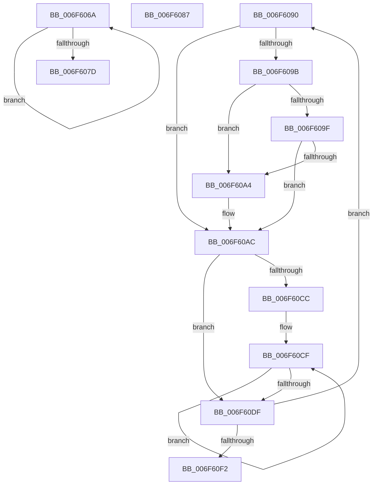

# sub_006F606A

- RVA: `0x006F606A`–`0x006F60F7` (길이 `141` bytes)
- VA: `0x00000001406F606A`
- 실행 섹션: `.text`
- PDB 이름 있음: `아니요`; PDB Function 태그: `아니요`
- unwind 정보 RVA: `0x000B06B8`
- 디코드: `42`개 명령, `141/141` bytes 표시
- 미해석 바이트: `0` (있으면 어셈블리에 `.byte`로 보존)

> 이 문서는 커널 이미지의 기계어와 PDB 기호를 분석해 생성했습니다. 4번과 5번은 함수 원형과 자료형을 바이너리 사용 방식에서 추정한 C 해석이며 원본 소스 복구 결과는 아닙니다.

## 1. Dependencies

- 직접 호출 지점: **1**; 고유 호출 대상: **1**
- 직접 호출자로 확인된 함수: **0**
- RIP 상대 이미지 참조: **0**

### Outgoing calls
- `0x006F6070` → [IoFreeMdl](../29/IoFreeMdl_function_0029EA80.md) (function, `0x0029EA80`)

### Direct callers
- 이 함수 시작 RVA로 연결되는 직접 call은 확인되지 않았습니다. 간접 호출은 완전히 역산할 수 없습니다.

### Static image references
- 디코드된 RIP-relative 메모리 참조가 없습니다.

## 2. Other-region calls and transfers

- 다른 실행 섹션으로 향하는 call: **0**
- call이 아닌 외부 분기/꼬리 이동: **3**
  - `0x006F6082` → [HalBuildMdlFromScatterGatherListV3 + 0x41](../48/HalBuildMdlFromScatterGatherListV3_function_0048B500.md) (`tail-transfer`)
  - `0x006F608B` → [HalBuildMdlFromScatterGatherListV3 + 0x136](../48/HalBuildMdlFromScatterGatherListV3_function_0048B500.md) (`tail-transfer`)
  - `0x006F60F2` → [HalBuildMdlFromScatterGatherListV3 + 0x150](../48/HalBuildMdlFromScatterGatherListV3_function_0048B500.md) (`tail-transfer`)

## 3. Assembly (complete function range)

```asm
006F606A  48 8B 1F                        mov rbx, qword ptr [rdi]
006F606D  48 8B CF                        mov rcx, rdi
006F6070  E8 0B 8A BA FF                  call 0x14029ea80
006F6075  48 8B FB                        mov rdi, rbx
006F6078  48 85 DB                        test rbx, rbx
006F607B  75 ED                           jne 0x1406f606a
006F607D  B8 9A 00 00 C0                  mov eax, 0xc000009a
006F6082  E9 BA 54 D9 FF                  jmp 0x14048b541
006F6087  49 89 04 24                     mov qword ptr [r12], rax
006F608B  E9 A6 55 D9 FF                  jmp 0x14048b636
006F6090  4D 8B 13                        mov r10, qword ptr [r11]
006F6093  45 8B 7B 08                     mov r15d, dword ptr [r11 + 8]
006F6097  84 D2                           test dl, dl
006F6099  75 11                           jne 0x1406f60ac
006F609B  85 C0                           test eax, eax
006F609D  75 05                           jne 0x1406f60a4
006F609F  45 85 D5                        test r13d, r10d
006F60A2  74 08                           je 0x1406f60ac
006F60A4  48 8B 6D 00                     mov rbp, qword ptr [rbp]
006F60A8  4C 8D 45 30                     lea r8, [rbp + 0x30]
006F60AC  49 8B CA                        mov rcx, r10
006F60AF  4D 8D 8F FF 0F 00 00            lea r9, [r15 + 0xfff]
006F60B6  49 23 CD                        and rcx, r13
006F60B9  49 8B D2                        mov rdx, r10
006F60BC  4C 03 C9                        add r9, rcx
006F60BF  48 C1 EA 0C                     shr rdx, 0xc
006F60C3  49 C1 E9 0C                     shr r9, 0xc
006F60C7  45 85 C9                        test r9d, r9d
006F60CA  74 13                           je 0x1406f60df
006F60CC  41 8B C1                        mov eax, r9d
006F60CF  49 89 10                        mov qword ptr [r8], rdx
006F60D2  49 83 C0 08                     add r8, 8
006F60D6  48 FF C2                        inc rdx
006F60D9  48 83 E8 01                     sub rax, 1
006F60DD  75 F0                           jne 0x1406f60cf
006F60DF  43 8D 04 3A                     lea eax, [r10 + r15]
006F60E3  32 D2                           xor dl, dl
006F60E5  41 23 C5                        and eax, r13d
006F60E8  49 83 C3 18                     add r11, 0x18
006F60EC  49 83 EC 01                     sub r12, 1
006F60F0  75 9E                           jne 0x1406f6090
006F60F2  E9 59 55 D9 FF                  jmp 0x14048b650
```

## 4. C-style interpretation (structured pseudocode)

```c
__int64 __fastcall sub_006F606A(__int64 a1, unsigned __int8 a2)
{
    __int64 result;

    result = IoFreeMdl(v_rdi, a2, a3, a4);
    if (*(unsigned __int64 *)(v_rdi) != 0) goto loc_006F606A;
}
```

## 5. (Beta) C Style

```c
int64_t sub_006F606A(int64_t Arg1, uint8_t Arg2)
{
    int64_t result;

    result = IoFreeMdl(local_rdi, Arg2, a3, a4);
    if (*(uint64_t *)(local_rdi) != 0) goto loc_006F606A;
}
```

## 6. Execution-region graph

[열기: 2D/3D 그래프와 함수 탐색 컨트롤 패널](../../../control-panel.html?section=text&rva=0x006F606A&view=graph)

- 2D 그래프는 위에서 아래로 흐르고, 3D 그래프는 빈 공간을 드래그해 회전합니다. Shift+드래그는 이동, 휠은 확대·축소, 함수 노드 선택은 대상 보고서 이동입니다.

### Static fallback


