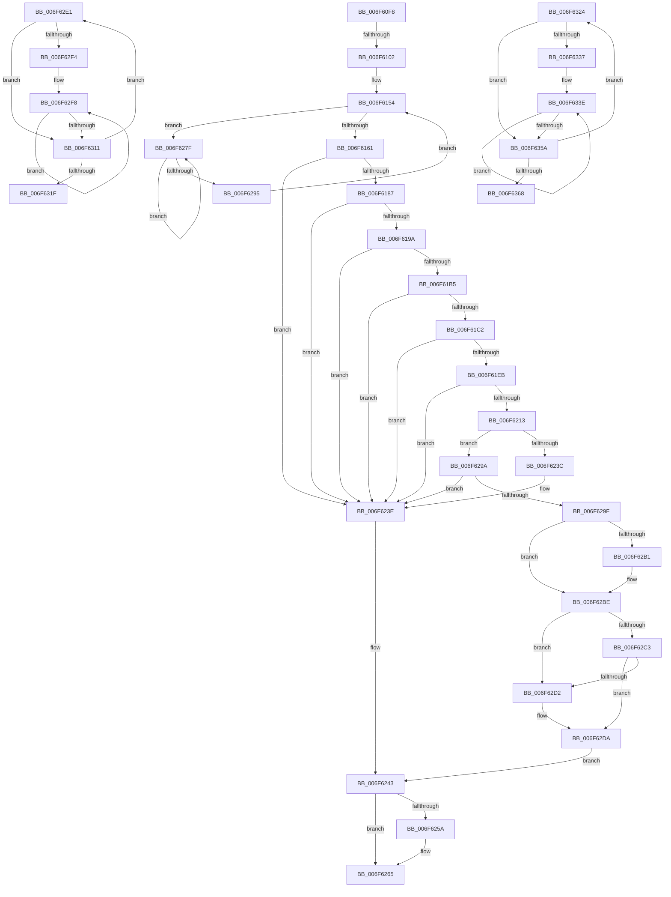

# sub_006F60F8

- RVA: `0x006F60F8`–`0x006F636D` (길이 `629` bytes)
- VA: `0x00000001406F60F8`
- 실행 섹션: `.text`
- PDB 이름 있음: `아니요`; PDB Function 태그: `아니요`
- unwind 정보 RVA: `0x000B0BF0`
- 디코드: `167`개 명령, `629/629` bytes 표시
- 미해석 바이트: `0` (있으면 어셈블리에 `.byte`로 보존)

> 이 문서는 커널 이미지의 기계어와 PDB 기호를 분석해 생성했습니다. 4번과 5번은 함수 원형과 자료형을 바이너리 사용 방식에서 추정한 C 해석이며 원본 소스 복구 결과는 아닙니다.

## 1. Dependencies

- 직접 호출 지점: **16**; 고유 호출 대상: **13**
- 직접 호출자로 확인된 함수: **0**
- RIP 상대 이미지 참조: **2**

### Outgoing calls
- `0x006F6148` → [MiLockWorkingSetSharedAtDpc](../23/MiLockWorkingSetSharedAtDpc_function_00239574.md) (function, `0x00239574`)
- `0x006F618D` → [MiCanStealKernelStack](../29/MiCanStealKernelStack_function_0029FD2C.md) (function, `0x0029FD2C`)
- `0x006F61A6` → [MiGetPfnKernelStack](../44/MiGetPfnKernelStack_function_0044EFB8.md) (function, `0x0044EFB8`)
- `0x006F61B8` → [MiGetPfnKernelStack](../44/MiGetPfnKernelStack_function_0044EFB8.md) (function, `0x0044EFB8`)
- `0x006F61C5` → [MiGetPfnSlabType](../28/MiGetPfnSlabType_function_0028E2D0.md) (function, `0x0028E2D0`)
- `0x006F61D0` → [MiGetPfnSlabType](../28/MiGetPfnSlabType_function_0028E2D0.md) (function, `0x0028E2D0`)
- `0x006F61E2` → [MiCheckSameSlabType](../29/MiCheckSameSlabType_function_0029FC90.md) (function, `0x0029FC90`)
- `0x006F6233` → [MiTryLockPageTableUnordered](../2A/MiTryLockPageTableUnordered_function_002AD9D4.md) (function, `0x002AD9D4`)
- `0x006F6260` → [MiUnlockPageTable](../21/MiUnlockPageTable_function_00216EC0.md) (function, `0x00216EC0`)
- `0x006F626A` → [MiUnlockWorkingSetShared](../27/MiUnlockWorkingSetShared_function_0027D690.md) (function, `0x0027D690`)
- `0x006F6287` → [KeYieldProcessorEx](../3F/KeYieldProcessorEx_function_003FBD00.md) (function, `0x003FBD00`)
- `0x006F62B4` → [MiRemoveLockedPageChargeAndDecRef](../24/MiRemoveLockedPageChargeAndDecRef_function_002459D0.md) (function, `0x002459D0`)
- `0x006F62C9` → [MiSwapStackPageNoDpc](../2A/MiSwapStackPageNoDpc_function_002A0270.md) (function, `0x002A0270`)
- `0x006F62D5` → [MiStackTheftFreezeProcessors](../67/MiStackTheftFreezeProcessors_function_0067B274.md) (function, `0x0067B274`)
- `0x006F6306` → [KiHaltOnAddress](../4F/KiHaltOnAddress_function_004FBA3C.md) (function, `0x004FBA3C`)
- `0x006F634F` → [KiHaltOnAddress](../4F/KiHaltOnAddress_function_004FBA3C.md) (function, `0x004FBA3C`)

### Direct callers
- 이 함수 시작 RVA로 연결되는 직접 call은 확인되지 않았습니다. 간접 호출은 완전히 역산할 수 없습니다.

### Static image references
- `0x006F6165` → RVA `0x00E30088` (`.data`; read)
- `0x006F629F` → RVA `0x00E2DBC9` (`.data`; read)

## 2. Other-region calls and transfers

- 다른 실행 섹션으로 향하는 call: **0**
- call이 아닌 외부 분기/꼬리 이동: **4**
  - `0x006F60FC` → [MiJumpStackTarget + 0x70](../48/MiJumpStackTarget_function_0048BC10.md) (`tail-transfer`)
  - `0x006F627A` → [MiJumpStackTarget + 0x70](../48/MiJumpStackTarget_function_0048BC10.md) (`tail-transfer`)
  - `0x006F631F` → [MiJumpStackTarget + 0x61](../48/MiJumpStackTarget_function_0048BC10.md) (`tail-transfer`)
  - `0x006F6368` → [MiJumpStackTarget + 0xCE](../48/MiJumpStackTarget_function_0048BC10.md) (`tail-transfer`)

## 3. Assembly (complete function range)

```asm
006F60F8  83 7E 20 00                     cmp dword ptr [rsi + 0x20], 0
006F60FC  0F 85 7E 5B D9 FF               jne 0x14048bc80
006F6102  48 8B 06                        mov rax, qword ptr [rsi]
006F6105  48 B9 00 00 00 00 00 DE FF FF   movabs rcx, 0xffffde0000000000
006F610F  48 8D 1C 40                     lea rbx, [rax + rax*2]
006F6113  48 C1 E3 04                     shl rbx, 4
006F6117  48 8B C1                        mov rax, rcx
006F611A  48 03 D8                        add rbx, rax
006F611D  48 8B 46 08                     mov rax, qword ptr [rsi + 8]
006F6121  4C 8D 3C 40                     lea r15, [rax + rax*2]
006F6125  49 C1 E7 04                     shl r15, 4
006F6129  48 8B C1                        mov rax, rcx
006F612C  4C 8B 66 38                     mov r12, qword ptr [rsi + 0x38]
006F6130  4C 03 F8                        add r15, rax
006F6133  48 8B 46 30                     mov rax, qword ptr [rsi + 0x30]
006F6137  49 8B CC                        mov rcx, r12
006F613A  48 F7 D8                        neg rax
006F613D  66 1B ED                        sbb bp, bp
006F6140  33 FF                           xor edi, edi
006F6142  66 F7 DD                        neg bp
006F6145  66 03 EA                        add bp, dx
006F6148  E8 27 34 B4 FF                  call 0x140239574
006F614D  21 BC 24 88 00 00 00            and dword ptr [rsp + 0x88], edi
006F6154  F0 48 0F BA 6B 18 3F            lock bts qword ptr [rbx + 0x18], 0x3f
006F615B  0F 82 1E 01 00 00               jb 0x1406f627f
006F6161  48 8B 43 28                     mov rax, qword ptr [rbx + 0x28]
006F6165  48 8B 0D 1C 9F 73 00            mov rcx, qword ptr [rip + 0x739f1c]
006F616C  48 8B 56 18                     mov rdx, qword ptr [rsi + 0x18]
006F6170  4C 8B 76 28                     mov r14, qword ptr [rsi + 0x28]
006F6174  48 C1 E8 2B                     shr rax, 0x2b
006F6178  25 FF 03 00 00                  and eax, 0x3ff
006F617D  48 39 14 C1                     cmp qword ptr [rcx + rax*8], rdx
006F6181  0F 85 B7 00 00 00               jne 0x1406f623e
006F6187  0F B7 D5                        movzx edx, bp
006F618A  48 8B CB                        mov rcx, rbx
006F618D  E8 9A 9B BA FF                  call 0x14029fd2c
006F6192  85 C0                           test eax, eax
006F6194  0F 84 A4 00 00 00               je 0x1406f623e
006F619A  41 BA 01 00 00 00               mov r10d, 1
006F61A0  48 8B CB                        mov rcx, rbx
006F61A3  41 8B D2                        mov edx, r10d
006F61A6  E8 0D 8E D5 FF                  call 0x14044efb8
006F61AB  48 83 F8 E0                     cmp rax, -0x20
006F61AF  0F 84 89 00 00 00               je 0x1406f623e
006F61B5  48 8B CB                        mov rcx, rbx
006F61B8  E8 FB 8D D5 FF                  call 0x14044efb8
006F61BD  48 85 C0                        test rax, rax
006F61C0  74 7C                           je 0x1406f623e
006F61C2  49 8B CF                        mov rcx, r15
006F61C5  E8 06 81 B9 FF                  call 0x14028e2d0
006F61CA  48 8B CB                        mov rcx, rbx
006F61CD  44 8B C8                        mov r9d, eax
006F61D0  E8 FB 80 B9 FF                  call 0x14028e2d0
006F61D5  8B D0                           mov edx, eax
006F61D7  44 89 54 24 20                  mov dword ptr [rsp + 0x20], r10d
006F61DC  48 8B CB                        mov rcx, rbx
006F61DF  4D 8B C7                        mov r8, r15
006F61E2  E8 A9 9A BA FF                  call 0x14029fc90
006F61E7  85 C0                           test eax, eax
006F61E9  74 53                           je 0x1406f623e
006F61EB  48 8B 53 08                     mov rdx, qword ptr [rbx + 8]
006F61EF  48 8B CA                        mov rcx, rdx
006F61F2  49 B8 00 00 00 00 80 F6 FF FF   movabs r8, 0xfffff68000000000
006F61FC  48 C1 E1 19                     shl rcx, 0x19
006F6200  49 8B C0                        mov rax, r8
006F6203  48 C1 E0 19                     shl rax, 0x19
006F6207  48 2B C8                        sub rcx, rax
006F620A  48 C1 F9 10                     sar rcx, 0x10
006F620E  4C 3B F1                        cmp r14, rcx
006F6211  75 2B                           jne 0x1406f623e
006F6213  48 8B FA                        mov rdi, rdx
006F6216  48 B8 F8 FF FF FF 7F 00 00 00   movabs rax, 0x7ffffffff8
006F6220  48 C1 EF 09                     shr rdi, 9
006F6224  48 23 F8                        and rdi, rax
006F6227  49 8B C0                        mov rax, r8
006F622A  48 03 F8                        add rdi, rax
006F622D  49 8B CC                        mov rcx, r12
006F6230  48 8B D7                        mov rdx, rdi
006F6233  E8 9C 77 BB FF                  call 0x1402ad9d4
006F6238  85 C0                           test eax, eax
006F623A  75 5E                           jne 0x1406f629a
006F623C  33 FF                           xor edi, edi
006F623E  B8 34 04 00 C0                  mov eax, 0xc0000434
006F6243  89 46 20                        mov dword ptr [rsi + 0x20], eax
006F6246  48 B8 FF FF FF FF FF FF FF 7F   movabs rax, 0x7fffffffffffffff
006F6250  F0 48 21 43 18                  lock and qword ptr [rbx + 0x18], rax
006F6255  48 85 FF                        test rdi, rdi
006F6258  74 0B                           je 0x1406f6265
006F625A  48 8B D7                        mov rdx, rdi
006F625D  49 8B CC                        mov rcx, r12
006F6260  E8 5B 0C B2 FF                  call 0x140216ec0
006F6265  B2 11                           mov dl, 0x11
006F6267  49 8B CC                        mov rcx, r12
006F626A  E8 21 74 B8 FF                  call 0x14027d690
006F626F  4C 8B 7C 24 70                  mov r15, qword ptr [rsp + 0x70]
006F6274  41 BC 00 00 00 80               mov r12d, 0x80000000
006F627A  E9 01 5A D9 FF                  jmp 0x14048bc80
006F627F  48 8D 8C 24 88 00 00 00         lea rcx, [rsp + 0x88]
006F6287  E8 74 5A D0 FF                  call 0x1403fbd00
006F628C  48 8B 43 18                     mov rax, qword ptr [rbx + 0x18]
006F6290  48 85 C0                        test rax, rax
006F6293  78 EA                           js 0x1406f627f
006F6295  E9 BA FE FF FF                  jmp 0x1406f6154
006F629A  48 85 FF                        test rdi, rdi
006F629D  74 9F                           je 0x1406f623e
006F629F  40 8A 2D 23 79 73 00            mov bpl, byte ptr [rip + 0x737923]
006F62A6  40 80 E5 01                     and bpl, 1
006F62AA  48 83 7E 30 00                  cmp qword ptr [rsi + 0x30], 0
006F62AF  74 0D                           je 0x1406f62be
006F62B1  48 8B CB                        mov rcx, rbx
006F62B4  E8 17 F7 B4 FF                  call 0x1402459d0
006F62B9  48 83 66 30 00                  and qword ptr [rsi + 0x30], 0
006F62BE  40 84 ED                        test bpl, bpl
006F62C1  74 0F                           je 0x1406f62d2
006F62C3  49 8B D7                        mov rdx, r15
006F62C6  48 8B CB                        mov rcx, rbx
006F62C9  E8 A2 9F BA FF                  call 0x1402a0270
006F62CE  85 C0                           test eax, eax
006F62D0  75 08                           jne 0x1406f62da
006F62D2  48 8B CE                        mov rcx, rsi
006F62D5  E8 9A 4F F8 FF                  call 0x14067b274
006F62DA  33 C0                           xor eax, eax
006F62DC  E9 62 FF FF FF                  jmp 0x1406f6243
006F62E1  0F BA E9 1E                     bts ecx, 0x1e
006F62E5  8B C2                           mov eax, edx
006F62E7  8B E9                           mov ebp, ecx
006F62E9  F0 0F B1 2F                     lock cmpxchg dword ptr [rdi], ebp
006F62ED  8B C8                           mov ecx, eax
006F62EF  41 3B C0                        cmp eax, r8d
006F62F2  75 1D                           jne 0x1406f6311
006F62F4  89 6C 24 78                     mov dword ptr [rsp + 0x78], ebp
006F62F8  41 B8 04 00 00 00               mov r8d, 4
006F62FE  48 8D 54 24 78                  lea rdx, [rsp + 0x78]
006F6303  48 8B CF                        mov rcx, rdi
006F6306  E8 31 57 E0 FF                  call 0x1404fba3c
006F630B  8B 0F                           mov ecx, dword ptr [rdi]
006F630D  3B CD                           cmp ecx, ebp
006F630F  74 E7                           je 0x1406f62f8
006F6311  8B C1                           mov eax, ecx
006F6313  8B D1                           mov edx, ecx
006F6315  41 23 C4                        and eax, r12d
006F6318  44 8B C1                        mov r8d, ecx
006F631B  3B C3                           cmp eax, ebx
006F631D  75 C2                           jne 0x1406f62e1
006F631F  E9 4D 59 D9 FF                  jmp 0x14048bc71
006F6324  0F BA E9 1E                     bts ecx, 0x1e
006F6328  8B C2                           mov eax, edx
006F632A  8B E9                           mov ebp, ecx
006F632C  F0 0F B1 2F                     lock cmpxchg dword ptr [rdi], ebp
006F6330  8B C8                           mov ecx, eax
006F6332  41 3B C0                        cmp eax, r8d
006F6335  75 23                           jne 0x1406f635a
006F6337  89 AC 24 80 00 00 00            mov dword ptr [rsp + 0x80], ebp
006F633E  41 B8 04 00 00 00               mov r8d, 4
006F6344  48 8D 94 24 80 00 00 00         lea rdx, [rsp + 0x80]
006F634C  48 8B CF                        mov rcx, rdi
006F634F  E8 E8 56 E0 FF                  call 0x1404fba3c
006F6354  8B 0F                           mov ecx, dword ptr [rdi]
006F6356  3B CD                           cmp ecx, ebp
006F6358  74 E4                           je 0x1406f633e
006F635A  8B C1                           mov eax, ecx
006F635C  8B D1                           mov edx, ecx
006F635E  41 23 C4                        and eax, r12d
006F6361  44 8B C1                        mov r8d, ecx
006F6364  3B C3                           cmp eax, ebx
006F6366  75 BC                           jne 0x1406f6324
006F6368  E9 71 59 D9 FF                  jmp 0x14048bcde
```

## 4. C-style interpretation (structured pseudocode)

```c
__int64 __fastcall sub_006F60F8(__int64 a1, unsigned __int16 a2, __int64 a3, __int64 a4, __int64 a5, __int64 a6, __int64 a7, __int64 a8, __int64 a9, __int64 a10, __int64 a11, __int64 a12, __int64 a13, __int64 a14, __int64 a15, __int64 a16, unsigned int a17)
{
    __int64 result;
    __int64 v_r15;
    __int64 v_rbp;
    __int64 v_rbx;
    __int64 v_rdi;
    unsigned int v_stack_p20;
    unsigned int v_stack_p78;
    unsigned int v_stack_p80;

    v_rbx = (*(unsigned __int64 *)(v_rsi) + *(unsigned __int64 *)(v_rsi) * 2) << (4);
    v_rbx = (v_rbx) + (a1);
    v_r15 = (*(unsigned __int64 *)(v_rsi + 8) + *(unsigned __int64 *)(v_rsi + 8) * 2) << (4);
    v_r15 = (v_r15) + (a1);
    result = -(*(unsigned __int64 *)(v_rsi + 48));
    v_rdi = 0;
    v_rbp = (unsigned __int16)(-(v_rbp));
    v_rbp = (unsigned __int16)((v_rbp) + (a2));
    result = MiLockWorkingSetSharedAtDpc(*(unsigned __int64 *)(v_rsi + 56), a2, a3, a4);
loc_006F6154:
    if (condition_is_below) goto loc_006F627F;
    result = (*(unsigned __int64 *)(v_rbx + 40)) >> (43);
    result = (unsigned int)((result) & (0x3FFULL));
    if ((*(unsigned __int64 *)(*(unsigned __int64 *)(v_rip + 7577372) + result * 8)) != (*(unsigned __int64 *)(v_rsi + 24))) goto loc_006F623E;
    result = MiCanStealKernelStack(v_rbx, (unsigned __int16)(v_rbp), a3, a4);
    if ((unsigned int)(result) == 0) goto loc_006F623E;
    result = MiGetPfnKernelStack(v_rbx, 1, a3, a4);
    if (result == -32) goto loc_006F623E;
    result = MiGetPfnKernelStack(v_rbx, 1, a3, a4);
    if (result == 0) goto loc_006F623E;
    result = MiGetPfnSlabType(v_r15, 1, a3, a4);
    result = MiGetPfnSlabType(v_rbx, 1, a3, (unsigned int)((unsigned int)(result)));
    v_stack_p20 = 1;
    result = MiCheckSameSlabType(v_rbx, (unsigned int)((unsigned int)(result)), v_r15, (unsigned int)((unsigned int)(result)));
    if ((unsigned int)(result) == 0) goto loc_006F623E;
    a1 = (*(unsigned __int64 *)(v_rbx + 8)) << (25);
    result = (v_r15) << (25);
    a1 = (a1) - (result);
    a1 = (a1) >> (16);
    if ((*(unsigned __int64 *)(v_rsi + 40)) != a1) goto loc_006F623E;
    v_rdi = (*(unsigned __int64 *)(v_rbx + 8)) >> (9);
    v_rdi = (v_rdi) & (result);
    v_rdi = (v_rdi) + (v_r15);
    result = MiTryLockPageTableUnordered(*(unsigned __int64 *)(v_rsi + 56), v_rdi, v_r15, (unsigned int)((unsigned int)(result)));
    if ((unsigned int)(result) != 0) goto loc_006F629A;
    v_rdi = 0;
loc_006F623E:
loc_006F6243:
    *(unsigned int *)(v_rsi + 32) = (unsigned int)((unsigned int)(0xC0000434ULL));
    result = (unsigned int)(0xC0000434ULL);
    if (0 != 0) {
        a2 = 0;
        a1 = *(unsigned __int64 *)(v_rsi + 56);
        result = MiUnlockPageTable(a1, a2, v_r15, (unsigned int)((unsigned int)(result)));
    }
    result = MiUnlockWorkingSetShared(*(unsigned __int64 *)(v_rsi + 56), 17, v_r15, (unsigned int)((unsigned int)(result)));
loc_006F627F:
    result = KeYieldProcessorEx(a17, 17, v_r15, (unsigned int)((unsigned int)(result)));
    if (sign_flag) goto loc_006F627F;
    goto loc_006F6154;
loc_006F629A:
    if (0 == 0) goto loc_006F623E;
    v_rbp = (unsigned __int8)((*(unsigned __int8 *)(v_rip + 7567651)) & (1));
    result = *(unsigned __int64 *)(v_rbx + 24);
    if ((*(unsigned __int64 *)(v_rsi + 48)) != 0) {
        a1 = v_rbx;
        result = MiRemoveLockedPageChargeAndDecRef(a1, 17, v_r15, (unsigned int)((unsigned int)(result)));
    }
    if ((unsigned __int8)(v_rbp) == 0) goto loc_006F62D2;
    result = MiSwapStackPageNoDpc(v_rbx, a14, v_r15, (unsigned int)((unsigned int)(result)));
    if ((unsigned int)(result) == 0) {
        a1 = v_rsi;
        result = MiStackTheftFreezeProcessors(a1, a14, v_r15, (unsigned int)((unsigned int)(result)));
    }
    result = 0;
    goto loc_006F6243;
}
```

## 5. (Beta) C Style

```c
int64_t sub_006F60F8(int64_t Arg1, uint16_t Arg2, int64_t Arg3, int64_t Arg4, uint64_t Arg5, uint64_t Arg6, uint64_t Arg7, uint64_t Arg8, uint64_t Arg9, uint64_t Arg10, uint64_t Arg11, uint64_t Arg12, uint64_t Arg13, int64_t Arg14, uint64_t Arg15, uint64_t Arg16, uint32_t Arg17)
{
    int64_t result;
    int64_t local_r15;
    int64_t local_rbp;
    int64_t local_rbx;
    int64_t local_rdi;
    uint32_t v_stack_p20;
    uint32_t v_stack_p78;
    uint32_t v_stack_p80;

    local_rbx = (*(uint64_t *)(local_rsi) + *(uint64_t *)(local_rsi) * 2) << (4);
    local_rbx = (local_rbx) + (Arg1);
    local_r15 = (*(uint64_t *)(local_rsi + 0x8) + *(uint64_t *)(local_rsi + 0x8) * 2) << (4);
    local_r15 = (local_r15) + (Arg1);
    result = -(*(uint64_t *)(local_rsi + 0x30));
    local_rdi = 0;
    local_rbp = (uint16_t)(-(local_rbp));
    local_rbp = (uint16_t)((local_rbp) + (Arg2));
    result = MiLockWorkingSetSharedAtDpc(*(uint64_t *)(local_rsi + 0x38), Arg2, Arg3, Arg4);
loc_006F6154:
    if (condition_is_below) goto loc_006F627F;
    result = (*(uint64_t *)(local_rbx + 0x28)) >> (43);
    result = (uint32_t)((result) & (0x3FFULL));
    if ((*(uint64_t *)(*(uint64_t *)(v_rip + 0x739F1C) + result * 8)) != (*(uint64_t *)(local_rsi + 0x18))) goto loc_006F623E;
    result = MiCanStealKernelStack(local_rbx, (uint16_t)(local_rbp), Arg3, Arg4);
    if ((uint32_t)(result) == 0) goto loc_006F623E;
    result = MiGetPfnKernelStack(local_rbx, 1, Arg3, Arg4);
    if (result == -32) goto loc_006F623E;
    result = MiGetPfnKernelStack(local_rbx, 1, Arg3, Arg4);
    if (result == 0) goto loc_006F623E;
    result = MiGetPfnSlabType(local_r15, 1, Arg3, Arg4);
    result = MiGetPfnSlabType(local_rbx, 1, Arg3, (uint32_t)((uint32_t)(result)));
    v_stack_p20 = 1;
    result = MiCheckSameSlabType(local_rbx, (uint32_t)((uint32_t)(result)), local_r15, (uint32_t)((uint32_t)(result)));
    if ((uint32_t)(result) == 0) goto loc_006F623E;
    Arg1 = (*(uint64_t *)(local_rbx + 0x8)) << (25);
    result = (local_r15) << (25);
    Arg1 = (Arg1) - (result);
    Arg1 = (Arg1) >> (16);
    if ((*(uint64_t *)(local_rsi + 0x28)) != Arg1) goto loc_006F623E;
    local_rdi = (*(uint64_t *)(local_rbx + 0x8)) >> (9);
    local_rdi = (local_rdi) & (result);
    local_rdi = (local_rdi) + (local_r15);
    result = MiTryLockPageTableUnordered(*(uint64_t *)(local_rsi + 0x38), local_rdi, local_r15, (uint32_t)((uint32_t)(result)));
    if ((uint32_t)(result) != 0) goto loc_006F629A;
    local_rdi = 0;
loc_006F623E:
loc_006F6243:
    *(uint32_t *)(local_rsi + 0x20) = (uint32_t)((uint32_t)(0xC0000434ULL));
    result = (uint32_t)(0xC0000434ULL);
    if (0 != 0) {
        Arg2 = 0;
        Arg1 = *(uint64_t *)(local_rsi + 0x38);
        result = MiUnlockPageTable(Arg1, Arg2, local_r15, (uint32_t)((uint32_t)(result)));
    }
    result = MiUnlockWorkingSetShared(*(uint64_t *)(local_rsi + 0x38), 17, local_r15, (uint32_t)((uint32_t)(result)));
loc_006F627F:
    result = KeYieldProcessorEx(Arg17, 17, local_r15, (uint32_t)((uint32_t)(result)));
    if (sign_flag) goto loc_006F627F;
    goto loc_006F6154;
loc_006F629A:
    if (0 == 0) goto loc_006F623E;
    local_rbp = (uint8_t)((*(uint8_t *)(v_rip + 0x737923)) & (1));
    result = *(uint64_t *)(local_rbx + 0x18);
    if ((*(uint64_t *)(local_rsi + 0x30)) != 0) {
        Arg1 = local_rbx;
        result = MiRemoveLockedPageChargeAndDecRef(Arg1, 17, local_r15, (uint32_t)((uint32_t)(result)));
    }
    if ((uint8_t)(local_rbp) == 0) goto loc_006F62D2;
    result = MiSwapStackPageNoDpc(local_rbx, Arg14, local_r15, (uint32_t)((uint32_t)(result)));
    if ((uint32_t)(result) == 0) {
        Arg1 = local_rsi;
        result = MiStackTheftFreezeProcessors(Arg1, Arg14, local_r15, (uint32_t)((uint32_t)(result)));
    }
    result = 0;
    goto loc_006F6243;
}
```

## 6. Execution-region graph

[열기: 2D/3D 그래프와 함수 탐색 컨트롤 패널](../../../control-panel.html?section=text&rva=0x006F60F8&view=graph)

- 2D 그래프는 위에서 아래로 흐르고, 3D 그래프는 빈 공간을 드래그해 회전합니다. Shift+드래그는 이동, 휠은 확대·축소, 함수 노드 선택은 대상 보고서 이동입니다.

### Static fallback


