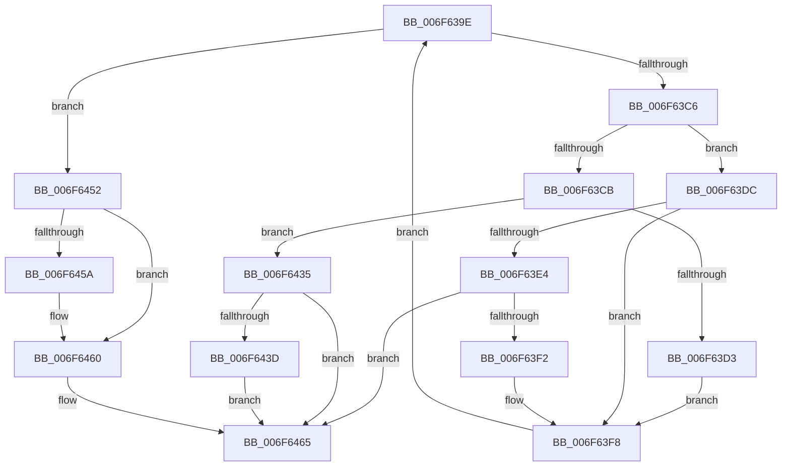

# sub_006F639E

- RVA: `0x006F639E`–`0x006F647B` (길이 `221` bytes)
- VA: `0x00000001406F639E`
- 실행 섹션: `.text`
- PDB 이름 있음: `아니요`; PDB Function 태그: `아니요`
- unwind 정보 RVA: `0x000B0CD4`
- 디코드: `48`개 명령, `221/221` bytes 표시
- 미해석 바이트: `0` (있으면 어셈블리에 `.byte`로 보존)

> 이 문서는 커널 이미지의 기계어와 PDB 기호를 분석해 생성했습니다. 4번과 5번은 함수 원형과 자료형을 바이너리 사용 방식에서 추정한 C 해석이며 원본 소스 복구 결과는 아닙니다.

## 1. Dependencies

- 직접 호출 지점: **6**; 고유 호출 대상: **5**
- 직접 호출자로 확인된 함수: **0**
- RIP 상대 이미지 참조: **9**

### Outgoing calls
- `0x006F63A5` → [ExAcquireSpinLockExclusive](../24/ExAcquireSpinLockExclusive_function_00248690.md) (function, `0x00248690`)
- `0x006F63B9` → [MiSufficientAvailablePages](../36/MiSufficientAvailablePages_function_0036D0B0.md) (function, `0x0036D0B0`)
- `0x006F63FF` → [KeResetEvent](../24/KeResetEvent_function_00248350.md) (function, `0x00248350`)
- `0x006F640E` → [MiReleaseSpinLockExclusive](../24/MiReleaseSpinLockExclusive_function_002482C0.md) (function, `0x002482C0`)
- `0x006F6429` → [KeWaitForSingleObject](../20/KeWaitForSingleObject_function_0020E6B0.md) (function, `0x0020E6B0`)
- `0x006F646F` → [MiReleaseSpinLockExclusive](../24/MiReleaseSpinLockExclusive_function_002482C0.md) (function, `0x002482C0`)

### Direct callers
- 이 함수 시작 RVA로 연결되는 직접 call은 확인되지 않았습니다. 간접 호출은 완전히 역산할 수 없습니다.

### Static image references
- `0x006F639E` → RVA `0x00E3CC40` (`.data`; read)
- `0x006F63AF` → RVA `0x00E38D00` (`.data`; read)
- `0x006F63D3` → RVA `0x000134D0` (`.rdata`; read)
- `0x006F63DC` → RVA `0x00E2CB5C` (`.data`; read)
- `0x006F63E4` → RVA `0x00E3CC80` (`.data`; read)
- `0x006F63EA` → RVA `0x00E2CB58` (`.data`; read)
- `0x006F63F2` → RVA `0x00E2CB5C` (`.data`; write)
- `0x006F63F8` → RVA `0x00E3CC68` (`.data`; read)
- `0x006F6443` → RVA `0x00E2CB58` (`.data`; write)

## 2. Other-region calls and transfers

- 다른 실행 섹션으로 향하는 call: **0**
- call이 아닌 외부 분기/꼬리 이동: **1**
  - `0x006F6476` → [MiRetryNonPagedAllocation + 0x20](../48/MiRetryNonPagedAllocation_function_0048C100.md) (`tail-transfer`)

## 3. Assembly (complete function range)

```asm
006F639E  48 8D 0D 9B 68 74 00            lea rcx, [rip + 0x74689b]
006F63A5  E8 E6 22 B5 FF                  call 0x140248690
006F63AA  BA A0 00 00 00                  mov edx, 0xa0
006F63AF  48 8D 0D 4A 29 74 00            lea rcx, [rip + 0x74294a]
006F63B6  40 8A E8                        mov bpl, al
006F63B9  E8 F2 6C C7 FF                  call 0x14036d0b0
006F63BE  85 C0                           test eax, eax
006F63C0  0F 85 8C 00 00 00               jne 0x1406f6452
006F63C6  83 FF 01                        cmp edi, 1
006F63C9  74 11                           je 0x1406f63dc
006F63CB  81 FF 02 01 00 00               cmp edi, 0x102
006F63D1  74 62                           je 0x1406f6435
006F63D3  48 8D 35 F6 D0 91 FF            lea rsi, [rip - 0x6e2f0a]
006F63DA  EB 1C                           jmp 0x1406f63f8
006F63DC  38 1D 7A 67 73 00               cmp byte ptr [rip + 0x73677a], bl
006F63E2  74 14                           je 0x1406f63f8
006F63E4  8B 05 96 68 74 00               mov eax, dword ptr [rip + 0x746896]
006F63EA  39 05 68 67 73 00               cmp dword ptr [rip + 0x736768], eax
006F63F0  74 73                           je 0x1406f6465
006F63F2  88 1D 64 67 73 00               mov byte ptr [rip + 0x736764], bl
006F63F8  48 8D 0D 69 68 74 00            lea rcx, [rip + 0x746869]
006F63FF  E8 4C 1F B5 FF                  call 0x140248350
006F6404  40 8A D5                        mov dl, bpl
006F6407  48 8D 0D 32 68 74 00            lea rcx, [rip + 0x746832]
006F640E  E8 AD 1E B5 FF                  call 0x1402482c0
006F6413  45 33 C9                        xor r9d, r9d
006F6416  48 89 74 24 20                  mov qword ptr [rsp + 0x20], rsi
006F641B  45 33 C0                        xor r8d, r8d
006F641E  48 8D 0D 43 68 74 00            lea rcx, [rip + 0x746843]
006F6425  41 8D 51 08                     lea edx, [r9 + 8]
006F6429  E8 82 82 B1 FF                  call 0x14020e6b0
006F642E  8B F8                           mov edi, eax
006F6430  E9 69 FF FF FF                  jmp 0x1406f639e
006F6435  38 1D 21 67 73 00               cmp byte ptr [rip + 0x736721], bl
006F643B  75 28                           jne 0x1406f6465
006F643D  8B 05 3D 68 74 00               mov eax, dword ptr [rip + 0x74683d]
006F6443  89 05 0F 67 73 00               mov dword ptr [rip + 0x73670f], eax
006F6449  C6 05 0C 67 73 00 01            mov byte ptr [rip + 0x73670c], 1
006F6450  EB 13                           jmp 0x1406f6465
006F6452  38 1D 04 67 73 00               cmp byte ptr [rip + 0x736704], bl
006F6458  74 06                           je 0x1406f6460
006F645A  88 1D FC 66 73 00               mov byte ptr [rip + 0x7366fc], bl
006F6460  BB 01 00 00 00                  mov ebx, 1
006F6465  40 8A D5                        mov dl, bpl
006F6468  48 8D 0D D1 67 74 00            lea rcx, [rip + 0x7467d1]
006F646F  E8 4C 1E B5 FF                  call 0x1402482c0
006F6474  8B C3                           mov eax, ebx
006F6476  E9 A5 5C D9 FF                  jmp 0x14048c120
```

## 4. C-style interpretation (structured pseudocode)

```c
__int64 __fastcall sub_006F639E(__int64 a1, __int64 a2, int a3, int a4)
{
    __int64 result;
    unsigned __int64 v_stack_p20;

    result = ExAcquireSpinLockExclusive(v_rip + 7628955, a2, a3, a4);
    result = MiSufficientAvailablePages(v_rip + 7612746, 160, a3, a4);
    if ((unsigned int)(result) != 0) goto loc_006F6452;
    if (((unsigned int)(v_rdi)) == 1) goto loc_006F63DC;
    if (((unsigned int)(v_rdi)) == 258) goto loc_006F6435;
    goto loc_006F63F8;
loc_006F63DC:
    if ((*(unsigned __int8 *)(v_rip + 7563130)) == ((unsigned __int8)(v_rbx))) goto loc_006F63F8;
    if ((*(unsigned int *)(v_rip + 7563112)) == ((unsigned int)((unsigned int)(*(unsigned int *)(v_rip + 7628950))))) goto loc_006F6465;
    *(unsigned __int8 *)(v_rip + 7563108) = (unsigned __int8)(v_rbx);
loc_006F63F8:
    result = KeResetEvent(v_rip + 7628905, 160, a3, a4);
    result = MiReleaseSpinLockExclusive(v_rip + 7628850, (unsigned __int8)((unsigned __int8)(result)), a3, a4);
    a4 = 0;
    v_stack_p20 = v_rip - 7221002;
    a3 = 0;
    result = KeWaitForSingleObject(v_rip + 7628867, a4 + 8, a3, a4);
    goto loc_006F639E;
loc_006F6435:
    if ((*(unsigned __int8 *)(v_rip + 7563041)) != ((unsigned __int8)(v_rbx))) goto loc_006F6465;
    *(unsigned int *)(v_rip + 7563023) = (unsigned int)((unsigned int)(*(unsigned int *)(v_rip + 7628861)));
    *(unsigned __int8 *)(v_rip + 7563020) = 1;
    goto loc_006F6465;
loc_006F6452:
    if ((*(unsigned __int8 *)(v_rip + 7563012)) != ((unsigned __int8)(v_rbx))) {
        *(unsigned __int8 *)(v_rip + 7563004) = (unsigned __int8)(v_rbx);
    }
loc_006F6465:
    result = MiReleaseSpinLockExclusive(v_rip + 7628753, (unsigned __int8)((unsigned __int8)(result)), a3, a4);
}
```

## 5. (Beta) C Style

```c
int64_t sub_006F639E(int64_t Arg1, int64_t Arg2, int32_t Arg3, int32_t Arg4)
{
    int64_t result;
    uint64_t v_stack_p20;

    result = ExAcquireSpinLockExclusive(v_rip + 7628955, Arg2, Arg3, Arg4);
    result = MiSufficientAvailablePages(v_rip + 7612746, 160, Arg3, Arg4);
    if ((uint32_t)(result) != 0) goto loc_006F6452;
    if (((uint32_t)(local_rdi)) == 1) goto loc_006F63DC;
    if (((uint32_t)(local_rdi)) == 258) goto loc_006F6435;
    goto loc_006F63F8;
loc_006F63DC:
    if ((*(uint8_t *)(v_rip + 0x73677A)) == ((uint8_t)(local_rbx))) goto loc_006F63F8;
    if ((*(uint32_t *)(v_rip + 0x736768)) == ((uint32_t)((uint32_t)(*(uint32_t *)(v_rip + 0x746896))))) goto loc_006F6465;
    *(uint8_t *)(v_rip + 0x736764) = (uint8_t)(local_rbx);
loc_006F63F8:
    result = KeResetEvent(v_rip + 7628905, 160, Arg3, Arg4);
    result = MiReleaseSpinLockExclusive(v_rip + 7628850, (uint8_t)((uint8_t)(result)), Arg3, Arg4);
    Arg4 = 0;
    v_stack_p20 = v_rip - 7221002;
    Arg3 = 0;
    result = KeWaitForSingleObject(v_rip + 7628867, Arg4 + 8, Arg3, Arg4);
    goto loc_006F639E;
loc_006F6435:
    if ((*(uint8_t *)(v_rip + 0x736721)) != ((uint8_t)(local_rbx))) goto loc_006F6465;
    *(uint32_t *)(v_rip + 0x73670F) = (uint32_t)((uint32_t)(*(uint32_t *)(v_rip + 0x74683D)));
    *(uint8_t *)(v_rip + 0x73670C) = 1;
    goto loc_006F6465;
loc_006F6452:
    if ((*(uint8_t *)(v_rip + 0x736704)) != ((uint8_t)(local_rbx))) {
        *(uint8_t *)(v_rip + 0x7366FC) = (uint8_t)(local_rbx);
    }
loc_006F6465:
    result = MiReleaseSpinLockExclusive(v_rip + 7628753, (uint8_t)((uint8_t)(result)), Arg3, Arg4);
}
```

## 6. Execution-region graph

[열기: 2D/3D 그래프와 함수 탐색 컨트롤 패널](../../../control-panel.html?section=text&rva=0x006F639E&view=graph)

- 2D 그래프는 위에서 아래로 흐르고, 3D 그래프는 빈 공간을 드래그해 회전합니다. Shift+드래그는 이동, 휠은 확대·축소, 함수 노드 선택은 대상 보고서 이동입니다.

### Static fallback


