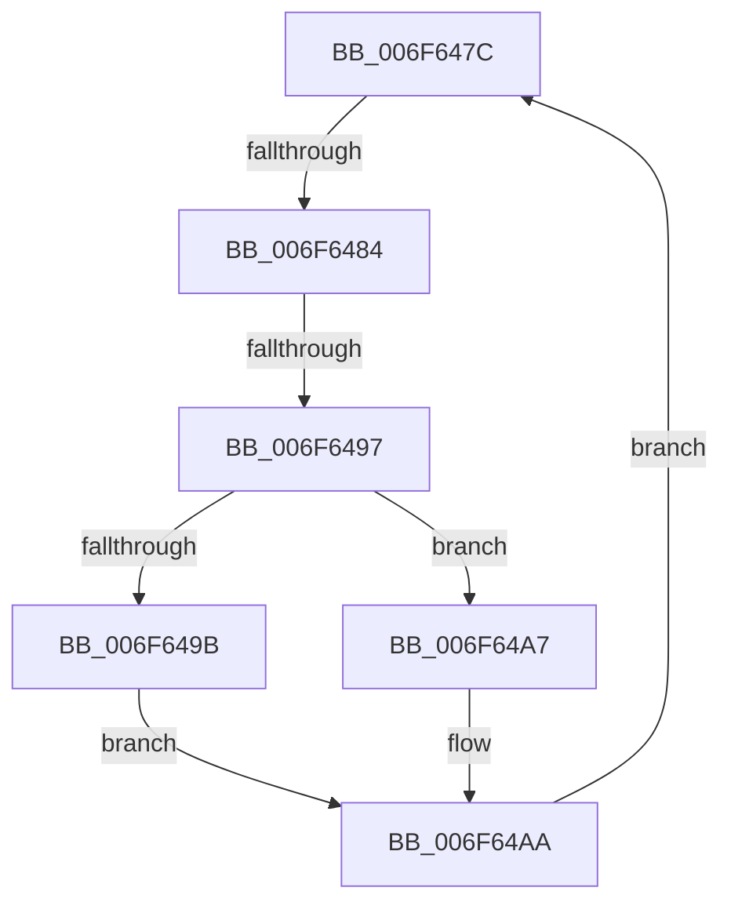

# sub_006F647C

- RVA: `0x006F647C`–`0x006F64BA` (길이 `62` bytes)
- VA: `0x00000001406F647C`
- 실행 섹션: `.text`
- PDB 이름 있음: `아니요`; PDB Function 태그: `아니요`
- unwind 정보 RVA: `0x000B0E7C`
- 디코드: `19`개 명령, `62/62` bytes 표시
- 미해석 바이트: `0` (있으면 어셈블리에 `.byte`로 보존)

> 이 문서는 커널 이미지의 기계어와 PDB 기호를 분석해 생성했습니다. 4번과 5번은 함수 원형과 자료형을 바이너리 사용 방식에서 추정한 C 해석이며 원본 소스 복구 결과는 아닙니다.

## 1. Dependencies

- 직접 호출 지점: **2**; 고유 호출 대상: **2**
- 직접 호출자로 확인된 함수: **0**
- RIP 상대 이미지 참조: **0**

### Outgoing calls
- `0x006F6486` → [RtlpAllocateSecondLevelDir](../48/RtlpAllocateSecondLevelDir_function_0048C520.md) (function, `0x0048C520`)
- `0x006F64AD` → [RtlpInitializeSecondLevelDir](../48/RtlpInitializeSecondLevelDir_function_0048C54C.md) (function, `0x0048C54C`)

### Direct callers
- 이 함수 시작 RVA로 연결되는 직접 call은 확인되지 않았습니다. 간접 호출은 완전히 역산할 수 없습니다.

### Static image references
- 디코드된 RIP-relative 메모리 참조가 없습니다.

## 2. Other-region calls and transfers

- 다른 실행 섹션으로 향하는 call: **0**
- call이 아닌 외부 분기/꼬리 이동: **2**
  - `0x006F647E` → [RtlpCreateHashTable + 0xA7](../48/RtlpCreateHashTable_function_0048C400.md) (`tail-transfer`)
  - `0x006F6491` → [RtlpCreateHashTable + 0xAE](../48/RtlpCreateHashTable_function_0048C400.md) (`tail-transfer`)

## 3. Assembly (complete function range)

```asm
006F647C  3B FE                           cmp edi, esi
006F647E  0F 87 23 60 D9 FF               ja 0x14048c4a7
006F6484  8B CF                           mov ecx, edi
006F6486  E8 95 60 D9 FF                  call 0x14048c520
006F648B  4C 8B C0                        mov r8, rax
006F648E  48 85 C0                        test rax, rax
006F6491  0F 84 17 60 D9 FF               je 0x14048c4ae
006F6497  3B FE                           cmp edi, esi
006F6499  73 0C                           jae 0x1406f64a7
006F649B  8D 4F 07                        lea ecx, [rdi + 7]
006F649E  BA 01 00 00 00                  mov edx, 1
006F64A3  D3 E2                           shl edx, cl
006F64A5  EB 03                           jmp 0x1406f64aa
006F64A7  8D 55 01                        lea edx, [rbp + 1]
006F64AA  49 8B C8                        mov rcx, r8
006F64AD  E8 9A 60 D9 FF                  call 0x14048c54c
006F64B2  4D 89 04 FE                     mov qword ptr [r14 + rdi*8], r8
006F64B6  FF C7                           inc edi
006F64B8  EB C2                           jmp 0x1406f647c
```

## 4. C-style interpretation (structured pseudocode)

```c
__int64 __fastcall sub_006F647C(void)
{
    __int64 result;
    __int64 v_rdi;

    result = RtlpAllocateSecondLevelDir((unsigned int)((unsigned int)(v_rdi)), a2, a3, a4);
    if (((unsigned int)(v_rdi)) >= ((unsigned int)(v_rsi))) goto loc_006F64A7;
    a2 = (unsigned int)((1) << ((unsigned __int8)(v_rdi + 7)));
    goto loc_006F64AA;
loc_006F64A7:
loc_006F64AA:
    result = RtlpInitializeSecondLevelDir(result, v_rbp + 1, result, a4);
    *(unsigned __int64 *)(v_r14 + v_rdi * 8) = result;
    v_rdi = (unsigned int)((v_rdi) + 1);
    goto loc_006F647C;
}
```

## 5. (Beta) C Style

```c
void sub_006F647C(void)
{
    int64_t result;
    int64_t local_rdi;

    result = RtlpAllocateSecondLevelDir((uint32_t)((uint32_t)(local_rdi)), a2, a3, a4);
    if (((uint32_t)(local_rdi)) >= ((uint32_t)(local_rsi))) goto loc_006F64A7;
    a2 = (uint32_t)((1) << ((uint8_t)(local_rdi + 7)));
    goto loc_006F64AA;
loc_006F64A7:
loc_006F64AA:
    result = RtlpInitializeSecondLevelDir(result, local_rbp + 1, result, a4);
    *(uint64_t *)(local_r14 + local_rdi * 8) = result;
    local_rdi = (uint32_t)((local_rdi) + 1);
    goto loc_006F647C;
}
```

## 6. Execution-region graph

[열기: 2D/3D 그래프와 함수 탐색 컨트롤 패널](../../../control-panel.html?section=text&rva=0x006F647C&view=graph)

- 2D 그래프는 위에서 아래로 흐르고, 3D 그래프는 빈 공간을 드래그해 회전합니다. Shift+드래그는 이동, 휠은 확대·축소, 함수 노드 선택은 대상 보고서 이동입니다.

### Static fallback


