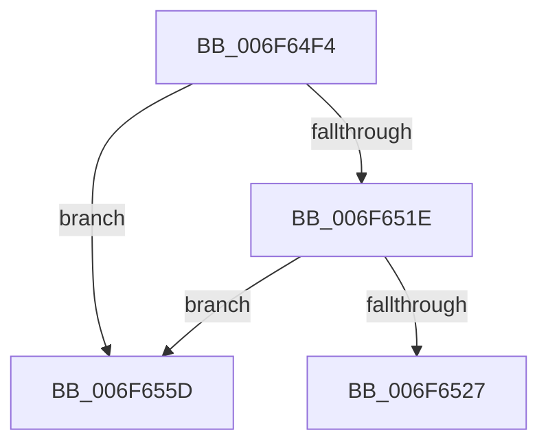

# sub_006F64F4

- RVA: `0x006F64F4`–`0x006F6564` (길이 `112` bytes)
- VA: `0x00000001406F64F4`
- 실행 섹션: `.text`
- PDB 이름 있음: `아니요`; PDB Function 태그: `아니요`
- unwind 정보 RVA: `0x000B126C`
- 디코드: `30`개 명령, `112/112` bytes 표시
- 미해석 바이트: `0` (있으면 어셈블리에 `.byte`로 보존)

> 이 문서는 커널 이미지의 기계어와 PDB 기호를 분석해 생성했습니다. 4번과 5번은 함수 원형과 자료형을 바이너리 사용 방식에서 추정한 C 해석이며 원본 소스 복구 결과는 아닙니다.

## 1. Dependencies

- 직접 호출 지점: **5**; 고유 호출 대상: **5**
- 직접 호출자로 확인된 함수: **0**
- RIP 상대 이미지 참조: **1**

### Outgoing calls
- `0x006F6510` → [ExAcquireSpinLockExclusive](../24/ExAcquireSpinLockExclusive_function_00248690.md) (function, `0x00248690`)
- `0x006F6533` → [MiReleaseSpinLockExclusive](../24/MiReleaseSpinLockExclusive_function_002482C0.md) (function, `0x002482C0`)
- `0x006F653E` → [MiFreeProcessLargePageCache](../69/MiFreeProcessLargePageCache_function_00699204.md) (function, `0x00699204`)
- `0x006F6548` → [MiPruneProcessLargePageCaches](../2D/MiPruneProcessLargePageCaches_function_002DBD60.md) (function, `0x002DBD60`)
- `0x006F6552` → [ExFreePoolWithTag](../../poolcode/B8/ExFreePoolWithTag_function_00B82870.md) (function, `0x00B82870`)

### Direct callers
- 이 함수 시작 RVA로 연결되는 직접 call은 확인되지 않았습니다. 간접 호출은 완전히 역산할 수 없습니다.

### Static image references
- `0x006F64FB` → RVA `0x00E30088` (`.data`; read)

## 2. Other-region calls and transfers

- 다른 실행 섹션으로 향하는 call: **1**
  - `0x006F6552` → [ExFreePoolWithTag](../../poolcode/B8/ExFreePoolWithTag_function_00B82870.md) (`.text` → `POOLCODE`)
- call이 아닌 외부 분기/꼬리 이동: **1**
  - `0x006F6558` → [MiDeleteWorkingSetList + 0x43](../48/MiDeleteWorkingSetList_function_0048C7E8.md) (`tail-transfer`)

## 3. Assembly (complete function range)

```asm
006F64F4  0F B7 89 AE 00 00 00            movzx ecx, word ptr [rcx + 0xae]
006F64FB  48 8B 05 86 9B 73 00            mov rax, qword ptr [rip + 0x739b86]
006F6502  48 8B 2C C8                     mov rbp, qword ptr [rax + rcx*8]
006F6506  4C 8D B5 40 40 00 00            lea r14, [rbp + 0x4040]
006F650D  49 8B CE                        mov rcx, r14
006F6510  E8 7B 21 B5 FF                  call 0x140248690
006F6515  4C 8B 07                        mov r8, qword ptr [rdi]
006F6518  49 39 78 08                     cmp qword ptr [r8 + 8], rdi
006F651C  75 3F                           jne 0x1406f655d
006F651E  48 8B 57 08                     mov rdx, qword ptr [rdi + 8]
006F6522  48 39 3A                        cmp qword ptr [rdx], rdi
006F6525  75 36                           jne 0x1406f655d
006F6527  4C 89 02                        mov qword ptr [rdx], r8
006F652A  49 8B CE                        mov rcx, r14
006F652D  49 89 50 08                     mov qword ptr [r8 + 8], rdx
006F6531  8A D0                           mov dl, al
006F6533  E8 88 1D B5 FF                  call 0x1402482c0
006F6538  48 8B D7                        mov rdx, rdi
006F653B  48 8B CD                        mov rcx, rbp
006F653E  E8 C1 2C FA FF                  call 0x140699204
006F6543  33 D2                           xor edx, edx
006F6545  48 8B CD                        mov rcx, rbp
006F6548  E8 13 58 BE FF                  call 0x1402dbd60
006F654D  33 D2                           xor edx, edx
006F654F  48 8B CF                        mov rcx, rdi
006F6552  E8 19 C3 48 00                  call 0x140b82870
006F6557  90                              nop
006F6558  E9 CE 62 D9 FF                  jmp 0x14048c82b
006F655D  B9 03 00 00 00                  mov ecx, 3
006F6562  CD 29                           int 0x29
```

## 4. C-style interpretation (structured pseudocode)

```c
__int64 __fastcall sub_006F64F4(__int64 a1)
{
    __int64 result;

    result = ExAcquireSpinLockExclusive(*(unsigned __int64 *)(*(unsigned __int64 *)(v_rip + 7576454) + *(unsigned __int16 *)(a1 + 174) * 8) + 16448, a2, a3, a4);
    if ((*(unsigned __int64 *)(*(unsigned __int64 *)(v_rdi) + 8)) != v_rdi) goto loc_006F655D;
    if ((*(unsigned __int64 *)(*(unsigned __int64 *)(v_rdi + 8))) != v_rdi) goto loc_006F655D;
    *(unsigned __int64 *)(*(unsigned __int64 *)(v_rdi + 8)) = *(unsigned __int64 *)(v_rdi);
    *(unsigned __int64 *)(*(unsigned __int64 *)(v_rdi) + 8) = *(unsigned __int64 *)(v_rdi + 8);
    result = MiReleaseSpinLockExclusive(*(unsigned __int64 *)(*(unsigned __int64 *)(v_rip + 7576454) + *(unsigned __int16 *)(a1 + 174) * 8) + 16448, (unsigned __int8)(result), *(unsigned __int64 *)(v_rdi), a4);
    result = MiFreeProcessLargePageCache(*(unsigned __int64 *)(*(unsigned __int64 *)(v_rip + 7576454) + *(unsigned __int16 *)(a1 + 174) * 8), v_rdi, *(unsigned __int64 *)(v_rdi), a4);
    a2 = 0;
    result = MiPruneProcessLargePageCaches(*(unsigned __int64 *)(*(unsigned __int64 *)(v_rip + 7576454) + *(unsigned __int16 *)(a1 + 174) * 8), a2, *(unsigned __int64 *)(v_rdi), a4);
    a2 = 0;
    result = ExFreePoolWithTag(v_rdi, a2, *(unsigned __int64 *)(v_rdi), a4);
loc_006F655D:
    return result;
}
```

## 5. (Beta) C Style

```c
int64_t sub_006F64F4(void *Arg1)
{
    uint8_t *arg1 = (uint8_t *)Arg1;

    int64_t result;

    result = ExAcquireSpinLockExclusive(*(uint64_t *)(*(uint64_t *)(v_rip + 0x739B86) + *(uint16_t *)(arg1 + 0xAE) * 8) + 16448, a2, a3, a4);
    if ((*(uint64_t *)(*(uint64_t *)(local_rdi) + 0x8)) != local_rdi) goto loc_006F655D;
    if ((*(uint64_t *)(*(uint64_t *)(local_rdi + 0x8))) != local_rdi) goto loc_006F655D;
    *(uint64_t *)(*(uint64_t *)(local_rdi + 0x8)) = *(uint64_t *)(local_rdi);
    *(uint64_t *)(*(uint64_t *)(local_rdi) + 0x8) = *(uint64_t *)(local_rdi + 0x8);
    result = MiReleaseSpinLockExclusive(*(uint64_t *)(*(uint64_t *)(v_rip + 0x739B86) + *(uint16_t *)(arg1 + 0xAE) * 8) + 16448, (uint8_t)(result), *(uint64_t *)(local_rdi), a4);
    result = MiFreeProcessLargePageCache(*(uint64_t *)(*(uint64_t *)(v_rip + 0x739B86) + *(uint16_t *)(arg1 + 0xAE) * 8), local_rdi, *(uint64_t *)(local_rdi), a4);
    a2 = 0;
    result = MiPruneProcessLargePageCaches(*(uint64_t *)(*(uint64_t *)(v_rip + 0x739B86) + *(uint16_t *)(arg1 + 0xAE) * 8), a2, *(uint64_t *)(local_rdi), a4);
    a2 = 0;
    result = ExFreePoolWithTag(local_rdi, a2, *(uint64_t *)(local_rdi), a4);
loc_006F655D:
    return result;
}
```

### 관측된 메모리 오프셋

구조체 형식이 확인되지 않은 접근은 인자 기준의 오프셋으로만 기록했습니다.

| 기준 인자 | 오프셋 표현 | 폭 (bit) | 접근 |
|---|---:|---:|---|
| `Arg1` | `+ 0xAE` | `16` | `R` |

## 6. Execution-region graph

[열기: 2D/3D 그래프와 함수 탐색 컨트롤 패널](../../../control-panel.html?section=text&rva=0x006F64F4&view=graph)

- 2D 그래프는 위에서 아래로 흐르고, 3D 그래프는 빈 공간을 드래그해 회전합니다. Shift+드래그는 이동, 휠은 확대·축소, 함수 노드 선택은 대상 보고서 이동입니다.

### Static fallback


