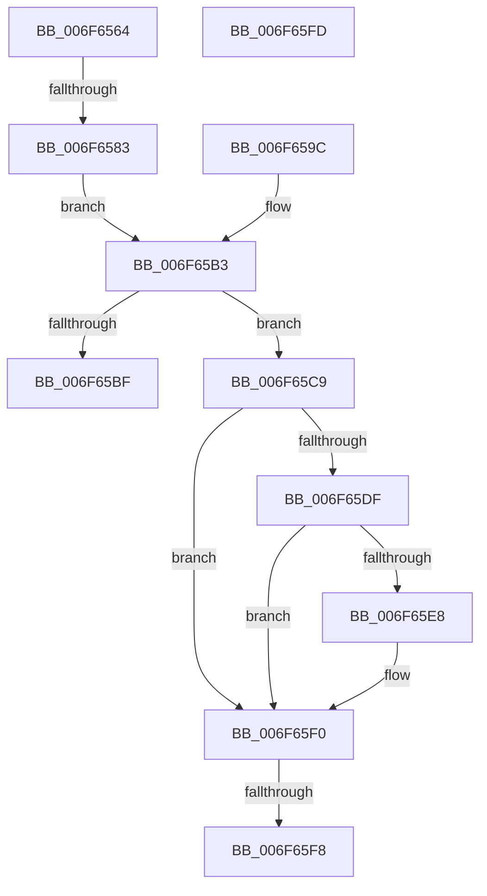

# sub_006F6564

- RVA: `0x006F6564`–`0x006F6604` (길이 `160` bytes)
- VA: `0x00000001406F6564`
- 실행 섹션: `.text`
- PDB 이름 있음: `아니요`; PDB Function 태그: `아니요`
- unwind 정보 RVA: `0x000B1378`
- 디코드: `44`개 명령, `160/160` bytes 표시
- 미해석 바이트: `0` (있으면 어셈블리에 `.byte`로 보존)

> 이 문서는 커널 이미지의 기계어와 PDB 기호를 분석해 생성했습니다. 4번과 5번은 함수 원형과 자료형을 바이너리 사용 방식에서 추정한 C 해석이며 원본 소스 복구 결과는 아닙니다.

## 1. Dependencies

- 직접 호출 지점: **3**; 고유 호출 대상: **3**
- 직접 호출자로 확인된 함수: **0**
- RIP 상대 이미지 참조: **2**

### Outgoing calls
- `0x006F6574` → [BgpGxConvertRectangleEx](../46/BgpGxConvertRectangleEx_function_004696D4.md) (function, `0x004696D4`)
- `0x006F65D3` → `indirect target` (indirect, 간접 대상)
- `0x006F65EB` → [BgpGxRectangleDestroy](../../pagebgfx/BC/BgpGxRectangleDestroy_function_00BC3F04.md) (function, `0x00BC3F04`)

### Direct callers
- 이 함수 시작 RVA로 연결되는 직접 call은 확인되지 않았습니다. 간접 호출은 완전히 역산할 수 없습니다.

### Static image references
- `0x006F65AA` → RVA `0x00EF03F0` (`.data`; read)
- `0x006F65B3` → RVA `0x00EF0400` (`.data`; read)

## 2. Other-region calls and transfers

- 다른 실행 섹션으로 향하는 call: **1**
  - `0x006F65EB` → [BgpGxRectangleDestroy](../../pagebgfx/BC/BgpGxRectangleDestroy_function_00BC3F04.md) (`.text` → `PAGEBGFX`)
- call이 아닌 외부 분기/꼬리 이동: **5**
  - `0x006F657D` → [GxpWriteFrameBufferPixels + 0x1B5](../48/GxpWriteFrameBufferPixels_function_0048C9F4.md) (`tail-transfer`)
  - `0x006F65C4` → [GxpWriteFrameBufferPixels + 0x1B5](../48/GxpWriteFrameBufferPixels_function_0048C9F4.md) (`tail-transfer`)
  - `0x006F65F2` → [GxpWriteFrameBufferPixels + 0x1B5](../48/GxpWriteFrameBufferPixels_function_0048C9F4.md) (`tail-transfer`)
  - `0x006F65F8` → [GxpWriteFrameBufferPixels + 0x1AC](../48/GxpWriteFrameBufferPixels_function_0048C9F4.md) (`tail-transfer`)
  - `0x006F65FF` → [GxpWriteFrameBufferPixels + 0x25B](../48/GxpWriteFrameBufferPixels_function_0048C9F4.md) (`tail-transfer`)

## 3. Assembly (complete function range)

```asm
006F6564  45 33 C9                        xor r9d, r9d
006F6567  4C 8D 44 24 40                  lea r8, [rsp + 0x40]
006F656C  BA 04 00 00 00                  mov edx, 4
006F6571  48 8B CF                        mov rcx, rdi
006F6574  E8 5B 31 D7 FF                  call 0x1404696d4
006F6579  8B D8                           mov ebx, eax
006F657B  85 C0                           test eax, eax
006F657D  0F 88 26 66 D9 FF               js 0x14048cba9
006F6583  48 8B 74 24 40                  mov rsi, qword ptr [rsp + 0x40]
006F6588  8B 46 0C                        mov eax, dword ptr [rsi + 0xc]
006F658B  89 45 B4                        mov dword ptr [rbp - 0x4c], eax
006F658E  48 8B 46 18                     mov rax, qword ptr [rsi + 0x18]
006F6592  48 89 45 B8                     mov qword ptr [rbp - 0x48], rax
006F6596  44 89 7D B0                     mov dword ptr [rbp - 0x50], r15d
006F659A  EB 17                           jmp 0x1406f65b3
006F659C  8B 47 0C                        mov eax, dword ptr [rdi + 0xc]
006F659F  89 45 B4                        mov dword ptr [rbp - 0x4c], eax
006F65A2  48 8B 47 18                     mov rax, qword ptr [rdi + 0x18]
006F65A6  48 89 45 B8                     mov qword ptr [rbp - 0x48], rax
006F65AA  8B 05 40 9E 7F 00               mov eax, dword ptr [rip + 0x7f9e40]
006F65B0  89 45 B0                        mov dword ptr [rbp - 0x50], eax
006F65B3  48 8B 05 46 9E 7F 00            mov rax, qword ptr [rip + 0x7f9e46]
006F65BA  48 85 C0                        test rax, rax
006F65BD  75 0A                           jne 0x1406f65c9
006F65BF  BB 01 00 00 C0                  mov ebx, 0xc0000001
006F65C4  E9 E0 65 D9 FF                  jmp 0x14048cba9
006F65C9  45 33 C0                        xor r8d, r8d
006F65CC  48 8D 4D A8                     lea rcx, [rbp - 0x58]
006F65D0  49 8B D6                        mov rdx, r14
006F65D3  FF D0                           call rax
006F65D5  0F 1F 00                        nop dword ptr [rax]
006F65D8  8B D8                           mov ebx, eax
006F65DA  48 85 F6                        test rsi, rsi
006F65DD  74 11                           je 0x1406f65f0
006F65DF  48 8D 45 D0                     lea rax, [rbp - 0x30]
006F65E3  48 3B F0                        cmp rsi, rax
006F65E6  74 08                           je 0x1406f65f0
006F65E8  48 8B CE                        mov rcx, rsi
006F65EB  E8 14 D9 4C 00                  call 0x140bc3f04
006F65F0  85 DB                           test ebx, ebx
006F65F2  0F 88 B1 65 D9 FF               js 0x14048cba9
006F65F8  E9 A3 65 D9 FF                  jmp 0x14048cba0
006F65FD  FF CA                           dec edx
006F65FF  E9 4B 66 D9 FF                  jmp 0x14048cc4f
```

## 4. C-style interpretation (structured pseudocode)

```c
__int64 __fastcall sub_006F6564(__int64 a1, __int64 a2, __int64 a3, int a4, __int64 a5, __int64 a6, __int64 a7, __int64 a8)
{
    __int64 result;

    a4 = 0;
    result = BgpGxConvertRectangleEx(v_rdi, 4, a8, a4);
    *(unsigned int *)(v_rbp - 76) = (unsigned int)((unsigned int)(*(unsigned int *)(a8 + 12)));
    *(unsigned __int64 *)(v_rbp - 72) = *(unsigned __int64 *)(a8 + 24);
    *(unsigned int *)(v_rbp - 80) = (unsigned int)(v_r15);
    goto loc_006F65B3;
loc_006F65B3:
    if (*(unsigned __int64 *)(v_rip + 8363590) != 0) goto loc_006F65C9;
loc_006F65C9:
    a3 = 0;
    result = kernel_indirect_call(v_rbp - 88, v_r14, a3, a4);
    if (a8 == 0) goto loc_006F65F0;
    result = v_rbp - 48;
    if (a8 != (v_rbp - 48)) {
        a1 = a8;
        result = BgpGxRectangleDestroy(a1, v_r14, a3, a4);
    }
}
```

## 5. (Beta) C Style

```c
int64_t sub_006F6564(int64_t Arg1, int64_t Arg2, int64_t Arg3, int32_t Arg4, uint64_t Arg5, uint64_t Arg6, uint64_t Arg7, void *Arg8)
{
    uint8_t *arg8 = (uint8_t *)Arg8;

    int64_t result;

    Arg4 = 0;
    result = BgpGxConvertRectangleEx(local_rdi, 4, Arg8, Arg4);
    *(uint32_t *)(local_rbp - 0x4C) = (uint32_t)((uint32_t)(*(uint32_t *)(arg8 + 0xC)));
    *(uint64_t *)(local_rbp - 0x48) = *(uint64_t *)(arg8 + 0x18);
    *(uint32_t *)(local_rbp - 0x50) = (uint32_t)(local_r15);
    goto loc_006F65B3;
loc_006F65B3:
    if (*(uint64_t *)(v_rip + 0x7F9E46) != 0) goto loc_006F65C9;
loc_006F65C9:
    Arg3 = 0;
    result = kernel_indirect_call(local_rbp - 88, local_r14, Arg3, Arg4);
    if (Arg8 == NULL) goto loc_006F65F0;
    result = local_rbp - 48;
    if (Arg8 != (local_rbp - 48)) {
        Arg1 = Arg8;
        result = BgpGxRectangleDestroy(Arg1, local_r14, Arg3, Arg4);
    }
}
```

### 관측된 메모리 오프셋

구조체 형식이 확인되지 않은 접근은 인자 기준의 오프셋으로만 기록했습니다.

| 기준 인자 | 오프셋 표현 | 폭 (bit) | 접근 |
|---|---:|---:|---|
| `Arg8` | `+ 0xC` | `32` | `R` |
| `Arg8` | `+ 0x18` | `64` | `R` |

## 6. Execution-region graph

[열기: 2D/3D 그래프와 함수 탐색 컨트롤 패널](../../../control-panel.html?section=text&rva=0x006F6564&view=graph)

- 2D 그래프는 위에서 아래로 흐르고, 3D 그래프는 빈 공간을 드래그해 회전합니다. Shift+드래그는 이동, 휠은 확대·축소, 함수 노드 선택은 대상 보고서 이동입니다.

### Static fallback


