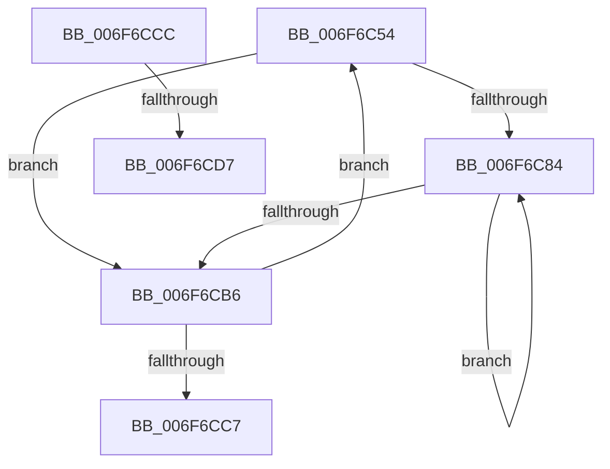

# sub_006F6C54

- RVA: `0x006F6C54`–`0x006F6CE0` (길이 `140` bytes)
- VA: `0x00000001406F6C54`
- 실행 섹션: `.text`
- PDB 이름 있음: `아니요`; PDB Function 태그: `아니요`
- unwind 정보 RVA: `0x000B2940`
- 디코드: `35`개 명령, `140/140` bytes 표시
- 미해석 바이트: `0` (있으면 어셈블리에 `.byte`로 보존)

> 이 문서는 커널 이미지의 기계어와 PDB 기호를 분석해 생성했습니다. 4번과 5번은 함수 원형과 자료형을 바이너리 사용 방식에서 추정한 C 해석이며 원본 소스 복구 결과는 아닙니다.

## 1. Dependencies

- 직접 호출 지점: **2**; 고유 호출 대상: **2**
- 직접 호출자로 확인된 함수: **0**
- RIP 상대 이미지 참조: **1**

### Outgoing calls
- `0x006F6C59` → [KeGetPrcb](../2D/KeGetPrcb_function_002D85D0.md) (function, `0x002D85D0`)
- `0x006F6CBE` → [KeEnumerateNextProcessor](../41/KeEnumerateNextProcessor_function_00415480.md) (function, `0x00415480`)

### Direct callers
- 이 함수 시작 RVA로 연결되는 직접 call은 확인되지 않았습니다. 간접 호출은 완전히 역산할 수 없습니다.

### Static image references
- `0x006F6C77` → RVA `0x00FC6BC8` (`ALMOSTRO`; read)

## 2. Other-region calls and transfers

- 다른 실행 섹션으로 향하는 call: **0**
- call이 아닌 외부 분기/꼬리 이동: **3**
  - `0x006F6CC7` → [PpmHeteroDetectHgsCores + 0xEB](../48/PpmHeteroDetectHgsCores_function_0048E980.md) (`tail-transfer`)
  - `0x006F6CD1` → [PpmHeteroDetectHgsCores + 0x328](../48/PpmHeteroDetectHgsCores_function_0048E980.md) (`tail-transfer`)
  - `0x006F6CDB` → [PpmHeteroDetectHgsCores + 0x328](../48/PpmHeteroDetectHgsCores_function_0048E980.md) (`tail-transfer`)

## 3. Assembly (complete function range)

```asm
006F6C54  8B 75 48                        mov esi, dword ptr [rbp + 0x48]
006F6C57  8B CE                           mov ecx, esi
006F6C59  E8 72 19 BE FF                  call 0x1402d85d0
006F6C5E  48 8B 4F 08                     mov rcx, qword ptr [rdi + 8]
006F6C62  4C 8B C8                        mov r9, rax
006F6C65  44 38 A0 4D 8A 00 00            cmp byte ptr [rax + 0x8a4d], r12b
006F6C6C  41 0F 95 C0                     setne r8b
006F6C70  44 88 04 0E                     mov byte ptr [rsi + rcx], r8b
006F6C74  45 33 C0                        xor r8d, r8d
006F6C77  4C 8B 15 4A FF 8C 00            mov r10, qword ptr [rip + 0x8cff4a]
006F6C7E  45 39 42 04                     cmp dword ptr [r10 + 4], r8d
006F6C82  76 32                           jbe 0x1406f6cb6
006F6C84  8B D6                           mov edx, esi
006F6C86  0F AF 57 04                     imul edx, dword ptr [rdi + 4]
006F6C8A  41 03 D0                        add edx, r8d
006F6C8D  45 38 A1 4D 8A 00 00            cmp byte ptr [r9 + 0x8a4d], r12b
006F6C94  0F 95 C0                        setne al
006F6C97  88 44 97 19                     mov byte ptr [rdi + rdx*4 + 0x19], al
006F6C9B  0F 94 C0                        sete al
006F6C9E  88 44 97 18                     mov byte ptr [rdi + rdx*4 + 0x18], al
006F6CA2  48 8B 47 10                     mov rax, qword ptr [rdi + 0x10]
006F6CA6  66 42 C7 04 40 01 01            mov word ptr [rax + r8*2], 0x101
006F6CAD  44 03 C3                        add r8d, ebx
006F6CB0  45 3B 42 04                     cmp r8d, dword ptr [r10 + 4]
006F6CB4  72 CE                           jb 0x1406f6c84
006F6CB6  48 8D 55 E8                     lea rdx, [rbp - 0x18]
006F6CBA  48 8D 4D 48                     lea rcx, [rbp + 0x48]
006F6CBE  E8 BD E7 D1 FF                  call 0x140415480
006F6CC3  85 C0                           test eax, eax
006F6CC5  74 8D                           je 0x1406f6c54
006F6CC7  E9 9F 7D D9 FF                  jmp 0x14048ea6b
006F6CCC  44 38 5C B1 06                  cmp byte ptr [rcx + rsi*4 + 6], r11b
006F6CD1  0F 85 D1 7F D9 FF               jne 0x14048eca8
006F6CD7  88 5C 97 1B                     mov byte ptr [rdi + rdx*4 + 0x1b], bl
006F6CDB  E9 C8 7F D9 FF                  jmp 0x14048eca8
```

## 4. C-style interpretation (structured pseudocode)

```c
__int64 __fastcall sub_006F6C54(void)
{
    __int64 result;

    result = KeGetPrcb((unsigned int)((unsigned int)((unsigned int)(*(unsigned int *)(v_rbp + 72)))), a2, a3, a4);
    a3 = ((*(unsigned __int8 *)(result + 35405)) != ((unsigned __int8)(v_r12))) ? 1 : 0;
    *(unsigned __int8 *)((unsigned int)(*(unsigned int *)(v_rbp + 72)) + *(unsigned __int64 *)(v_rdi + 8) * 1) = (unsigned __int8)(a3);
    a3 = 0;
    if ((*(unsigned int *)(*(unsigned __int64 *)(v_rip + 9240394) + 4)) <= 0) goto loc_006F6CB6;
loc_006F6C84:
    a2 = (unsigned int)(((unsigned int)((unsigned int)((unsigned int)(*(unsigned int *)(v_rbp + 72))))) * (*(unsigned int *)(v_rdi + 4)));
    a2 = (unsigned int)((a2) + (0));
    result = ((*(unsigned __int8 *)(result + 35405)) != ((unsigned __int8)(v_r12))) ? 1 : 0;
    *(unsigned __int8 *)(v_rdi + a2 * 4 + 25) = (unsigned __int8)(result);
    result = ((*(unsigned __int8 *)(result + 35405)) == ((unsigned __int8)(v_r12))) ? 1 : 0;
    *(unsigned __int8 *)(v_rdi + a2 * 4 + 24) = (unsigned __int8)(result);
    *(unsigned __int16 *)(*(unsigned __int64 *)(v_rdi + 16) + a3 * 2) = 257;
    a3 = (unsigned int)((a3) + ((unsigned int)(v_rbx)));
    if (((unsigned int)(a3)) < (*(unsigned int *)(*(unsigned __int64 *)(v_rip + 9240394) + 4))) goto loc_006F6C84;
loc_006F6CB6:
    result = KeEnumerateNextProcessor(v_rbp + 72, v_rbp - 24, a3, result);
    if ((unsigned int)(result) == 0) goto loc_006F6C54;
}
```

## 5. (Beta) C Style

```c
void sub_006F6C54(void)
{
    int64_t result;

    result = KeGetPrcb((uint32_t)((uint32_t)((uint32_t)(*(uint32_t *)(local_rbp + 0x48)))), a2, a3, a4);
    a3 = ((*(uint8_t *)(result + 0x8A4D)) != ((uint8_t)(local_r12))) ? 1 : 0;
    *(uint8_t *)((uint32_t)(*(uint32_t *)(local_rbp + 0x48)) + *(uint64_t *)(local_rdi + 0x8) * 1) = (uint8_t)(a3);
    a3 = 0;
    if ((*(uint32_t *)(*(uint64_t *)(v_rip + 0x8CFF4A) + 0x4)) <= 0) goto loc_006F6CB6;
loc_006F6C84:
    a2 = (uint32_t)(((uint32_t)((uint32_t)((uint32_t)(*(uint32_t *)(local_rbp + 0x48))))) * (*(uint32_t *)(local_rdi + 0x4)));
    a2 = (uint32_t)((a2) + (0));
    result = ((*(uint8_t *)(result + 0x8A4D)) != ((uint8_t)(local_r12))) ? 1 : 0;
    *(uint8_t *)(local_rdi + a2 * 4 + 0x19) = (uint8_t)(result);
    result = ((*(uint8_t *)(result + 0x8A4D)) == ((uint8_t)(local_r12))) ? 1 : 0;
    *(uint8_t *)(local_rdi + a2 * 4 + 0x18) = (uint8_t)(result);
    *(uint16_t *)(*(uint64_t *)(local_rdi + 0x10) + a3 * 2) = 257;
    a3 = (uint32_t)((a3) + ((uint32_t)(local_rbx)));
    if (((uint32_t)(a3)) < (*(uint32_t *)(*(uint64_t *)(v_rip + 0x8CFF4A) + 0x4))) goto loc_006F6C84;
loc_006F6CB6:
    result = KeEnumerateNextProcessor(local_rbp + 72, local_rbp - 24, a3, result);
    if ((uint32_t)(result) == 0) goto loc_006F6C54;
}
```

## 6. Execution-region graph

[열기: 2D/3D 그래프와 함수 탐색 컨트롤 패널](../../../control-panel.html?section=text&rva=0x006F6C54&view=graph)

- 2D 그래프는 위에서 아래로 흐르고, 3D 그래프는 빈 공간을 드래그해 회전합니다. Shift+드래그는 이동, 휠은 확대·축소, 함수 노드 선택은 대상 보고서 이동입니다.

### Static fallback


