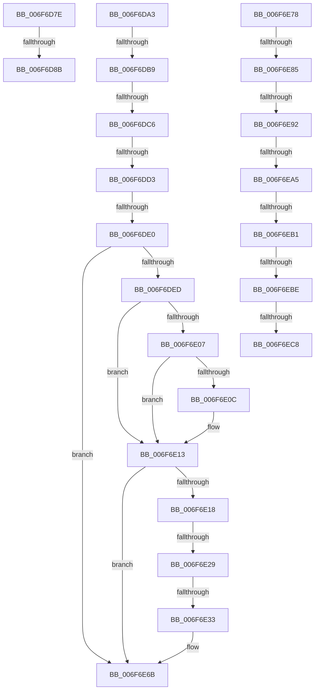

# sub_006F6D7E

- RVA: `0x006F6D7E`–`0x006F6F05` (길이 `391` bytes)
- VA: `0x00000001406F6D7E`
- 실행 섹션: `.text`
- PDB 이름 있음: `아니요`; PDB Function 태그: `아니요`
- unwind 정보 RVA: `0x000B2AA4`
- 디코드: `88`개 명령, `391/391` bytes 표시
- 미해석 바이트: `0` (있으면 어셈블리에 `.byte`로 보존)

> 이 문서는 커널 이미지의 기계어와 PDB 기호를 분석해 생성했습니다. 4번과 5번은 함수 원형과 자료형을 바이너리 사용 방식에서 추정한 C 해석이며 원본 소스 복구 결과는 아닙니다.

## 1. Dependencies

- 직접 호출 지점: **5**; 고유 호출 대상: **3**
- 직접 호출자로 확인된 함수: **0**
- RIP 상대 이미지 참조: **1**

### Outgoing calls
- `0x006F6DF3` → [CcOkToAddWriteBehindThread](../57/CcOkToAddWriteBehindThread_function_0057BAAC.md) (function, `0x0057BAAC`)
- `0x006F6E49` → [CcReferencePartitionAndPrivateVolumeCacheMap](../38/CcReferencePartitionAndPrivateVolumeCacheMap_function_0038B9E0.md) (function, `0x0038B9E0`)
- `0x006F6E5E` → [ExQueueWorkItemToPartition](../35/ExQueueWorkItemToPartition_function_00356E2C.md) (function, `0x00356E2C`)
- `0x006F6EDD` → [CcReferencePartitionAndPrivateVolumeCacheMap](../38/CcReferencePartitionAndPrivateVolumeCacheMap_function_0038B9E0.md) (function, `0x0038B9E0`)
- `0x006F6EF2` → [ExQueueWorkItemToPartition](../35/ExQueueWorkItemToPartition_function_00356E2C.md) (function, `0x00356E2C`)

### Direct callers
- 이 함수 시작 RVA로 연결되는 직접 call은 확인되지 않았습니다. 간접 호출은 완전히 역산할 수 없습니다.

### Static image references
- `0x006F6DA3` → RVA `0x00E65B64` (`.data`; read)

## 2. Other-region calls and transfers

- 다른 실행 섹션으로 향하는 call: **0**
- call이 아닌 외부 분기/꼬리 이동: **16**
  - `0x006F6D85` → [CcWorkerThread + 0x38E](../48/CcWorkerThread_function_0048F0F0.md) (`tail-transfer`)
  - `0x006F6D9E` → [CcWorkerThread + 0xD9](../48/CcWorkerThread_function_0048F0F0.md) (`tail-transfer`)
  - `0x006F6DB3` → [CcWorkerThread + 0x15B](../48/CcWorkerThread_function_0048F0F0.md) (`tail-transfer`)
  - `0x006F6DC0` → [CcWorkerThread + 0x15B](../48/CcWorkerThread_function_0048F0F0.md) (`tail-transfer`)
  - `0x006F6DCD` → [CcWorkerThread + 0x15B](../48/CcWorkerThread_function_0048F0F0.md) (`tail-transfer`)
  - `0x006F6DDA` → [CcWorkerThread + 0x15B](../48/CcWorkerThread_function_0048F0F0.md) (`tail-transfer`)
  - `0x006F6E23` → [CcWorkerThread + 0x38E](../48/CcWorkerThread_function_0048F0F0.md) (`tail-transfer`)
  - `0x006F6E2D` → [CcWorkerThread + 0x38E](../48/CcWorkerThread_function_0048F0F0.md) (`tail-transfer`)
  - `0x006F6E73` → [CcWorkerThread + 0x15B](../48/CcWorkerThread_function_0048F0F0.md) (`tail-transfer`)
  - `0x006F6E7F` → [CcWorkerThread + 0x178](../48/CcWorkerThread_function_0048F0F0.md) (`tail-transfer`)
  - `0x006F6E8C` → [CcWorkerThread + 0x178](../48/CcWorkerThread_function_0048F0F0.md) (`tail-transfer`)
  - `0x006F6E9F` → [CcWorkerThread + 0x178](../48/CcWorkerThread_function_0048F0F0.md) (`tail-transfer`)
  - `0x006F6EAB` → [CcWorkerThread + 0x178](../48/CcWorkerThread_function_0048F0F0.md) (`tail-transfer`)
  - `0x006F6EB8` → [CcWorkerThread + 0x38E](../48/CcWorkerThread_function_0048F0F0.md) (`tail-transfer`)
  - `0x006F6EC2` → [CcWorkerThread + 0x38E](../48/CcWorkerThread_function_0048F0F0.md) (`tail-transfer`)
  - `0x006F6F00` → [CcWorkerThread + 0x17F](../48/CcWorkerThread_function_0048F0F0.md) (`tail-transfer`)

## 3. Assembly (complete function range)

```asm
006F6D7E  49 8B 47 08                     mov rax, qword ptr [r15 + 8]
006F6D82  4C 39 38                        cmp qword ptr [rax], r15
006F6D85  0F 85 F3 86 D9 FF               jne 0x14048f47e
006F6D8B  4D 89 3E                        mov qword ptr [r14], r15
006F6D8E  49 89 46 08                     mov qword ptr [r14 + 8], rax
006F6D92  4C 89 30                        mov qword ptr [rax], r14
006F6D95  4D 89 77 08                     mov qword ptr [r15 + 8], r14
006F6D99  48 89 74 24 48                  mov qword ptr [rsp + 0x48], rsi
006F6D9E  E9 26 84 D9 FF                  jmp 0x14048f1c9
006F6DA3  8B 15 BB ED 76 00               mov edx, dword ptr [rip + 0x76edbb]
006F6DA9  48 03 97 D8 00 00 00            add rdx, qword ptr [rdi + 0xd8]
006F6DB0  48 3B DA                        cmp rbx, rdx
006F6DB3  0F 8C 92 84 D9 FF               jl 0x14048f24b
006F6DB9  48 8D 47 38                     lea rax, [rdi + 0x38]
006F6DBD  48 39 00                        cmp qword ptr [rax], rax
006F6DC0  0F 85 85 84 D9 FF               jne 0x14048f24b
006F6DC6  41 39 B5 D0 03 00 00            cmp dword ptr [r13 + 0x3d0], esi
006F6DCD  0F 84 78 84 D9 FF               je 0x14048f24b
006F6DD3  48 8D 47 68                     lea rax, [rdi + 0x68]
006F6DD7  48 39 00                        cmp qword ptr [rax], rax
006F6DDA  0F 84 6B 84 D9 FF               je 0x14048f24b
006F6DE0  4C 8D A7 88 00 00 00            lea r12, [rdi + 0x88]
006F6DE7  4D 39 24 24                     cmp qword ptr [r12], r12
006F6DEB  74 7E                           je 0x1406f6e6b
006F6DED  48 8B D7                        mov rdx, rdi
006F6DF0  49 8B CD                        mov rcx, r13
006F6DF3  E8 B4 4C E8 FF                  call 0x14057baac
006F6DF8  48 89 9F D8 00 00 00            mov qword ptr [rdi + 0xd8], rbx
006F6DFF  39 B7 98 00 00 00               cmp dword ptr [rdi + 0x98], esi
006F6E05  76 0C                           jbe 0x1406f6e13
006F6E07  83 F8 03                        cmp eax, 3
006F6E0A  75 07                           jne 0x1406f6e13
006F6E0C  C6 87 E1 00 00 00 01            mov byte ptr [rdi + 0xe1], 1
006F6E13  83 F8 02                        cmp eax, 2
006F6E16  75 53                           jne 0x1406f6e6b
006F6E18  4D 8B 14 24                     mov r10, qword ptr [r12]
006F6E1C  49 8B 02                        mov rax, qword ptr [r10]
006F6E1F  4D 39 62 08                     cmp qword ptr [r10 + 8], r12
006F6E23  0F 85 55 86 D9 FF               jne 0x14048f47e
006F6E29  4C 39 50 08                     cmp qword ptr [rax + 8], r10
006F6E2D  0F 85 4B 86 D9 FF               jne 0x14048f47e
006F6E33  49 89 04 24                     mov qword ptr [r12], rax
006F6E37  4C 89 60 08                     mov qword ptr [rax + 8], r12
006F6E3B  FF 87 98 00 00 00               inc dword ptr [rdi + 0x98]
006F6E41  48 8B 54 24 38                  mov rdx, qword ptr [rsp + 0x38]
006F6E46  49 8B CD                        mov rcx, r13
006F6E49  E8 92 4B C9 FF                  call 0x14038b9e0
006F6E4E  49 89 32                        mov qword ptr [r10], rsi
006F6E51  4D 8B 4D 08                     mov r9, qword ptr [r13 + 8]
006F6E55  44 8B 47 18                     mov r8d, dword ptr [rdi + 0x18]
006F6E59  33 D2                           xor edx, edx
006F6E5B  49 8B CA                        mov rcx, r10
006F6E5E  E8 C9 FF C5 FF                  call 0x140356e2c
006F6E63  C6 84 24 18 01 00 00 01         mov byte ptr [rsp + 0x118], 1
006F6E6B  44 8B A4 24 28 01 00 00         mov r12d, dword ptr [rsp + 0x128]
006F6E73  E9 D3 83 D9 FF                  jmp 0x14048f24b
006F6E78  48 8D 47 38                     lea rax, [rdi + 0x38]
006F6E7C  48 39 00                        cmp qword ptr [rax], rax
006F6E7F  0F 85 E3 83 D9 FF               jne 0x14048f268
006F6E85  48 8D 47 68                     lea rax, [rdi + 0x68]
006F6E89  48 39 00                        cmp qword ptr [rax], rax
006F6E8C  0F 84 D6 83 D9 FF               je 0x14048f268
006F6E92  48 8D 87 88 00 00 00            lea rax, [rdi + 0x88]
006F6E99  4C 8B 10                        mov r10, qword ptr [rax]
006F6E9C  4C 3B D0                        cmp r10, rax
006F6E9F  0F 84 C3 83 D9 FF               je 0x14048f268
006F6EA5  39 B7 98 00 00 00               cmp dword ptr [rdi + 0x98], esi
006F6EAB  0F 85 B7 83 D9 FF               jne 0x14048f268
006F6EB1  49 8B 0A                        mov rcx, qword ptr [r10]
006F6EB4  49 39 42 08                     cmp qword ptr [r10 + 8], rax
006F6EB8  0F 85 C0 85 D9 FF               jne 0x14048f47e
006F6EBE  4C 39 51 08                     cmp qword ptr [rcx + 8], r10
006F6EC2  0F 85 B6 85 D9 FF               jne 0x14048f47e
006F6EC8  48 89 08                        mov qword ptr [rax], rcx
006F6ECB  48 89 41 08                     mov qword ptr [rcx + 8], rax
006F6ECF  FF 87 98 00 00 00               inc dword ptr [rdi + 0x98]
006F6ED5  48 8B 54 24 38                  mov rdx, qword ptr [rsp + 0x38]
006F6EDA  49 8B CD                        mov rcx, r13
006F6EDD  E8 FE 4A C9 FF                  call 0x14038b9e0
006F6EE2  49 89 32                        mov qword ptr [r10], rsi
006F6EE5  4D 8B 4D 08                     mov r9, qword ptr [r13 + 8]
006F6EE9  44 8B 47 18                     mov r8d, dword ptr [rdi + 0x18]
006F6EED  33 D2                           xor edx, edx
006F6EEF  49 8B CA                        mov rcx, r10
006F6EF2  E8 35 FF C5 FF                  call 0x140356e2c
006F6EF7  48 89 9F D0 00 00 00            mov qword ptr [rdi + 0xd0], rbx
006F6EFE  B3 01                           mov bl, 1
006F6F00  E9 6A 83 D9 FF                  jmp 0x14048f26f
```

## 4. C-style interpretation (structured pseudocode)

```c
__int64 __fastcall sub_006F6D7E(void)
{
    unsigned __int8 v_stack_p118;
    unsigned int v_stack_p128;
    unsigned __int64 v_stack_p38;
    unsigned __int64 v_stack_p48;

    *(unsigned __int64 *)(v_r14) = v_r15;
    *(unsigned __int64 *)(v_r14 + 8) = *(unsigned __int64 *)(v_r15 + 8);
    *(unsigned __int64 *)(*(unsigned __int64 *)(v_r15 + 8)) = v_r14;
    *(unsigned __int64 *)(v_r15 + 8) = v_r14;
    v_stack_p48 = v_rsi;
}
```

## 5. (Beta) C Style

```c
void sub_006F6D7E(void)
{
    uint8_t v_stack_p118;
    uint32_t v_stack_p128;
    uint64_t v_stack_p38;
    uint64_t v_stack_p48;

    *(uint64_t *)(local_r14) = local_r15;
    *(uint64_t *)(local_r14 + 0x8) = *(uint64_t *)(local_r15 + 0x8);
    *(uint64_t *)(*(uint64_t *)(local_r15 + 0x8)) = local_r14;
    *(uint64_t *)(local_r15 + 0x8) = local_r14;
    v_stack_p48 = local_rsi;
}
```

## 6. Execution-region graph

[열기: 2D/3D 그래프와 함수 탐색 컨트롤 패널](../../../control-panel.html?section=text&rva=0x006F6D7E&view=graph)

- 2D 그래프는 위에서 아래로 흐르고, 3D 그래프는 빈 공간을 드래그해 회전합니다. Shift+드래그는 이동, 휠은 확대·축소, 함수 노드 선택은 대상 보고서 이동입니다.

### Static fallback


