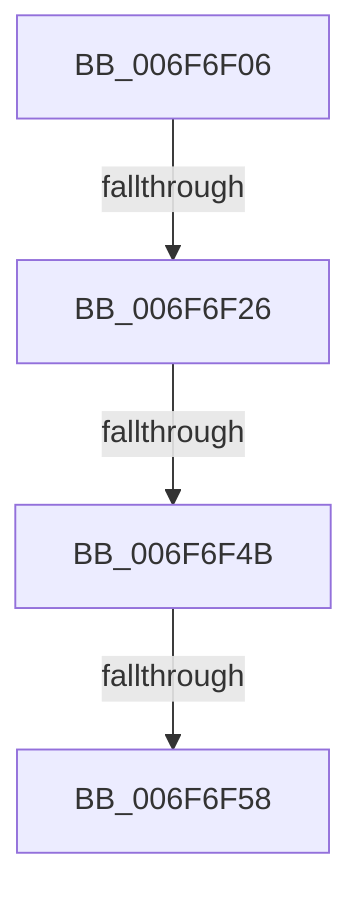

# sub_006F6F06

- RVA: `0x006F6F06`–`0x006F6F71` (길이 `107` bytes)
- VA: `0x00000001406F6F06`
- 실행 섹션: `.text`
- PDB 이름 있음: `아니요`; PDB Function 태그: `아니요`
- unwind 정보 RVA: `0x000B2B34`
- 디코드: `24`개 명령, `107/107` bytes 표시
- 미해석 바이트: `0` (있으면 어셈블리에 `.byte`로 보존)

> 이 문서는 커널 이미지의 기계어와 PDB 기호를 분석해 생성했습니다. 4번과 5번은 함수 원형과 자료형을 바이너리 사용 방식에서 추정한 C 해석이며 원본 소스 복구 결과는 아닙니다.

## 1. Dependencies

- 직접 호출 지점: **4**; 고유 호출 대상: **4**
- 직접 호출자로 확인된 함수: **0**
- RIP 상대 이미지 참조: **1**

### Outgoing calls
- `0x006F6F0D` → [KeAcquireQueuedSpinLock](../27/KeAcquireQueuedSpinLock_function_00273D80.md) (function, `0x00273D80`)
- `0x006F6F26` → [KeReleaseQueuedSpinLock](../27/KeReleaseQueuedSpinLock_function_00272540.md) (function, `0x00272540`)
- `0x006F6F32` → [ExAcquireFastMutex](../20/ExAcquireFastMutex_function_0020E5A0.md) (function, `0x0020E5A0`)
- `0x006F6F66` → [ExReleaseFastMutex](../25/ExReleaseFastMutex_function_002519C0.md) (function, `0x002519C0`)

### Direct callers
- 이 함수 시작 RVA로 연결되는 직접 call은 확인되지 않았습니다. 간접 호출은 완전히 역산할 수 없습니다.

### Static image references
- `0x006F6F2B` → RVA `0x00F05CC0` (`.data`; read)

## 2. Other-region calls and transfers

- 다른 실행 섹션으로 향하는 call: **0**
- call이 아닌 외부 분기/꼬리 이동: **4**
  - `0x006F6F20` → [RawInitiateDeleteVolume + 0x5D](../48/RawInitiateDeleteVolume_function_0048FDFC.md) (`tail-transfer`)
  - `0x006F6F45` → [RawInitiateDeleteVolume + 0xD7](../48/RawInitiateDeleteVolume_function_0048FDFC.md) (`tail-transfer`)
  - `0x006F6F52` → [RawInitiateDeleteVolume + 0xD7](../48/RawInitiateDeleteVolume_function_0048FDFC.md) (`tail-transfer`)
  - `0x006F6F6C` → [RawInitiateDeleteVolume + 0x106](../48/RawInitiateDeleteVolume_function_0048FDFC.md) (`tail-transfer`)

## 3. Assembly (complete function range)

```asm
006F6F06  BD 09 00 00 00                  mov ebp, 9
006F6F0B  8B CD                           mov ecx, ebp
006F6F0D  E8 6E CE B7 FF                  call 0x140273d80
006F6F12  8A D0                           mov dl, al
006F6F14  8B CD                           mov ecx, ebp
006F6F16  48 8B 83 C8 00 00 00            mov rax, qword ptr [rbx + 0xc8]
006F6F1D  39 70 1C                        cmp dword ptr [rax + 0x1c], esi
006F6F20  0F 85 33 8F D9 FF               jne 0x14048fe59
006F6F26  E8 15 B6 B7 FF                  call 0x140272540
006F6F2B  48 8D 0D 8E ED 80 00            lea rcx, [rip + 0x80ed8e]
006F6F32  E8 69 76 B1 FF                  call 0x14020e5a0
006F6F37  48 8D 83 B0 00 00 00            lea rax, [rbx + 0xb0]
006F6F3E  48 8B 10                        mov rdx, qword ptr [rax]
006F6F41  48 39 42 08                     cmp qword ptr [rdx + 8], rax
006F6F45  0F 85 88 8F D9 FF               jne 0x14048fed3
006F6F4B  48 8B 48 08                     mov rcx, qword ptr [rax + 8]
006F6F4F  48 39 01                        cmp qword ptr [rcx], rax
006F6F52  0F 85 7B 8F D9 FF               jne 0x14048fed3
006F6F58  48 89 11                        mov qword ptr [rcx], rdx
006F6F5B  48 89 4A 08                     mov qword ptr [rdx + 8], rcx
006F6F5F  48 8D 0D 5A ED 80 00            lea rcx, [rip + 0x80ed5a]
006F6F66  E8 55 AA B5 FF                  call 0x1402519c0
006F6F6B  90                              nop
006F6F6C  E9 91 8F D9 FF                  jmp 0x14048ff02
```

## 4. C-style interpretation (structured pseudocode)

```c
__int64 __fastcall sub_006F6F06(void)
{
    __int64 result;

    result = KeAcquireQueuedSpinLock(9, a2, a3, a4);
    result = KeReleaseQueuedSpinLock(9, (unsigned __int8)(result), a3, a4);
    result = ExAcquireFastMutex(v_rip + 8449422, (unsigned __int8)(result), a3, a4);
    *(unsigned __int64 *)(*(unsigned __int64 *)(v_rbx + 176 + 8)) = *(unsigned __int64 *)(v_rbx + 176);
    *(unsigned __int64 *)(*(unsigned __int64 *)(v_rbx + 176) + 8) = *(unsigned __int64 *)(v_rbx + 176 + 8);
    result = ExReleaseFastMutex(v_rip + 8449370, *(unsigned __int64 *)(v_rbx + 176), a3, a4);
}
```

## 5. (Beta) C Style

```c
void sub_006F6F06(void)
{
    int64_t result;

    result = KeAcquireQueuedSpinLock(9, a2, a3, a4);
    result = KeReleaseQueuedSpinLock(9, (uint8_t)(result), a3, a4);
    result = ExAcquireFastMutex(v_rip + 8449422, (uint8_t)(result), a3, a4);
    *(uint64_t *)(*(uint64_t *)(local_rbx + 0xB0 + 0x8)) = *(uint64_t *)(local_rbx + 0xB0);
    *(uint64_t *)(*(uint64_t *)(local_rbx + 0xB0) + 0x8) = *(uint64_t *)(local_rbx + 0xB0 + 0x8);
    result = ExReleaseFastMutex(v_rip + 8449370, *(uint64_t *)(local_rbx + 0xB0), a3, a4);
}
```

## 6. Execution-region graph

[열기: 2D/3D 그래프와 함수 탐색 컨트롤 패널](../../../control-panel.html?section=text&rva=0x006F6F06&view=graph)

- 2D 그래프는 위에서 아래로 흐르고, 3D 그래프는 빈 공간을 드래그해 회전합니다. Shift+드래그는 이동, 휠은 확대·축소, 함수 노드 선택은 대상 보고서 이동입니다.

### Static fallback


