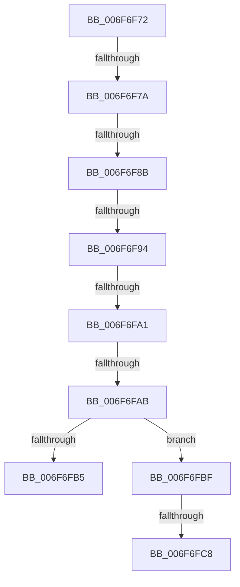

# sub_006F6F72

- RVA: `0x006F6F72`–`0x006F6FD2` (길이 `96` bytes)
- VA: `0x00000001406F6F72`
- 실행 섹션: `.text`
- PDB 이름 있음: `아니요`; PDB Function 태그: `아니요`
- unwind 정보 RVA: `0x000B2B60`
- 디코드: `21`개 명령, `96/96` bytes 표시
- 미해석 바이트: `0` (있으면 어셈블리에 `.byte`로 보존)

> 이 문서는 커널 이미지의 기계어와 PDB 기호를 분석해 생성했습니다. 4번과 5번은 함수 원형과 자료형을 바이너리 사용 방식에서 추정한 C 해석이며 원본 소스 복구 결과는 아닙니다.

## 1. Dependencies

- 직접 호출 지점: **0**; 고유 호출 대상: **0**
- 직접 호출자로 확인된 함수: **0**
- RIP 상대 이미지 참조: **0**

### Outgoing calls
- 직접 디코드된 call 명령이 없습니다.

### Direct callers
- 이 함수 시작 RVA로 연결되는 직접 call은 확인되지 않았습니다. 간접 호출은 완전히 역산할 수 없습니다.

### Static image references
- 디코드된 RIP-relative 메모리 참조가 없습니다.

## 2. Other-region calls and transfers

- 다른 실행 섹션으로 향하는 call: **0**
- call이 아닌 외부 분기/꼬리 이동: **8**
  - `0x006F6F74` → [SepSetTokenBnoIsolation + 0x82](../49/SepSetTokenBnoIsolation_function_0049002C.md) (`tail-transfer`)
  - `0x006F6F85` → [SepSetTokenBnoIsolation + 0x82](../49/SepSetTokenBnoIsolation_function_0049002C.md) (`tail-transfer`)
  - `0x006F6F8E` → [SepSetTokenBnoIsolation + 0x82](../49/SepSetTokenBnoIsolation_function_0049002C.md) (`tail-transfer`)
  - `0x006F6F9B` → [SepSetTokenBnoIsolation + 0x82](../49/SepSetTokenBnoIsolation_function_0049002C.md) (`tail-transfer`)
  - `0x006F6FA5` → [SepSetTokenBnoIsolation + 0x82](../49/SepSetTokenBnoIsolation_function_0049002C.md) (`tail-transfer`)
  - `0x006F6FBA` → [SepSetTokenBnoIsolation + 0x60](../49/SepSetTokenBnoIsolation_function_0049002C.md) (`tail-transfer`)
  - `0x006F6FC2` → [SepSetTokenBnoIsolation + 0x4F](../49/SepSetTokenBnoIsolation_function_0049002C.md) (`tail-transfer`)
  - `0x006F6FCD` → [SepSetTokenBnoIsolation + 0x60](../49/SepSetTokenBnoIsolation_function_0049002C.md) (`tail-transfer`)

## 3. Assembly (complete function range)

```asm
006F6F72  85 ED                           test ebp, ebp
006F6F74  0F 84 34 91 D9 FF               je 0x1404900ae
006F6F7A  48 8B B4 24 80 00 00 00         mov rsi, qword ptr [rsp + 0x80]
006F6F82  48 85 F6                        test rsi, rsi
006F6F85  0F 84 23 91 D9 FF               je 0x1404900ae
006F6F8B  48 85 FF                        test rdi, rdi
006F6F8E  0F 84 1A 91 D9 FF               je 0x1404900ae
006F6F94  41 0F B7 00                     movzx eax, word ptr [r8]
006F6F98  66 85 C0                        test ax, ax
006F6F9B  0F 84 0D 91 D9 FF               je 0x1404900ae
006F6FA1  49 39 58 08                     cmp qword ptr [r8 + 8], rbx
006F6FA5  0F 84 03 91 D9 FF               je 0x1404900ae
006F6FAB  B9 10 01 00 00                  mov ecx, 0x110
006F6FB0  66 3B C1                        cmp ax, cx
006F6FB3  72 0A                           jb 0x1406f6fbf
006F6FB5  BB 06 01 00 C0                  mov ebx, 0xc0000106
006F6FBA  E9 CD 90 D9 FF                  jmp 0x14049008c
006F6FBF  83 FD 0A                        cmp ebp, 0xa
006F6FC2  0F 86 B3 90 D9 FF               jbe 0x14049007b
006F6FC8  BB 0D 00 00 C0                  mov ebx, 0xc000000d
006F6FCD  E9 BA 90 D9 FF                  jmp 0x14049008c
```

## 4. C-style interpretation (structured pseudocode)

```c
__int64 __fastcall sub_006F6F72(__int64 a1, __int64 a2, __int64 a3, __int64 a4, __int64 a5, __int64 a6, __int64 a7, __int64 a8, __int64 a9, __int64 a10, __int64 a11, __int64 a12, __int64 a13, __int64 a14, __int64 a15, __int64 a16)
{
    if (((unsigned __int16)(*(unsigned __int16 *)(a3))) < 272) goto loc_006F6FBF;
loc_006F6FBF:
}
```

## 5. (Beta) C Style

```c
int64_t sub_006F6F72(int64_t Arg1, int64_t Arg2, void *Arg3, int64_t Arg4, uint64_t Arg5, uint64_t Arg6, uint64_t Arg7, uint64_t Arg8, uint64_t Arg9, uint64_t Arg10, uint64_t Arg11, uint64_t Arg12, uint64_t Arg13, uint64_t Arg14, uint64_t Arg15, int64_t Arg16)
{
    uint8_t *arg3 = (uint8_t *)Arg3;

    if (((uint16_t)(*(uint16_t *)(arg3))) < 272) goto loc_006F6FBF;
loc_006F6FBF:
}
```

### 관측된 메모리 오프셋

구조체 형식이 확인되지 않은 접근은 인자 기준의 오프셋으로만 기록했습니다.

| 기준 인자 | 오프셋 표현 | 폭 (bit) | 접근 |
|---|---:|---:|---|
| `Arg3` | `+ 0x0` | `16` | `R` |
| `Arg3` | `+ 0x8` | `64` | `R` |

## 6. Execution-region graph

[열기: 2D/3D 그래프와 함수 탐색 컨트롤 패널](../../../control-panel.html?section=text&rva=0x006F6F72&view=graph)

- 2D 그래프는 위에서 아래로 흐르고, 3D 그래프는 빈 공간을 드래그해 회전합니다. Shift+드래그는 이동, 휠은 확대·축소, 함수 노드 선택은 대상 보고서 이동입니다.

### Static fallback


