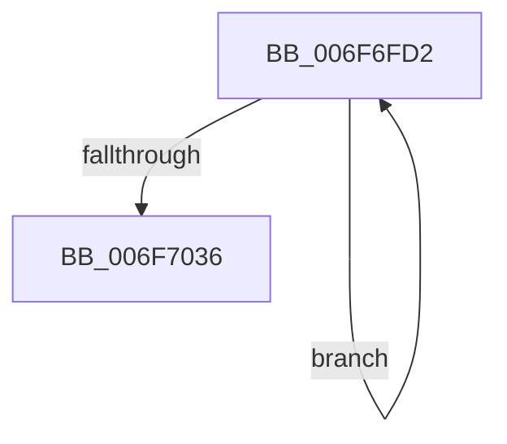

# sub_006F6FD2

- RVA: `0x006F6FD2`–`0x006F703E` (길이 `108` bytes)
- VA: `0x00000001406F6FD2`
- 실행 섹션: `.text`
- PDB 이름 있음: `아니요`; PDB Function 태그: `아니요`
- unwind 정보 RVA: `0x000B2BD8`
- 디코드: `23`개 명령, `108/108` bytes 표시
- 미해석 바이트: `0` (있으면 어셈블리에 `.byte`로 보존)

> 이 문서는 커널 이미지의 기계어와 PDB 기호를 분석해 생성했습니다. 4번과 5번은 함수 원형과 자료형을 바이너리 사용 방식에서 추정한 C 해석이며 원본 소스 복구 결과는 아닙니다.

## 1. Dependencies

- 직접 호출 지점: **1**; 고유 호출 대상: **1**
- 직접 호출자로 확인된 함수: **0**
- RIP 상대 이미지 참조: **2**

### Outgoing calls
- `0x006F7029` → [EtwWriteEx](../25/EtwWriteEx_function_0025F0D0.md) (function, `0x0025F0D0`)

### Direct callers
- 이 함수 시작 RVA로 연결되는 직접 call은 확인되지 않았습니다. 간접 호출은 완전히 역산할 수 없습니다.

### Static image references
- `0x006F6FD2` → RVA `0x00F083E8` (`.data`; read)
- `0x006F6FE1` → RVA `0x0001A7D0` (`.rdata`; read)

## 2. Other-region calls and transfers

- 다른 실행 섹션으로 향하는 call: **0**
- call이 아닌 외부 분기/꼬리 이동: **1**
  - `0x006F7039` → [PpmEventPlatformVetoRundown + 0x120](../49/PpmEventPlatformVetoRundown_function_00490C38.md) (`tail-transfer`)

## 3. Assembly (complete function range)

```asm
006F6FD2  48 8B 0D 0F 14 81 00            mov rcx, qword ptr [rip + 0x81140f]
006F6FD9  48 8D 43 10                     lea rax, [rbx + 0x10]
006F6FDD  83 65 E4 00                     and dword ptr [rbp - 0x1c], 0
006F6FE1  48 8D 15 E8 37 92 FF            lea rdx, [rip - 0x6dc818]
006F6FE8  83 65 F4 00                     and dword ptr [rbp - 0xc], 0
006F6FEC  45 33 C9                        xor r9d, r9d
006F6FEF  48 89 45 D8                     mov qword ptr [rbp - 0x28], rax
006F6FF3  45 33 C0                        xor r8d, r8d
006F6FF6  48 8D 43 14                     lea rax, [rbx + 0x14]
006F6FFA  C7 45 E0 04 00 00 00            mov dword ptr [rbp - 0x20], 4
006F7001  48 89 45 E8                     mov qword ptr [rbp - 0x18], rax
006F7005  48 8D 45 C8                     lea rax, [rbp - 0x38]
006F7009  48 89 44 24 38                  mov qword ptr [rsp + 0x38], rax
006F700E  C7 44 24 30 03 00 00 00         mov dword ptr [rsp + 0x30], 3
006F7016  48 83 64 24 28 00               and qword ptr [rsp + 0x28], 0
006F701C  48 83 64 24 20 00               and qword ptr [rsp + 0x20], 0
006F7022  C7 45 F0 04 00 00 00            mov dword ptr [rbp - 0x10], 4
006F7029  E8 A2 80 B6 FF                  call 0x14025f0d0
006F702E  48 8B 1B                        mov rbx, qword ptr [rbx]
006F7031  48 3B DF                        cmp rbx, rdi
006F7034  75 9C                           jne 0x1406f6fd2
006F7036  8B 55 C0                        mov edx, dword ptr [rbp - 0x40]
006F7039  E9 1A 9D D9 FF                  jmp 0x140490d58
```

## 4. C-style interpretation (structured pseudocode)

```c
__int64 __fastcall sub_006F6FD2(__int64 a1, __int64 a2, int a3, int a4, __int64 a5)
{
    __int64 result;
    unsigned __int64 v_stack_p20;
    unsigned int v_stack_p30;
    unsigned __int64 v_stack_p38;

    a4 = 0;
    *(unsigned __int64 *)(v_rbp - 40) = v_rbx + 16;
    a3 = 0;
    *(unsigned int *)(v_rbp - 32) = 4;
    *(unsigned __int64 *)(v_rbp - 24) = v_rbx + 20;
    v_stack_p38 = v_rbp - 56;
    v_stack_p30 = 3;
    *(unsigned int *)(v_rbp - 16) = 4;
    result = EtwWriteEx(*(unsigned __int64 *)(v_rip + 8459279), v_rip - 7194648, a3, a4);
    if ((*(unsigned __int64 *)(v_rbx)) != v_rdi) goto loc_006F6FD2;
}
```

## 5. (Beta) C Style

```c
int64_t sub_006F6FD2(int64_t Arg1, int64_t Arg2, int32_t Arg3, int32_t Arg4, int64_t Arg5)
{
    int64_t result;
    uint64_t v_stack_p20;
    uint32_t v_stack_p30;
    uint64_t v_stack_p38;

    Arg4 = 0;
    *(uint64_t *)(local_rbp - 0x28) = local_rbx + 16;
    Arg3 = 0;
    *(uint32_t *)(local_rbp - 0x20) = 4;
    *(uint64_t *)(local_rbp - 0x18) = local_rbx + 20;
    v_stack_p38 = local_rbp - 56;
    v_stack_p30 = 3;
    *(uint32_t *)(local_rbp - 0x10) = 4;
    result = EtwWriteEx(*(uint64_t *)(v_rip + 0x81140F), v_rip - 7194648, Arg3, Arg4);
    if ((*(uint64_t *)(local_rbx)) != local_rdi) goto loc_006F6FD2;
}
```

## 6. Execution-region graph

[열기: 2D/3D 그래프와 함수 탐색 컨트롤 패널](../../../control-panel.html?section=text&rva=0x006F6FD2&view=graph)

- 2D 그래프는 위에서 아래로 흐르고, 3D 그래프는 빈 공간을 드래그해 회전합니다. Shift+드래그는 이동, 휠은 확대·축소, 함수 노드 선택은 대상 보고서 이동입니다.

### Static fallback


