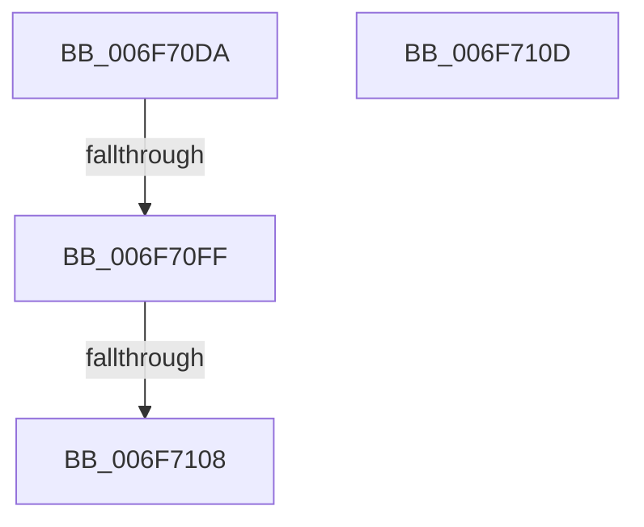

# sub_006F70DA

- RVA: `0x006F70DA`–`0x006F7118` (길이 `62` bytes)
- VA: `0x00000001406F70DA`
- 실행 섹션: `.text`
- PDB 이름 있음: `아니요`; PDB Function 태그: `아니요`
- unwind 정보 RVA: `0x000B2F60`
- 디코드: `15`개 명령, `62/62` bytes 표시
- 미해석 바이트: `0` (있으면 어셈블리에 `.byte`로 보존)

> 이 문서는 커널 이미지의 기계어와 PDB 기호를 분석해 생성했습니다. 4번과 5번은 함수 원형과 자료형을 바이너리 사용 방식에서 추정한 C 해석이며 원본 소스 복구 결과는 아닙니다.

## 1. Dependencies

- 직접 호출 지점: **0**; 고유 호출 대상: **0**
- 직접 호출자로 확인된 함수: **0**
- RIP 상대 이미지 참조: **0**

### Outgoing calls
- 직접 디코드된 call 명령이 없습니다.

### Direct callers
- 이 함수 시작 RVA로 연결되는 직접 call은 확인되지 않았습니다. 간접 호출은 완전히 역산할 수 없습니다.

### Static image references
- 디코드된 RIP-relative 메모리 참조가 없습니다.

## 2. Other-region calls and transfers

- 다른 실행 섹션으로 향하는 call: **0**
- call이 아닌 외부 분기/꼬리 이동: **4**
  - `0x006F70F9` → [EmonIsModifiedByBadActorInternalOriginal + 0x115](../49/EmonIsModifiedByBadActorInternalOriginal_function_004928FC.md) (`tail-transfer`)
  - `0x006F7102` → [EmonIsModifiedByBadActorInternalOriginal + 0x115](../49/EmonIsModifiedByBadActorInternalOriginal_function_004928FC.md) (`tail-transfer`)
  - `0x006F7108` → [EmonIsModifiedByBadActorInternalOriginal + 0xA9](../49/EmonIsModifiedByBadActorInternalOriginal_function_004928FC.md) (`tail-transfer`)
  - `0x006F7113` → [EmonIsModifiedByBadActorInternalOriginal + 0xAD](../49/EmonIsModifiedByBadActorInternalOriginal_function_004928FC.md) (`tail-transfer`)

## 3. Assembly (complete function range)

```asm
006F70DA  B9 8F 03 00 00                  mov ecx, 0x38f
006F70DF  0F 32                           rdmsr
006F70E1  48 C1 E2 20                     shl rdx, 0x20
006F70E5  41 8B CB                        mov ecx, r11d
006F70E8  48 0B D0                        or rdx, rax
006F70EB  B8 01 00 00 00                  mov eax, 1
006F70F0  48 D3 E0                        shl rax, cl
006F70F3  48 23 D0                        and rdx, rax
006F70F6  83 FF 01                        cmp edi, 1
006F70F9  0F 85 12 B9 D9 FF               jne 0x140492a11
006F70FF  48 85 D2                        test rdx, rdx
006F7102  0F 84 09 B9 D9 FF               je 0x140492a11
006F7108  E9 98 B8 D9 FF                  jmp 0x1404929a5
006F710D  41 BA 08 07 00 C0               mov r10d, 0xc0000708
006F7113  E9 91 B8 D9 FF                  jmp 0x1404929a9
```

## 4. C-style interpretation (structured pseudocode)

```c
__int64 __fastcall sub_006F70DA(__int64 a1, __int64 a2)
{
    __int64 result;

    a2 = (a2) << (32);
    a2 = (a2) | (result);
    result = (1) << ((unsigned __int8)((unsigned int)((unsigned int)(v_r11))));
    a2 = (a2) & (result);
}
```

## 5. (Beta) C Style

```c
int64_t sub_006F70DA(int64_t Arg1, int64_t Arg2)
{
    int64_t result;

    Arg2 = (Arg2) << (32);
    Arg2 = (Arg2) | (result);
    result = (1) << ((uint8_t)((uint32_t)((uint32_t)(local_r11))));
    Arg2 = (Arg2) & (result);
}
```

## 6. Execution-region graph

[열기: 2D/3D 그래프와 함수 탐색 컨트롤 패널](../../../control-panel.html?section=text&rva=0x006F70DA&view=graph)

- 2D 그래프는 위에서 아래로 흐르고, 3D 그래프는 빈 공간을 드래그해 회전합니다. Shift+드래그는 이동, 휠은 확대·축소, 함수 노드 선택은 대상 보고서 이동입니다.

### Static fallback


