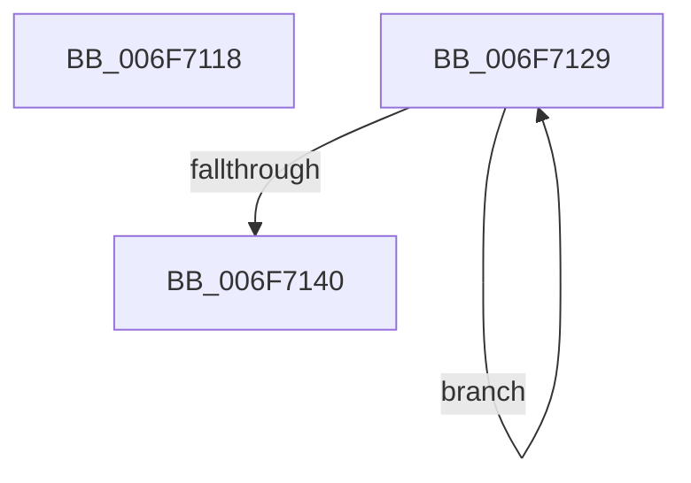

# sub_006F7118

- RVA: `0x006F7118`–`0x006F7145` (길이 `45` bytes)
- VA: `0x00000001406F7118`
- 실행 섹션: `.text`
- PDB 이름 있음: `아니요`; PDB Function 태그: `아니요`
- unwind 정보 RVA: `0x000B3030`
- 디코드: `9`개 명령, `45/45` bytes 표시
- 미해석 바이트: `0` (있으면 어셈블리에 `.byte`로 보존)

> 이 문서는 커널 이미지의 기계어와 PDB 기호를 분석해 생성했습니다. 4번과 5번은 함수 원형과 자료형을 바이너리 사용 방식에서 추정한 C 해석이며 원본 소스 복구 결과는 아닙니다.

## 1. Dependencies

- 직접 호출 지점: **1**; 고유 호출 대상: **1**
- 직접 호출자로 확인된 함수: **0**
- RIP 상대 이미지 참조: **1**

### Outgoing calls
- `0x006F7135` → [HalpTscAdvSynchSkewCounter](../54/HalpTscAdvSynchSkewCounter_function_0054A950.md) (function, `0x0054A950`)

### Direct callers
- 이 함수 시작 RVA로 연결되는 직접 call은 확인되지 않았습니다. 간접 호출은 완전히 역산할 수 없습니다.

### Static image references
- `0x006F7118` → RVA `0x00FC2238` (`.data`; read)

## 2. Other-region calls and transfers

- 다른 실행 섹션으로 향하는 call: **0**
- call이 아닌 외부 분기/꼬리 이동: **2**
  - `0x006F7124` → [HalpTscAdvSynchTarget + 0x118](../49/HalpTscAdvSynchTarget_function_00492A44.md) (`tail-transfer`)
  - `0x006F7140` → [HalpTscAdvSynchTarget + 0x118](../49/HalpTscAdvSynchTarget_function_00492A44.md) (`tail-transfer`)

## 3. Assembly (complete function range)

```asm
006F7118  48 8B 0D 19 B1 8C 00            mov rcx, qword ptr [rip + 0x8cb119]
006F711F  48 89 44 0B 08                  mov qword ptr [rbx + rcx + 8], rax
006F7124  E9 33 BA D9 FF                  jmp 0x140492b5c
006F7129  48 8B 0D 08 B1 8C 00            mov rcx, qword ptr [rip + 0x8cb108]
006F7130  48 8B 4C 0B 08                  mov rcx, qword ptr [rbx + rcx + 8]
006F7135  E8 16 38 E5 FF                  call 0x14054a950
006F713A  41 83 C0 FF                     add r8d, -1
006F713E  75 E9                           jne 0x1406f7129
006F7140  E9 17 BA D9 FF                  jmp 0x140492b5c
```

## 4. C-style interpretation (structured pseudocode)

```c
__int64 __fastcall sub_006F7118(__int64 a1, __int64 a2, int a3)
{
    *(unsigned __int64 *)(v_rbx + *(unsigned __int64 *)(v_rip + 9220377) * 1 + 8) = result;
}
```

## 5. (Beta) C Style

```c
int64_t sub_006F7118(int64_t Arg1, int64_t Arg2, int32_t Arg3)
{
    *(uint64_t *)(local_rbx + *(uint64_t *)(v_rip + 0x8CB119) * 1 + 0x8) = result;
}
```

## 6. Execution-region graph

[열기: 2D/3D 그래프와 함수 탐색 컨트롤 패널](../../../control-panel.html?section=text&rva=0x006F7118&view=graph)

- 2D 그래프는 위에서 아래로 흐르고, 3D 그래프는 빈 공간을 드래그해 회전합니다. Shift+드래그는 이동, 휠은 확대·축소, 함수 노드 선택은 대상 보고서 이동입니다.

### Static fallback


