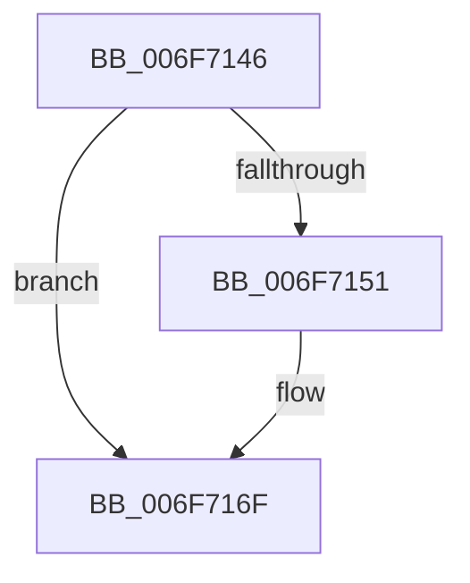

# sub_006F7146

- RVA: `0x006F7146`–`0x006F71BC` (길이 `118` bytes)
- VA: `0x00000001406F7146`
- 실행 섹션: `.text`
- PDB 이름 있음: `아니요`; PDB Function 태그: `아니요`
- unwind 정보 RVA: `0x000B30BC`
- 디코드: `26`개 명령, `118/118` bytes 표시
- 미해석 바이트: `0` (있으면 어셈블리에 `.byte`로 보존)

> 이 문서는 커널 이미지의 기계어와 PDB 기호를 분석해 생성했습니다. 4번과 5번은 함수 원형과 자료형을 바이너리 사용 방식에서 추정한 C 해석이며 원본 소스 복구 결과는 아닙니다.

## 1. Dependencies

- 직접 호출 지점: **1**; 고유 호출 대상: **1**
- 직접 호출자로 확인된 함수: **0**
- RIP 상대 이미지 참조: **3**

### Outgoing calls
- `0x006F71B1` → [MiWalkPageTables](../2C/MiWalkPageTables_function_002C2710.md) (function, `0x002C2710`)

### Direct callers
- 이 함수 시작 RVA로 연결되는 직접 call은 확인되지 않았습니다. 간접 호출은 완전히 역산할 수 없습니다.

### Static image references
- `0x006F7146` → RVA `0x00FC6A88` (`ALMOSTRO`; read)
- `0x006F7193` → RVA `0x004ACD40` (`MiSimpleAgePte`; read)
- `0x006F719E` → RVA `0x00428D10` (`MiAgeWorkingSetTail`; read)

## 2. Other-region calls and transfers

- 다른 실행 섹션으로 향하는 call: **0**
- call이 아닌 외부 분기/꼬리 이동: **1**
  - `0x006F71B7` → [MiSimpleAging + 0x9C](../49/MiSimpleAging_function_004930C8.md) (`tail-transfer`)

## 3. Assembly (complete function range)

```asm
006F7146  48 0F BA 25 39 F9 8C 00 24      bt qword ptr [rip + 0x8cf939], 0x24
006F714F  73 1E                           jae 0x1406f716f
006F7151  8B 8B B8 00 00 00               mov ecx, dword ptr [rbx + 0xb8]
006F7157  C1 E9 08                        shr ecx, 8
006F715A  C1 E9 03                        shr ecx, 3
006F715D  23 CA                           and ecx, edx
006F715F  48 8B 44 24 68                  mov rax, qword ptr [rsp + 0x68]
006F7164  85 C9                           test ecx, ecx
006F7166  48 0F 45 C2                     cmovne rax, rdx
006F716A  48 89 44 24 68                  mov qword ptr [rsp + 0x68], rax
006F716F  48 8D 44 24 20                  lea rax, [rsp + 0x20]
006F7174  48 89 5D 90                     mov qword ptr [rbp - 0x70], rbx
006F7178  48 89 45 28                     mov qword ptr [rbp + 0x28], rax
006F717C  48 8D 4C 24 70                  lea rcx, [rsp + 0x70]
006F7181  40 88 7C 24 79                  mov byte ptr [rsp + 0x79], dil
006F7186  49 8B 43 08                     mov rax, qword ptr [r11 + 8]
006F718A  48 83 4D A0 FF                  or qword ptr [rbp - 0x60], 0xffffffffffffffff
006F718F  48 89 45 B0                     mov qword ptr [rbp - 0x50], rax
006F7193  48 8D 05 A6 5B DB FF            lea rax, [rip - 0x24a45a]
006F719A  48 89 45 18                     mov qword ptr [rbp + 0x18], rax
006F719E  48 8D 05 6B 1B D3 FF            lea rax, [rip - 0x2ce495]
006F71A5  48 89 45 20                     mov qword ptr [rbp + 0x20], rax
006F71A9  C7 44 24 70 06 00 00 00         mov dword ptr [rsp + 0x70], 6
006F71B1  E8 5A B5 BC FF                  call 0x1402c2710
006F71B6  90                              nop
006F71B7  E9 A8 BF D9 FF                  jmp 0x140493164
```

## 4. C-style interpretation (structured pseudocode)

```c
__int64 __fastcall sub_006F7146(__int64 a1, __int64 a2, __int64 a3, __int64 a4, __int64 a5, __int64 a6, __int64 a7, __int64 a8, __int64 a9, __int64 a10, __int64 a11, __int64 a12, __int64 a13, __int64 a14)
{
    __int64 result;
    unsigned __int64 v_stack_p20;
    unsigned __int64 v_stack_p68;
    unsigned int v_stack_p70;
    unsigned __int8 v_stack_p79;

    if (!(condition_is_above_or_equal)) {
        a1 = *(unsigned int *)(v_rbx + 184);
        a1 = (unsigned int)((a1) >> (8));
        a1 = (unsigned int)((a1) >> (3));
        a1 = (unsigned int)((a1) & ((unsigned int)(a2)));
        result = a13;
        if ((unsigned int)(a1) != 0) { result = a2; }
        v_stack_p68 = result;
    }
    *(unsigned __int64 *)(v_rbp - 112) = v_rbx;
    *(unsigned __int64 *)(v_rbp + 40) = v_stack_p20;
    v_stack_p79 = (unsigned __int8)(v_rdi);
    *(unsigned __int64 *)(v_rbp - 80) = *(unsigned __int64 *)(v_r11 + 8);
    *(unsigned __int64 *)(v_rbp + 24) = v_rip - 2401370;
    *(unsigned __int64 *)(v_rbp + 32) = v_rip - 2942101;
    v_stack_p70 = 6;
    result = MiWalkPageTables(a14, a2, a3, a4);
}
```

## 5. (Beta) C Style

```c
int64_t sub_006F7146(int64_t Arg1, int64_t Arg2, int64_t Arg3, int64_t Arg4, uint64_t Arg5, uint64_t Arg6, uint64_t Arg7, uint64_t Arg8, uint64_t Arg9, uint64_t Arg10, uint64_t Arg11, uint64_t Arg12, int64_t Arg13, int64_t Arg14)
{
    int64_t result;
    uint64_t v_stack_p20;
    uint64_t v_stack_p68;
    uint32_t v_stack_p70;
    uint8_t v_stack_p79;

    if (!(condition_is_above_or_equal)) {
        Arg1 = *(uint32_t *)(local_rbx + 0xB8);
        Arg1 = (uint32_t)((Arg1) >> (8));
        Arg1 = (uint32_t)((Arg1) >> (3));
        Arg1 = (uint32_t)((Arg1) & ((uint32_t)(Arg2)));
        result = Arg13;
        if ((uint32_t)(Arg1) != 0) { result = Arg2; }
        v_stack_p68 = result;
    }
    *(uint64_t *)(local_rbp - 0x70) = local_rbx;
    *(uint64_t *)(local_rbp + 0x28) = v_stack_p20;
    v_stack_p79 = (uint8_t)(local_rdi);
    *(uint64_t *)(local_rbp - 0x50) = *(uint64_t *)(local_r11 + 0x8);
    *(uint64_t *)(local_rbp + 0x18) = v_rip - 2401370;
    *(uint64_t *)(local_rbp + 0x20) = v_rip - 2942101;
    v_stack_p70 = 6;
    result = MiWalkPageTables(Arg14, Arg2, Arg3, Arg4);
}
```

## 6. Execution-region graph

[열기: 2D/3D 그래프와 함수 탐색 컨트롤 패널](../../../control-panel.html?section=text&rva=0x006F7146&view=graph)

- 2D 그래프는 위에서 아래로 흐르고, 3D 그래프는 빈 공간을 드래그해 회전합니다. Shift+드래그는 이동, 휠은 확대·축소, 함수 노드 선택은 대상 보고서 이동입니다.

### Static fallback


