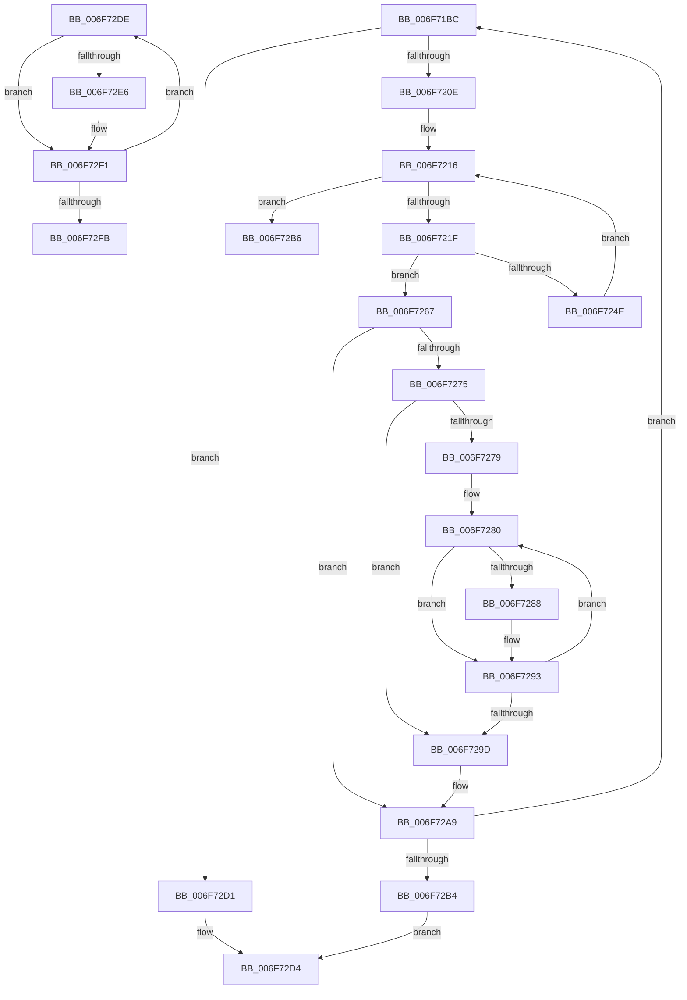

# sub_006F71BC

- RVA: `0x006F71BC`–`0x006F730B` (길이 `335` bytes)
- VA: `0x00000001406F71BC`
- 실행 섹션: `.text`
- PDB 이름 있음: `아니요`; PDB Function 태그: `아니요`
- unwind 정보 RVA: `0x000B31D0`
- 디코드: `100`개 명령, `335/335` bytes 표시
- 미해석 바이트: `0` (있으면 어셈블리에 `.byte`로 보존)

> 이 문서는 커널 이미지의 기계어와 PDB 기호를 분석해 생성했습니다. 4번과 5번은 함수 원형과 자료형을 바이너리 사용 방식에서 추정한 C 해석이며 원본 소스 복구 결과는 아닙니다.

## 1. Dependencies

- 직접 호출 지점: **6**; 고유 호출 대상: **2**
- 직접 호출자로 확인된 함수: **0**
- RIP 상대 이미지 참조: **1**

### Outgoing calls
- `0x006F71FA` → [ExAllocatePool2](../../poolcode/B8/ExAllocatePool2_function_00B820F0.md) (function, `0x00B820F0`)
- `0x006F723F` → [ExAllocatePool2](../../poolcode/B8/ExAllocatePool2_function_00B820F0.md) (function, `0x00B820F0`)
- `0x006F728A` → [ExFreePoolWithTag](../../poolcode/B8/ExFreePoolWithTag_function_00B82870.md) (function, `0x00B82870`)
- `0x006F72A2` → [ExFreePoolWithTag](../../poolcode/B8/ExFreePoolWithTag_function_00B82870.md) (function, `0x00B82870`)
- `0x006F72E8` → [ExFreePoolWithTag](../../poolcode/B8/ExFreePoolWithTag_function_00B82870.md) (function, `0x00B82870`)
- `0x006F7300` → [ExFreePoolWithTag](../../poolcode/B8/ExFreePoolWithTag_function_00B82870.md) (function, `0x00B82870`)

### Direct callers
- 이 함수 시작 RVA로 연결되는 직접 call은 확인되지 않았습니다. 간접 호출은 완전히 역산할 수 없습니다.

### Static image references
- `0x006F71CA` → RVA `0x0003A9D8` (`.rdata`; read)

## 2. Other-region calls and transfers

- 다른 실행 섹션으로 향하는 call: **6**
  - `0x006F71FA` → [ExAllocatePool2](../../poolcode/B8/ExAllocatePool2_function_00B820F0.md) (`.text` → `POOLCODE`)
  - `0x006F723F` → [ExAllocatePool2](../../poolcode/B8/ExAllocatePool2_function_00B820F0.md) (`.text` → `POOLCODE`)
  - `0x006F728A` → [ExFreePoolWithTag](../../poolcode/B8/ExFreePoolWithTag_function_00B82870.md) (`.text` → `POOLCODE`)
  - `0x006F72A2` → [ExFreePoolWithTag](../../poolcode/B8/ExFreePoolWithTag_function_00B82870.md) (`.text` → `POOLCODE`)
  - `0x006F72E8` → [ExFreePoolWithTag](../../poolcode/B8/ExFreePoolWithTag_function_00B82870.md) (`.text` → `POOLCODE`)
  - `0x006F7300` → [ExFreePoolWithTag](../../poolcode/B8/ExFreePoolWithTag_function_00B82870.md) (`.text` → `POOLCODE`)
- call이 아닌 외부 분기/꼬리 이동: **3**
  - `0x006F72CC` → [HvpAllocateLogBuffers + 0x8D](../49/HvpAllocateLogBuffers_function_00493A14.md) (`tail-transfer`)
  - `0x006F72D9` → [HvpAllocateLogBuffers + 0x8D](../49/HvpAllocateLogBuffers_function_00493A14.md) (`tail-transfer`)
  - `0x006F7306` → [HvpAllocateLogBuffers + 0x72](../49/HvpAllocateLogBuffers_function_00493A14.md) (`tail-transfer`)

## 3. Assembly (complete function range)

```asm
006F71BC  8B C3                           mov eax, ebx
006F71BE  33 D2                           xor edx, edx
006F71C0  89 5C 24 20                     mov dword ptr [rsp + 0x20], ebx
006F71C4  41 B8 43 4D 49 6F               mov r8d, 0x6f494d43
006F71CA  48 8D 1D 07 38 94 FF            lea rbx, [rip - 0x6bc7f9]
006F71D1  8B 1C 83                        mov ebx, dword ptr [rbx + rax*4]
006F71D4  41 8B C5                        mov eax, r13d
006F71D7  C1 E3 0C                        shl ebx, 0xc
006F71DA  F7 F3                           div ebx
006F71DC  89 9C 24 88 00 00 00            mov dword ptr [rsp + 0x88], ebx
006F71E3  85 D2                           test edx, edx
006F71E5  8D 48 01                        lea ecx, [rax + 1]
006F71E8  0F 44 C8                        cmove ecx, eax
006F71EB  8B F1                           mov esi, ecx
006F71ED  48 8D 14 49                     lea rdx, [rcx + rcx*2]
006F71F1  B9 00 01 00 00                  mov ecx, 0x100
006F71F6  48 C1 E2 03                     shl rdx, 3
006F71FA  E8 F1 AE 48 00                  call 0x140b820f0
006F71FF  48 8B F8                        mov rdi, rax
006F7202  4C 8B F8                        mov r15, rax
006F7205  48 85 C0                        test rax, rax
006F7208  0F 84 C3 00 00 00               je 0x1406f72d1
006F720E  41 8B ED                        mov ebp, r13d
006F7211  45 33 E4                        xor r12d, r12d
006F7214  8B D3                           mov edx, ebx
006F7216  44 3B E6                        cmp r12d, esi
006F7219  0F 83 97 00 00 00               jae 0x1406f72b6
006F721F  4B 8D 1C 64                     lea rbx, [r12 + r12*2]
006F7223  8B C5                           mov eax, ebp
006F7225  83 24 DF 00                     and dword ptr [rdi + rbx*8], 0
006F7229  B9 08 01 00 00                  mov ecx, 0x108
006F722E  3B EA                           cmp ebp, edx
006F7230  41 B8 43 4D 49 6F               mov r8d, 0x6f494d43
006F7236  0F 43 C2                        cmovae eax, edx
006F7239  8B D0                           mov edx, eax
006F723B  89 54 DF 10                     mov dword ptr [rdi + rbx*8 + 0x10], edx
006F723F  E8 AC AE 48 00                  call 0x140b820f0
006F7244  48 89 44 DF 08                  mov qword ptr [rdi + rbx*8 + 8], rax
006F7249  48 85 C0                        test rax, rax
006F724C  74 19                           je 0x1406f7267
006F724E  8B 94 24 88 00 00 00            mov edx, dword ptr [rsp + 0x88]
006F7255  8B C5                           mov eax, ebp
006F7257  8B CD                           mov ecx, ebp
006F7259  2B C2                           sub eax, edx
006F725B  33 ED                           xor ebp, ebp
006F725D  41 FF C4                        inc r12d
006F7260  3B CA                           cmp ecx, edx
006F7262  0F 43 E8                        cmovae ebp, eax
006F7265  EB AF                           jmp 0x1406f7216
006F7267  8B 44 24 20                     mov eax, dword ptr [rsp + 0x20]
006F726B  8B D8                           mov ebx, eax
006F726D  48 8B EE                        mov rbp, rsi
006F7270  4D 85 FF                        test r15, r15
006F7273  74 34                           je 0x1406f72a9
006F7275  85 F6                           test esi, esi
006F7277  74 24                           je 0x1406f729d
006F7279  49 8D 7F 08                     lea rdi, [r15 + 8]
006F727D  4C 8B E6                        mov r12, rsi
006F7280  48 8B 0F                        mov rcx, qword ptr [rdi]
006F7283  48 85 C9                        test rcx, rcx
006F7286  74 0B                           je 0x1406f7293
006F7288  33 D2                           xor edx, edx
006F728A  E8 E1 B5 48 00                  call 0x140b82870
006F728F  48 83 27 00                     and qword ptr [rdi], 0
006F7293  48 83 C7 18                     add rdi, 0x18
006F7297  49 83 EC 01                     sub r12, 1
006F729B  75 E3                           jne 0x1406f7280
006F729D  33 D2                           xor edx, edx
006F729F  49 8B CF                        mov rcx, r15
006F72A2  E8 C9 B5 48 00                  call 0x140b82870
006F72A7  33 FF                           xor edi, edi
006F72A9  FF C3                           inc ebx
006F72AB  83 FB 09                        cmp ebx, 9
006F72AE  0F 85 08 FF FF FF               jne 0x1406f71bc
006F72B4  EB 1E                           jmp 0x1406f72d4
006F72B6  48 8B 44 24 70                  mov rax, qword ptr [rsp + 0x70]
006F72BB  48 8B EE                        mov rbp, rsi
006F72BE  48 89 38                        mov qword ptr [rax], rdi
006F72C1  33 FF                           xor edi, edi
006F72C3  48 8B 44 24 78                  mov rax, qword ptr [rsp + 0x78]
006F72C8  33 DB                           xor ebx, ebx
006F72CA  89 30                           mov dword ptr [rax], esi
006F72CC  E9 D0 C7 D9 FF                  jmp 0x140493aa1
006F72D1  48 8B EE                        mov rbp, rsi
006F72D4  BB 17 00 00 C0                  mov ebx, 0xc0000017
006F72D9  E9 C3 C7 D9 FF                  jmp 0x140493aa1
006F72DE  48 8B 0E                        mov rcx, qword ptr [rsi]
006F72E1  48 85 C9                        test rcx, rcx
006F72E4  74 0B                           je 0x1406f72f1
006F72E6  33 D2                           xor edx, edx
006F72E8  E8 83 B5 48 00                  call 0x140b82870
006F72ED  48 83 26 00                     and qword ptr [rsi], 0
006F72F1  48 83 C6 18                     add rsi, 0x18
006F72F5  48 83 ED 01                     sub rbp, 1
006F72F9  75 E3                           jne 0x1406f72de
006F72FB  33 D2                           xor edx, edx
006F72FD  48 8B CF                        mov rcx, rdi
006F7300  E8 6B B5 48 00                  call 0x140b82870
006F7305  90                              nop
006F7306  E9 7B C7 D9 FF                  jmp 0x140493a86
```

## 4. C-style interpretation (structured pseudocode)

```c
__int64 __fastcall sub_006F71BC(__int64 a1, int a2, __int64 a3, __int64 a4, __int64 a5, __int64 a6, __int64 a7, __int64 a8, __int64 a9, __int64 a10, __int64 a11, __int64 a12, __int64 a13, __int64 a14, __int64 a15, __int64 a16, unsigned int a17)
{
    __int64 result;
    __int64 v_r12;
    __int64 v_rbp;
    __int64 v_rbx;
    __int64 v_rdi;
    unsigned int v_stack_p20;
    unsigned int v_stack_p88;

    a2 = 0;
    v_stack_p20 = (unsigned int)(v_rbx);
    v_rbx = (unsigned int)(((unsigned int)(*(unsigned int *)(v_rip - 7063545 + (unsigned int)((unsigned int)(v_rbx)) * 4))) << (12));
    v_stack_p88 = (unsigned int)(v_rbx);
    a1 = (unsigned int)((unsigned int)(v_r13)) + 1;
    if (0 == 0) { a1 = (unsigned int)((unsigned int)((unsigned int)(v_r13))); }
    a2 = (a1 + a1 * 2) << (3);
    result = ExAllocatePool2(256, a2, (unsigned int)(0x6F494D43ULL), a4);
    if (result == 0) goto loc_006F72D1;
    v_r12 = 0;
loc_006F7216:
    if (0 >= ((unsigned int)((unsigned int)((unsigned int)(a1))))) goto loc_006F72B6;
    result = (unsigned int)((unsigned int)((unsigned int)((unsigned int)(v_r13))));
    if (((unsigned int)((unsigned int)((unsigned int)(v_r13)))) >= ((unsigned int)((unsigned int)((unsigned int)(v_rbx))))) { result = (unsigned int)((unsigned int)((unsigned int)(v_rbx))); }
    *(unsigned int *)(result + v_r12 + v_r12 * 2 * 8 + 16) = (unsigned int)((unsigned int)((unsigned int)(result)));
    result = ExAllocatePool2(264, (unsigned int)((unsigned int)(result)), (unsigned int)(0x6F494D43ULL), a4);
    *(unsigned __int64 *)(result + v_r12 + v_r12 * 2 * 8 + 8) = result;
    if (result == 0) goto loc_006F7267;
    result = (unsigned int)(((unsigned int)((unsigned int)((unsigned int)((unsigned int)(v_r13))))) - ((unsigned int)((unsigned int)(a17))));
    v_rbp = 0;
    v_r12 = (unsigned int)((v_r12) + 1);
    if (((unsigned int)((unsigned int)((unsigned int)((unsigned int)((unsigned int)(v_r13)))))) >= ((unsigned int)((unsigned int)(a17)))) { v_rbp = (unsigned int)(result); }
    goto loc_006F7216;
loc_006F7267:
    if (result == 0) goto loc_006F72A9;
    if ((unsigned int)((unsigned int)((unsigned int)(a1))) == 0) goto loc_006F729D;
loc_006F7280:
    result = (unsigned int)(v_stack_p20);
    if (*(unsigned __int64 *)(result + 8) != 0) {
        a2 = 0;
        result = ExFreePoolWithTag(*(unsigned __int64 *)(result + 8), a2, (unsigned int)(0x6F494D43ULL), a4);
    }
    v_rdi = (result + 8) + (24);
    v_r12 = ((unsigned int)((unsigned int)(a1))) - (1);
    if (condition_is_not_equal) goto loc_006F7280;
loc_006F729D:
    a2 = 0;
    result = ExFreePoolWithTag(result, a2, (unsigned int)(0x6F494D43ULL), a4);
    v_rdi = 0;
loc_006F72A9:
    v_rbx = (unsigned int)(((unsigned int)((unsigned int)((unsigned int)(v_stack_p20)))) + 1);
    if (((unsigned int)(v_rbx)) != 9) goto loc_006F71BC;
    goto loc_006F72D4;
loc_006F72B6:
    *(unsigned __int64 *)(a14) = 0;
    v_rdi = 0;
    v_rbx = 0;
    *(unsigned int *)(a15) = (unsigned int)((unsigned int)((unsigned int)(a1)));
loc_006F72D1:
loc_006F72D4:
}
```

## 5. (Beta) C Style

```c
int64_t sub_006F71BC(int64_t Arg1, int32_t Arg2, int64_t Arg3, int64_t Arg4, uint64_t Arg5, uint64_t Arg6, uint64_t Arg7, uint64_t Arg8, uint64_t Arg9, uint64_t Arg10, uint64_t Arg11, uint64_t Arg12, uint64_t Arg13, void *Arg14, void *Arg15, uint64_t Arg16, uint32_t Arg17)
{
    uint8_t *arg14 = (uint8_t *)Arg14;
    uint8_t *arg15 = (uint8_t *)Arg15;

    int64_t result;
    int64_t local_r12;
    int64_t local_rbp;
    int64_t local_rbx;
    int64_t local_rdi;
    uint32_t v_stack_p20;
    uint32_t v_stack_p88;

    Arg2 = 0;
    v_stack_p20 = (uint32_t)(local_rbx);
    local_rbx = (uint32_t)(((uint32_t)(*(uint32_t *)(v_rip - 0x6BC7F9 + (uint32_t)((uint32_t)(local_rbx)) * 4))) << (12));
    v_stack_p88 = (uint32_t)(local_rbx);
    Arg1 = (uint32_t)((uint32_t)(local_r13)) + 1;
    if (0 == 0) { Arg1 = (uint32_t)((uint32_t)((uint32_t)(local_r13))); }
    Arg2 = (Arg1 + Arg1 * 2) << (3);
    result = ExAllocatePool2(256, Arg2, (uint32_t)(0x6F494D43ULL), Arg4);
    if (result == 0) goto loc_006F72D1;
    local_r12 = 0;
loc_006F7216:
    if (0 >= ((uint32_t)((uint32_t)((uint32_t)(Arg1))))) goto loc_006F72B6;
    result = (uint32_t)((uint32_t)((uint32_t)((uint32_t)(local_r13))));
    if (((uint32_t)((uint32_t)((uint32_t)(local_r13)))) >= ((uint32_t)((uint32_t)((uint32_t)(local_rbx))))) { result = (uint32_t)((uint32_t)((uint32_t)(local_rbx))); }
    *(uint32_t *)(result + local_r12 + local_r12 * 2 * 8 + 0x10) = (uint32_t)((uint32_t)((uint32_t)(result)));
    result = ExAllocatePool2(264, (uint32_t)((uint32_t)(result)), (uint32_t)(0x6F494D43ULL), Arg4);
    *(uint64_t *)(result + local_r12 + local_r12 * 2 * 8 + 0x8) = result;
    if (result == 0) goto loc_006F7267;
    result = (uint32_t)(((uint32_t)((uint32_t)((uint32_t)((uint32_t)(local_r13))))) - ((uint32_t)((uint32_t)(Arg17))));
    local_rbp = 0;
    local_r12 = (uint32_t)((local_r12) + 1);
    if (((uint32_t)((uint32_t)((uint32_t)((uint32_t)((uint32_t)(local_r13)))))) >= ((uint32_t)((uint32_t)(Arg17)))) { local_rbp = (uint32_t)(result); }
    goto loc_006F7216;
loc_006F7267:
    if (result == 0) goto loc_006F72A9;
    if ((uint32_t)((uint32_t)((uint32_t)(Arg1))) == 0) goto loc_006F729D;
loc_006F7280:
    result = (uint32_t)(v_stack_p20);
    if (*(uint64_t *)(result + 0x8) != 0) {
        Arg2 = 0;
        result = ExFreePoolWithTag(*(uint64_t *)(result + 0x8), Arg2, (uint32_t)(0x6F494D43ULL), Arg4);
    }
    local_rdi = (result + 8) + (24);
    local_r12 = ((uint32_t)((uint32_t)(Arg1))) - (1);
    if (condition_is_not_equal) goto loc_006F7280;
loc_006F729D:
    Arg2 = 0;
    result = ExFreePoolWithTag(result, Arg2, (uint32_t)(0x6F494D43ULL), Arg4);
    local_rdi = 0;
loc_006F72A9:
    local_rbx = (uint32_t)(((uint32_t)((uint32_t)((uint32_t)(v_stack_p20)))) + 1);
    if (((uint32_t)(local_rbx)) != 9) goto loc_006F71BC;
    goto loc_006F72D4;
loc_006F72B6:
    *(uint64_t *)(arg14) = 0;
    local_rdi = 0;
    local_rbx = 0;
    *(uint32_t *)(arg15) = (uint32_t)((uint32_t)((uint32_t)(Arg1)));
loc_006F72D1:
loc_006F72D4:
}
```

### 관측된 메모리 오프셋

구조체 형식이 확인되지 않은 접근은 인자 기준의 오프셋으로만 기록했습니다.

| 기준 인자 | 오프셋 표현 | 폭 (bit) | 접근 |
|---|---:|---:|---|
| `Arg14` | `+ 0x0` | `64` | `W` |
| `Arg15` | `+ 0x0` | `32` | `W` |

## 6. Execution-region graph

[열기: 2D/3D 그래프와 함수 탐색 컨트롤 패널](../../../control-panel.html?section=text&rva=0x006F71BC&view=graph)

- 2D 그래프는 위에서 아래로 흐르고, 3D 그래프는 빈 공간을 드래그해 회전합니다. Shift+드래그는 이동, 휠은 확대·축소, 함수 노드 선택은 대상 보고서 이동입니다.

### Static fallback


