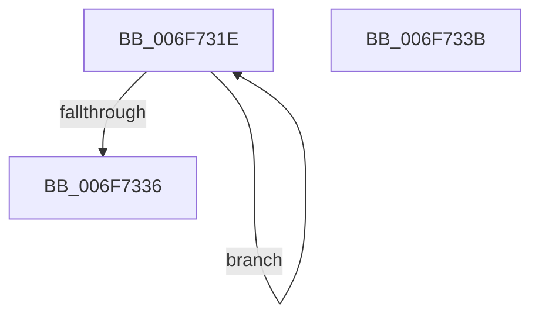

# sub_006F731E

- RVA: `0x006F731E`–`0x006F7340` (길이 `34` bytes)
- VA: `0x00000001406F731E`
- 실행 섹션: `.text`
- PDB 이름 있음: `아니요`; PDB Function 태그: `아니요`
- unwind 정보 RVA: `0x000B3238`
- 디코드: `8`개 명령, `34/34` bytes 표시
- 미해석 바이트: `0` (있으면 어셈블리에 `.byte`로 보존)

> 이 문서는 커널 이미지의 기계어와 PDB 기호를 분석해 생성했습니다. 4번과 5번은 함수 원형과 자료형을 바이너리 사용 방식에서 추정한 C 해석이며 원본 소스 복구 결과는 아닙니다.

## 1. Dependencies

- 직접 호출 지점: **1**; 고유 호출 대상: **1**
- 직접 호출자로 확인된 함수: **0**
- RIP 상대 이미지 참조: **0**

### Outgoing calls
- `0x006F7324` → [ExpInterlockedPushEntrySList](../6B/ExpInterlockedPushEntrySList_function_006BA5B0.md) (function, `0x006BA5B0`)

### Direct callers
- 이 함수 시작 RVA로 연결되는 직접 call은 확인되지 않았습니다. 간접 호출은 완전히 역산할 수 없습니다.

### Static image references
- 디코드된 RIP-relative 메모리 참조가 없습니다.

## 2. Other-region calls and transfers

- 다른 실행 섹션으로 향하는 call: **0**
- call이 아닌 외부 분기/꼬리 이동: **2**
  - `0x006F7336` → [KeAllocateInterrupt + 0x32](../49/KeAllocateInterrupt_function_00493F50.md) (`tail-transfer`)
  - `0x006F733B` → [KeAllocateInterrupt + 0x46](../49/KeAllocateInterrupt_function_00493F50.md) (`tail-transfer`)

## 3. Assembly (complete function range)

```asm
006F731E  48 8B D3                        mov rdx, rbx
006F7321  48 8B CD                        mov rcx, rbp
006F7324  E8 87 32 FC FF                  call 0x1406ba5b0
006F7329  48 81 C3 40 01 00 00            add rbx, 0x140
006F7330  48 83 EE 01                     sub rsi, 1
006F7334  75 E8                           jne 0x1406f731e
006F7336  E9 47 CC D9 FF                  jmp 0x140493f82
006F733B  E9 56 CC D9 FF                  jmp 0x140493f96
```

## 4. C-style interpretation (structured pseudocode)

```c
__int64 __fastcall sub_006F731E(void)
{
    __int64 result;
    __int64 v_rbx;
    __int64 v_rsi;

    result = ExpInterlockedPushEntrySList(v_rbp, v_rbx, a3, a4);
    v_rbx = (v_rbx) + (320);
    v_rsi = (v_rsi) - (1);
    if (condition_is_not_equal) goto loc_006F731E;
}
```

## 5. (Beta) C Style

```c
void sub_006F731E(void)
{
    int64_t result;
    int64_t local_rbx;
    int64_t local_rsi;

    result = ExpInterlockedPushEntrySList(local_rbp, local_rbx, a3, a4);
    local_rbx = (local_rbx) + (320);
    local_rsi = (local_rsi) - (1);
    if (condition_is_not_equal) goto loc_006F731E;
}
```

## 6. Execution-region graph

[열기: 2D/3D 그래프와 함수 탐색 컨트롤 패널](../../../control-panel.html?section=text&rva=0x006F731E&view=graph)

- 2D 그래프는 위에서 아래로 흐르고, 3D 그래프는 빈 공간을 드래그해 회전합니다. Shift+드래그는 이동, 휠은 확대·축소, 함수 노드 선택은 대상 보고서 이동입니다.

### Static fallback


