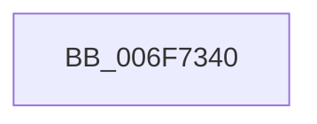

# sub_006F7340

- RVA: `0x006F7340`–`0x006F736B` (길이 `43` bytes)
- VA: `0x00000001406F7340`
- 실행 섹션: `.text`
- PDB 이름 있음: `아니요`; PDB Function 태그: `아니요`
- unwind 정보 RVA: `0x000B3370`
- 디코드: `10`개 명령, `43/43` bytes 표시
- 미해석 바이트: `0` (있으면 어셈블리에 `.byte`로 보존)

> 이 문서는 커널 이미지의 기계어와 PDB 기호를 분석해 생성했습니다. 4번과 5번은 함수 원형과 자료형을 바이너리 사용 방식에서 추정한 C 해석이며 원본 소스 복구 결과는 아닙니다.

## 1. Dependencies

- 직접 호출 지점: **2**; 고유 호출 대상: **2**
- 직접 호출자로 확인된 함수: **0**
- RIP 상대 이미지 참조: **2**

### Outgoing calls
- `0x006F734A` → [KeReleaseSpinLock](../39/KeReleaseSpinLock_function_00392BA0.md) (function, `0x00392BA0`)
- `0x006F7360` → [KeReleaseMutant](../39/KeReleaseMutant_function_003967D0.md) (function, `0x003967D0`)

### Direct callers
- 이 함수 시작 RVA로 연결되는 직접 call은 확인되지 않았습니다. 간접 호출은 완전히 역산할 수 없습니다.

### Static image references
- `0x006F7343` → RVA `0x00EFFC28` (`.data`; read)
- `0x006F7352` → RVA `0x00EFFA60` (`.data`; read)

## 2. Other-region calls and transfers

- 다른 실행 섹션으로 향하는 call: **0**
- call이 아닌 외부 분기/꼬리 이동: **1**
  - `0x006F7366` → [WmipBuildTraceDeviceList + 0xF7](../49/WmipBuildTraceDeviceList_function_00494050.md) (`tail-transfer`)

## 3. Assembly (complete function range)

```asm
006F7340  41 8A D6                        mov dl, r14b
006F7343  48 8D 0D DE 88 80 00            lea rcx, [rip + 0x8088de]
006F734A  E8 51 B8 C9 FF                  call 0x140392ba0
006F734F  45 33 C9                        xor r9d, r9d
006F7352  48 8D 0D 07 87 80 00            lea rcx, [rip + 0x808707]
006F7359  45 33 C0                        xor r8d, r8d
006F735C  41 8D 51 01                     lea edx, [r9 + 1]
006F7360  E8 6B F4 C9 FF                  call 0x1403967d0
006F7365  90                              nop
006F7366  E9 DC CD D9 FF                  jmp 0x140494147
```

## 4. C-style interpretation (structured pseudocode)

```c
__int64 __fastcall sub_006F7340(__int64 a1, __int64 a2, int a3, int a4)
{
    __int64 result;

    result = KeReleaseSpinLock(v_rip + 8423646, (unsigned __int8)(v_r14), a3, a4);
    a4 = 0;
    a3 = 0;
    result = KeReleaseMutant(v_rip + 8423175, a4 + 1, a3, a4);
}
```

## 5. (Beta) C Style

```c
int64_t sub_006F7340(int64_t Arg1, int64_t Arg2, int32_t Arg3, int32_t Arg4)
{
    int64_t result;

    result = KeReleaseSpinLock(v_rip + 8423646, (uint8_t)(local_r14), Arg3, Arg4);
    Arg4 = 0;
    Arg3 = 0;
    result = KeReleaseMutant(v_rip + 8423175, Arg4 + 1, Arg3, Arg4);
}
```

## 6. Execution-region graph

[열기: 2D/3D 그래프와 함수 탐색 컨트롤 패널](../../../control-panel.html?section=text&rva=0x006F7340&view=graph)

- 2D 그래프는 위에서 아래로 흐르고, 3D 그래프는 빈 공간을 드래그해 회전합니다. Shift+드래그는 이동, 휠은 확대·축소, 함수 노드 선택은 대상 보고서 이동입니다.

### Static fallback


