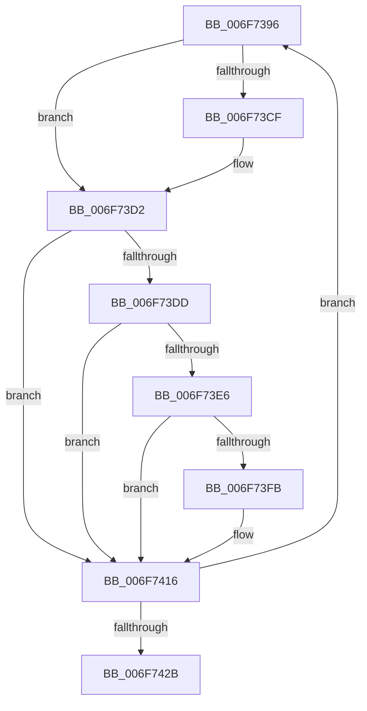

# sub_006F7396

- RVA: `0x006F7396`–`0x006F7430` (길이 `154` bytes)
- VA: `0x00000001406F7396`
- 실행 섹션: `.text`
- PDB 이름 있음: `아니요`; PDB Function 태그: `아니요`
- unwind 정보 RVA: `0x000B33E8`
- 디코드: `38`개 명령, `154/154` bytes 표시
- 미해석 바이트: `0` (있으면 어셈블리에 `.byte`로 보존)

> 이 문서는 커널 이미지의 기계어와 PDB 기호를 분석해 생성했습니다. 4번과 5번은 함수 원형과 자료형을 바이너리 사용 방식에서 추정한 C 해석이며 원본 소스 복구 결과는 아닙니다.

## 1. Dependencies

- 직접 호출 지점: **1**; 고유 호출 대상: **1**
- 직접 호출자로 확인된 함수: **0**
- RIP 상대 이미지 참조: **1**

### Outgoing calls
- `0x006F7407` → [MiCheckLinearProtectedPteAccessedBit](../29/MiCheckLinearProtectedPteAccessedBit_function_00292D80.md) (function, `0x00292D80`)

### Direct callers
- 이 함수 시작 RVA로 연결되는 직접 call은 확인되지 않았습니다. 간접 호출은 완전히 역산할 수 없습니다.

### Static image references
- `0x006F73C2` → RVA `0x00FC6A88` (`ALMOSTRO`; read)

## 2. Other-region calls and transfers

- 다른 실행 섹션으로 향하는 call: **0**
- call이 아닌 외부 분기/꼬리 이동: **1**
  - `0x006F742B` → [MiPerformSafePdeWrite + 0xA2](../49/MiPerformSafePdeWrite_function_00494300.md) (`tail-transfer`)

## 3. Assembly (complete function range)

```asm
006F7396  48 8B CB                        mov rcx, rbx
006F7399  48 8B F3                        mov rsi, rbx
006F739C  48 83 C9 20                     or rcx, 0x20
006F73A0  45 85 E4                        test r12d, r12d
006F73A3  48 0F 44 CB                     cmove rcx, rbx
006F73A7  48 8B C1                        mov rax, rcx
006F73AA  49 0B C7                        or rax, r15
006F73AD  45 85 ED                        test r13d, r13d
006F73B0  48 0F 44 C1                     cmove rax, rcx
006F73B4  48 8B F8                        mov rdi, rax
006F73B7  48 83 CF 04                     or rdi, 4
006F73BB  45 85 F6                        test r14d, r14d
006F73BE  48 0F 44 F8                     cmove rdi, rax
006F73C2  48 F7 05 BB F6 8C 00 00 00 00 02  test qword ptr [rip + 0x8cf6bb], 0x2000000
006F73CD  74 03                           je 0x1406f73d2
006F73CF  0F AE E8                        lfence
006F73D2  48 0F BA 25 AD F6 8C 00 24      bt qword ptr [rip + 0x8cf6ad], 0x24
006F73DB  73 39                           jae 0x1406f7416
006F73DD  40 8A C7                        mov al, dil
006F73E0  24 21                           and al, 0x21
006F73E2  3C 01                           cmp al, 1
006F73E4  75 30                           jne 0x1406f7416
006F73E6  48 8B C2                        mov rax, rdx
006F73E9  48 B9 00 00 00 00 40 00 00 00   movabs rcx, 0x4000000000
006F73F3  48 03 C1                        add rax, rcx
006F73F6  48 3B E8                        cmp rbp, rax
006F73F9  72 1B                           jb 0x1406f7416
006F73FB  41 B8 80 00 00 00               mov r8d, 0x80
006F7401  48 8B D7                        mov rdx, rdi
006F7404  48 8B CD                        mov rcx, rbp
006F7407  E8 74 B9 B9 FF                  call 0x140292d80
006F740C  48 BA 00 00 00 00 80 F6 FF FF   movabs rdx, 0xfffff68000000000
006F7416  48 8B C3                        mov rax, rbx
006F7419  F0 48 0F B1 7D 00               lock cmpxchg qword ptr [rbp], rdi
006F741F  48 8B D8                        mov rbx, rax
006F7422  48 3B C6                        cmp rax, rsi
006F7425  0F 85 6B FF FF FF               jne 0x1406f7396
006F742B  E9 72 CF D9 FF                  jmp 0x1404943a2
```

## 4. C-style interpretation (structured pseudocode)

```c
__int64 __fastcall sub_006F7396(__int64 a1, __int64 a2)
{
    __int64 result;
    __int64 v_rdi;

    a1 = (v_rbx) | (32);
    if ((unsigned int)(v_r12) == 0) { a1 = v_rbx; }
    result = (a1) | (v_r15);
    if ((unsigned int)(v_r13) == 0) { result = a1; }
    v_rdi = (result) | (4);
    if ((unsigned int)(v_r14) == 0) { v_rdi = result; }
    if (((*(unsigned __int64 *)(v_rip + 9238203)) & (0x2000000ULL)) != 0) {
    }
    if (condition_is_above_or_equal) goto loc_006F7416;
    result = (unsigned __int8)(((unsigned __int8)(v_rdi)) & (33));
    if (((unsigned __int8)(result)) != 1) goto loc_006F7416;
    result = (a2) + (a1);
    if (v_rbp >= result) {
        a3 = 128;
        a2 = v_rdi;
        a1 = v_rbp;
        result = MiCheckLinearProtectedPteAccessedBit(a1, a2, a3, a4);
    }
    if (v_rbx != v_rbx) goto loc_006F7396;
}
```

## 5. (Beta) C Style

```c
int64_t sub_006F7396(int64_t Arg1, int64_t Arg2)
{
    int64_t result;
    int64_t local_rdi;

    Arg1 = (local_rbx) | (32);
    if ((uint32_t)(local_r12) == 0) { Arg1 = local_rbx; }
    result = (Arg1) | (local_r15);
    if ((uint32_t)(local_r13) == 0) { result = Arg1; }
    local_rdi = (result) | (4);
    if ((uint32_t)(local_r14) == 0) { local_rdi = result; }
    if (((*(uint64_t *)(v_rip + 0x8CF6BB)) & (0x2000000ULL)) != 0) {
    }
    if (condition_is_above_or_equal) goto loc_006F7416;
    result = (uint8_t)(((uint8_t)(local_rdi)) & (33));
    if (((uint8_t)(result)) != 1) goto loc_006F7416;
    result = (Arg2) + (Arg1);
    if (local_rbp >= result) {
        a3 = 128;
        Arg2 = local_rdi;
        Arg1 = local_rbp;
        result = MiCheckLinearProtectedPteAccessedBit(Arg1, Arg2, a3, a4);
    }
    if (local_rbx != local_rbx) goto loc_006F7396;
}
```

## 6. Execution-region graph

[열기: 2D/3D 그래프와 함수 탐색 컨트롤 패널](../../../control-panel.html?section=text&rva=0x006F7396&view=graph)

- 2D 그래프는 위에서 아래로 흐르고, 3D 그래프는 빈 공간을 드래그해 회전합니다. Shift+드래그는 이동, 휠은 확대·축소, 함수 노드 선택은 대상 보고서 이동입니다.

### Static fallback


