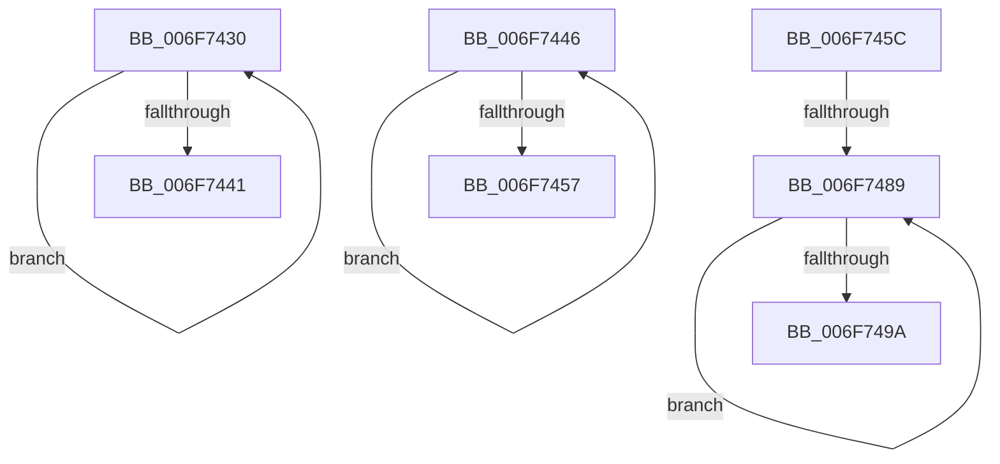

# sub_006F7430

- RVA: `0x006F7430`–`0x006F749F` (길이 `111` bytes)
- VA: `0x00000001406F7430`
- 실행 섹션: `.text`
- PDB 이름 있음: `아니요`; PDB Function 태그: `아니요`
- unwind 정보 RVA: `0x000B3418`
- 디코드: `28`개 명령, `111/111` bytes 표시
- 미해석 바이트: `0` (있으면 어셈블리에 `.byte`로 보존)

> 이 문서는 커널 이미지의 기계어와 PDB 기호를 분석해 생성했습니다. 4번과 5번은 함수 원형과 자료형을 바이너리 사용 방식에서 추정한 C 해석이며 원본 소스 복구 결과는 아닙니다.

## 1. Dependencies

- 직접 호출 지점: **0**; 고유 호출 대상: **0**
- 직접 호출자로 확인된 함수: **0**
- RIP 상대 이미지 참조: **1**

### Outgoing calls
- 직접 디코드된 call 명령이 없습니다.

### Direct callers
- 이 함수 시작 RVA로 연결되는 직접 call은 확인되지 않았습니다. 간접 호출은 완전히 역산할 수 없습니다.

### Static image references
- `0x006F7432` → RVA `0x00FC2238` (`.data`; read)

## 2. Other-region calls and transfers

- 다른 실행 섹션으로 향하는 call: **0**
- call이 아닌 외부 분기/꼬리 이동: **4**
  - `0x006F7441` → [HalpTscAdvSynchToLeader + 0x32](../49/HalpTscAdvSynchToLeader_function_00494494.md) (`tail-transfer`)
  - `0x006F7457` → [HalpTscAdvSynchToLeader + 0x124](../49/HalpTscAdvSynchToLeader_function_00494494.md) (`tail-transfer`)
  - `0x006F7483` → [HalpTscAdvSynchToLeader + 0x124](../49/HalpTscAdvSynchToLeader_function_00494494.md) (`tail-transfer`)
  - `0x006F749A` → [HalpTscAdvSynchToLeader + 0x124](../49/HalpTscAdvSynchToLeader_function_00494494.md) (`tail-transfer`)

## 3. Assembly (complete function range)

```asm
006F7430  F3 90                           pause
006F7432  48 8B 05 FF AD 8C 00            mov rax, qword ptr [rip + 0x8cadff]
006F7439  8B 0C 02                        mov ecx, dword ptr [rdx + rax]
006F743C  41 3B CC                        cmp ecx, r12d
006F743F  74 EF                           je 0x1406f7430
006F7441  E9 80 D0 D9 FF                  jmp 0x1404944c6
006F7446  F3 90                           pause
006F7448  48 8B 05 E9 AD 8C 00            mov rax, qword ptr [rip + 0x8cade9]
006F744F  8B 0C 02                        mov ecx, dword ptr [rdx + rax]
006F7452  83 F9 03                        cmp ecx, 3
006F7455  74 EF                           je 0x1406f7446
006F7457  E9 5C D1 D9 FF                  jmp 0x1404945b8
006F745C  49 03 F7                        add rsi, r15
006F745F  48 89 74 02 08                  mov qword ptr [rdx + rax + 8], rsi
006F7464  F0 83 0C 24 00                  lock or dword ptr [rsp], 0
006F7469  48 8B 0D C8 AD 8C 00            mov rcx, qword ptr [rip + 0x8cadc8]
006F7470  41 8B C4                        mov eax, r12d
006F7473  87 04 0A                        xchg dword ptr [rdx + rcx], eax
006F7476  48 8B 0D BB AD 8C 00            mov rcx, qword ptr [rip + 0x8cadbb]
006F747D  8B 04 0A                        mov eax, dword ptr [rdx + rcx]
006F7480  41 3B C4                        cmp eax, r12d
006F7483  0F 85 2F D1 D9 FF               jne 0x1404945b8
006F7489  F3 90                           pause
006F748B  48 8B 05 A6 AD 8C 00            mov rax, qword ptr [rip + 0x8cada6]
006F7492  8B 0C 02                        mov ecx, dword ptr [rdx + rax]
006F7495  41 3B CC                        cmp ecx, r12d
006F7498  74 EF                           je 0x1406f7489
006F749A  E9 19 D1 D9 FF                  jmp 0x1404945b8
```

## 4. C-style interpretation (structured pseudocode)

```c
__int64 __fastcall sub_006F7430(__int64 a1, __int64 a2)
{
    unsigned int v_stack_p0;

    if (((unsigned int)((unsigned int)(*(unsigned int *)(a2 + *(unsigned __int64 *)(v_rip + 9219583) * 1)))) == ((unsigned int)(v_r12))) goto loc_006F7430;
}
```

## 5. (Beta) C Style

```c
int64_t sub_006F7430(int64_t Arg1, void *Arg2)
{
    uint8_t *arg2 = (uint8_t *)Arg2;

    uint32_t v_stack_p0;

    if (((uint32_t)((uint32_t)(*(uint32_t *)(arg2 + *(uint64_t *)(v_rip + 0x8CADFF) * 1)))) == ((uint32_t)(local_r12))) goto loc_006F7430;
}
```

### 관측된 메모리 오프셋

구조체 형식이 확인되지 않은 접근은 인자 기준의 오프셋으로만 기록했습니다.

| 기준 인자 | 오프셋 표현 | 폭 (bit) | 접근 |
|---|---:|---:|---|
| `Arg2` | `+ 0x0 + rax*1` | `32` | `R` |

## 6. Execution-region graph

[열기: 2D/3D 그래프와 함수 탐색 컨트롤 패널](../../../control-panel.html?section=text&rva=0x006F7430&view=graph)

- 2D 그래프는 위에서 아래로 흐르고, 3D 그래프는 빈 공간을 드래그해 회전합니다. Shift+드래그는 이동, 휠은 확대·축소, 함수 노드 선택은 대상 보고서 이동입니다.

### Static fallback


