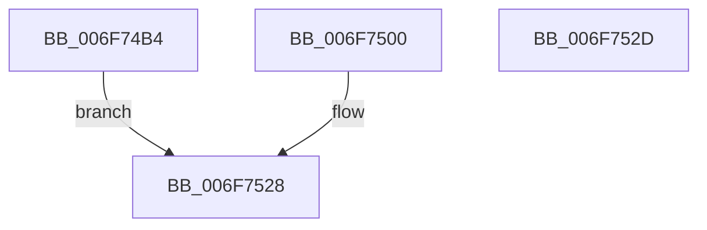

# sub_006F74B4

- RVA: `0x006F74B4`–`0x006F753A` (길이 `134` bytes)
- VA: `0x00000001406F74B4`
- 실행 섹션: `.text`
- PDB 이름 있음: `아니요`; PDB Function 태그: `아니요`
- unwind 정보 RVA: `0x000B35EC`
- 디코드: `29`개 명령, `134/134` bytes 표시
- 미해석 바이트: `0` (있으면 어셈블리에 `.byte`로 보존)

> 이 문서는 커널 이미지의 기계어와 PDB 기호를 분석해 생성했습니다. 4번과 5번은 함수 원형과 자료형을 바이너리 사용 방식에서 추정한 C 해석이며 원본 소스 복구 결과는 아닙니다.

## 1. Dependencies

- 직접 호출 지점: **1**; 고유 호출 대상: **1**
- 직접 호출자로 확인된 함수: **0**
- RIP 상대 이미지 참조: **0**

### Outgoing calls
- `0x006F74F8` → [KiCustomAccessRoutine6](../6B/KiCustomAccessRoutine6_function_006BC1C0.md) (function, `0x006BC1C0`)

### Direct callers
- 이 함수 시작 RVA로 연결되는 직접 call은 확인되지 않았습니다. 간접 호출은 완전히 역산할 수 없습니다.

### Static image references
- 디코드된 RIP-relative 메모리 참조가 없습니다.

## 2. Other-region calls and transfers

- 다른 실행 섹션으로 향하는 call: **0**
- call이 아닌 외부 분기/꼬리 이동: **2**
  - `0x006F7528` → [KiBalanceSetManagerDeferredRoutine + 0x56](../49/KiBalanceSetManagerDeferredRoutine_function_00494F40.md) (`tail-transfer`)
  - `0x006F7535` → [KiBalanceSetManagerDeferredRoutine + 0x56](../49/KiBalanceSetManagerDeferredRoutine_function_00494F40.md) (`tail-transfer`)

## 3. Assembly (complete function range)

```asm
006F74B4  83 64 24 30 00                  and dword ptr [rsp + 0x30], 0
006F74B9  C6 07 00                        mov byte ptr [rdi], 0
006F74BC  49 8B C6                        mov rax, r14
006F74BF  48 C1 E8 08                     shr rax, 8
006F74C3  48 89 47 20                     mov qword ptr [rdi + 0x20], rax
006F74C7  48 89 B4 24 E7 00 00 00         mov qword ptr [rsp + 0xe7], rsi
006F74CF  8B CE                           mov ecx, esi
006F74D1  48 8B C3                        mov rax, rbx
006F74D4  48 D3 C0                        rol rax, cl
006F74D7  48 89 84 24 C7 00 00 00         mov qword ptr [rsp + 0xc7], rax
006F74DF  48 8B C7                        mov rax, rdi
006F74E2  48 D3 C8                        ror rax, cl
006F74E5  48 89 84 24 AF 00 00 00         mov qword ptr [rsp + 0xaf], rax
006F74ED  4C 31 77 28                     xor qword ptr [rdi + 0x28], r14
006F74F1  48 31 77 30                     xor qword ptr [rdi + 0x30], rsi
006F74F5  48 8B CB                        mov rcx, rbx
006F74F8  E8 C3 4C FC FF                  call 0x1406bc1c0
006F74FD  90                              nop
006F74FE  EB 28                           jmp 0x1406f7528
006F7500  48 83 64 24 58 00               and qword ptr [rsp + 0x58], 0
006F7506  48 8B 8C 24 E7 00 00 00         mov rcx, qword ptr [rsp + 0xe7]
006F750E  48 89 4C 24 58                  mov qword ptr [rsp + 0x58], rcx
006F7513  48 8B 84 24 C7 00 00 00         mov rax, qword ptr [rsp + 0xc7]
006F751B  48 D3 C8                        ror rax, cl
006F751E  8B 00                           mov eax, dword ptr [rax]
006F7520  48 8B 9C 24 68 01 00 00         mov rbx, qword ptr [rsp + 0x168]
006F7528  E9 69 DA D9 FF                  jmp 0x140494f96
006F752D  48 8B 9C 24 68 01 00 00         mov rbx, qword ptr [rsp + 0x168]
006F7535  E9 5C DA D9 FF                  jmp 0x140494f96
```

## 4. C-style interpretation (structured pseudocode)

```c
__int64 __fastcall sub_006F74B4(__int64 a1, __int64 a2, __int64 a3, __int64 a4, __int64 a5, unsigned int a6)
{
    __int64 result;
    unsigned __int64 v_stack_p168;
    unsigned __int64 v_stack_p58;
    unsigned __int64 v_stack_pAF;
    unsigned __int64 v_stack_pC7;
    unsigned __int64 v_stack_pE7;

    *(unsigned __int8 *)(v_rdi) = 0;
    result = (v_r14) >> (8);
    *(unsigned __int64 *)(v_rdi + 32) = result;
    v_stack_pE7 = v_rsi;
    v_stack_pC7 = v_rbx;
    v_stack_pAF = v_rdi;
    result = KiCustomAccessRoutine6(v_rbx, a2, a3, a4);
    goto loc_006F7528;
loc_006F7528:
}
```

## 5. (Beta) C Style

```c
int64_t sub_006F74B4(int64_t Arg1, int64_t Arg2, int64_t Arg3, int64_t Arg4, uint64_t Arg5, uint32_t Arg6)
{
    int64_t result;
    uint64_t v_stack_p168;
    uint64_t v_stack_p58;
    uint64_t v_stack_pAF;
    uint64_t v_stack_pC7;
    uint64_t v_stack_pE7;

    *(uint8_t *)(local_rdi) = 0;
    result = (local_r14) >> (8);
    *(uint64_t *)(local_rdi + 0x20) = result;
    v_stack_pE7 = local_rsi;
    v_stack_pC7 = local_rbx;
    v_stack_pAF = local_rdi;
    result = KiCustomAccessRoutine6(local_rbx, Arg2, Arg3, Arg4);
    goto loc_006F7528;
loc_006F7528:
}
```

## 6. Execution-region graph

[열기: 2D/3D 그래프와 함수 탐색 컨트롤 패널](../../../control-panel.html?section=text&rva=0x006F74B4&view=graph)

- 2D 그래프는 위에서 아래로 흐르고, 3D 그래프는 빈 공간을 드래그해 회전합니다. Shift+드래그는 이동, 휠은 확대·축소, 함수 노드 선택은 대상 보고서 이동입니다.

### Static fallback


