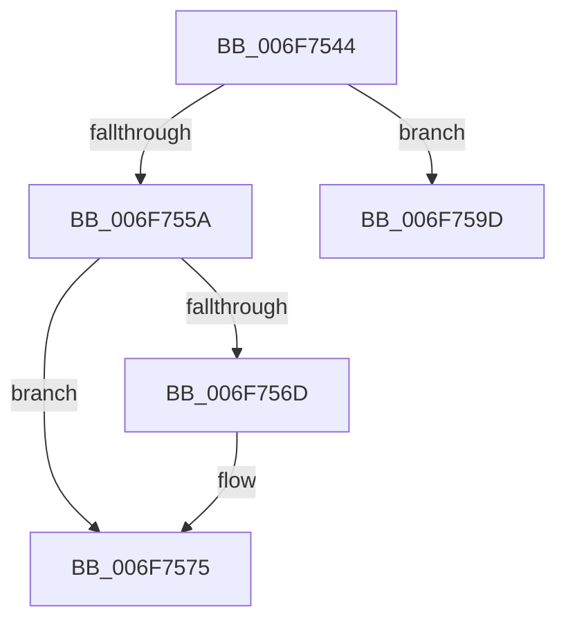

# sub_006F7544

- RVA: `0x006F7544`–`0x006F75B3` (길이 `111` bytes)
- VA: `0x00000001406F7544`
- 실행 섹션: `.text`
- PDB 이름 있음: `아니요`; PDB Function 태그: `아니요`
- unwind 정보 RVA: `0x000B38BC`
- 디코드: `28`개 명령, `111/111` bytes 표시
- 미해석 바이트: `0` (있으면 어셈블리에 `.byte`로 보존)

> 이 문서는 커널 이미지의 기계어와 PDB 기호를 분석해 생성했습니다. 4번과 5번은 함수 원형과 자료형을 바이너리 사용 방식에서 추정한 C 해석이며 원본 소스 복구 결과는 아닙니다.

## 1. Dependencies

- 직접 호출 지점: **5**; 고유 호출 대상: **4**
- 직접 호출자로 확인된 함수: **0**
- RIP 상대 이미지 참조: **2**

### Outgoing calls
- `0x006F7551` → [MiChargeCommit](../28/MiChargeCommit_function_00286EB0.md) (function, `0x00286EB0`)
- `0x006F7570` → [MiSetSlabAllocatorPolicy](../68/MiSetSlabAllocatorPolicy_function_0068F174.md) (function, `0x0068F174`)
- `0x006F7584` → [MiReleaseSpinLockExclusive](../24/MiReleaseSpinLockExclusive_function_002482C0.md) (function, `0x002482C0`)
- `0x006F7592` → [MiReturnCommit](../24/MiReturnCommit_function_00248410.md) (function, `0x00248410`)
- `0x006F75A7` → [MiReleaseSpinLockExclusive](../24/MiReleaseSpinLockExclusive_function_002482C0.md) (function, `0x002482C0`)

### Direct callers
- 이 함수 시작 RVA로 연결되는 직접 call은 확인되지 않았습니다. 간접 호출은 완전히 역산할 수 없습니다.

### Static image references
- `0x006F755A` → RVA `0x00E38D00` (`.data`; read)
- `0x006F757D` → RVA `0x00E30040` (`.data`; read)

## 2. Other-region calls and transfers

- 다른 실행 섹션으로 향하는 call: **0**
- call이 아닌 외부 분기/꼬리 이동: **2**
  - `0x006F7598` → [MiMakePartitionActive + 0x30](../49/MiMakePartitionActive_function_004959B8.md) (`tail-transfer`)
  - `0x006F75AE` → [MiMakePartitionActive + 0x35](../49/MiMakePartitionActive_function_004959B8.md) (`tail-transfer`)

## 3. Assembly (complete function range)

```asm
006F7544  BD A0 00 00 00                  mov ebp, 0xa0
006F7549  45 33 C0                        xor r8d, r8d
006F754C  8B D5                           mov edx, ebp
006F754E  48 8B CB                        mov rcx, rbx
006F7551  E8 5A F9 B8 FF                  call 0x140286eb0
006F7556  85 C0                           test eax, eax
006F7558  74 43                           je 0x1406f759d
006F755A  48 8D 05 9F 17 74 00            lea rax, [rip + 0x74179f]
006F7561  48 89 AB 00 42 00 00            mov qword ptr [rbx + 0x4200], rbp
006F7568  48 3B D8                        cmp rbx, rax
006F756B  74 08                           je 0x1406f7575
006F756D  48 8B CB                        mov rcx, rbx
006F7570  E8 FF 7B F9 FF                  call 0x14068f174
006F7575  F0 83 63 04 EF                  lock and dword ptr [rbx + 4], 0xffffffef
006F757A  40 8A D6                        mov dl, sil
006F757D  48 8D 0D BC 8A 73 00            lea rcx, [rip + 0x738abc]
006F7584  E8 37 0D B5 FF                  call 0x1402482c0
006F7589  45 33 C0                        xor r8d, r8d
006F758C  48 8B D5                        mov rdx, rbp
006F758F  48 8B CB                        mov rcx, rbx
006F7592  E8 79 0E B5 FF                  call 0x140248410
006F7597  90                              nop
006F7598  E9 4B E4 D9 FF                  jmp 0x1404959e8
006F759D  40 8A D6                        mov dl, sil
006F75A0  48 8D 0D 99 8A 73 00            lea rcx, [rip + 0x738a99]
006F75A7  E8 14 0D B5 FF                  call 0x1402482c0
006F75AC  8B C7                           mov eax, edi
006F75AE  E9 3A E4 D9 FF                  jmp 0x1404959ed
```

## 4. C-style interpretation (structured pseudocode)

```c
__int64 __fastcall sub_006F7544(__int64 a1, __int64 a2, int a3)
{
    __int64 result;

    a3 = 0;
    result = MiChargeCommit(v_rbx, 160, a3, a4);
    if ((unsigned int)(result) == 0) goto loc_006F759D;
    *(unsigned __int64 *)(v_rbx + 16896) = 160;
    result = v_rip + 7608223;
    if (v_rbx != (v_rip + 7608223)) {
        a1 = v_rbx;
        result = MiSetSlabAllocatorPolicy(a1, 160, a3, a4);
    }
    result = MiReleaseSpinLockExclusive(v_rip + 7572156, (unsigned __int8)(v_rsi), a3, a4);
    a3 = 0;
    result = MiReturnCommit(v_rbx, 160, a3, a4);
loc_006F759D:
    result = MiReleaseSpinLockExclusive(v_rip + 7572121, (unsigned __int8)(v_rsi), a3, a4);
}
```

## 5. (Beta) C Style

```c
int64_t sub_006F7544(int64_t Arg1, int64_t Arg2, int32_t Arg3)
{
    int64_t result;

    Arg3 = 0;
    result = MiChargeCommit(local_rbx, 160, Arg3, a4);
    if ((uint32_t)(result) == 0) goto loc_006F759D;
    *(uint64_t *)(local_rbx + 0x4200) = 160;
    result = v_rip + 7608223;
    if (local_rbx != (v_rip + 7608223)) {
        Arg1 = local_rbx;
        result = MiSetSlabAllocatorPolicy(Arg1, 160, Arg3, a4);
    }
    result = MiReleaseSpinLockExclusive(v_rip + 7572156, (uint8_t)(local_rsi), Arg3, a4);
    Arg3 = 0;
    result = MiReturnCommit(local_rbx, 160, Arg3, a4);
loc_006F759D:
    result = MiReleaseSpinLockExclusive(v_rip + 7572121, (uint8_t)(local_rsi), Arg3, a4);
}
```

## 6. Execution-region graph

[열기: 2D/3D 그래프와 함수 탐색 컨트롤 패널](../../../control-panel.html?section=text&rva=0x006F7544&view=graph)

- 2D 그래프는 위에서 아래로 흐르고, 3D 그래프는 빈 공간을 드래그해 회전합니다. Shift+드래그는 이동, 휠은 확대·축소, 함수 노드 선택은 대상 보고서 이동입니다.

### Static fallback


