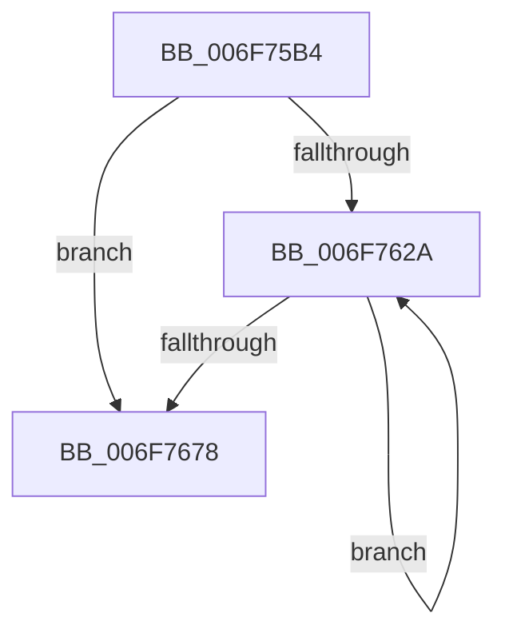

# sub_006F75B4

- RVA: `0x006F75B4`–`0x006F7680` (길이 `204` bytes)
- VA: `0x00000001406F75B4`
- 실행 섹션: `.text`
- PDB 이름 있음: `아니요`; PDB Function 태그: `아니요`
- unwind 정보 RVA: `0x000B3AE0`
- 디코드: `47`개 명령, `204/204` bytes 표시
- 미해석 바이트: `0` (있으면 어셈블리에 `.byte`로 보존)

> 이 문서는 커널 이미지의 기계어와 PDB 기호를 분석해 생성했습니다. 4번과 5번은 함수 원형과 자료형을 바이너리 사용 방식에서 추정한 C 해석이며 원본 소스 복구 결과는 아닙니다.

## 1. Dependencies

- 직접 호출 지점: **0**; 고유 호출 대상: **0**
- 직접 호출자로 확인된 함수: **0**
- RIP 상대 이미지 참조: **0**

### Outgoing calls
- 직접 디코드된 call 명령이 없습니다.

### Direct callers
- 이 함수 시작 RVA로 연결되는 직접 call은 확인되지 않았습니다. 간접 호출은 완전히 역산할 수 없습니다.

### Static image references
- 디코드된 RIP-relative 메모리 참조가 없습니다.

## 2. Other-region calls and transfers

- 다른 실행 섹션으로 향하는 call: **0**
- call이 아닌 외부 분기/꼬리 이동: **1**
  - `0x006F767B` → [SshpWriteBlocker + 0x133](../49/SshpWriteBlocker_function_00496300.md) (`tail-transfer`)

## 3. Assembly (complete function range)

```asm
006F75B4  41 8B 01                        mov eax, dword ptr [r9]
006F75B7  49 8D 49 08                     lea rcx, [r9 + 8]
006F75BB  48 C7 43 68 02 00 00 00         mov qword ptr [rbx + 0x68], 2
006F75C3  49 8B D0                        mov rdx, r8
006F75C6  41 BA 0A 00 00 00               mov r10d, 0xa
006F75CC  48 8D 04 85 0C 00 00 00         lea rax, [rax*4 + 0xc]
006F75D4  49 3B C0                        cmp rax, r8
006F75D7  48 0F 47 D0                     cmova rdx, rax
006F75DB  49 8D 41 04                     lea rax, [r9 + 4]
006F75DF  48 89 43 60                     mov qword ptr [rbx + 0x60], rax
006F75E3  49 03 D1                        add rdx, r9
006F75E6  48 89 4B 70                     mov qword ptr [rbx + 0x70], rcx
006F75EA  45 33 FF                        xor r15d, r15d
006F75ED  48 C7 43 78 04 00 00 00         mov qword ptr [rbx + 0x78], 4
006F75F5  8B 01                           mov eax, dword ptr [rcx]
006F75F7  48 89 93 80 00 00 00            mov qword ptr [rbx + 0x80], rdx
006F75FE  03 C0                           add eax, eax
006F7600  89 83 88 00 00 00               mov dword ptr [rbx + 0x88], eax
006F7606  44 89 9B 8C 00 00 00            mov dword ptr [rbx + 0x8c], r11d
006F760D  8B 01                           mov eax, dword ptr [rcx]
006F760F  4C 89 8B 90 00 00 00            mov qword ptr [rbx + 0x90], r9
006F7616  48 C7 83 98 00 00 00 04 00 00 00  mov qword ptr [rbx + 0x98], 4
006F7621  48 8D 34 42                     lea rsi, [rdx + rax*2]
006F7625  45 39 39                        cmp dword ptr [r9], r15d
006F7628  76 4E                           jbe 0x1406f7678
006F762A  45 8B C3                        mov r8d, r11d
006F762D  49 8D 41 0C                     lea rax, [r9 + 0xc]
006F7631  41 8B CA                        mov ecx, r10d
006F7634  41 FF C3                        inc r11d
006F7637  48 03 C9                        add rcx, rcx
006F763A  4A 8D 04 80                     lea rax, [rax + r8*4]
006F763E  48 89 04 CB                     mov qword ptr [rbx + rcx*8], rax
006F7642  48 C7 44 CB 08 04 00 00 00      mov qword ptr [rbx + rcx*8 + 8], 4
006F764B  41 8D 4A 01                     lea ecx, [r10 + 1]
006F764F  43 8B 54 81 0C                  mov edx, dword ptr [r9 + r8*4 + 0xc]
006F7654  48 03 C9                        add rcx, rcx
006F7657  03 D2                           add edx, edx
006F7659  41 83 C2 02                     add r10d, 2
006F765D  48 89 34 CB                     mov qword ptr [rbx + rcx*8], rsi
006F7661  89 54 CB 08                     mov dword ptr [rbx + rcx*8 + 8], edx
006F7665  44 89 7C CB 0C                  mov dword ptr [rbx + rcx*8 + 0xc], r15d
006F766A  43 8B 44 81 0C                  mov eax, dword ptr [r9 + r8*4 + 0xc]
006F766F  48 8D 34 46                     lea rsi, [rsi + rax*2]
006F7673  45 3B 19                        cmp r11d, dword ptr [r9]
006F7676  72 B2                           jb 0x1406f762a
006F7678  45 33 DB                        xor r11d, r11d
006F767B  E9 B3 ED D9 FF                  jmp 0x140496433
```

## 4. C-style interpretation (structured pseudocode)

```c
__int64 __fastcall sub_006F75B4(__int64 a1, __int64 a2, __int64 a3, __int64 a4)
{
    __int64 result;
    __int64 v_r10;
    __int64 v_r11;
    __int64 v_r15;

    *(unsigned __int64 *)(v_rbx + 104) = 2;
    if (((unsigned int)(*(unsigned int *)(a4)) * 4 + 12) > a3) { a3 = (unsigned int)(*(unsigned int *)(a4)) * 4 + 12; }
    *(unsigned __int64 *)(v_rbx + 96) = a4 + 4;
    a2 = (a3) + (a4);
    *(unsigned __int64 *)(v_rbx + 112) = a4 + 8;
    v_r15 = 0;
    *(unsigned __int64 *)(v_rbx + 120) = 4;
    *(unsigned __int64 *)(v_rbx + 128) = a2;
    result = (unsigned int)(((unsigned int)(*(unsigned int *)(a4 + 8))) + ((unsigned int)((unsigned int)(*(unsigned int *)(a4 + 8)))));
    *(unsigned int *)(v_rbx + 136) = (unsigned int)(result);
    *(unsigned int *)(v_rbx + 140) = (unsigned int)(v_r11);
    *(unsigned __int64 *)(v_rbx + 144) = a4;
    *(unsigned __int64 *)(v_rbx + 152) = 4;
    if ((*(unsigned int *)(a4)) <= 0) goto loc_006F7678;
loc_006F762A:
    v_r11 = (unsigned int)((v_r11) + 1);
    a1 = (10) + (10);
    *(unsigned __int64 *)(v_rbx + a1 * 8) = a4 + 12 + (unsigned int)((unsigned int)(v_r11)) * 4;
    *(unsigned __int64 *)(v_rbx + a1 * 8 + 8) = 4;
    a1 = (10 + 1) + (10 + 1);
    a2 = (unsigned int)(((unsigned int)(*(unsigned int *)(a4 + (unsigned int)((unsigned int)(v_r11)) * 4 + 12))) + ((unsigned int)((unsigned int)(*(unsigned int *)(a4 + (unsigned int)((unsigned int)(v_r11)) * 4 + 12)))));
    v_r10 = (unsigned int)((10) + (2));
    *(unsigned __int64 *)(v_rbx + a1 * 8) = a2 + (unsigned int)(*(unsigned int *)(a4 + 8)) * 2;
    *(unsigned int *)(v_rbx + a1 * 8 + 8) = (unsigned int)(a2);
    *(unsigned int *)(v_rbx + a1 * 8 + 12) = 0;
    if (((unsigned int)(v_r11)) < (*(unsigned int *)(a4))) goto loc_006F762A;
loc_006F7678:
    v_r11 = 0;
}
```

## 5. (Beta) C Style

```c
int64_t sub_006F75B4(int64_t Arg1, int64_t Arg2, int64_t Arg3, void *Arg4)
{
    uint8_t *arg4 = (uint8_t *)Arg4;

    int64_t result;
    int64_t local_r10;
    int64_t local_r11;
    int64_t local_r15;

    *(uint64_t *)(local_rbx + 0x68) = 2;
    if (((uint32_t)(*(uint32_t *)(arg4)) * 4 + 12) > Arg3) { Arg3 = (uint32_t)(*(uint32_t *)(arg4)) * 4 + 12; }
    *(void **)(local_rbx + 0x60) = Arg4 + 4;
    Arg2 = (Arg3) + (Arg4);
    *(void **)(local_rbx + 0x70) = Arg4 + 8;
    local_r15 = 0;
    *(uint64_t *)(local_rbx + 0x78) = 4;
    *(uint64_t *)(local_rbx + 0x80) = Arg2;
    result = (uint32_t)(((uint32_t)(*(uint32_t *)(arg4 + 0x8))) + ((uint32_t)((uint32_t)(*(uint32_t *)(arg4 + 0x8)))));
    *(uint32_t *)(local_rbx + 0x88) = (uint32_t)(result);
    *(uint32_t *)(local_rbx + 0x8C) = (uint32_t)(local_r11);
    *(void **)(local_rbx + 0x90) = Arg4;
    *(uint64_t *)(local_rbx + 0x98) = 4;
    if ((*(uint32_t *)(arg4)) <= 0) goto loc_006F7678;
loc_006F762A:
    local_r11 = (uint32_t)((local_r11) + 1);
    Arg1 = (10) + (10);
    *(void **)(local_rbx + Arg1 * 8) = Arg4 + 12 + (uint32_t)((uint32_t)(local_r11)) * 4;
    *(uint64_t *)(local_rbx + Arg1 * 8 + 0x8) = 4;
    Arg1 = (10 + 1) + (10 + 1);
    Arg2 = (uint32_t)(((uint32_t)(*(uint32_t *)(arg4 + (uint32_t)((uint32_t)(local_r11)) * 4 + 0xC))) + ((uint32_t)((uint32_t)(*(uint32_t *)(arg4 + (uint32_t)((uint32_t)(local_r11)) * 4 + 0xC)))));
    local_r10 = (uint32_t)((10) + (2));
    *(uint64_t *)(local_rbx + Arg1 * 8) = Arg2 + (uint32_t)(*(uint32_t *)(arg4 + 0x8)) * 2;
    *(uint32_t *)(local_rbx + Arg1 * 8 + 0x8) = (uint32_t)(Arg2);
    *(uint32_t *)(local_rbx + Arg1 * 8 + 0xC) = 0;
    if (((uint32_t)(local_r11)) < (*(uint32_t *)(arg4))) goto loc_006F762A;
loc_006F7678:
    local_r11 = 0;
}
```

### 관측된 메모리 오프셋

구조체 형식이 확인되지 않은 접근은 인자 기준의 오프셋으로만 기록했습니다.

| 기준 인자 | 오프셋 표현 | 폭 (bit) | 접근 |
|---|---:|---:|---|
| `Arg4` | `+ 0x0` | `32` | `R` |
| `Arg4` | `+ 0x0 + r8*4` | `64` | `R` |
| `Arg4` | `+ 0x4` | `64` | `R` |
| `Arg4` | `+ 0x8` | `64` | `R` |
| `Arg4` | `+ 0xC` | `64` | `R` |
| `Arg4` | `+ 0xC + r8*4` | `32` | `R` |

## 6. Execution-region graph

[열기: 2D/3D 그래프와 함수 탐색 컨트롤 패널](../../../control-panel.html?section=text&rva=0x006F75B4&view=graph)

- 2D 그래프는 위에서 아래로 흐르고, 3D 그래프는 빈 공간을 드래그해 회전합니다. Shift+드래그는 이동, 휠은 확대·축소, 함수 노드 선택은 대상 보고서 이동입니다.

### Static fallback


