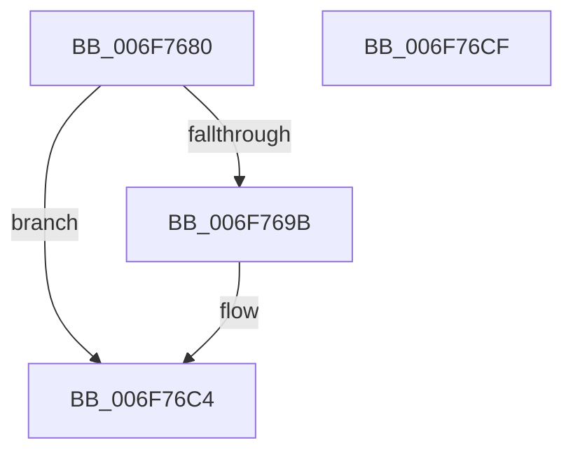

# sub_006F7680

- RVA: `0x006F7680`–`0x006F76DA` (길이 `90` bytes)
- VA: `0x00000001406F7680`
- 실행 섹션: `.text`
- PDB 이름 있음: `아니요`; PDB Function 태그: `아니요`
- unwind 정보 RVA: `0x000B3B14`
- 디코드: `20`개 명령, `90/90` bytes 표시
- 미해석 바이트: `0` (있으면 어셈블리에 `.byte`로 보존)

> 이 문서는 커널 이미지의 기계어와 PDB 기호를 분석해 생성했습니다. 4번과 5번은 함수 원형과 자료형을 바이너리 사용 방식에서 추정한 C 해석이며 원본 소스 복구 결과는 아닙니다.

## 1. Dependencies

- 직접 호출 지점: **2**; 고유 호출 대상: **2**
- 직접 호출자로 확인된 함수: **0**
- RIP 상대 이미지 참조: **4**

### Outgoing calls
- `0x006F768E` → [ExAllocatePool2](../../poolcode/B8/ExAllocatePool2_function_00B820F0.md) (function, `0x00B820F0`)
- `0x006F76BF` → [ExQueueWorkItem](../2F/ExQueueWorkItem_function_002F9520.md) (function, `0x002F9520`)

### Direct callers
- 이 함수 시작 RVA로 연결되는 직접 call은 확인되지 않았습니다. 간접 호출은 완전히 역산할 수 없습니다.

### Static image references
- `0x006F769B` → RVA `0x0079EF90` (`SepAdtGenerateDiscardAudit`; read)
- `0x006F76AF` → RVA `0x00E67E24` (`.data`; read)
- `0x006F76C4` → RVA `0x00E67E24` (`.data`; write)
- `0x006F76CF` → RVA `0x00E67E24` (`.data`; read/write)

## 2. Other-region calls and transfers

- 다른 실행 섹션으로 향하는 call: **1**
  - `0x006F768E` → [ExAllocatePool2](../../poolcode/B8/ExAllocatePool2_function_00B820F0.md) (`.text` → `POOLCODE`)
- call이 아닌 외부 분기/꼬리 이동: **2**
  - `0x006F76CA` → [SepAdtDetermineInsertQueue + 0x25](../49/SepAdtDetermineInsertQueue_function_00496730.md) (`tail-transfer`)
  - `0x006F76D5` → [SepAdtDetermineInsertQueue + 0x35](../49/SepAdtDetermineInsertQueue_function_00496730.md) (`tail-transfer`)

## 3. Assembly (complete function range)

```asm
006F7680  BA 28 00 00 00                  mov edx, 0x28
006F7685  41 B8 53 65 20 20               mov r8d, 0x20206553
006F768B  8D 4A 18                        lea ecx, [rdx + 0x18]
006F768E  E8 5D AA 48 00                  call 0x140b820f0
006F7693  48 8B C8                        mov rcx, rax
006F7696  48 85 C0                        test rax, rax
006F7699  74 29                           je 0x1406f76c4
006F769B  48 8D 05 EE 78 0A 00            lea rax, [rip + 0xa78ee]
006F76A2  48 89 49 18                     mov qword ptr [rcx + 0x18], rcx
006F76A6  48 89 41 10                     mov qword ptr [rcx + 0x10], rax
006F76AA  BA 01 00 00 00                  mov edx, 1
006F76AF  8B 05 6F 07 77 00               mov eax, dword ptr [rip + 0x77076f]
006F76B5  48 89 19                        mov qword ptr [rcx], rbx
006F76B8  89 41 20                        mov dword ptr [rcx + 0x20], eax
006F76BB  C6 41 24 01                     mov byte ptr [rcx + 0x24], 1
006F76BF  E8 5C 1E C0 FF                  call 0x1402f9520
006F76C4  89 1D 5A 07 77 00               mov dword ptr [rip + 0x77075a], ebx
006F76CA  E9 86 F0 D9 FF                  jmp 0x140496755
006F76CF  FF 05 4F 07 77 00               inc dword ptr [rip + 0x77074f]
006F76D5  E9 8B F0 D9 FF                  jmp 0x140496765
```

## 4. C-style interpretation (structured pseudocode)

```c
__int64 __fastcall sub_006F7680(void)
{
    __int64 result;

    result = ExAllocatePool2(40 + 24, 40, (unsigned int)(0x20206553ULL), a4);
    if (result != 0) {
        result = v_rip + 686318;
        *(unsigned __int64 *)(result + 24) = result;
        *(unsigned __int64 *)(result + 16) = result;
        a2 = 1;
        result = *(unsigned int *)(v_rip + 7800687);
        *(unsigned __int64 *)(result) = v_rbx;
        *(unsigned int *)(result + 32) = (unsigned int)(result);
        *(unsigned __int8 *)(result + 36) = 1;
        result = ExQueueWorkItem(result, a2, (unsigned int)(0x20206553ULL), a4);
    }
    *(unsigned int *)(v_rip + 7800666) = (unsigned int)(v_rbx);
}
```

## 5. (Beta) C Style

```c
void sub_006F7680(void)
{
    int64_t result;

    result = ExAllocatePool2(40 + 24, 40, (uint32_t)(0x20206553ULL), a4);
    if (result != 0) {
        result = v_rip + 686318;
        *(uint64_t *)(result + 0x18) = result;
        *(uint64_t *)(result + 0x10) = result;
        a2 = 1;
        result = *(uint32_t *)(v_rip + 0x77076F);
        *(uint64_t *)(result) = local_rbx;
        *(uint32_t *)(result + 0x20) = (uint32_t)(result);
        *(uint8_t *)(result + 0x24) = 1;
        result = ExQueueWorkItem(result, a2, (uint32_t)(0x20206553ULL), a4);
    }
    *(uint32_t *)(v_rip + 0x77075A) = (uint32_t)(local_rbx);
}
```

## 6. Execution-region graph

[열기: 2D/3D 그래프와 함수 탐색 컨트롤 패널](../../../control-panel.html?section=text&rva=0x006F7680&view=graph)

- 2D 그래프는 위에서 아래로 흐르고, 3D 그래프는 빈 공간을 드래그해 회전합니다. Shift+드래그는 이동, 휠은 확대·축소, 함수 노드 선택은 대상 보고서 이동입니다.

### Static fallback


