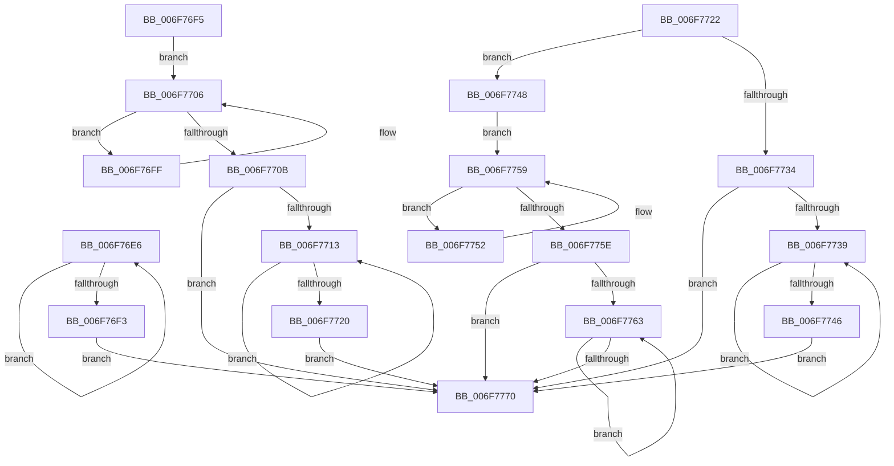

# sub_006F76E6

- RVA: `0x006F76E6`–`0x006F777D` (길이 `151` bytes)
- VA: `0x00000001406F76E6`
- 실행 섹션: `.text`
- PDB 이름 있음: `아니요`; PDB Function 태그: `아니요`
- unwind 정보 RVA: `0x000B3B44`
- 디코드: `49`개 명령, `151/151` bytes 표시
- 미해석 바이트: `0` (있으면 어셈블리에 `.byte`로 보존)

> 이 문서는 커널 이미지의 기계어와 PDB 기호를 분석해 생성했습니다. 4번과 5번은 함수 원형과 자료형을 바이너리 사용 방식에서 추정한 C 해석이며 원본 소스 복구 결과는 아닙니다.

## 1. Dependencies

- 직접 호출 지점: **4**; 고유 호출 대상: **2**
- 직접 호출자로 확인된 함수: **0**
- RIP 상대 이미지 참조: **0**

### Outgoing calls
- `0x006F76E6` → [RealPredecessor](../3E/RealPredecessor_function_003E5D08.md) (function, `0x003E5D08`)
- `0x006F7713` → [RealSuccessor](../3E/RealSuccessor_function_003E5B20.md) (function, `0x003E5B20`)
- `0x006F7739` → [RealSuccessor](../3E/RealSuccessor_function_003E5B20.md) (function, `0x003E5B20`)
- `0x006F7763` → [RealPredecessor](../3E/RealPredecessor_function_003E5D08.md) (function, `0x003E5D08`)

### Direct callers
- 이 함수 시작 RVA로 연결되는 직접 call은 확인되지 않았습니다. 간접 호출은 완전히 역산할 수 없습니다.

### Static image references
- 디코드된 RIP-relative 메모리 참조가 없습니다.

## 2. Other-region calls and transfers

- 다른 실행 섹션으로 향하는 call: **0**
- call이 아닌 외부 분기/꼬리 이동: **1**
  - `0x006F7778` → [RtlGetElementGenericTableAvl + 0x48](../49/RtlGetElementGenericTableAvl_function_004968F0.md) (`tail-transfer`)

## 3. Assembly (complete function range)

```asm
006F76E6  E8 1D E6 CE FF                  call 0x1403e5d08
006F76EB  48 8B C8                        mov rcx, rax
006F76EE  44 03 CB                        add r9d, ebx
006F76F1  75 F3                           jne 0x1406f76e6
006F76F3  EB 7B                           jmp 0x1406f7770
006F76F5  49 8B 4B 10                     mov rcx, qword ptr [r11 + 0x10]
006F76F9  48 8B 41 08                     mov rax, qword ptr [rcx + 8]
006F76FD  EB 07                           jmp 0x1406f7706
006F76FF  48 8B C8                        mov rcx, rax
006F7702  48 8B 40 08                     mov rax, qword ptr [rax + 8]
006F7706  48 85 C0                        test rax, rax
006F7709  75 F4                           jne 0x1406f76ff
006F770B  45 8B C2                        mov r8d, r10d
006F770E  45 85 D2                        test r10d, r10d
006F7711  74 5D                           je 0x1406f7770
006F7713  E8 08 E4 CE FF                  call 0x1403e5b20
006F7718  48 8B C8                        mov rcx, rax
006F771B  44 03 C3                        add r8d, ebx
006F771E  75 F3                           jne 0x1406f7713
006F7720  EB 4E                           jmp 0x1406f7770
006F7722  41 2B D2                        sub edx, r10d
006F7725  45 8B C2                        mov r8d, r10d
006F7728  45 2B C1                        sub r8d, r9d
006F772B  44 8D 4A FF                     lea r9d, [rdx - 1]
006F772F  44 3B C2                        cmp r8d, edx
006F7732  77 14                           ja 0x1406f7748
006F7734  45 85 C0                        test r8d, r8d
006F7737  74 37                           je 0x1406f7770
006F7739  E8 E2 E3 CE FF                  call 0x1403e5b20
006F773E  48 8B C8                        mov rcx, rax
006F7741  44 03 C3                        add r8d, ebx
006F7744  75 F3                           jne 0x1406f7739
006F7746  EB 28                           jmp 0x1406f7770
006F7748  49 8B 4B 10                     mov rcx, qword ptr [r11 + 0x10]
006F774C  48 8B 41 10                     mov rax, qword ptr [rcx + 0x10]
006F7750  EB 07                           jmp 0x1406f7759
006F7752  48 8B C8                        mov rcx, rax
006F7755  48 8B 40 10                     mov rax, qword ptr [rax + 0x10]
006F7759  48 85 C0                        test rax, rax
006F775C  75 F4                           jne 0x1406f7752
006F775E  45 85 C9                        test r9d, r9d
006F7761  74 0D                           je 0x1406f7770
006F7763  E8 A0 E5 CE FF                  call 0x1403e5d08
006F7768  48 8B C8                        mov rcx, rax
006F776B  44 03 CB                        add r9d, ebx
006F776E  75 F3                           jne 0x1406f7763
006F7770  49 89 4B 20                     mov qword ptr [r11 + 0x20], rcx
006F7774  45 89 53 28                     mov dword ptr [r11 + 0x28], r10d
006F7778  E9 BB F1 D9 FF                  jmp 0x140496938
```

## 4. C-style interpretation (structured pseudocode)

```c
__int64 __fastcall sub_006F76E6(__int64 a1, int a2, __int64 a3, int a4)
{
    __int64 result;

    result = RealPredecessor(a1, a2, a3, a4);
    a4 = (unsigned int)((a4) + ((unsigned int)(v_rbx)));
    if (condition_is_not_equal) goto loc_006F76E6;
    goto loc_006F7770;
loc_006F7770:
    *(unsigned __int64 *)(v_r11 + 32) = result;
    *(unsigned int *)(v_r11 + 40) = (unsigned int)(v_r10);
}
```

## 5. (Beta) C Style

```c
int64_t sub_006F76E6(int64_t Arg1, int32_t Arg2, int64_t Arg3, int32_t Arg4)
{
    int64_t result;

    result = RealPredecessor(Arg1, Arg2, Arg3, Arg4);
    Arg4 = (uint32_t)((Arg4) + ((uint32_t)(local_rbx)));
    if (condition_is_not_equal) goto loc_006F76E6;
    goto loc_006F7770;
loc_006F7770:
    *(uint64_t *)(local_r11 + 0x20) = result;
    *(uint32_t *)(local_r11 + 0x28) = (uint32_t)(local_r10);
}
```

## 6. Execution-region graph

[열기: 2D/3D 그래프와 함수 탐색 컨트롤 패널](../../../control-panel.html?section=text&rva=0x006F76E6&view=graph)

- 2D 그래프는 위에서 아래로 흐르고, 3D 그래프는 빈 공간을 드래그해 회전합니다. Shift+드래그는 이동, 휠은 확대·축소, 함수 노드 선택은 대상 보고서 이동입니다.

### Static fallback


