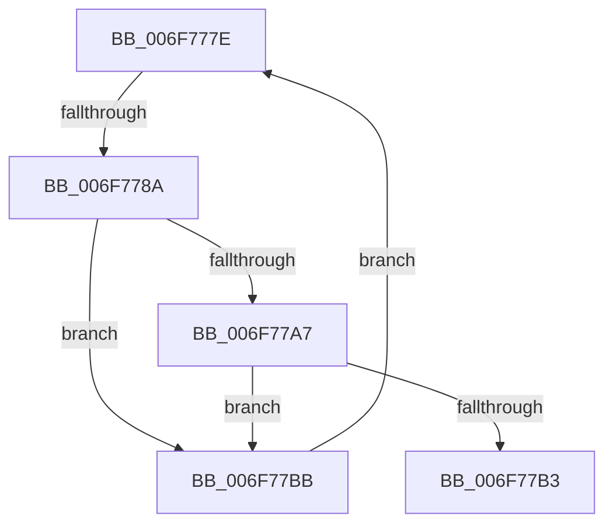

# sub_006F777E

- RVA: `0x006F777E`–`0x006F77C0` (길이 `66` bytes)
- VA: `0x00000001406F777E`
- 실행 섹션: `.text`
- PDB 이름 있음: `아니요`; PDB Function 태그: `아니요`
- unwind 정보 RVA: `0x000B3CD8`
- 디코드: `19`개 명령, `66/66` bytes 표시
- 미해석 바이트: `0` (있으면 어셈블리에 `.byte`로 보존)

> 이 문서는 커널 이미지의 기계어와 PDB 기호를 분석해 생성했습니다. 4번과 5번은 함수 원형과 자료형을 바이너리 사용 방식에서 추정한 C 해석이며 원본 소스 복구 결과는 아닙니다.

## 1. Dependencies

- 직접 호출 지점: **0**; 고유 호출 대상: **0**
- 직접 호출자로 확인된 함수: **0**
- RIP 상대 이미지 참조: **0**

### Outgoing calls
- 직접 디코드된 call 명령이 없습니다.

### Direct callers
- 이 함수 시작 RVA로 연결되는 직접 call은 확인되지 않았습니다. 간접 호출은 완전히 역산할 수 없습니다.

### Static image references
- 디코드된 RIP-relative 메모리 참조가 없습니다.

## 2. Other-region calls and transfers

- 다른 실행 섹션으로 향하는 call: **0**
- call이 아닌 외부 분기/꼬리 이동: **2**
  - `0x006F7784` → [RtlpFlsSlotDataValidateEmpty + 0x1B](../49/RtlpFlsSlotDataValidateEmpty_function_00497108.md) (`tail-transfer`)
  - `0x006F77B6` → [RtlpFlsSlotDataValidateEmpty + 0x1B](../49/RtlpFlsSlotDataValidateEmpty_function_00497108.md) (`tail-transfer`)

## 3. Assembly (complete function range)

```asm
006F777E  8D 42 F0                        lea eax, [rdx - 0x10]
006F7781  41 3B C3                        cmp eax, r11d
006F7784  0F 87 99 F9 D9 FF               ja 0x140497123
006F778A  83 64 24 08 00                  and dword ptr [rsp + 8], 0
006F778F  45 8B C8                        mov r9d, r8d
006F7792  0F BD CA                        bsr ecx, edx
006F7795  41 D3 E1                        shl r9d, cl
006F7798  83 C1 FC                        add ecx, -4
006F779B  44 33 CA                        xor r9d, edx
006F779E  49 8B 1C CA                     mov rbx, qword ptr [r10 + rcx*8]
006F77A2  48 85 DB                        test rbx, rbx
006F77A5  74 14                           je 0x1406f77bb
006F77A7  4B 8D 0C 49                     lea rcx, [r9 + r9*2]
006F77AB  48 83 7C CB 08 00               cmp qword ptr [rbx + rcx*8 + 8], 0
006F77B1  74 08                           je 0x1406f77bb
006F77B3  45 32 C0                        xor r8b, r8b
006F77B6  E9 68 F9 D9 FF                  jmp 0x140497123
006F77BB  41 03 D0                        add edx, r8d
006F77BE  EB BE                           jmp 0x1406f777e
```

## 4. C-style interpretation (structured pseudocode)

```c
__int64 __fastcall sub_006F777E(__int64 a1, __int64 a2, int a3)
{
    unsigned int v_stack_p8;

    a4 = (unsigned int)(((unsigned int)(a3)) << ((unsigned __int8)(a1)));
    a1 = (unsigned int)((a1) + (-4));
    a4 = (unsigned int)((a4) ^ ((unsigned int)(a2)));
    if (*(unsigned __int64 *)(v_r10 + a1 * 8) == 0) goto loc_006F77BB;
    if ((*(unsigned __int64 *)(*(unsigned __int64 *)(v_r10 + a1 * 8) + a4 + a4 * 2 * 8 + 8)) == 0) goto loc_006F77BB;
    a3 = 0;
loc_006F77BB:
    a2 = (unsigned int)((a2) + (0));
    goto loc_006F777E;
}
```

## 5. (Beta) C Style

```c
int64_t sub_006F777E(int64_t Arg1, void *Arg2, int32_t Arg3)
{
    uint8_t *arg2 = (uint8_t *)Arg2;

    uint32_t v_stack_p8;

    a4 = (uint32_t)(((uint32_t)(Arg3)) << ((uint8_t)(Arg1)));
    Arg1 = (uint32_t)((Arg1) + (-4));
    a4 = (uint32_t)((a4) ^ ((uint32_t)(Arg2)));
    if (*(uint64_t *)(local_r10 + Arg1 * 8) == 0) goto loc_006F77BB;
    if ((*(uint64_t *)(*(uint64_t *)(local_r10 + Arg1 * 8) + a4 + a4 * 2 * 8 + 0x8)) == 0) goto loc_006F77BB;
    Arg3 = 0;
loc_006F77BB:
    Arg2 = (uint32_t)((Arg2) + (0));
    goto loc_006F777E;
}
```

### 관측된 메모리 오프셋

구조체 형식이 확인되지 않은 접근은 인자 기준의 오프셋으로만 기록했습니다.

| 기준 인자 | 오프셋 표현 | 폭 (bit) | 접근 |
|---|---:|---:|---|
| `Arg2` | `- 0x10` | `32` | `R` |

## 6. Execution-region graph

[열기: 2D/3D 그래프와 함수 탐색 컨트롤 패널](../../../control-panel.html?section=text&rva=0x006F777E&view=graph)

- 2D 그래프는 위에서 아래로 흐르고, 3D 그래프는 빈 공간을 드래그해 회전합니다. Shift+드래그는 이동, 휠은 확대·축소, 함수 노드 선택은 대상 보고서 이동입니다.

### Static fallback


