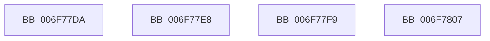

# sub_006F77DA

- RVA: `0x006F77DA`–`0x006F7815` (길이 `59` bytes)
- VA: `0x00000001406F77DA`
- 실행 섹션: `.text`
- PDB 이름 있음: `아니요`; PDB Function 태그: `아니요`
- unwind 정보 RVA: `0x000B3DF8`
- 디코드: `13`개 명령, `59/59` bytes 표시
- 미해석 바이트: `0` (있으면 어셈블리에 `.byte`로 보존)

> 이 문서는 커널 이미지의 기계어와 PDB 기호를 분석해 생성했습니다. 4번과 5번은 함수 원형과 자료형을 바이너리 사용 방식에서 추정한 C 해석이며 원본 소스 복구 결과는 아닙니다.

## 1. Dependencies

- 직접 호출 지점: **0**; 고유 호출 대상: **0**
- 직접 호출자로 확인된 함수: **0**
- RIP 상대 이미지 참조: **0**

### Outgoing calls
- 직접 디코드된 call 명령이 없습니다.

### Direct callers
- 이 함수 시작 RVA로 연결되는 직접 call은 확인되지 않았습니다. 간접 호출은 완전히 역산할 수 없습니다.

### Static image references
- 디코드된 RIP-relative 메모리 참조가 없습니다.

## 2. Other-region calls and transfers

- 다른 실행 섹션으로 향하는 call: **0**
- call이 아닌 외부 분기/꼬리 이동: **4**
  - `0x006F77E3` → [WheapGetErrorSourceFunction + 0x78](../49/WheapGetErrorSourceFunction_function_004974EC.md) (`tail-transfer`)
  - `0x006F77F4` → [WheapGetErrorSourceFunction + 0x78](../49/WheapGetErrorSourceFunction_function_004974EC.md) (`tail-transfer`)
  - `0x006F7802` → [WheapGetErrorSourceFunction + 0x78](../49/WheapGetErrorSourceFunction_function_004974EC.md) (`tail-transfer`)
  - `0x006F7810` → [WheapGetErrorSourceFunction + 0x78](../49/WheapGetErrorSourceFunction_function_004974EC.md) (`tail-transfer`)

## 3. Assembly (complete function range)

```asm
006F77DA  48 C1 E0 06                     shl rax, 6
006F77DE  4E 8B 4C 00 30                  mov r9, qword ptr [rax + r8 + 0x30]
006F77E3  E9 7C FD D9 FF                  jmp 0x140497564
006F77E8  48 63 01                        movsxd rax, dword ptr [rcx]
006F77EB  48 C1 E0 06                     shl rax, 6
006F77EF  4E 8B 4C 00 28                  mov r9, qword ptr [rax + r8 + 0x28]
006F77F4  E9 6B FD D9 FF                  jmp 0x140497564
006F77F9  48 C1 E0 06                     shl rax, 6
006F77FD  4E 8B 4C 00 18                  mov r9, qword ptr [rax + r8 + 0x18]
006F7802  E9 5D FD D9 FF                  jmp 0x140497564
006F7807  48 C1 E0 06                     shl rax, 6
006F780B  4E 8B 4C 00 10                  mov r9, qword ptr [rax + r8 + 0x10]
006F7810  E9 4F FD D9 FF                  jmp 0x140497564
```

## 4. C-style interpretation (structured pseudocode)

```c
__int64 __fastcall sub_006F77DA(__int64 a1, __int64 a2, __int64 a3)
{
    __int64 result;

    result = (result) << (6);
}
```

## 5. (Beta) C Style

```c
int64_t sub_006F77DA(int64_t Arg1, int64_t Arg2, int64_t Arg3)
{
    int64_t result;

    result = (result) << (6);
}
```

## 6. Execution-region graph

[열기: 2D/3D 그래프와 함수 탐색 컨트롤 패널](../../../control-panel.html?section=text&rva=0x006F77DA&view=graph)

- 2D 그래프는 위에서 아래로 흐르고, 3D 그래프는 빈 공간을 드래그해 회전합니다. Shift+드래그는 이동, 휠은 확대·축소, 함수 노드 선택은 대상 보고서 이동입니다.

### Static fallback


