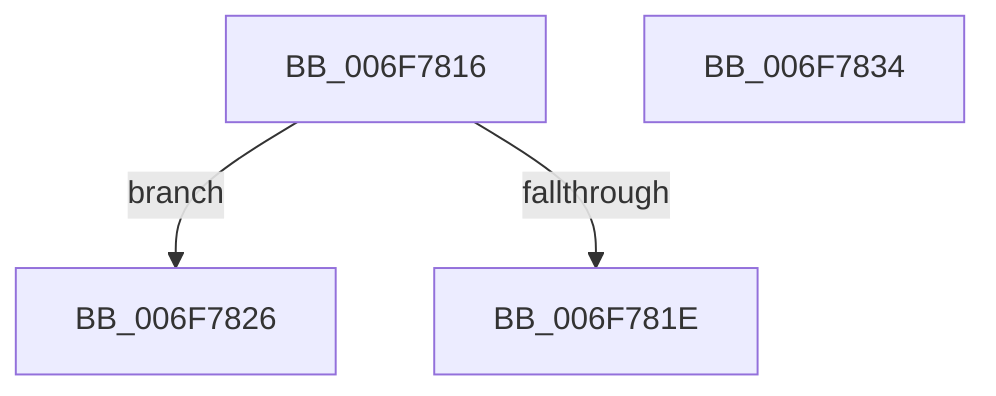

# sub_006F7816

- RVA: `0x006F7816`–`0x006F7849` (길이 `51` bytes)
- VA: `0x00000001406F7816`
- 실행 섹션: `.text`
- PDB 이름 있음: `아니요`; PDB Function 태그: `아니요`
- unwind 정보 RVA: `0x000B3ED0`
- 디코드: `15`개 명령, `51/51` bytes 표시
- 미해석 바이트: `0` (있으면 어셈블리에 `.byte`로 보존)

> 이 문서는 커널 이미지의 기계어와 PDB 기호를 분석해 생성했습니다. 4번과 5번은 함수 원형과 자료형을 바이너리 사용 방식에서 추정한 C 해석이며 원본 소스 복구 결과는 아닙니다.

## 1. Dependencies

- 직접 호출 지점: **0**; 고유 호출 대상: **0**
- 직접 호출자로 확인된 함수: **0**
- RIP 상대 이미지 참조: **0**

### Outgoing calls
- 직접 디코드된 call 명령이 없습니다.

### Direct callers
- 이 함수 시작 RVA로 연결되는 직접 call은 확인되지 않았습니다. 간접 호출은 완전히 역산할 수 없습니다.

### Static image references
- 디코드된 RIP-relative 메모리 참조가 없습니다.

## 2. Other-region calls and transfers

- 다른 실행 섹션으로 향하는 call: **0**
- call이 아닌 외부 분기/꼬리 이동: **3**
  - `0x006F7821` → [RtlIpv4StringToAddressA + 0x4D](../49/RtlIpv4StringToAddressA_function_004978D0.md) (`tail-transfer`)
  - `0x006F782F` → [RtlIpv4StringToAddressA + 0x4D](../49/RtlIpv4StringToAddressA_function_004978D0.md) (`tail-transfer`)
  - `0x006F7844` → [RtlIpv4StringToAddressA + 0x8D](../49/RtlIpv4StringToAddressA_function_004978D0.md) (`tail-transfer`)

## 3. Assembly (complete function range)

```asm
006F7816  8A 07                           mov al, byte ptr [rdi]
006F7818  2C 58                           sub al, 0x58
006F781A  A8 DF                           test al, 0xdf
006F781C  74 08                           je 0x1406f7826
006F781E  41 B7 01                        mov r15b, 1
006F7821  E9 F7 00 DA FF                  jmp 0x14049791d
006F7826  41 BE 10 00 00 00               mov r14d, 0x10
006F782C  48 FF C7                        inc rdi
006F782F  E9 E9 00 DA FF                  jmp 0x14049791d
006F7834  B9 41 00 00 00                  mov ecx, 0x41
006F7839  41 8B C4                        mov eax, r12d
006F783C  C1 E0 04                        shl eax, 4
006F783F  2B C1                           sub eax, ecx
006F7841  8D 48 0A                        lea ecx, [rax + 0xa]
006F7844  E9 14 01 DA FF                  jmp 0x14049795d
```

## 4. C-style interpretation (structured pseudocode)

```c
__int64 __fastcall sub_006F7816(void)
{
    __int64 result;
    __int64 v_rdi;

    result = (unsigned __int8)((*(unsigned __int8 *)(v_rdi)) - (88));
    if ((((unsigned __int8)(result)) & (223)) == 0) goto loc_006F7826;
loc_006F7826:
    v_rdi = (v_rdi) + 1;
}
```

## 5. (Beta) C Style

```c
void sub_006F7816(void)
{
    int64_t result;
    int64_t local_rdi;

    result = (uint8_t)((*(uint8_t *)(local_rdi)) - (88));
    if ((((uint8_t)(result)) & (223)) == 0) goto loc_006F7826;
loc_006F7826:
    local_rdi = (local_rdi) + 1;
}
```

## 6. Execution-region graph

[열기: 2D/3D 그래프와 함수 탐색 컨트롤 패널](../../../control-panel.html?section=text&rva=0x006F7816&view=graph)

- 2D 그래프는 위에서 아래로 흐르고, 3D 그래프는 빈 공간을 드래그해 회전합니다. Shift+드래그는 이동, 휠은 확대·축소, 함수 노드 선택은 대상 보고서 이동입니다.

### Static fallback


