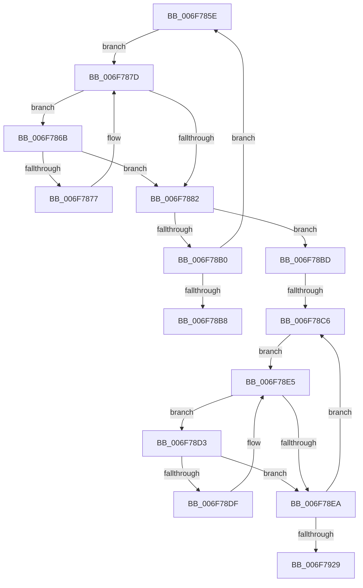

# sub_006F785E

- RVA: `0x006F785E`–`0x006F7932` (길이 `212` bytes)
- VA: `0x00000001406F785E`
- 실행 섹션: `.text`
- PDB 이름 있음: `아니요`; PDB Function 태그: `아니요`
- unwind 정보 RVA: `0x000B41AC`
- 디코드: `62`개 명령, `212/212` bytes 표시
- 미해석 바이트: `0` (있으면 어셈블리에 `.byte`로 보존)

> 이 문서는 커널 이미지의 기계어와 PDB 기호를 분석해 생성했습니다. 4번과 5번은 함수 원형과 자료형을 바이너리 사용 방식에서 추정한 C 해석이며 원본 소스 복구 결과는 아닙니다.

## 1. Dependencies

- 직접 호출 지점: **3**; 고유 호출 대상: **3**
- 직접 호출자로 확인된 함수: **0**
- RIP 상대 이미지 참조: **0**

### Outgoing calls
- `0x006F78A3` → [HalpIommuMapLogicalRange](../56/HalpIommuMapLogicalRange_function_005690DC.md) (function, `0x005690DC`)
- `0x006F790E` → [HalpIommuUnmapLogicalRange](../30/HalpIommuUnmapLogicalRange_function_00308660.md) (function, `0x00308660`)
- `0x006F791C` → [HalpIommuFlushDomainTbs](../30/HalpIommuFlushDomainTbs_function_003085C0.md) (function, `0x003085C0`)

### Direct callers
- 이 함수 시작 RVA로 연결되는 직접 call은 확인되지 않았습니다. 간접 호출은 완전히 역산할 수 없습니다.

### Static image references
- 디코드된 RIP-relative 메모리 참조가 없습니다.

## 2. Other-region calls and transfers

- 다른 실행 섹션으로 향하는 call: **0**
- call이 아닌 외부 분기/꼬리 이동: **3**
  - `0x006F78B8` → [HalpIommuDomainMapIdentityRange + 0x47](../49/HalpIommuDomainMapIdentityRange_function_004986AC.md) (`tail-transfer`)
  - `0x006F78C0` → [HalpIommuDomainMapIdentityRange + 0x47](../49/HalpIommuDomainMapIdentityRange_function_004986AC.md) (`tail-transfer`)
  - `0x006F792D` → [HalpIommuDomainMapIdentityRange + 0x47](../49/HalpIommuDomainMapIdentityRange_function_004986AC.md) (`tail-transfer`)

## 3. Assembly (complete function range)

```asm
006F785E  4F 8B 0C FC                     mov r9, qword ptr [r12 + r15*8]
006F7862  49 8D 5F 01                     lea rbx, [r15 + 1]
006F7866  49 8B C1                        mov rax, r9
006F7869  EB 12                           jmp 0x1406f787d
006F786B  49 8B 0C DC                     mov rcx, qword ptr [r12 + rbx*8]
006F786F  48 FF C0                        inc rax
006F7872  48 3B C8                        cmp rcx, rax
006F7875  75 0B                           jne 0x1406f7882
006F7877  48 8B C1                        mov rax, rcx
006F787A  48 FF C3                        inc rbx
006F787D  48 3B DD                        cmp rbx, rbp
006F7880  72 E9                           jb 0x1406f786b
006F7882  49 8B 55 28                     mov rdx, qword ptr [r13 + 0x28]
006F7886  48 8B C3                        mov rax, rbx
006F7889  49 2B C7                        sub rax, r15
006F788C  49 C1 E1 0C                     shl r9, 0xc
006F7890  48 C1 E0 0C                     shl rax, 0xc
006F7894  44 8B C7                        mov r8d, edi
006F7897  4C 89 4C 24 28                  mov qword ptr [rsp + 0x28], r9
006F789C  33 C9                           xor ecx, ecx
006F789E  48 89 44 24 20                  mov qword ptr [rsp + 0x20], rax
006F78A3  E8 34 18 E7 FF                  call 0x1405690dc
006F78A8  89 44 24 30                     mov dword ptr [rsp + 0x30], eax
006F78AC  85 C0                           test eax, eax
006F78AE  78 0D                           js 0x1406f78bd
006F78B0  4C 8B FB                        mov r15, rbx
006F78B3  48 3B DD                        cmp rbx, rbp
006F78B6  72 A6                           jb 0x1406f785e
006F78B8  E9 36 0E DA FF                  jmp 0x1404986f3
006F78BD  4D 85 FF                        test r15, r15
006F78C0  0F 84 2D 0E DA FF               je 0x1404986f3
006F78C6  49 8B 1C F4                     mov rbx, qword ptr [r12 + rsi*8]
006F78CA  4C 8D 76 01                     lea r14, [rsi + 1]
006F78CE  48 8B C3                        mov rax, rbx
006F78D1  EB 12                           jmp 0x1406f78e5
006F78D3  4B 8B 0C F4                     mov rcx, qword ptr [r12 + r14*8]
006F78D7  48 FF C0                        inc rax
006F78DA  48 3B C8                        cmp rcx, rax
006F78DD  75 0B                           jne 0x1406f78ea
006F78DF  48 8B C1                        mov rax, rcx
006F78E2  49 FF C6                        inc r14
006F78E5  4C 3B F5                        cmp r14, rbp
006F78E8  72 E9                           jb 0x1406f78d3
006F78EA  49 8B 4D 28                     mov rcx, qword ptr [r13 + 0x28]
006F78EE  48 8D 54 24 40                  lea rdx, [rsp + 0x40]
006F78F3  49 8B FE                        mov rdi, r14
006F78F6  48 C1 E3 0C                     shl rbx, 0xc
006F78FA  48 2B FE                        sub rdi, rsi
006F78FD  4C 8B C3                        mov r8, rbx
006F7900  48 89 7C 24 38                  mov qword ptr [rsp + 0x38], rdi
006F7905  48 C1 E7 0C                     shl rdi, 0xc
006F7909  48 89 7C 24 40                  mov qword ptr [rsp + 0x40], rdi
006F790E  E8 4D 0D C1 FF                  call 0x140308660
006F7913  4C 8B C7                        mov r8, rdi
006F7916  48 8B D3                        mov rdx, rbx
006F7919  49 8B CD                        mov rcx, r13
006F791C  E8 9F 0C C1 FF                  call 0x1403085c0
006F7921  49 8B F6                        mov rsi, r14
006F7924  4D 3B F7                        cmp r14, r15
006F7927  72 9D                           jb 0x1406f78c6
006F7929  8B 44 24 30                     mov eax, dword ptr [rsp + 0x30]
006F792D  E9 C1 0D DA FF                  jmp 0x1404986f3
```

## 4. C-style interpretation (structured pseudocode)

```c
__int64 __fastcall sub_006F785E(__int64 a1, __int64 a2, __int64 a3, __int64 a4, __int64 a5, unsigned int a6, __int64 a7, __int64 a8)
{
    __int64 result;
    __int64 v_r14;
    __int64 v_rbx;
    __int64 v_rdi;
    unsigned __int64 v_stack_p20;
    unsigned __int64 v_stack_p28;
    unsigned int v_stack_p30;
    unsigned __int64 v_stack_p38;
    unsigned __int64 v_stack_p40;

    goto loc_006F787D;
loc_006F786B:
    result = (*(unsigned __int64 *)(v_r12 + v_r15 * 8)) + 1;
    if ((*(unsigned __int64 *)(v_r12 + v_r15 + 1 * 8)) != result) goto loc_006F7882;
    v_rbx = (v_r15 + 1) + 1;
loc_006F787D:
    if (v_rbx < v_rbp) goto loc_006F786B;
loc_006F7882:
    result = (v_rbx) - (v_r15);
    a4 = (*(unsigned __int64 *)(v_r12 + v_r15 * 8)) << (12);
    result = (result) << (12);
    v_stack_p28 = a4;
    a1 = 0;
    v_stack_p20 = result;
    result = HalpIommuMapLogicalRange(a1, *(unsigned __int64 *)(v_r13 + 40), (unsigned int)((unsigned int)(v_rdi)), a4);
    v_stack_p30 = (unsigned int)(result);
    if (sign_flag) goto loc_006F78BD;
    if (v_rbx < v_rbp) goto loc_006F785E;
loc_006F78BD:
loc_006F78C6:
    goto loc_006F78E5;
loc_006F78D3:
    result = (*(unsigned __int64 *)(v_r12 + v_rsi * 8)) + 1;
    if ((*(unsigned __int64 *)(v_r12 + v_rsi + 1 * 8)) != result) goto loc_006F78EA;
    v_r14 = (v_rsi + 1) + 1;
loc_006F78E5:
    if (v_r14 < v_rbp) goto loc_006F78D3;
loc_006F78EA:
    v_rbx = (*(unsigned __int64 *)(v_r12 + v_rsi * 8)) << (12);
    v_rdi = (v_r14) - (v_rsi);
    v_stack_p38 = v_rdi;
    v_rdi = (v_rdi) << (12);
    v_stack_p40 = v_rdi;
    result = HalpIommuUnmapLogicalRange(*(unsigned __int64 *)(v_r13 + 40), a8, v_rbx, a4);
    result = HalpIommuFlushDomainTbs(v_r13, v_rbx, v_rdi, a4);
    if (v_r14 < v_rbx) goto loc_006F78C6;
}
```

## 5. (Beta) C Style

```c
int64_t sub_006F785E(int64_t Arg1, int64_t Arg2, int64_t Arg3, int64_t Arg4, uint64_t Arg5, uint32_t Arg6, uint64_t Arg7, int64_t Arg8)
{
    int64_t result;
    int64_t local_r14;
    int64_t local_rbx;
    int64_t local_rdi;
    uint64_t v_stack_p20;
    uint64_t v_stack_p28;
    uint32_t v_stack_p30;
    uint64_t v_stack_p38;
    uint64_t v_stack_p40;

    goto loc_006F787D;
loc_006F786B:
    result = (*(uint64_t *)(local_r12 + local_r15 * 8)) + 1;
    if ((*(uint64_t *)(local_r12 + local_r15 + 0x1 * 8)) != result) goto loc_006F7882;
    local_rbx = (local_r15 + 1) + 1;
loc_006F787D:
    if (local_rbx < local_rbp) goto loc_006F786B;
loc_006F7882:
    result = (local_rbx) - (local_r15);
    Arg4 = (*(uint64_t *)(local_r12 + local_r15 * 8)) << (12);
    result = (result) << (12);
    v_stack_p28 = Arg4;
    Arg1 = 0;
    v_stack_p20 = result;
    result = HalpIommuMapLogicalRange(Arg1, *(uint64_t *)(local_r13 + 0x28), (uint32_t)((uint32_t)(local_rdi)), Arg4);
    v_stack_p30 = (uint32_t)(result);
    if (sign_flag) goto loc_006F78BD;
    if (local_rbx < local_rbp) goto loc_006F785E;
loc_006F78BD:
loc_006F78C6:
    goto loc_006F78E5;
loc_006F78D3:
    result = (*(uint64_t *)(local_r12 + local_rsi * 8)) + 1;
    if ((*(uint64_t *)(local_r12 + local_rsi + 0x1 * 8)) != result) goto loc_006F78EA;
    local_r14 = (local_rsi + 1) + 1;
loc_006F78E5:
    if (local_r14 < local_rbp) goto loc_006F78D3;
loc_006F78EA:
    local_rbx = (*(uint64_t *)(local_r12 + local_rsi * 8)) << (12);
    local_rdi = (local_r14) - (local_rsi);
    v_stack_p38 = local_rdi;
    local_rdi = (local_rdi) << (12);
    v_stack_p40 = local_rdi;
    result = HalpIommuUnmapLogicalRange(*(uint64_t *)(local_r13 + 0x28), Arg8, local_rbx, Arg4);
    result = HalpIommuFlushDomainTbs(local_r13, local_rbx, local_rdi, Arg4);
    if (local_r14 < local_rbx) goto loc_006F78C6;
}
```

## 6. Execution-region graph

[열기: 2D/3D 그래프와 함수 탐색 컨트롤 패널](../../../control-panel.html?section=text&rva=0x006F785E&view=graph)

- 2D 그래프는 위에서 아래로 흐르고, 3D 그래프는 빈 공간을 드래그해 회전합니다. Shift+드래그는 이동, 휠은 확대·축소, 함수 노드 선택은 대상 보고서 이동입니다.

### Static fallback


