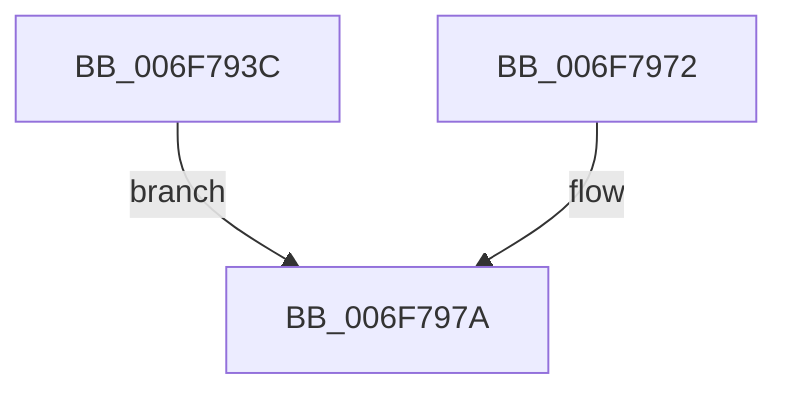

# sub_006F793C

- RVA: `0x006F793C`–`0x006F7985` (길이 `73` bytes)
- VA: `0x00000001406F793C`
- 실행 섹션: `.text`
- PDB 이름 있음: `아니요`; PDB Function 태그: `아니요`
- unwind 정보 RVA: `0x000B4728`
- 디코드: `17`개 명령, `73/73` bytes 표시
- 미해석 바이트: `0` (있으면 어셈블리에 `.byte`로 보존)

> 이 문서는 커널 이미지의 기계어와 PDB 기호를 분석해 생성했습니다. 4번과 5번은 함수 원형과 자료형을 바이너리 사용 방식에서 추정한 C 해석이며 원본 소스 복구 결과는 아닙니다.

## 1. Dependencies

- 직접 호출 지점: **1**; 고유 호출 대상: **1**
- 직접 호출자로 확인된 함수: **0**
- RIP 상대 이미지 참조: **1**

### Outgoing calls
- `0x006F7975` → [MmUnlockPages](../29/MmUnlockPages_function_0029EEE0.md) (function, `0x0029EEE0`)

### Direct callers
- 이 함수 시작 RVA로 연결되는 직접 call은 확인되지 않았습니다. 간접 호출은 완전히 역산할 수 없습니다.

### Static image references
- `0x006F797A` → RVA `0x00E30224` (`.data`; read/write)

## 2. Other-region calls and transfers

- 다른 실행 섹션으로 향하는 call: **0**
- call이 아닌 외부 분기/꼬리 이동: **1**
  - `0x006F7980` → [MiProbeAndLockComplete + 0x68](../49/MiProbeAndLockComplete_function_0049A18C.md) (`tail-transfer`)

## 3. Assembly (complete function range)

```asm
006F793C  65 8B 0C 25 A4 01 00 00         mov ecx, dword ptr gs:[0x1a4]
006F7944  48 8B 53 10                     mov rdx, qword ptr [rbx + 0x10]
006F7948  48 2B 53 08                     sub rdx, qword ptr [rbx + 8]
006F794C  48 8B 43 58                     mov rax, qword ptr [rbx + 0x58]
006F7950  48 D1 E9                        shr rcx, 1
006F7953  83 E1 03                        and ecx, 3
006F7956  48 C1 EA 0C                     shr rdx, 0xc
006F795A  48 83 C1 08                     add rcx, 8
006F795E  48 F7 DA                        neg rdx
006F7961  48 C1 E1 06                     shl rcx, 6
006F7965  48 03 88 10 04 00 00            add rcx, qword ptr [rax + 0x410]
006F796C  F0 48 01 11                     lock add qword ptr [rcx], rdx
006F7970  EB 08                           jmp 0x1406f797a
006F7972  48 8B CF                        mov rcx, rdi
006F7975  E8 66 75 BA FF                  call 0x14029eee0
006F797A  FF 05 A4 88 73 00               inc dword ptr [rip + 0x7388a4]
006F7980  E9 6F 28 DA FF                  jmp 0x14049a1f4
```

## 4. C-style interpretation (structured pseudocode)

```c
__int64 __fastcall sub_006F793C(void)
{
    a2 = (*(unsigned __int64 *)(v_rbx + 16)) - (*(unsigned __int64 *)(v_rbx + 8));
    a1 = ((unsigned int)(*(unsigned int *)(gs_base + (0 + 420)))) >> (1);
    a1 = (unsigned int)((a1) & (3));
    a2 = (a2) >> (12);
    a1 = (a1) + (8);
    a2 = -(a2);
    a1 = (a1) << (6);
    a1 = (a1) + (*(unsigned __int64 *)(*(unsigned __int64 *)(v_rbx + 88) + 1040));
    goto loc_006F797A;
loc_006F797A:
}
```

## 5. (Beta) C Style

```c
void sub_006F793C(void)
{
    a2 = (*(uint64_t *)(local_rbx + 0x10)) - (*(uint64_t *)(local_rbx + 0x8));
    a1 = ((uint32_t)(*(uint32_t *)(gs_base + (0 + 0x1A4)))) >> (1);
    a1 = (uint32_t)((a1) & (3));
    a2 = (a2) >> (12);
    a1 = (a1) + (8);
    a2 = -(a2);
    a1 = (a1) << (6);
    a1 = (a1) + (*(uint64_t *)(*(uint64_t *)(local_rbx + 0x58) + 0x410));
    goto loc_006F797A;
loc_006F797A:
}
```

## 6. Execution-region graph

[열기: 2D/3D 그래프와 함수 탐색 컨트롤 패널](../../../control-panel.html?section=text&rva=0x006F793C&view=graph)

- 2D 그래프는 위에서 아래로 흐르고, 3D 그래프는 빈 공간을 드래그해 회전합니다. Shift+드래그는 이동, 휠은 확대·축소, 함수 노드 선택은 대상 보고서 이동입니다.

### Static fallback


