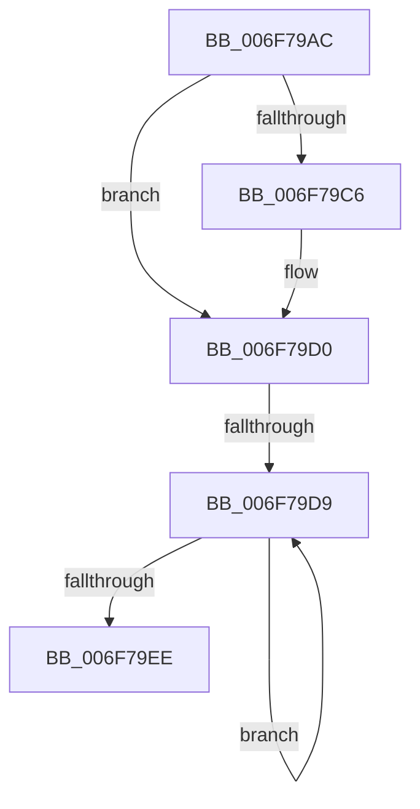

# sub_006F79AC

- RVA: `0x006F79AC`–`0x006F79F3` (길이 `71` bytes)
- VA: `0x00000001406F79AC`
- 실행 섹션: `.text`
- PDB 이름 있음: `아니요`; PDB Function 태그: `아니요`
- unwind 정보 RVA: `0x000B47CC`
- 디코드: `21`개 명령, `71/71` bytes 표시
- 미해석 바이트: `0` (있으면 어셈블리에 `.byte`로 보존)

> 이 문서는 커널 이미지의 기계어와 PDB 기호를 분석해 생성했습니다. 4번과 5번은 함수 원형과 자료형을 바이너리 사용 방식에서 추정한 C 해석이며 원본 소스 복구 결과는 아닙니다.

## 1. Dependencies

- 직접 호출 지점: **4**; 고유 호출 대상: **4**
- 직접 호출자로 확인된 함수: **0**
- RIP 상대 이미지 참조: **0**

### Outgoing calls
- `0x006F79AF` → [MiLockWorkingSetExclusive](../32/MiLockWorkingSetExclusive_function_003238A0.md) (function, `0x003238A0`)
- `0x006F79B9` → [MiDeleteDeferredCloneDescriptors](../4D/MiDeleteDeferredCloneDescriptors_function_004D8DAC.md) (function, `0x004D8DAC`)
- `0x006F79CB` → [MiUnlockWorkingSetExclusive](../27/MiUnlockWorkingSetExclusive_function_0027EC70.md) (function, `0x0027EC70`)
- `0x006F79E1` → [ExFreePoolWithTag](../../poolcode/B8/ExFreePoolWithTag_function_00B82870.md) (function, `0x00B82870`)

### Direct callers
- 이 함수 시작 RVA로 연결되는 직접 call은 확인되지 않았습니다. 간접 호출은 완전히 역산할 수 없습니다.

### Static image references
- 디코드된 RIP-relative 메모리 참조가 없습니다.

## 2. Other-region calls and transfers

- 다른 실행 섹션으로 향하는 call: **1**
  - `0x006F79E1` → [ExFreePoolWithTag](../../poolcode/B8/ExFreePoolWithTag_function_00B82870.md) (`.text` → `POOLCODE`)
- call이 아닌 외부 분기/꼬리 이동: **2**
  - `0x006F79D3` → [MiDeleteCloneZombies + 0x29](../49/MiDeleteCloneZombies_function_0049A7B8.md) (`tail-transfer`)
  - `0x006F79EE` → [MiDeleteCloneZombies + 0x29](../49/MiDeleteCloneZombies_function_0049A7B8.md) (`tail-transfer`)

## 3. Assembly (complete function range)

```asm
006F79AC  48 8B CE                        mov rcx, rsi
006F79AF  E8 EC BE C2 FF                  call 0x1403238a0
006F79B4  8A D8                           mov bl, al
006F79B6  48 8B CF                        mov rcx, rdi
006F79B9  E8 EE 13 DE FF                  call 0x1404d8dac
006F79BE  48 8B F8                        mov rdi, rax
006F79C1  80 FB 11                        cmp bl, 0x11
006F79C4  74 0A                           je 0x1406f79d0
006F79C6  8A D3                           mov dl, bl
006F79C8  48 8B CE                        mov rcx, rsi
006F79CB  E8 A0 72 B8 FF                  call 0x14027ec70
006F79D0  48 85 FF                        test rdi, rdi
006F79D3  0F 84 08 2E DA FF               je 0x14049a7e1
006F79D9  48 8B 1F                        mov rbx, qword ptr [rdi]
006F79DC  33 D2                           xor edx, edx
006F79DE  48 8B CF                        mov rcx, rdi
006F79E1  E8 8A AE 48 00                  call 0x140b82870
006F79E6  48 8B FB                        mov rdi, rbx
006F79E9  48 85 DB                        test rbx, rbx
006F79EC  75 EB                           jne 0x1406f79d9
006F79EE  E9 EE 2D DA FF                  jmp 0x14049a7e1
```

## 4. C-style interpretation (structured pseudocode)

```c
__int64 __fastcall sub_006F79AC(void)
{
    __int64 result;

    result = MiLockWorkingSetExclusive(v_rsi, a2, a3, a4);
    result = MiDeleteDeferredCloneDescriptors(v_rdi, a2, a3, a4);
    if (((unsigned __int8)((unsigned __int8)(result))) != 17) {
        a2 = (unsigned __int8)((unsigned __int8)(result));
        a1 = v_rsi;
        result = MiUnlockWorkingSetExclusive(a1, a2, a3, a4);
    }
loc_006F79D9:
    a2 = 0;
    result = ExFreePoolWithTag(result, a2, a3, a4);
    if (*(unsigned __int64 *)(result) != 0) goto loc_006F79D9;
}
```

## 5. (Beta) C Style

```c
void sub_006F79AC(void)
{
    int64_t result;

    result = MiLockWorkingSetExclusive(local_rsi, a2, a3, a4);
    result = MiDeleteDeferredCloneDescriptors(local_rdi, a2, a3, a4);
    if (((uint8_t)((uint8_t)(result))) != 17) {
        a2 = (uint8_t)((uint8_t)(result));
        a1 = local_rsi;
        result = MiUnlockWorkingSetExclusive(a1, a2, a3, a4);
    }
loc_006F79D9:
    a2 = 0;
    result = ExFreePoolWithTag(result, a2, a3, a4);
    if (*(uint64_t *)(result) != 0) goto loc_006F79D9;
}
```

## 6. Execution-region graph

[열기: 2D/3D 그래프와 함수 탐색 컨트롤 패널](../../../control-panel.html?section=text&rva=0x006F79AC&view=graph)

- 2D 그래프는 위에서 아래로 흐르고, 3D 그래프는 빈 공간을 드래그해 회전합니다. Shift+드래그는 이동, 휠은 확대·축소, 함수 노드 선택은 대상 보고서 이동입니다.

### Static fallback


