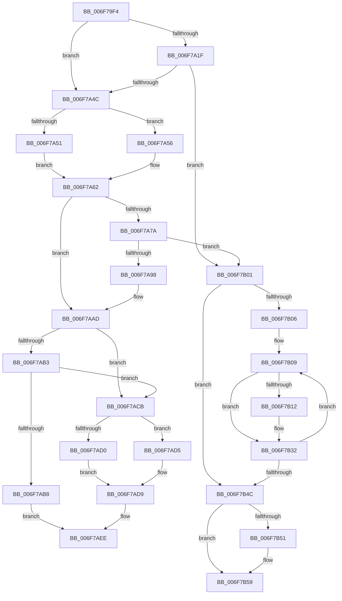

# sub_006F79F4

- RVA: `0x006F79F4`–`0x006F7B60` (길이 `364` bytes)
- VA: `0x00000001406F79F4`
- 실행 섹션: `.text`
- PDB 이름 있음: `아니요`; PDB Function 태그: `아니요`
- unwind 정보 RVA: `0x000B4834`
- 디코드: `97`개 명령, `364/364` bytes 표시
- 미해석 바이트: `0` (있으면 어셈블리에 `.byte`로 보존)

> 이 문서는 커널 이미지의 기계어와 PDB 기호를 분석해 생성했습니다. 4번과 5번은 함수 원형과 자료형을 바이너리 사용 방식에서 추정한 C 해석이며 원본 소스 복구 결과는 아닙니다.

## 1. Dependencies

- 직접 호출 지점: **6**; 고유 호출 대상: **6**
- 직접 호출자로 확인된 함수: **0**
- RIP 상대 이미지 참조: **0**

### Outgoing calls
- `0x006F7A0F` → [HalpDmaAllocateScatterPagesFromScatterPool](../3D/HalpDmaAllocateScatterPagesFromScatterPool_function_003DC3EC.md) (function, `0x003DC3EC`)
- `0x006F7A38` → [HalpDmaAllocateScatterPagesFromContiguousPool](../3D/HalpDmaAllocateScatterPagesFromContiguousPool_function_003DC184.md) (function, `0x003DC184`)
- `0x006F7A88` → [MmMapIoSpaceEx](../32/MmMapIoSpaceEx_function_00327830.md) (function, `0x00327830`)
- `0x006F7B21` → [MiUnmapContiguousMemory](../3F/MiUnmapContiguousMemory_function_003F7908.md) (function, `0x003F7908`)
- `0x006F7B3E` → [HalpDmaReturnPageToOwner](../3D/HalpDmaReturnPageToOwner_function_003DFB94.md) (function, `0x003DFB94`)
- `0x006F7B54` → [HalpMmAllocCtxFree](../3E/HalpMmAllocCtxFree_function_003E1904.md) (function, `0x003E1904`)

### Direct callers
- 이 함수 시작 RVA로 연결되는 직접 call은 확인되지 않았습니다. 간접 호출은 완전히 역산할 수 없습니다.

### Static image references
- 디코드된 RIP-relative 메모리 참조가 없습니다.

## 2. Other-region calls and transfers

- 다른 실행 섹션으로 향하는 call: **0**
- call이 아닌 외부 분기/꼬리 이동: **2**
  - `0x006F7AFC` → [HalpDmaAllocateNewTranslationBuffer + 0x5B](../49/HalpDmaAllocateNewTranslationBuffer_function_0049ACD8.md) (`tail-transfer`)
  - `0x006F7B5B` → [HalpDmaAllocateNewTranslationBuffer + 0x67](../49/HalpDmaAllocateNewTranslationBuffer_function_0049ACD8.md) (`tail-transfer`)

## 3. Assembly (complete function range)

```asm
006F79F4  48 8D 44 24 70                  lea rax, [rsp + 0x70]
006F79F9  41 B1 01                        mov r9b, 1
006F79FC  48 89 44 24 28                  mov qword ptr [rsp + 0x28], rax
006F7A01  48 8B D5                        mov rdx, rbp
006F7A04  44 88 44 24 20                  mov byte ptr [rsp + 0x20], r8b
006F7A09  41 B8 01 00 00 00               mov r8d, 1
006F7A0F  E8 D8 49 CE FF                  call 0x1403dc3ec
006F7A14  45 33 C0                        xor r8d, r8d
006F7A17  48 8B D8                        mov rbx, rax
006F7A1A  48 85 C0                        test rax, rax
006F7A1D  75 2D                           jne 0x1406f7a4c
006F7A1F  48 8D 44 24 70                  lea rax, [rsp + 0x70]
006F7A24  41 B1 01                        mov r9b, 1
006F7A27  48 89 44 24 28                  mov qword ptr [rsp + 0x28], rax
006F7A2C  48 8B D5                        mov rdx, rbp
006F7A2F  44 88 44 24 20                  mov byte ptr [rsp + 0x20], r8b
006F7A34  44 8D 43 01                     lea r8d, [rbx + 1]
006F7A38  E8 47 47 CE FF                  call 0x1403dc184
006F7A3D  45 33 C0                        xor r8d, r8d
006F7A40  48 8B D8                        mov rbx, rax
006F7A43  48 85 C0                        test rax, rax
006F7A46  0F 84 B5 00 00 00               je 0x1406f7b01
006F7A4C  48 85 F6                        test rsi, rsi
006F7A4F  75 05                           jne 0x1406f7a56
006F7A51  48 8B F3                        mov rsi, rbx
006F7A54  EB 0C                           jmp 0x1406f7a62
006F7A56  48 8B 84 24 80 00 00 00         mov rax, qword ptr [rsp + 0x80]
006F7A5E  48 89 58 08                     mov qword ptr [rax + 8], rbx
006F7A62  48 8B 53 30                     mov rdx, qword ptr [rbx + 0x30]
006F7A66  41 FF C7                        inc r15d
006F7A69  48 89 9C 24 80 00 00 00         mov qword ptr [rsp + 0x80], rbx
006F7A71  48 81 E2 00 F0 FF FF            and rdx, 0xfffffffffffff000
006F7A78  75 33                           jne 0x1406f7aad
006F7A7A  48 8B 0B                        mov rcx, qword ptr [rbx]
006F7A7D  BA 00 10 00 00                  mov edx, 0x1000
006F7A82  41 B8 04 00 00 00               mov r8d, 4
006F7A88  E8 A3 FD C2 FF                  call 0x140327830
006F7A8D  45 33 C0                        xor r8d, r8d
006F7A90  48 8B D0                        mov rdx, rax
006F7A93  48 85 C0                        test rax, rax
006F7A96  74 69                           je 0x1406f7b01
006F7A98  48 83 4B 30 10                  or qword ptr [rbx + 0x30], 0x10
006F7A9D  8B 4B 30                        mov ecx, dword ptr [rbx + 0x30]
006F7AA0  81 E1 FF 0F 00 00               and ecx, 0xfff
006F7AA6  48 0B C8                        or rcx, rax
006F7AA9  48 89 4B 30                     mov qword ptr [rbx + 0x30], rcx
006F7AAD  41 83 FF 01                     cmp r15d, 1
006F7AB1  75 18                           jne 0x1406f7acb
006F7AB3  45 84 E4                        test r12b, r12b
006F7AB6  74 13                           je 0x1406f7acb
006F7AB8  4C 89 07                        mov qword ptr [rdi], r8
006F7ABB  4C 8B EF                        mov r13, rdi
006F7ABE  48 89 57 10                     mov qword ptr [rdi + 0x10], rdx
006F7AC2  C7 47 08 38 00 00 00            mov dword ptr [rdi + 8], 0x38
006F7AC9  EB 23                           jmp 0x1406f7aee
006F7ACB  48 85 FF                        test rdi, rdi
006F7ACE  75 05                           jne 0x1406f7ad5
006F7AD0  48 8B FA                        mov rdi, rdx
006F7AD3  EB 04                           jmp 0x1406f7ad9
006F7AD5  49 89 55 00                     mov qword ptr [r13], rdx
006F7AD9  48 8D 42 18                     lea rax, [rdx + 0x18]
006F7ADD  4C 89 02                        mov qword ptr [rdx], r8
006F7AE0  48 89 42 10                     mov qword ptr [rdx + 0x10], rax
006F7AE4  4C 8B EA                        mov r13, rdx
006F7AE7  C7 42 08 38 00 00 00            mov dword ptr [rdx + 8], 0x38
006F7AEE  41 8B C6                        mov eax, r14d
006F7AF1  41 83 C6 C8                     add r14d, -0x38
006F7AF5  83 F8 38                        cmp eax, 0x38
006F7AF8  45 0F 46 F0                     cmovbe r14d, r8d
006F7AFC  E9 32 32 DA FF                  jmp 0x14049ad33
006F7B01  45 85 FF                        test r15d, r15d
006F7B04  74 46                           je 0x1406f7b4c
006F7B06  45 8B F7                        mov r14d, r15d
006F7B09  48 8B 4E 30                     mov rcx, qword ptr [rsi + 0x30]
006F7B0D  F6 C1 10                        test cl, 0x10
006F7B10  74 20                           je 0x1406f7b32
006F7B12  48 81 E1 00 F0 FF FF            and rcx, 0xfffffffffffff000
006F7B19  41 B0 01                        mov r8b, 1
006F7B1C  BA 00 10 00 00                  mov edx, 0x1000
006F7B21  E8 E2 FD CF FF                  call 0x1403f7908
006F7B26  8B 46 30                        mov eax, dword ptr [rsi + 0x30]
006F7B29  25 EF 0F 00 00                  and eax, 0xfef
006F7B2E  48 89 46 30                     mov qword ptr [rsi + 0x30], rax
006F7B32  48 8B 5E 08                     mov rbx, qword ptr [rsi + 8]
006F7B36  4C 8B C6                        mov r8, rsi
006F7B39  48 8B D5                        mov rdx, rbp
006F7B3C  33 C9                           xor ecx, ecx
006F7B3E  E8 51 80 CE FF                  call 0x1403dfb94
006F7B43  48 8B F3                        mov rsi, rbx
006F7B46  49 83 EE 01                     sub r14, 1
006F7B4A  75 BD                           jne 0x1406f7b09
006F7B4C  45 84 E4                        test r12b, r12b
006F7B4F  74 08                           je 0x1406f7b59
006F7B51  48 8B D7                        mov rdx, rdi
006F7B54  E8 AB 9D CE FF                  call 0x1403e1904
006F7B59  33 C0                           xor eax, eax
006F7B5B  E9 DF 31 DA FF                  jmp 0x14049ad3f
```

## 4. C-style interpretation (structured pseudocode)

```c
__int64 __fastcall sub_006F79F4(__int64 a1, __int64 a2, unsigned __int8 a3, __int64 a4, __int64 a5, __int64 a6, __int64 a7, __int64 a8, __int64 a9, __int64 a10, __int64 a11, __int64 a12, __int64 a13, __int64 a14, __int64 a15, __int64 a16)
{
    __int64 result;
    __int64 v_r14;
    __int64 v_r15;
    unsigned __int8 v_stack_p20;
    unsigned __int64 v_stack_p28;
    unsigned __int64 v_stack_p80;

    v_stack_p28 = a14;
    v_stack_p20 = a3;
    result = HalpDmaAllocateScatterPagesFromScatterPool(a1, v_rbp, 1, 1);
    a3 = 0;
    if (result != 0) goto loc_006F7A4C;
    v_stack_p28 = a14;
    v_stack_p20 = 0;
    result = HalpDmaAllocateScatterPagesFromContiguousPool(a1, v_rbp, result + 1, 1);
    a3 = 0;
    if (result == 0) goto loc_006F7B01;
loc_006F7A4C:
    if (v_rsi != 0) goto loc_006F7A56;
    goto loc_006F7A62;
loc_006F7A56:
    *(unsigned __int64 *)(a16 + 8) = result;
loc_006F7A62:
    v_r15 = (unsigned int)((v_r15) + 1);
    v_stack_p80 = result;
    a2 = (*(unsigned __int64 *)(result + 48)) & (0xFFFFFFFFFFFFF000ULL);
    if (condition_is_not_equal) goto loc_006F7AAD;
    result = MmMapIoSpaceEx(*(unsigned __int64 *)(result), (unsigned int)(0x1000ULL), 4, 1);
    a3 = 0;
    if (result == 0) goto loc_006F7B01;
    a1 = (unsigned int)(((unsigned int)(*(unsigned int *)(result + 48))) & (0xFFFULL));
    a1 = (a1) | (result);
    *(unsigned __int64 *)(result + 48) = a1;
loc_006F7AAD:
    if (((unsigned int)(v_r15)) != 1) goto loc_006F7ACB;
    if ((unsigned __int8)(v_r12) == 0) goto loc_006F7ACB;
    *(unsigned __int64 *)(v_rdi) = 0;
    *(unsigned __int64 *)(v_rdi + 16) = result;
    *(unsigned int *)(v_rdi + 8) = 56;
    goto loc_006F7AEE;
loc_006F7ACB:
    if (v_rdi != 0) goto loc_006F7AD5;
    goto loc_006F7AD9;
loc_006F7AD5:
    *(unsigned __int64 *)(v_rdi) = result;
loc_006F7AD9:
    *(unsigned __int64 *)(result) = 0;
    *(unsigned __int64 *)(result + 16) = result + 24;
    *(unsigned int *)(result + 8) = 56;
loc_006F7AEE:
    v_r14 = (unsigned int)((v_r14) + (-56));
    if (((unsigned int)((unsigned int)((unsigned int)(v_r14)))) <= 56) { v_r14 = 0; }
loc_006F7B01:
    if ((unsigned int)(v_r15) == 0) goto loc_006F7B4C;
loc_006F7B09:
    result = (unsigned int)((unsigned int)(v_r14));
    if ((((unsigned __int8)(*(unsigned __int64 *)(result + 48))) & (16)) != 0) {
        a1 = (*(unsigned __int64 *)(result + 48)) & (0xFFFFFFFFFFFFF000ULL);
        a3 = 1;
        a2 = 0x1000ULL;
        result = MiUnmapContiguousMemory(a1, a2, a3, 1);
        result = *(unsigned int *)(result + 48);
        result = (unsigned int)((result) & (0xFEFULL));
        *(unsigned __int64 *)(result + 48) = result;
    }
    a1 = 0;
    result = HalpDmaReturnPageToOwner(a1, v_rbp, result, 1);
    v_r14 = ((unsigned int)((unsigned int)(v_r15))) - (1);
    if (condition_is_not_equal) goto loc_006F7B09;
loc_006F7B4C:
    if ((unsigned __int8)(v_r12) != 0) {
        a2 = result;
        result = HalpMmAllocCtxFree(a1, a2, result, 1);
    }
    result = 0;
}
```

## 5. (Beta) C Style

```c
int64_t sub_006F79F4(int64_t Arg1, int64_t Arg2, uint8_t Arg3, int64_t Arg4, uint64_t Arg5, uint64_t Arg6, uint64_t Arg7, uint64_t Arg8, uint64_t Arg9, uint64_t Arg10, uint64_t Arg11, uint64_t Arg12, uint64_t Arg13, int64_t Arg14, uint64_t Arg15, void *Arg16)
{
    uint8_t *arg16 = (uint8_t *)Arg16;

    int64_t result;
    int64_t local_r14;
    int64_t local_r15;
    uint8_t v_stack_p20;
    uint64_t v_stack_p28;
    uint64_t v_stack_p80;

    v_stack_p28 = Arg14;
    v_stack_p20 = Arg3;
    result = HalpDmaAllocateScatterPagesFromScatterPool(Arg1, local_rbp, 1, 1);
    Arg3 = 0;
    if (result != 0) goto loc_006F7A4C;
    v_stack_p28 = Arg14;
    v_stack_p20 = 0;
    result = HalpDmaAllocateScatterPagesFromContiguousPool(Arg1, local_rbp, result + 1, 1);
    Arg3 = 0;
    if (result == 0) goto loc_006F7B01;
loc_006F7A4C:
    if (local_rsi != 0) goto loc_006F7A56;
    goto loc_006F7A62;
loc_006F7A56:
    *(uint64_t *)(arg16 + 0x8) = result;
loc_006F7A62:
    local_r15 = (uint32_t)((local_r15) + 1);
    v_stack_p80 = result;
    Arg2 = (*(uint64_t *)(result + 0x30)) & (0xFFFFFFFFFFFFF000ULL);
    if (condition_is_not_equal) goto loc_006F7AAD;
    result = MmMapIoSpaceEx(*(uint64_t *)(result), (uint32_t)(0x1000ULL), 4, 1);
    Arg3 = 0;
    if (result == 0) goto loc_006F7B01;
    Arg1 = (uint32_t)(((uint32_t)(*(uint32_t *)(result + 0x30))) & (0xFFFULL));
    Arg1 = (Arg1) | (result);
    *(uint64_t *)(result + 0x30) = Arg1;
loc_006F7AAD:
    if (((uint32_t)(local_r15)) != 1) goto loc_006F7ACB;
    if ((uint8_t)(local_r12) == 0) goto loc_006F7ACB;
    *(uint64_t *)(local_rdi) = 0;
    *(uint64_t *)(local_rdi + 0x10) = result;
    *(uint32_t *)(local_rdi + 0x8) = 56;
    goto loc_006F7AEE;
loc_006F7ACB:
    if (local_rdi != 0) goto loc_006F7AD5;
    goto loc_006F7AD9;
loc_006F7AD5:
    *(uint64_t *)(local_rdi) = result;
loc_006F7AD9:
    *(uint64_t *)(result) = 0;
    *(uint64_t *)(result + 0x10) = result + 24;
    *(uint32_t *)(result + 0x8) = 56;
loc_006F7AEE:
    local_r14 = (uint32_t)((local_r14) + (-56));
    if (((uint32_t)((uint32_t)((uint32_t)(local_r14)))) <= 56) { local_r14 = 0; }
loc_006F7B01:
    if ((uint32_t)(local_r15) == 0) goto loc_006F7B4C;
loc_006F7B09:
    result = (uint32_t)((uint32_t)(local_r14));
    if ((((uint8_t)(*(uint64_t *)(result + 0x30))) & (16)) != 0) {
        Arg1 = (*(uint64_t *)(result + 0x30)) & (0xFFFFFFFFFFFFF000ULL);
        Arg3 = 1;
        Arg2 = 0x1000ULL;
        result = MiUnmapContiguousMemory(Arg1, Arg2, Arg3, 1);
        result = *(uint32_t *)(result + 0x30);
        result = (uint32_t)((result) & (0xFEFULL));
        *(uint64_t *)(result + 0x30) = result;
    }
    Arg1 = 0;
    result = HalpDmaReturnPageToOwner(Arg1, local_rbp, result, 1);
    local_r14 = ((uint32_t)((uint32_t)(local_r15))) - (1);
    if (condition_is_not_equal) goto loc_006F7B09;
loc_006F7B4C:
    if ((uint8_t)(local_r12) != 0) {
        Arg2 = result;
        result = HalpMmAllocCtxFree(Arg1, Arg2, result, 1);
    }
    result = 0;
}
```

### 관측된 메모리 오프셋

구조체 형식이 확인되지 않은 접근은 인자 기준의 오프셋으로만 기록했습니다.

| 기준 인자 | 오프셋 표현 | 폭 (bit) | 접근 |
|---|---:|---:|---|
| `Arg16` | `+ 0x8` | `64` | `W` |

## 6. Execution-region graph

[열기: 2D/3D 그래프와 함수 탐색 컨트롤 패널](../../../control-panel.html?section=text&rva=0x006F79F4&view=graph)

- 2D 그래프는 위에서 아래로 흐르고, 3D 그래프는 빈 공간을 드래그해 회전합니다. Shift+드래그는 이동, 휠은 확대·축소, 함수 노드 선택은 대상 보고서 이동입니다.

### Static fallback


