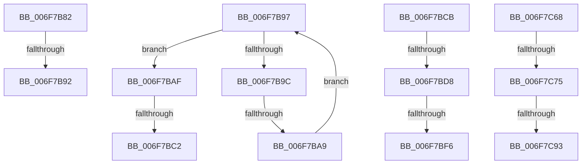

# sub_006F7B82

- RVA: `0x006F7B82`–`0x006F7D05` (길이 `387` bytes)
- VA: `0x00000001406F7B82`
- 실행 섹션: `.text`
- PDB 이름 있음: `아니요`; PDB Function 태그: `아니요`
- unwind 정보 RVA: `0x000B48E8`
- 디코드: `76`개 명령, `387/387` bytes 표시
- 미해석 바이트: `0` (있으면 어셈블리에 `.byte`로 보존)

> 이 문서는 커널 이미지의 기계어와 PDB 기호를 분석해 생성했습니다. 4번과 5번은 함수 원형과 자료형을 바이너리 사용 방식에서 추정한 C 해석이며 원본 소스 복구 결과는 아닙니다.

## 1. Dependencies

- 직접 호출 지점: **4**; 고유 호출 대상: **2**
- 직접 호출자로 확인된 함수: **0**
- RIP 상대 이미지 참조: **3**

### Outgoing calls
- `0x006F7BE9` → [tlgKeywordOn](../42/tlgKeywordOn_function_0042EAA0.md) (function, `0x0042EAA0`)
- `0x006F7C5D` → [tlgWriteTransfer_EtwWriteTransfer](../42/tlgWriteTransfer_EtwWriteTransfer_function_004260E0.md) (function, `0x004260E0`)
- `0x006F7C86` → [tlgKeywordOn](../42/tlgKeywordOn_function_0042EAA0.md) (function, `0x0042EAA0`)
- `0x006F7CFA` → [tlgWriteTransfer_EtwWriteTransfer](../42/tlgWriteTransfer_EtwWriteTransfer_function_004260E0.md) (function, `0x004260E0`)

### Direct callers
- 이 함수 시작 RVA로 연결되는 직접 call은 확인되지 않았습니다. 간접 호출은 완전히 역산할 수 없습니다.

### Static image references
- `0x006F7BCB` → RVA `0x00E07748` (`.data`; read)
- `0x006F7C05` → RVA `0x0004903E` (`.rdata`; read)
- `0x006F7CA0` → RVA `0x0004909D` (`.rdata`; read)

## 2. Other-region calls and transfers

- 다른 실행 섹션으로 향하는 call: **0**
- call이 아닌 외부 분기/꼬리 이동: **11**
  - `0x006F7B8C` → [PopFxBuildDripsBlockingDeviceList + 0x24F](../49/PopFxBuildDripsBlockingDeviceList_function_0049B5B0.md) (`tail-transfer`)
  - `0x006F7B92` → [PopFxBuildDripsBlockingDeviceList + 0x264](../49/PopFxBuildDripsBlockingDeviceList_function_0049B5B0.md) (`tail-transfer`)
  - `0x006F7BA3` → [PopFxBuildDripsBlockingDeviceList + 0x2C3](../49/PopFxBuildDripsBlockingDeviceList_function_0049B5B0.md) (`tail-transfer`)
  - `0x006F7BBC` → [PopFxBuildDripsBlockingDeviceList + 0x3E9](../49/PopFxBuildDripsBlockingDeviceList_function_0049B5B0.md) (`tail-transfer`)
  - `0x006F7BC6` → [PopFxBuildDripsBlockingDeviceList + 0x2C3](../49/PopFxBuildDripsBlockingDeviceList_function_0049B5B0.md) (`tail-transfer`)
  - `0x006F7BD2` → [PopFxBuildDripsBlockingDeviceList + 0x3C3](../49/PopFxBuildDripsBlockingDeviceList_function_0049B5B0.md) (`tail-transfer`)
  - `0x006F7BF0` → [PopFxBuildDripsBlockingDeviceList + 0x3C3](../49/PopFxBuildDripsBlockingDeviceList_function_0049B5B0.md) (`tail-transfer`)
  - `0x006F7C63` → [PopFxBuildDripsBlockingDeviceList + 0x3C3](../49/PopFxBuildDripsBlockingDeviceList_function_0049B5B0.md) (`tail-transfer`)
  - `0x006F7C6F` → [PopFxBuildDripsBlockingDeviceList + 0x3CB](../49/PopFxBuildDripsBlockingDeviceList_function_0049B5B0.md) (`tail-transfer`)
  - `0x006F7C8D` → [PopFxBuildDripsBlockingDeviceList + 0x3CB](../49/PopFxBuildDripsBlockingDeviceList_function_0049B5B0.md) (`tail-transfer`)
  - `0x006F7D00` → [PopFxBuildDripsBlockingDeviceList + 0x3CB](../49/PopFxBuildDripsBlockingDeviceList_function_0049B5B0.md) (`tail-transfer`)

## 3. Assembly (complete function range)

```asm
006F7B82  B9 03 00 00 00                  mov ecx, 3
006F7B87  CD 29                           int 0x29
006F7B89  48 85 C0                        test rax, rax
006F7B8C  0F 85 6D 3C DA FF               jne 0x14049b7ff
006F7B92  E9 7D 3C DA FF                  jmp 0x14049b814
006F7B97  49 3B C6                        cmp rax, r14
006F7B9A  74 13                           je 0x1406f7baf
006F7B9C  83 B8 9C 00 00 00 01            cmp dword ptr [rax + 0x9c], 1
006F7BA3  0F 85 CA 3C DA FF               jne 0x14049b873
006F7BA9  48 8B 40 10                     mov rax, qword ptr [rax + 0x10]
006F7BAD  EB E8                           jmp 0x1406f7b97
006F7BAF  F0 83 8B 28 01 00 00 20         lock or dword ptr [rbx + 0x128], 0x20
006F7BB7  8D 46 01                        lea eax, [rsi + 1]
006F7BBA  3B C6                           cmp eax, esi
006F7BBC  0F 82 D7 3D DA FF               jb 0x14049b999
006F7BC2  8B F0                           mov esi, eax
006F7BC4  33 FF                           xor edi, edi
006F7BC6  E9 A8 3C DA FF                  jmp 0x14049b873
006F7BCB  83 3D 76 FB 70 00 05            cmp dword ptr [rip + 0x70fb76], 5
006F7BD2  0F 86 9B 3D DA FF               jbe 0x14049b973
006F7BD8  48 BA 00 00 00 00 00 40 00 00   movabs rdx, 0x400000000000
006F7BE2  48 8D 0D 5F FB 70 00            lea rcx, [rip + 0x70fb5f]
006F7BE9  E8 B2 6E D3 FF                  call 0x14042eaa0
006F7BEE  84 C0                           test al, al
006F7BF0  0F 84 7D 3D DA FF               je 0x14049b973
006F7BF6  8D 43 01                        lea eax, [rbx + 1]
006F7BF9  48 C7 45 D8 04 00 00 00         mov qword ptr [rbp - 0x28], 4
006F7C01  89 44 24 58                     mov dword ptr [rsp + 0x58], eax
006F7C05  48 8D 15 32 14 95 FF            lea rdx, [rip - 0x6aebce]
006F7C0C  48 8D 44 24 58                  lea rax, [rsp + 0x58]
006F7C11  89 74 24 5C                     mov dword ptr [rsp + 0x5c], esi
006F7C15  48 89 45 D0                     mov qword ptr [rbp - 0x30], rax
006F7C19  48 8D 0D 28 FB 70 00            lea rcx, [rip + 0x70fb28]
006F7C20  48 8D 44 24 5C                  lea rax, [rsp + 0x5c]
006F7C25  48 C7 45 E8 04 00 00 00         mov qword ptr [rbp - 0x18], 4
006F7C2D  48 89 45 E0                     mov qword ptr [rbp - 0x20], rax
006F7C31  45 33 C0                        xor r8d, r8d
006F7C34  48 8D 45 88                     lea rax, [rbp - 0x78]
006F7C38  48 C7 45 88 00 00 00 01         mov qword ptr [rbp - 0x78], 0x1000000
006F7C40  48 89 45 F0                     mov qword ptr [rbp - 0x10], rax
006F7C44  48 8D 45 B0                     lea rax, [rbp - 0x50]
006F7C48  48 89 44 24 28                  mov qword ptr [rsp + 0x28], rax
006F7C4D  C7 44 24 20 05 00 00 00         mov dword ptr [rsp + 0x20], 5
006F7C55  48 C7 45 F8 08 00 00 00         mov qword ptr [rbp - 8], 8
006F7C5D  E8 7E E4 D2 FF                  call 0x1404260e0
006F7C62  90                              nop
006F7C63  E9 0B 3D DA FF                  jmp 0x14049b973
006F7C68  83 3D D9 FA 70 00 05            cmp dword ptr [rip + 0x70fad9], 5
006F7C6F  0F 86 06 3D DA FF               jbe 0x14049b97b
006F7C75  48 BA 00 00 00 00 00 40 00 00   movabs rdx, 0x400000000000
006F7C7F  48 8D 0D C2 FA 70 00            lea rcx, [rip + 0x70fac2]
006F7C86  E8 15 6E D3 FF                  call 0x14042eaa0
006F7C8B  84 C0                           test al, al
006F7C8D  0F 84 E8 3C DA FF               je 0x14049b97b
006F7C93  48 8D 44 24 60                  lea rax, [rsp + 0x60]
006F7C98  89 5C 24 60                     mov dword ptr [rsp + 0x60], ebx
006F7C9C  48 89 45 20                     mov qword ptr [rbp + 0x20], rax
006F7CA0  48 8D 15 F6 13 95 FF            lea rdx, [rip - 0x6aec0a]
006F7CA7  48 8D 44 24 4C                  lea rax, [rsp + 0x4c]
006F7CAC  48 C7 45 28 04 00 00 00         mov qword ptr [rbp + 0x28], 4
006F7CB4  48 89 45 30                     mov qword ptr [rbp + 0x30], rax
006F7CB8  48 8D 0D 89 FA 70 00            lea rcx, [rip + 0x70fa89]
006F7CBF  48 8D 45 90                     lea rax, [rbp - 0x70]
006F7CC3  89 74 24 4C                     mov dword ptr [rsp + 0x4c], esi
006F7CC7  48 89 45 40                     mov qword ptr [rbp + 0x40], rax
006F7CCB  45 33 C9                        xor r9d, r9d
006F7CCE  48 8D 45 00                     lea rax, [rbp]
006F7CD2  48 C7 45 38 04 00 00 00         mov qword ptr [rbp + 0x38], 4
006F7CDA  48 89 44 24 28                  mov qword ptr [rsp + 0x28], rax
006F7CDF  45 33 C0                        xor r8d, r8d
006F7CE2  C7 44 24 20 05 00 00 00         mov dword ptr [rsp + 0x20], 5
006F7CEA  48 C7 45 90 00 00 00 01         mov qword ptr [rbp - 0x70], 0x1000000
006F7CF2  48 C7 45 48 08 00 00 00         mov qword ptr [rbp + 0x48], 8
006F7CFA  E8 E1 E3 D2 FF                  call 0x1404260e0
006F7CFF  90                              nop
006F7D00  E9 76 3C DA FF                  jmp 0x14049b97b
```

## 4. C-style interpretation (structured pseudocode)

```c
__int64 __fastcall sub_006F7B82(__int64 a1, __int64 a2, int a3, int a4)
{
    unsigned int v_stack_p20;
    unsigned __int64 v_stack_p28;
    unsigned __int64 v_stack_p4C;
    unsigned int v_stack_p58;
    unsigned int v_stack_p5C;
    unsigned __int64 v_stack_p60;
}
```

## 5. (Beta) C Style

```c
int64_t sub_006F7B82(int64_t Arg1, int64_t Arg2, int32_t Arg3, int32_t Arg4)
{
    uint32_t v_stack_p20;
    uint64_t v_stack_p28;
    uint64_t v_stack_p4C;
    uint32_t v_stack_p58;
    uint32_t v_stack_p5C;
    uint64_t v_stack_p60;
}
```

## 6. Execution-region graph

[열기: 2D/3D 그래프와 함수 탐색 컨트롤 패널](../../../control-panel.html?section=text&rva=0x006F7B82&view=graph)

- 2D 그래프는 위에서 아래로 흐르고, 3D 그래프는 빈 공간을 드래그해 회전합니다. Shift+드래그는 이동, 휠은 확대·축소, 함수 노드 선택은 대상 보고서 이동입니다.

### Static fallback


