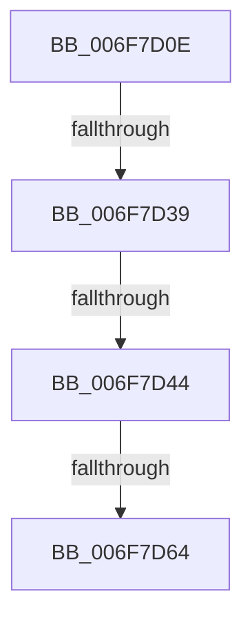

# sub_006F7D0E

- RVA: `0x006F7D0E`–`0x006F7D8C` (길이 `126` bytes)
- VA: `0x00000001406F7D0E`
- 실행 섹션: `.text`
- PDB 이름 있음: `아니요`; PDB Function 태그: `아니요`
- unwind 정보 RVA: `0x000B491C`
- 디코드: `29`개 명령, `126/126` bytes 표시
- 미해석 바이트: `0` (있으면 어셈블리에 `.byte`로 보존)

> 이 문서는 커널 이미지의 기계어와 PDB 기호를 분석해 생성했습니다. 4번과 5번은 함수 원형과 자료형을 바이너리 사용 방식에서 추정한 C 해석이며 원본 소스 복구 결과는 아닙니다.

## 1. Dependencies

- 직접 호출 지점: **3**; 고유 호출 대상: **2**
- 직접 호출자로 확인된 함수: **0**
- RIP 상대 이미지 참조: **0**

### Outgoing calls
- `0x006F7D2A` → [ZwQuerySecurityObject](../6A/ZwQuerySecurityObject_function_006AFDF0.md) (function, `0x006AFDF0`)
- `0x006F7D53` → [ExAllocatePool2](../../poolcode/B8/ExAllocatePool2_function_00B820F0.md) (function, `0x00B820F0`)
- `0x006F7D81` → [ZwQuerySecurityObject](../6A/ZwQuerySecurityObject_function_006AFDF0.md) (function, `0x006AFDF0`)

### Direct callers
- 이 함수 시작 RVA로 연결되는 직접 call은 확인되지 않았습니다. 간접 호출은 완전히 역산할 수 없습니다.

### Static image references
- 디코드된 RIP-relative 메모리 참조가 없습니다.

## 2. Other-region calls and transfers

- 다른 실행 섹션으로 향하는 call: **1**
  - `0x006F7D53` → [ExAllocatePool2](../../poolcode/B8/ExAllocatePool2_function_00B820F0.md) (`.text` → `POOLCODE`)
- call이 아닌 외부 분기/꼬리 이동: **4**
  - `0x006F7D33` → [RtlIsUntrustedObject + 0xAD](../49/RtlIsUntrustedObject_function_0049BC50.md) (`tail-transfer`)
  - `0x006F7D3E` → [RtlIsUntrustedObject + 0x81](../49/RtlIsUntrustedObject_function_0049BC50.md) (`tail-transfer`)
  - `0x006F7D5E` → [RtlIsUntrustedObject + 0x198](../49/RtlIsUntrustedObject_function_0049BC50.md) (`tail-transfer`)
  - `0x006F7D87` → [RtlIsUntrustedObject + 0x182](../49/RtlIsUntrustedObject_function_0049BC50.md) (`tail-transfer`)

## 3. Assembly (complete function range)

```asm
006F7D0E  41 B9 7C 00 00 00               mov r9d, 0x7c
006F7D14  48 8D 44 24 30                  lea rax, [rsp + 0x30]
006F7D19  4C 8D 44 24 40                  lea r8, [rsp + 0x40]
006F7D1E  48 89 44 24 20                  mov qword ptr [rsp + 0x20], rax
006F7D23  45 8A E6                        mov r12b, r14b
006F7D26  41 8D 51 94                     lea edx, [r9 - 0x6c]
006F7D2A  E8 C1 80 FB FF                  call 0x1406afdf0
006F7D2F  8B D8                           mov ebx, eax
006F7D31  85 C0                           test eax, eax
006F7D33  0F 89 C4 3F DA FF               jns 0x14049bcfd
006F7D39  3D 23 00 00 C0                  cmp eax, 0xc0000023
006F7D3E  0F 85 8D 3F DA FF               jne 0x14049bcd1
006F7D44  8B 54 24 30                     mov edx, dword ptr [rsp + 0x30]
006F7D48  B9 41 00 00 00                  mov ecx, 0x41
006F7D4D  41 B8 52 74 50 62               mov r8d, 0x62507452
006F7D53  E8 98 A3 48 00                  call 0x140b820f0
006F7D58  48 8B F8                        mov rdi, rax
006F7D5B  48 85 C0                        test rax, rax
006F7D5E  0F 84 84 40 DA FF               je 0x14049bde8
006F7D64  41 B9 7C 00 00 00               mov r9d, 0x7c
006F7D6A  48 8D 44 24 30                  lea rax, [rsp + 0x30]
006F7D6F  4C 8B C7                        mov r8, rdi
006F7D72  48 89 44 24 20                  mov qword ptr [rsp + 0x20], rax
006F7D77  48 8B CE                        mov rcx, rsi
006F7D7A  41 B4 01                        mov r12b, 1
006F7D7D  41 8D 51 94                     lea edx, [r9 - 0x6c]
006F7D81  E8 6A 80 FB FF                  call 0x1406afdf0
006F7D86  90                              nop
006F7D87  E9 46 40 DA FF                  jmp 0x14049bdd2
```

## 4. C-style interpretation (structured pseudocode)

```c
__int64 __fastcall sub_006F7D0E(__int64 a1, __int64 a2, __int64 a3, __int64 a4, __int64 a5, unsigned int a6, __int64 a7, __int64 a8)
{
    __int64 result;
    unsigned __int64 v_stack_p20;

    v_stack_p20 = a6;
    result = ZwQuerySecurityObject(a1, 124 - 108, a8, 124);
    result = ExAllocatePool2(65, (unsigned int)(a6), (unsigned int)(0x62507452ULL), 124);
    v_stack_p20 = a6;
    result = ZwQuerySecurityObject(v_rsi, 124 - 108, result, 124);
}
```

## 5. (Beta) C Style

```c
int64_t sub_006F7D0E(int64_t Arg1, int64_t Arg2, int64_t Arg3, int64_t Arg4, uint64_t Arg5, uint32_t Arg6, uint64_t Arg7, int64_t Arg8)
{
    int64_t result;
    uint64_t v_stack_p20;

    v_stack_p20 = Arg6;
    result = ZwQuerySecurityObject(Arg1, 124 - 108, Arg8, 124);
    result = ExAllocatePool2(65, (uint32_t)(Arg6), (uint32_t)(0x62507452ULL), 124);
    v_stack_p20 = Arg6;
    result = ZwQuerySecurityObject(local_rsi, 124 - 108, result, 124);
}
```

## 6. Execution-region graph

[열기: 2D/3D 그래프와 함수 탐색 컨트롤 패널](../../../control-panel.html?section=text&rva=0x006F7D0E&view=graph)

- 2D 그래프는 위에서 아래로 흐르고, 3D 그래프는 빈 공간을 드래그해 회전합니다. Shift+드래그는 이동, 휠은 확대·축소, 함수 노드 선택은 대상 보고서 이동입니다.

### Static fallback


