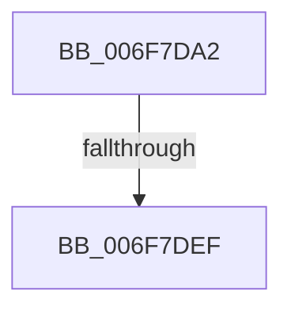

# sub_006F7DA2

- RVA: `0x006F7DA2`–`0x006F7E00` (길이 `94` bytes)
- VA: `0x00000001406F7DA2`
- 실행 섹션: `.text`
- PDB 이름 있음: `아니요`; PDB Function 태그: `아니요`
- unwind 정보 RVA: `0x000B4AA8`
- 디코드: `23`개 명령, `94/94` bytes 표시
- 미해석 바이트: `0` (있으면 어셈블리에 `.byte`로 보존)

> 이 문서는 커널 이미지의 기계어와 PDB 기호를 분석해 생성했습니다. 4번과 5번은 함수 원형과 자료형을 바이너리 사용 방식에서 추정한 C 해석이며 원본 소스 복구 결과는 아닙니다.

## 1. Dependencies

- 직접 호출 지점: **1**; 고유 호출 대상: **1**
- 직접 호출자로 확인된 함수: **0**
- RIP 상대 이미지 참조: **0**

### Outgoing calls
- `0x006F7DE0` → [SiIssueSynchronousIoctl](../../page/82/SiIssueSynchronousIoctl_function_00827A34.md) (function, `0x00827A34`)

### Direct callers
- 이 함수 시작 RVA로 연결되는 직접 call은 확인되지 않았습니다. 간접 호출은 완전히 역산할 수 없습니다.

### Static image references
- 디코드된 RIP-relative 메모리 참조가 없습니다.

## 2. Other-region calls and transfers

- 다른 실행 섹션으로 향하는 call: **1**
  - `0x006F7DE0` → [SiIssueSynchronousIoctl](../../page/82/SiIssueSynchronousIoctl_function_00827A34.md) (`.text` → `PAGE`)
- call이 아닌 외부 분기/꼬리 이동: **2**
  - `0x006F7DE9` → [SiValidateSystemPartition + 0x98](../49/SiValidateSystemPartition_function_0049C280.md) (`tail-transfer`)
  - `0x006F7DFB` → [SiValidateSystemPartition + 0x98](../49/SiValidateSystemPartition_function_0049C280.md) (`tail-transfer`)

## 3. Assembly (complete function range)

```asm
006F7DA2  83 65 D8 00                     and dword ptr [rbp - 0x28], 0
006F7DA6  4C 8D 45 D0                     lea r8, [rbp - 0x30]
006F7DAA  33 C0                           xor eax, eax
006F7DAC  C7 44 24 28 28 00 00 00         mov dword ptr [rsp + 0x28], 0x28
006F7DB4  21 45 D0                        and dword ptr [rbp - 0x30], eax
006F7DB7  0F 57 C0                        xorps xmm0, xmm0
006F7DBA  21 45 D4                        and dword ptr [rbp - 0x2c], eax
006F7DBD  41 B9 0C 00 00 00               mov r9d, 0xc
006F7DC3  48 89 45 00                     mov qword ptr [rbp], rax
006F7DC7  BA 00 14 2D 00                  mov edx, 0x2d1400
006F7DCC  48 8D 45 E0                     lea rax, [rbp - 0x20]
006F7DD0  48 8B CF                        mov rcx, rdi
006F7DD3  48 89 44 24 20                  mov qword ptr [rsp + 0x20], rax
006F7DD8  0F 11 45 E0                     movups xmmword ptr [rbp - 0x20], xmm0
006F7DDC  0F 11 45 F0                     movups xmmword ptr [rbp - 0x10], xmm0
006F7DE0  E8 4F FC 12 00                  call 0x140827a34
006F7DE5  8B D0                           mov edx, eax
006F7DE7  85 C0                           test eax, eax
006F7DE9  0F 88 29 45 DA FF               js 0x14049c318
006F7DEF  80 7D EA 00                     cmp byte ptr [rbp - 0x16], 0
006F7DF3  B8 84 01 00 C0                  mov eax, 0xc0000184
006F7DF8  0F 45 D0                        cmovne edx, eax
006F7DFB  E9 18 45 DA FF                  jmp 0x14049c318
```

## 4. C-style interpretation (structured pseudocode)

```c
__int64 __fastcall sub_006F7DA2(void)
{
    __int64 result;
    unsigned __int64 v_stack_p20;
    unsigned int v_stack_p28;

    result = 0;
    v_stack_p28 = 40;
    *(unsigned __int64 *)(v_rbp) = 0;
    v_stack_p20 = v_rbp - 32;
    *(unsigned __int64 *)(v_rbp - 32) = v_xmm0;
    *(unsigned __int64 *)(v_rbp - 16) = v_xmm0;
    result = SiIssueSynchronousIoctl(v_rdi, (unsigned int)(0x2D1400ULL), v_rbp - 48, 12);
    a2 = (unsigned int)((unsigned int)(result));
    if ((*(unsigned __int8 *)(v_rbp - 22)) != 0) { a2 = (unsigned int)((unsigned int)(0xC0000184ULL)); }
}
```

## 5. (Beta) C Style

```c
void sub_006F7DA2(void)
{
    int64_t result;
    uint64_t v_stack_p20;
    uint32_t v_stack_p28;

    result = 0;
    v_stack_p28 = 40;
    *(uint64_t *)(local_rbp) = 0;
    v_stack_p20 = local_rbp - 32;
    *(uint64_t *)(local_rbp - 0x20) = v_xmm0;
    *(uint64_t *)(local_rbp - 0x10) = v_xmm0;
    result = SiIssueSynchronousIoctl(local_rdi, (uint32_t)(0x2D1400ULL), local_rbp - 48, 12);
    a2 = (uint32_t)((uint32_t)(result));
    if ((*(uint8_t *)(local_rbp - 0x16)) != 0) { a2 = (uint32_t)((uint32_t)(0xC0000184ULL)); }
}
```

## 6. Execution-region graph

[열기: 2D/3D 그래프와 함수 탐색 컨트롤 패널](../../../control-panel.html?section=text&rva=0x006F7DA2&view=graph)

- 2D 그래프는 위에서 아래로 흐르고, 3D 그래프는 빈 공간을 드래그해 회전합니다. Shift+드래그는 이동, 휠은 확대·축소, 함수 노드 선택은 대상 보고서 이동입니다.

### Static fallback


