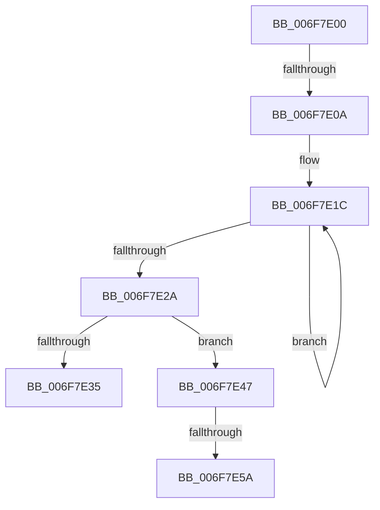

# sub_006F7E00

- RVA: `0x006F7E00`–`0x006F7E71` (길이 `113` bytes)
- VA: `0x00000001406F7E00`
- 실행 섹션: `.text`
- PDB 이름 있음: `아니요`; PDB Function 태그: `아니요`
- unwind 정보 RVA: `0x000B4C84`
- 디코드: `30`개 명령, `113/113` bytes 표시
- 미해석 바이트: `0` (있으면 어셈블리에 `.byte`로 보존)

> 이 문서는 커널 이미지의 기계어와 PDB 기호를 분석해 생성했습니다. 4번과 5번은 함수 원형과 자료형을 바이너리 사용 방식에서 추정한 C 해석이며 원본 소스 복구 결과는 아닙니다.

## 1. Dependencies

- 직접 호출 지점: **2**; 고유 호출 대상: **2**
- 직접 호출자로 확인된 함수: **0**
- RIP 상대 이미지 참조: **3**

### Outgoing calls
- `0x006F7E3C` → [CmpWorkItemQueueWork](../37/CmpWorkItemQueueWork_function_00378D4C.md) (function, `0x00378D4C`)
- `0x006F7E66` → [KeInsertQueueDpc](../20/KeInsertQueueDpc_function_00207C50.md) (function, `0x00207C50`)

### Direct callers
- 이 함수 시작 RVA로 연결되는 직접 call은 확인되지 않았습니다. 간접 호출은 완전히 역산할 수 없습니다.

### Static image references
- `0x006F7E0F` → RVA `0x00EF7A44` (`.data`; read)
- `0x006F7E35` → RVA `0x00EF79D0` (`.data`; read)
- `0x006F7E5D` → RVA `0x00EF7900` (`.data`; read)

## 2. Other-region calls and transfers

- 다른 실행 섹션으로 향하는 call: **0**
- call이 아닌 외부 분기/꼬리 이동: **4**
  - `0x006F7E04` → [CmFcManagerRecordFeatureUsage + 0xB1](../49/CmFcManagerRecordFeatureUsage_function_0049C7B4.md) (`tail-transfer`)
  - `0x006F7E42` → [CmFcManagerRecordFeatureUsage + 0xB1](../49/CmFcManagerRecordFeatureUsage_function_0049C7B4.md) (`tail-transfer`)
  - `0x006F7E54` → [CmFcManagerRecordFeatureUsage + 0xB1](../49/CmFcManagerRecordFeatureUsage_function_0049C7B4.md) (`tail-transfer`)
  - `0x006F7E6C` → [CmFcManagerRecordFeatureUsage + 0xB1](../49/CmFcManagerRecordFeatureUsage_function_0049C7B4.md) (`tail-transfer`)

## 3. Assembly (complete function range)

```asm
006F7E00  40 80 FF 0F                     cmp dil, 0xf
006F7E04  0F 83 5B 4A DA FF               jae 0x14049c865
006F7E0A  BA 02 00 00 00                  mov edx, 2
006F7E0F  0F 0D 0D 2E FC 7F 00            prefetchw byte ptr [rip + 0x7ffc2e]
006F7E16  8B 05 28 FC 7F 00               mov eax, dword ptr [rip + 0x7ffc28]
006F7E1C  8B C8                           mov ecx, eax
006F7E1E  0B CA                           or ecx, edx
006F7E20  F0 0F B1 0D 1C FC 7F 00         lock cmpxchg dword ptr [rip + 0x7ffc1c], ecx
006F7E28  75 F2                           jne 0x1406f7e1c
006F7E2A  8B C8                           mov ecx, eax
006F7E2C  F7 D1                           not ecx
006F7E2E  23 D1                           and edx, ecx
006F7E30  F6 C2 01                        test dl, 1
006F7E33  74 12                           je 0x1406f7e47
006F7E35  48 8D 0D 94 FB 7F 00            lea rcx, [rip + 0x7ffb94]
006F7E3C  E8 0B 0F C8 FF                  call 0x140378d4c
006F7E41  90                              nop
006F7E42  E9 1E 4A DA FF                  jmp 0x14049c865
006F7E47  A8 01                           test al, 1
006F7E49  0F 94 C1                        sete cl
006F7E4C  F6 C2 02                        test dl, 2
006F7E4F  0F 95 C0                        setne al
006F7E52  84 C8                           test al, cl
006F7E54  0F 84 0B 4A DA FF               je 0x14049c865
006F7E5A  45 33 C0                        xor r8d, r8d
006F7E5D  48 8D 0D 9C FA 7F 00            lea rcx, [rip + 0x7ffa9c]
006F7E64  33 D2                           xor edx, edx
006F7E66  E8 E5 FD B0 FF                  call 0x140207c50
006F7E6B  90                              nop
006F7E6C  E9 F4 49 DA FF                  jmp 0x14049c865
```

## 4. C-style interpretation (structured pseudocode)

```c
__int64 __fastcall sub_006F7E00(__int64 a1, __int64 a2, int a3)
{
    __int64 result;

loc_006F7E1C:
    a1 = (unsigned int)(((unsigned int)((unsigned int)((unsigned int)(*(unsigned int *)(v_rip + 8387624))))) | (2));
    if (condition_is_not_equal) goto loc_006F7E1C;
    a1 = (unsigned int)(~((unsigned int)((unsigned int)((unsigned int)(*(unsigned int *)(v_rip + 8387624))))));
    a2 = (unsigned int)((2) & ((unsigned int)(a1)));
    if ((((unsigned __int8)(a2)) & (1)) == 0) goto loc_006F7E47;
    result = CmpWorkItemQueueWork(v_rip + 8387476, a2, a3, a4);
loc_006F7E47:
    a1 = ((((unsigned __int8)(result)) & (1)) == 0) ? 1 : 0;
    result = ((((unsigned __int8)(a2)) & (2)) != 0) ? 1 : 0;
    a3 = 0;
    a2 = 0;
    result = KeInsertQueueDpc(v_rip + 8387228, a2, a3, a4);
}
```

## 5. (Beta) C Style

```c
int64_t sub_006F7E00(int64_t Arg1, int64_t Arg2, int32_t Arg3)
{
    int64_t result;

loc_006F7E1C:
    Arg1 = (uint32_t)(((uint32_t)((uint32_t)((uint32_t)(*(uint32_t *)(v_rip + 0x7FFC28))))) | (2));
    if (condition_is_not_equal) goto loc_006F7E1C;
    Arg1 = (uint32_t)(~((uint32_t)((uint32_t)((uint32_t)(*(uint32_t *)(v_rip + 0x7FFC28))))));
    Arg2 = (uint32_t)((2) & ((uint32_t)(Arg1)));
    if ((((uint8_t)(Arg2)) & (1)) == 0) goto loc_006F7E47;
    result = CmpWorkItemQueueWork(v_rip + 8387476, Arg2, Arg3, a4);
loc_006F7E47:
    Arg1 = ((((uint8_t)(result)) & (1)) == 0) ? 1 : 0;
    result = ((((uint8_t)(Arg2)) & (2)) != 0) ? 1 : 0;
    Arg3 = 0;
    Arg2 = 0;
    result = KeInsertQueueDpc(v_rip + 8387228, Arg2, Arg3, a4);
}
```

## 6. Execution-region graph

[열기: 2D/3D 그래프와 함수 탐색 컨트롤 패널](../../../control-panel.html?section=text&rva=0x006F7E00&view=graph)

- 2D 그래프는 위에서 아래로 흐르고, 3D 그래프는 빈 공간을 드래그해 회전합니다. Shift+드래그는 이동, 휠은 확대·축소, 함수 노드 선택은 대상 보고서 이동입니다.

### Static fallback


