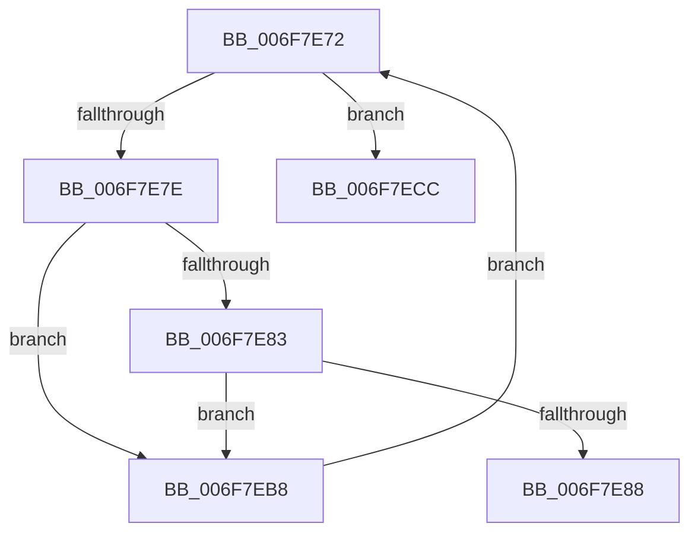

# sub_006F7E72

- RVA: `0x006F7E72`–`0x006F7EE1` (길이 `111` bytes)
- VA: `0x00000001406F7E72`
- 실행 섹션: `.text`
- PDB 이름 있음: `아니요`; PDB Function 태그: `아니요`
- unwind 정보 RVA: `0x000B4CD0`
- 디코드: `29`개 명령, `111/111` bytes 표시
- 미해석 바이트: `0` (있으면 어셈블리에 `.byte`로 보존)

> 이 문서는 커널 이미지의 기계어와 PDB 기호를 분석해 생성했습니다. 4번과 5번은 함수 원형과 자료형을 바이너리 사용 방식에서 추정한 C 해석이며 원본 소스 복구 결과는 아닙니다.

## 1. Dependencies

- 직접 호출 지점: **3**; 고유 호출 대상: **2**
- 직접 호출자로 확인된 함수: **0**
- RIP 상대 이미지 참조: **3**

### Outgoing calls
- `0x006F7E9B` → [DbgPrintEx](../35/DbgPrintEx_function_00359290.md) (function, `0x00359290`)
- `0x006F7EAB` → [ExReleaseSpinLockShared](../2F/ExReleaseSpinLockShared_function_002F0EF0.md) (function, `0x002F0EF0`)
- `0x006F7ED6` → [ExReleaseSpinLockShared](../2F/ExReleaseSpinLockShared_function_002F0EF0.md) (function, `0x002F0EF0`)

### Direct callers
- 이 함수 시작 RVA로 연결되는 직접 call은 확인되지 않았습니다. 간접 호출은 완전히 역산할 수 없습니다.

### Static image references
- `0x006F7E72` → RVA `0x00EFAC20` (`.data`; read)
- `0x006F7E90` → RVA `0x006D0340` (` ?? ::FNODOBFM::`string'`; read)
- `0x006F7EA4` → RVA `0x00FCF0C0` (`CACHEALI`; read)

## 2. Other-region calls and transfers

- 다른 실행 섹션으로 향하는 call: **0**
- call이 아닌 외부 분기/꼬리 이동: **2**
  - `0x006F7EB3` → [ExpCheckForResource + 0x41](../49/ExpCheckForResource_function_0049CA24.md) (`tail-transfer`)
  - `0x006F7EDC` → [ExpCheckForResource + 0x3F](../49/ExpCheckForResource_function_0049CA24.md) (`tail-transfer`)

## 3. Assembly (complete function range)

```asm
006F7E72  48 8D 05 A7 2D 80 00            lea rax, [rip + 0x802da7]
006F7E79  48 3B D8                        cmp rbx, rax
006F7E7C  74 4E                           je 0x1406f7ecc
006F7E7E  48 3B DF                        cmp rbx, rdi
006F7E81  72 35                           jb 0x1406f7eb8
006F7E83  49 3B DE                        cmp rbx, r14
006F7E86  73 30                           jae 0x1406f7eb8
006F7E88  4C 8B CF                        mov r9, rdi
006F7E8B  48 89 74 24 20                  mov qword ptr [rsp + 0x20], rsi
006F7E90  4C 8D 05 A9 84 FD FF            lea r8, [rip - 0x27b57]
006F7E97  33 D2                           xor edx, edx
006F7E99  33 C9                           xor ecx, ecx
006F7E9B  E8 F0 13 C6 FF                  call 0x140359290
006F7EA0  CC                              int3
006F7EA1  40 8A D5                        mov dl, bpl
006F7EA4  48 8D 0D 15 72 8D 00            lea rcx, [rip + 0x8d7215]
006F7EAB  E8 40 90 BF FF                  call 0x1402f0ef0
006F7EB0  48 8B C3                        mov rax, rbx
006F7EB3  E9 AD 4B DA FF                  jmp 0x14049ca65
006F7EB8  48 8B 44 24 60                  mov rax, qword ptr [rsp + 0x60]
006F7EBD  48 89 44 24 68                  mov qword ptr [rsp + 0x68], rax
006F7EC2  48 89 5C 24 60                  mov qword ptr [rsp + 0x60], rbx
006F7EC7  48 8B 1B                        mov rbx, qword ptr [rbx]
006F7ECA  EB A6                           jmp 0x1406f7e72
006F7ECC  40 8A D5                        mov dl, bpl
006F7ECF  48 8D 0D EA 71 8D 00            lea rcx, [rip + 0x8d71ea]
006F7ED6  E8 15 90 BF FF                  call 0x1402f0ef0
006F7EDB  90                              nop
006F7EDC  E9 82 4B DA FF                  jmp 0x14049ca63
```

## 4. C-style interpretation (structured pseudocode)

```c
__int64 __fastcall sub_006F7E72(int a1, int a2, __int64 a3, __int64 a4, __int64 a5, __int64 a6, __int64 a7, __int64 a8, __int64 a9, __int64 a10, __int64 a11, __int64 a12)
{
    __int64 result;
    unsigned __int64 v_stack_p20;
    unsigned __int64 v_stack_p60;
    unsigned __int64 v_stack_p68;

    if (v_rbx == (v_rip + 8400295)) goto loc_006F7ECC;
    if (v_rbx < v_rdi) goto loc_006F7EB8;
    if (v_rbx >= v_r14) goto loc_006F7EB8;
    v_stack_p20 = v_rsi;
    a2 = 0;
    a1 = 0;
    result = DbgPrintEx(a1, a2, v_rip - 162647, v_rdi);
    result = ExReleaseSpinLockShared(v_rip + 9269781, (unsigned __int8)(v_rbp), v_rip - 162647, v_rdi);
loc_006F7EB8:
    v_stack_p68 = a12;
    v_stack_p60 = v_rbx;
    goto loc_006F7E72;
loc_006F7ECC:
    result = ExReleaseSpinLockShared(v_rip + 9269738, (unsigned __int8)(v_rbp), v_rip - 162647, v_rdi);
}
```

## 5. (Beta) C Style

```c
int64_t sub_006F7E72(int32_t Arg1, int32_t Arg2, int64_t Arg3, int64_t Arg4, uint64_t Arg5, uint64_t Arg6, uint64_t Arg7, uint64_t Arg8, uint64_t Arg9, uint64_t Arg10, uint64_t Arg11, int64_t Arg12)
{
    int64_t result;
    uint64_t v_stack_p20;
    uint64_t v_stack_p60;
    uint64_t v_stack_p68;

    if (local_rbx == (v_rip + 8400295)) goto loc_006F7ECC;
    if (local_rbx < local_rdi) goto loc_006F7EB8;
    if (local_rbx >= local_r14) goto loc_006F7EB8;
    v_stack_p20 = local_rsi;
    Arg2 = 0;
    Arg1 = 0;
    result = DbgPrintEx(Arg1, Arg2, v_rip - 162647, local_rdi);
    result = ExReleaseSpinLockShared(v_rip + 9269781, (uint8_t)(local_rbp), v_rip - 162647, local_rdi);
loc_006F7EB8:
    v_stack_p68 = Arg12;
    v_stack_p60 = local_rbx;
    goto loc_006F7E72;
loc_006F7ECC:
    result = ExReleaseSpinLockShared(v_rip + 9269738, (uint8_t)(local_rbp), v_rip - 162647, local_rdi);
}
```

## 6. Execution-region graph

[열기: 2D/3D 그래프와 함수 탐색 컨트롤 패널](../../../control-panel.html?section=text&rva=0x006F7E72&view=graph)

- 2D 그래프는 위에서 아래로 흐르고, 3D 그래프는 빈 공간을 드래그해 회전합니다. Shift+드래그는 이동, 휠은 확대·축소, 함수 노드 선택은 대상 보고서 이동입니다.

### Static fallback


