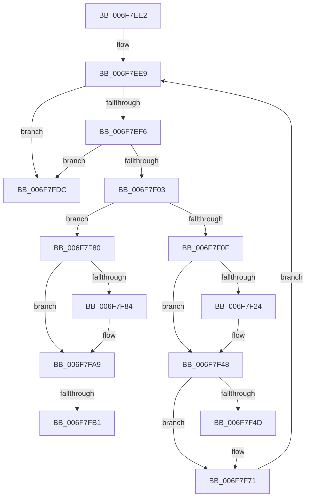

# sub_006F7EE2

- RVA: `0x006F7EE2`–`0x006F7FE3` (길이 `257` bytes)
- VA: `0x00000001406F7EE2`
- 실행 섹션: `.text`
- PDB 이름 있음: `아니요`; PDB Function 태그: `아니요`
- unwind 정보 RVA: `0x000B4D28`
- 디코드: `62`개 명령, `257/257` bytes 표시
- 미해석 바이트: `0` (있으면 어셈블리에 `.byte`로 보존)

> 이 문서는 커널 이미지의 기계어와 PDB 기호를 분석해 생성했습니다. 4번과 5번은 함수 원형과 자료형을 바이너리 사용 방식에서 추정한 C 해석이며 원본 소스 복구 결과는 아닙니다.

## 1. Dependencies

- 직접 호출 지점: **9**; 고유 호출 대상: **4**
- 직접 호출자로 확인된 함수: **0**
- RIP 상대 이미지 참조: **1**

### Outgoing calls
- `0x006F7F36` → [guard_dispatch_icall](../6B/guard_dispatch_icall_function_006BAAD0.md) (function, `0x006BAAD0`)
- `0x006F7F43` → [ExpSvmDereferenceDevice](../65/ExpSvmDereferenceDevice_function_0065BBCC.md) (function, `0x0065BBCC`)
- `0x006F7F5F` → [guard_dispatch_icall](../6B/guard_dispatch_icall_function_006BAAD0.md) (function, `0x006BAAD0`)
- `0x006F7F6C` → [ExpSvmDereferenceDevice](../65/ExpSvmDereferenceDevice_function_0065BBCC.md) (function, `0x0065BBCC`)
- `0x006F7F76` → [ExFreePoolWithTag](../../poolcode/B8/ExFreePoolWithTag_function_00B82870.md) (function, `0x00B82870`)
- `0x006F7F92` → [guard_dispatch_icall](../6B/guard_dispatch_icall_function_006BAAD0.md) (function, `0x006BAAD0`)
- `0x006F7FA4` → [ExpFreeAsid](../65/ExpFreeAsid_function_0065B1E8.md) (function, `0x0065B1E8`)
- `0x006F7FBF` → [guard_dispatch_icall](../6B/guard_dispatch_icall_function_006BAAD0.md) (function, `0x006BAAD0`)
- `0x006F7FD1` → [ExpFreeAsid](../65/ExpFreeAsid_function_0065B1E8.md) (function, `0x0065B1E8`)

### Direct callers
- 이 함수 시작 RVA로 연결되는 직접 call은 확인되지 않았습니다. 간접 호출은 완전히 역산할 수 없습니다.

### Static image references
- `0x006F7F24` → RVA `0x00E06D28` (`.data`; read)

## 2. Other-region calls and transfers

- 다른 실행 섹션으로 향하는 call: **1**
  - `0x006F7F76` → [ExFreePoolWithTag](../../poolcode/B8/ExFreePoolWithTag_function_00B82870.md) (`.text` → `POOLCODE`)
- call이 아닌 외부 분기/꼬리 이동: **2**
  - `0x006F7FAB` → [ExFreeSvmAsid + 0x48](../49/ExFreeSvmAsid_function_0049CCBC.md) (`tail-transfer`)
  - `0x006F7FD7` → [ExFreeSvmAsid + 0x48](../49/ExFreeSvmAsid_function_0049CCBC.md) (`tail-transfer`)

## 3. Assembly (complete function range)

```asm
006F7EE2  4C 8D BB 20 06 00 00            lea r15, [rbx + 0x620]
006F7EE9  4D 8B 37                        mov r14, qword ptr [r15]
006F7EEC  4D 39 7E 08                     cmp qword ptr [r14 + 8], r15
006F7EF0  0F 85 E6 00 00 00               jne 0x1406f7fdc
006F7EF6  49 8B 06                        mov rax, qword ptr [r14]
006F7EF9  4C 39 70 08                     cmp qword ptr [rax + 8], r14
006F7EFD  0F 85 D9 00 00 00               jne 0x1406f7fdc
006F7F03  49 89 07                        mov qword ptr [r15], rax
006F7F06  4C 89 78 08                     mov qword ptr [rax + 8], r15
006F7F0A  4D 3B F7                        cmp r14, r15
006F7F0D  74 71                           je 0x1406f7f80
006F7F0F  49 8B 46 10                     mov rax, qword ptr [r14 + 0x10]
006F7F13  48 89 44 24 50                  mov qword ptr [rsp + 0x50], rax
006F7F18  4C 8D A8 B0 00 00 00            lea r13, [rax + 0xb0]
006F7F1F  48 85 ED                        test rbp, rbp
006F7F22  74 24                           je 0x1406f7f48
006F7F24  48 8B 05 FD ED 70 00            mov rax, qword ptr [rip + 0x70edfd]
006F7F2B  48 8B CD                        mov rcx, rbp
006F7F2E  49 8B 55 00                     mov rdx, qword ptr [r13]
006F7F32  48 8B 40 30                     mov rax, qword ptr [rax + 0x30]
006F7F36  E8 95 2B FC FF                  call 0x1406baad0
006F7F3B  48 8B 4C 24 50                  mov rcx, qword ptr [rsp + 0x50]
006F7F40  48 8B D5                        mov rdx, rbp
006F7F43  E8 84 3C F6 FF                  call 0x14065bbcc
006F7F48  4D 85 E4                        test r12, r12
006F7F4B  74 24                           je 0x1406f7f71
006F7F4D  48 8B 05 D4 ED 70 00            mov rax, qword ptr [rip + 0x70edd4]
006F7F54  49 8B CC                        mov rcx, r12
006F7F57  49 8B 55 00                     mov rdx, qword ptr [r13]
006F7F5B  48 8B 40 30                     mov rax, qword ptr [rax + 0x30]
006F7F5F  E8 6C 2B FC FF                  call 0x1406baad0
006F7F64  48 8B 4C 24 50                  mov rcx, qword ptr [rsp + 0x50]
006F7F69  49 8B D4                        mov rdx, r12
006F7F6C  E8 5B 3C F6 FF                  call 0x14065bbcc
006F7F71  33 D2                           xor edx, edx
006F7F73  49 8B CE                        mov rcx, r14
006F7F76  E8 F5 A8 48 00                  call 0x140b82870
006F7F7B  E9 69 FF FF FF                  jmp 0x1406f7ee9
006F7F80  85 FF                           test edi, edi
006F7F82  74 25                           je 0x1406f7fa9
006F7F84  48 8B 05 9D ED 70 00            mov rax, qword ptr [rip + 0x70ed9d]
006F7F8B  48 8B CD                        mov rcx, rbp
006F7F8E  48 8B 40 40                     mov rax, qword ptr [rax + 0x40]
006F7F92  E8 39 2B FC FF                  call 0x1406baad0
006F7F97  48 83 A3 08 06 00 00 00         and qword ptr [rbx + 0x608], 0
006F7F9F  48 8B D3                        mov rdx, rbx
006F7FA2  8B CF                           mov ecx, edi
006F7FA4  E8 3F 32 F6 FF                  call 0x14065b1e8
006F7FA9  85 F6                           test esi, esi
006F7FAB  0F 84 53 4D DA FF               je 0x14049cd04
006F7FB1  48 8B 05 70 ED 70 00            mov rax, qword ptr [rip + 0x70ed70]
006F7FB8  49 8B CC                        mov rcx, r12
006F7FBB  48 8B 40 40                     mov rax, qword ptr [rax + 0x40]
006F7FBF  E8 0C 2B FC FF                  call 0x1406baad0
006F7FC4  48 83 A3 E8 07 00 00 00         and qword ptr [rbx + 0x7e8], 0
006F7FCC  48 8B D3                        mov rdx, rbx
006F7FCF  8B CE                           mov ecx, esi
006F7FD1  E8 12 32 F6 FF                  call 0x14065b1e8
006F7FD6  90                              nop
006F7FD7  E9 28 4D DA FF                  jmp 0x14049cd04
006F7FDC  B9 03 00 00 00                  mov ecx, 3
006F7FE1  CD 29                           int 0x29
```

## 4. C-style interpretation (structured pseudocode)

```c
__int64 __fastcall sub_006F7EE2(__int64 a1, __int64 a2, __int64 a3, __int64 a4, __int64 a5, __int64 a6, __int64 a7, __int64 a8, __int64 a9, __int64 a10)
{
    __int64 result;
    unsigned __int64 v_stack_p50;

loc_006F7EE9:
    if ((*(unsigned __int64 *)(*(unsigned __int64 *)(v_rbx + 1568) + 8)) != (v_rbx + 1568)) goto loc_006F7FDC;
    if ((*(unsigned __int64 *)(*(unsigned __int64 *)(*(unsigned __int64 *)(v_rbx + 1568)) + 8)) != (*(unsigned __int64 *)(v_rbx + 1568))) goto loc_006F7FDC;
    *(unsigned __int64 *)(v_rbx + 1568) = *(unsigned __int64 *)(*(unsigned __int64 *)(v_rbx + 1568));
    *(unsigned __int64 *)(*(unsigned __int64 *)(*(unsigned __int64 *)(v_rbx + 1568)) + 8) = v_rbx + 1568;
    if ((*(unsigned __int64 *)(v_rbx + 1568)) == (v_rbx + 1568)) goto loc_006F7F80;
    v_stack_p50 = *(unsigned __int64 *)(*(unsigned __int64 *)(v_rbx + 1568) + 16);
    result = *(unsigned __int64 *)(*(unsigned __int64 *)(v_rbx + 1568) + 16);
    if (v_rbp != 0) {
        result = *(unsigned __int64 *)(v_rip + 7400957);
        a1 = v_rbp;
        a2 = *(unsigned __int64 *)(*(unsigned __int64 *)(*(unsigned __int64 *)(v_rbx + 1568) + 16) + 176);
        result = *(unsigned __int64 *)(result + 48);
        result = guard_dispatch_icall(a1, a2, a3, a4);
        a1 = a10;
        a2 = v_rbp;
        result = ExpSvmDereferenceDevice(a1, a2, a3, a4);
    }
    if (v_r12 != 0) {
        result = *(unsigned __int64 *)(v_rip + 7400916);
        a1 = v_r12;
        a2 = *(unsigned __int64 *)(*(unsigned __int64 *)(*(unsigned __int64 *)(v_rbx + 1568) + 16) + 176);
        result = *(unsigned __int64 *)(result + 48);
        result = guard_dispatch_icall(a1, a2, a3, a4);
        a1 = a10;
        a2 = v_r12;
        result = ExpSvmDereferenceDevice(a1, a2, a3, a4);
    }
    a2 = 0;
    result = ExFreePoolWithTag(*(unsigned __int64 *)(v_rbx + 1568), a2, a3, a4);
    goto loc_006F7EE9;
loc_006F7F80:
    if ((unsigned int)(v_rdi) != 0) {
        result = *(unsigned __int64 *)(v_rip + 7400861);
        a1 = v_rbp;
        result = *(unsigned __int64 *)(result + 64);
        result = guard_dispatch_icall(a1, a2, a3, a4);
        a2 = v_rbx;
        a1 = (unsigned int)(v_rdi);
        result = ExpFreeAsid(a1, a2, a3, a4);
    }
    result = guard_dispatch_icall(v_r12, a2, a3, a4);
    result = ExpFreeAsid((unsigned int)((unsigned int)(v_rsi)), v_rbx, a3, a4);
loc_006F7FDC:
    return result;
}
```

## 5. (Beta) C Style

```c
int64_t sub_006F7EE2(int64_t Arg1, int64_t Arg2, int64_t Arg3, int64_t Arg4, uint64_t Arg5, uint64_t Arg6, uint64_t Arg7, uint64_t Arg8, uint64_t Arg9, int64_t Arg10)
{
    int64_t result;
    uint64_t v_stack_p50;

loc_006F7EE9:
    if ((*(uint64_t *)(*(uint64_t *)(local_rbx + 0x620) + 0x8)) != (local_rbx + 1568)) goto loc_006F7FDC;
    if ((*(uint64_t *)(*(uint64_t *)(*(uint64_t *)(local_rbx + 0x620)) + 0x8)) != (*(uint64_t *)(local_rbx + 0x620))) goto loc_006F7FDC;
    *(uint64_t *)(local_rbx + 0x620) = *(uint64_t *)(*(uint64_t *)(local_rbx + 0x620));
    *(uint64_t *)(*(uint64_t *)(*(uint64_t *)(local_rbx + 0x620)) + 0x8) = local_rbx + 1568;
    if ((*(uint64_t *)(local_rbx + 0x620)) == (local_rbx + 1568)) goto loc_006F7F80;
    v_stack_p50 = *(uint64_t *)(*(uint64_t *)(local_rbx + 0x620) + 0x10);
    result = *(uint64_t *)(*(uint64_t *)(local_rbx + 0x620) + 0x10);
    if (local_rbp != 0) {
        result = *(uint64_t *)(v_rip + 0x70EDFD);
        Arg1 = local_rbp;
        Arg2 = *(uint64_t *)(*(uint64_t *)(*(uint64_t *)(local_rbx + 0x620) + 0x10) + 0xB0);
        result = *(uint64_t *)(result + 0x30);
        result = guard_dispatch_icall(Arg1, Arg2, Arg3, Arg4);
        Arg1 = Arg10;
        Arg2 = local_rbp;
        result = ExpSvmDereferenceDevice(Arg1, Arg2, Arg3, Arg4);
    }
    if (local_r12 != 0) {
        result = *(uint64_t *)(v_rip + 0x70EDD4);
        Arg1 = local_r12;
        Arg2 = *(uint64_t *)(*(uint64_t *)(*(uint64_t *)(local_rbx + 0x620) + 0x10) + 0xB0);
        result = *(uint64_t *)(result + 0x30);
        result = guard_dispatch_icall(Arg1, Arg2, Arg3, Arg4);
        Arg1 = Arg10;
        Arg2 = local_r12;
        result = ExpSvmDereferenceDevice(Arg1, Arg2, Arg3, Arg4);
    }
    Arg2 = 0;
    result = ExFreePoolWithTag(*(uint64_t *)(local_rbx + 0x620), Arg2, Arg3, Arg4);
    goto loc_006F7EE9;
loc_006F7F80:
    if ((uint32_t)(local_rdi) != 0) {
        result = *(uint64_t *)(v_rip + 0x70ED9D);
        Arg1 = local_rbp;
        result = *(uint64_t *)(result + 0x40);
        result = guard_dispatch_icall(Arg1, Arg2, Arg3, Arg4);
        Arg2 = local_rbx;
        Arg1 = (uint32_t)(local_rdi);
        result = ExpFreeAsid(Arg1, Arg2, Arg3, Arg4);
    }
    result = guard_dispatch_icall(local_r12, Arg2, Arg3, Arg4);
    result = ExpFreeAsid((uint32_t)((uint32_t)(local_rsi)), local_rbx, Arg3, Arg4);
loc_006F7FDC:
    return result;
}
```

## 6. Execution-region graph

[열기: 2D/3D 그래프와 함수 탐색 컨트롤 패널](../../../control-panel.html?section=text&rva=0x006F7EE2&view=graph)

- 2D 그래프는 위에서 아래로 흐르고, 3D 그래프는 빈 공간을 드래그해 회전합니다. Shift+드래그는 이동, 휠은 확대·축소, 함수 노드 선택은 대상 보고서 이동입니다.

### Static fallback


